# Full Swing missions gauntlet

Loop: missions, playability, controls, feel, UX, pacing and fun for In Full Swing. Focus group: playability. Reference: Marvel's Spider-Man 2. Rubric: [RUBRIC.md](RUBRIC.md). Original fiction and UI only.

### Round 1 — 2026-10-21 — rubric v1

- What changed: While a job has a goal, a comic sticker names it and shows the distance. On the Sludge Run it reads RUNNER (CREW once his crew is out). It sits on the goal in view. Off to the side, or behind the camera, it sits on the left or right edge and points the way to turn. A chase says CLOSING or FALLING BEHIND. The compass title says "Your job" during a job.
- Why it helped: A play of Mission 1 showed the bomb runner at the bottom of the chase camera, about 40 m away, while the training card said to swing at a gold ring and the compass was still titled "The nearest clog". Spider-Man 2 keeps the chase target readable, including when he leaves the frame, and tells you if you are gaining. The sticker does that without a new mission or a change to the timer.
- Screenshots: before `docs/gauntlet/fullswing-r1/before-chase.png`. After `docs/gauntlet/fullswing-r1/runner-closing.png` and `docs/gauntlet/fullswing-r1/runner-offscreen.png`.
- Next target: pacing (4), tied with sound design. Pacing is the one to change next: Mission 1's timer should not run against the training lesson. Sound stays at 4 until a round listens to it.

| Dimension | Score | Why |
| --- | ---: | --- |
| Lighting | 5 | Golden-hour sun and ink shadows read clearly, and they are not a filmed city at dusk. |
| Color palette | 6 | Yellow, red and sludge green are consistent and loud enough to separate the HUD from the blocks. |
| Detail density | 4 | Blocks, a few signs and simple streets. A swing reads as open space more than a dressed borough. |
| Texture and material quality | 3 | Flat fills. Little of the wear, glass or cloth a 2023 city uses to sell a surface. |
| Composition and camera | 4 | The chase camera looks at the skyline. The runner stays low in the frame even with the sticker on him. |
| Atmosphere | 5 | The dusk skyline and the lake have a mood. The street under the chase does not. |
| Character models | 3 | The hero and the gang read as simple comic figures at this distance. |
| Animation smoothness | 4 | Scored from still frames in software GL. Poses exist. Continuous motion was not watched. |
| Particles and VFX | 4 | Clog beams and the comic words are the effects in play. This chase frame had neither a hit nor a trail. |
| UI polish | 6 | The chips, the training card and the new sticker share one ink-and-yellow system and stay inside the window. |
| Responsiveness and input latency | 7 | The sticker and the mission card update on the stepped frame that moves the hero. No missed press showed up in the run. |
| Controls feel | 5 | Swing is hold-forward plus the mouse, with an auto target. It is not a one-button web swing, and the training still asks for the gold ring during the chase. |
| Mission clarity | 6 | The runner is named, measured, and marked when he leaves the view, and the compass says it is the job. The training card still gives a second target. |
| Pacing | 4 | The bomb timer, the eight-row training card and the gold-ring lesson all start together. After that, Mission 2 is twelve of the same clog. |
| Fun factor | 5 | Catching a marked runner is a readable chase now. The opening still splits attention, so the swing is not the whole of the first minute. |
| Difficulty curve | 5 | The runner jogs at 5.4 m/s once you can see him. The fail is a toast and a retry, then a short crew fight. |
| Feedback | 6 | CLOSING and FALLING BEHIND sit on the chase, next to the existing GO cue, hit-stop and focus meter. |
| Sound design | 4 | Not listened to this round (the playtest ran with audio disabled). The events have stingers. There is no chase bed that rises as the runner pulls away. |
| Variety | 5 | Odd jobs and crimes cover chase, carry, drive and fight. The story objective after Mission 1 does not. |
| Performance stability | 6 | Desktop play booted in software GL and the job tests passed with no page errors. Frame time on a real GPU was not measured. |

- Aesthetics raw: 44 / 10 dimensions, index 44
- Playability raw: 53 / 10 dimensions, index 53
- Total: 97 / 200
- Delta vs last round: — (first v1 score of this loop)

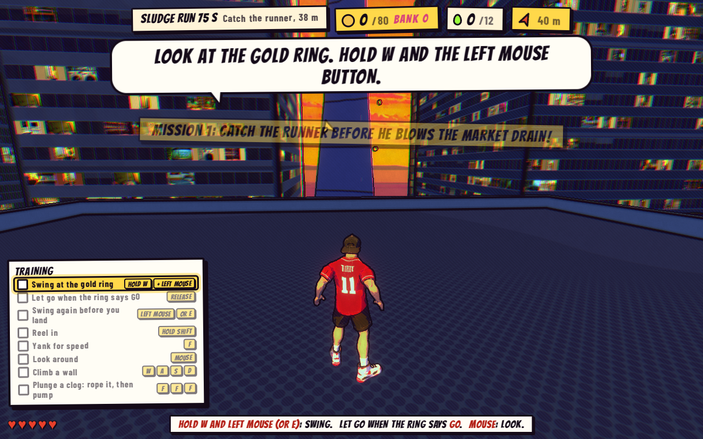

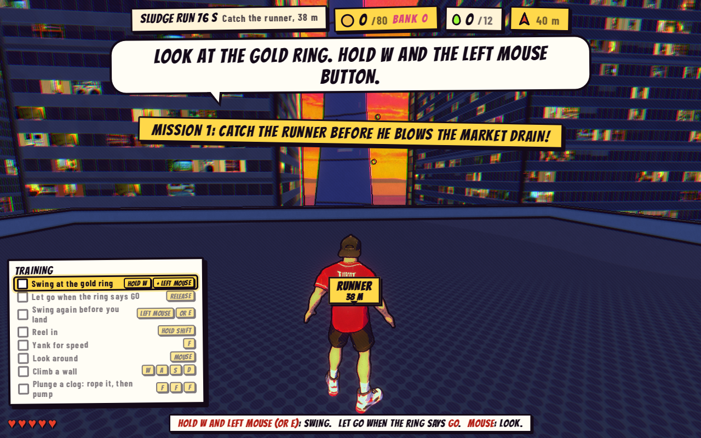

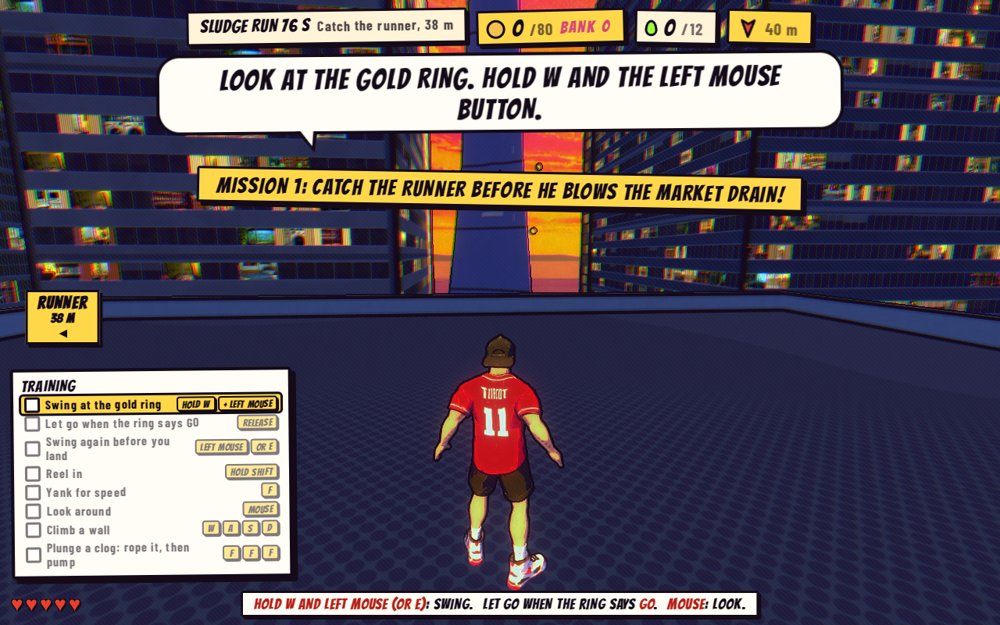

### Round 2 — 2026-10-21 — rubric v1

- What changed: On a first lesson (the gold-ring row, or the spoken tutorial's first line), the Sludge Run runner stands and the bomb clock does not count. The card keeps the time and says "Swing first. He waits until you do." A rope, or the end of that lesson, starts the run and the clock. A retry after the lesson runs at once. The eight training rows stay.
- Why it helped: A play at 1280×800 had "SLUDGE RUN 75 s" and "Catch the runner, 38 m" while training still said "Swing at the gold ring". Three seconds later the clock read 72 s and the runner had moved 17 m. Spider-Man 2 teaches the swing inside the opening chase and does not burn the fail timer during that beat. After the change the clock stayed at 76 s for three seconds, a rope on the gold ring ticked the first row, and the card became "Catch the runner, 32 m" with the clock at 74 s.
- Screenshots: before `docs/gauntlet/fullswing-r2/before-lesson.png`. After `docs/gauntlet/fullswing-r2/clock-waits.png` and `docs/gauntlet/fullswing-r2/clock-runs.png`.
- Next target: sound design (4). It is the lowest playability score. It stays at 4 until a round listens to the chase.

| Dimension | Score | Why |
| --- | ---: | --- |
| Lighting | 5 | Unchanged. Golden-hour sun and ink shadows, not a filmed city at dusk. |
| Color palette | 6 | Unchanged. Yellow, red and sludge green still separate the HUD from the blocks. |
| Detail density | 4 | Unchanged. The swing still reads as open space more than a dressed borough. |
| Texture and material quality | 3 | Unchanged. Flat fills. |
| Composition and camera | 4 | Unchanged. The chase camera still watches the skyline, and the runner leaves the bottom of the frame once he runs. |
| Atmosphere | 5 | Unchanged. The dusk skyline has a mood. The street under the chase does not. |
| Character models | 3 | Unchanged. Simple comic figures at this distance. |
| Animation smoothness | 4 | Scored from still frames in software GL. The rope pose is there. Continuous motion was not watched. |
| Particles and VFX | 4 | The second frame shows the rope line. No hit, trail or blast. |
| UI polish | 6 | The wait sentence fits the mission pill beside the training card, in the same ink and yellow. |
| Responsiveness and input latency | 7 | The card switches to the chase on the swing, and the stepped tests show the clock and the runner on that frame. |
| Controls feel | 5 | Unchanged. Swing is still hold-forward plus the mouse. The lesson no longer races the bomb, and the swing itself is the same. |
| Mission clarity | 7 | The card says to swing first while the gold-ring row is open, then names the runner and the distance. The gold ring is still a second place to look. |
| Pacing | 6 | The bomb and the runner wait out the first swing, so the lesson is not a fail timer. After that, Mission 2 is still twelve of the same clog. |
| Fun factor | 6 | The first minute is a swing and then a chase. The opening no longer splits the bomb and the lesson. |
| Difficulty curve | 6 | Standing on the roof to learn the swing no longer loses the runner. Once he runs he is still the same 5.4 m/s jog, with a toast and a retry. |
| Feedback | 6 | Unchanged. CLOSING, the GO cue and the hit-stop are the juice. The new sentence is the card, not a new hit. |
| Sound design | 4 | Not listened to. The playtest ran with audio disabled. No chase bed was judged. |
| Variety | 5 | Unchanged. Odd jobs cover chase, carry, drive and fight. The story after Mission 1 does not. |
| Performance stability | 6 | The first-run play and the job tests passed with no page errors. Frame time on a real GPU was not measured. |

- Aesthetics raw: 44 / 10 dimensions, index 44
- Playability raw: 58 / 10 dimensions, index 58
- Total: 102 / 200
- Delta vs last round: +5 (round 1 was 97). Pacing 4 → 6, mission clarity 6 → 7, fun factor 5 → 6, difficulty curve 5 → 6. Every other score held.

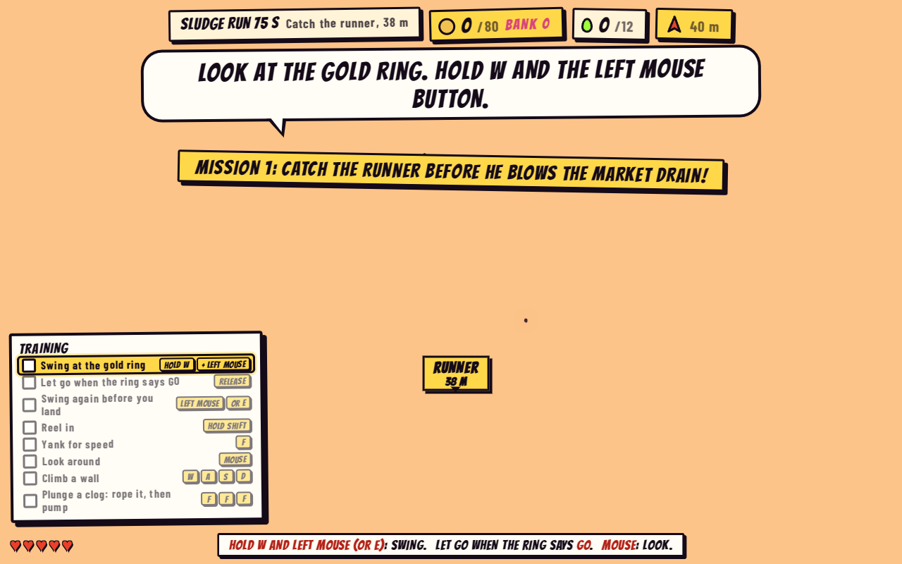

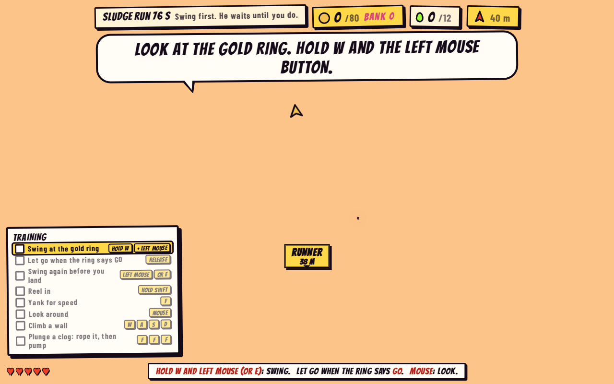

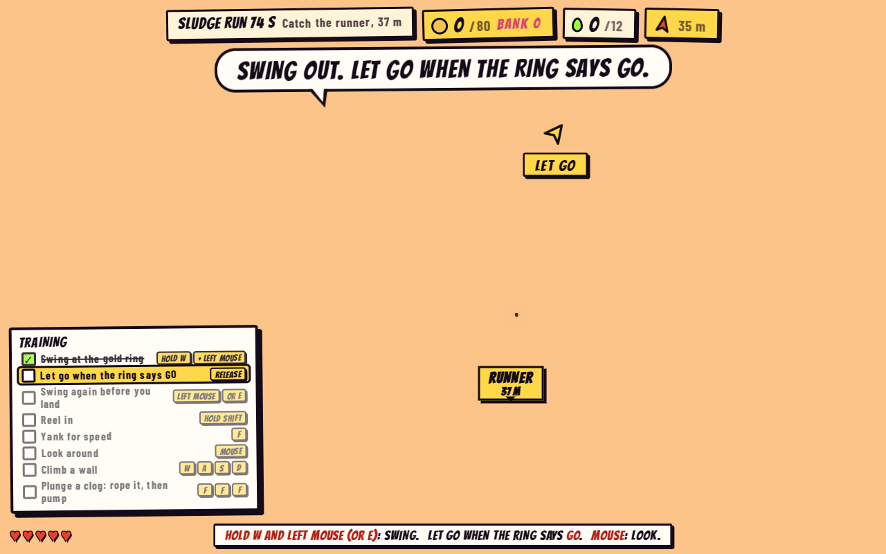

### Round 3 — 2026-10-21 — rubric v1

- What changed: A chase (the runner before his crew, the thief, the getaway car, the balloon) adds a clock tick to the groove. Falling behind speeds the tick and opens the filter. Closing takes the tick away. The first-lesson hold, and a fight, stay on the groove they already had.
- Why it helped: The sticker could already say FALLING BEHIND while the music stayed the same sunset loop. Spider-Man 2 tightens the chase when the target pulls away. An offline render of the same groove, same speed, was brighter with the clock (high end 0.0075 to 0.0081, difference 0.0034). In play, falling behind sets the bed to full, closing sets it to quiet, and the lesson hold keeps it quiet.
- Screenshots: `docs/gauntlet/fullswing-r3/falling-behind.png` (the sticker reads FALLING BEHIND, which is the full tick). No speaker in this run. The level was measured from the render, not heard in a room.
- Next target: controls feel (5), tied with variety and sound. Controls is the one to change next: swing is still hold-forward plus the mouse.

| Dimension | Score | Why |
| --- | ---: | --- |
| Lighting | 5 | Unchanged. Golden-hour sun and ink shadows. |
| Color palette | 6 | Unchanged. Yellow, red and sludge green still separate the HUD from the blocks. |
| Detail density | 4 | Unchanged. Open blocks more than a dressed borough. |
| Texture and material quality | 3 | Unchanged. Flat fills. |
| Composition and camera | 4 | Unchanged. The chase camera still leaves the runner low in the frame. |
| Atmosphere | 5 | Unchanged. The dusk skyline has a mood. The street under the chase does not. |
| Character models | 3 | Unchanged. Simple comic figures at this distance. |
| Animation smoothness | 4 | Scored from still frames in software GL. |
| Particles and VFX | 4 | Unchanged. A rope line and the sticker. No hit or trail in this frame. |
| UI polish | 6 | Unchanged. The sticker and the mission pill are the same ink and yellow. |
| Responsiveness and input latency | 7 | Unchanged. The bed follows the same stepped frame as the sticker. |
| Controls feel | 5 | Unchanged. Swing is still hold-forward plus the mouse. |
| Mission clarity | 7 | Unchanged. The card and the sticker still name the runner, and the clock now agrees when you are losing him. |
| Pacing | 6 | Unchanged. The lesson still waits, and Mission 2 is still twelve of the same clog. |
| Fun factor | 6 | Unchanged. The chase is the same swing. The tick marks losing him. It does not add a new trick. |
| Difficulty curve | 6 | Unchanged. Falling behind is now audible. The runner is still the same jog. |
| Feedback | 6 | The tick sits under the sticker's FALLING BEHIND. Hits, the GO cue and hit-stop are unchanged. |
| Sound design | 5 | The chase now has a clock that speeds up when the runner pulls away and drops out when you close. It is a click on the same groove, measured from a render, not a scored chase heard on speakers. |
| Variety | 5 | Unchanged. Odd jobs cover chase, carry, drive and fight. The story after Mission 1 does not. |
| Performance stability | 6 | The chase play and the render finished with no page errors. Frame time on a real GPU was not measured. |

- Aesthetics raw: 44 / 10 dimensions, index 44
- Playability raw: 59 / 10 dimensions, index 59
- Total: 103 / 200
- Delta vs last round: +1 (round 2 was 102). Sound design 4 → 5. Every other score held.

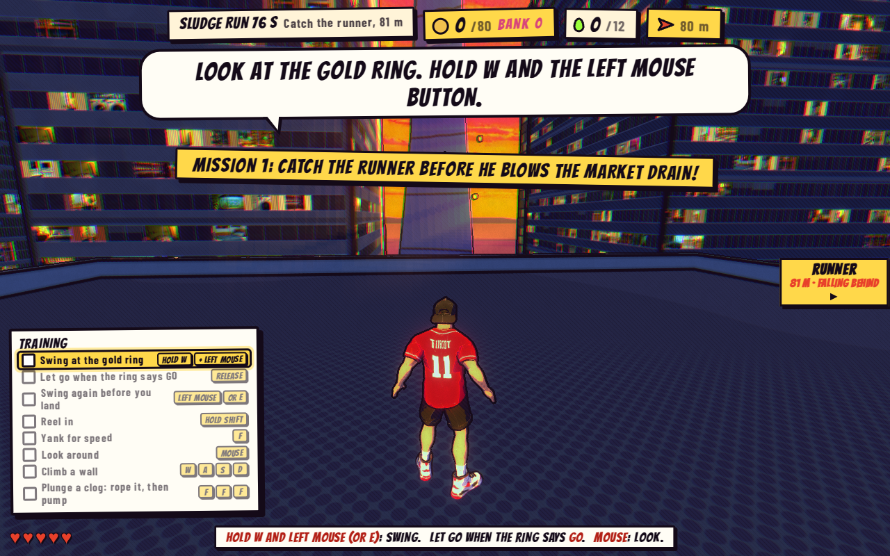

### Round 4 — 2026-10-21 — rubric v1

- What changed: On the ground, a swing button with no stick walks the hero toward the web at walking speed. W and the left stick still steer. A clog, a pipe, or the crack does not pull you. The hint, the training row, the spoken line, the title note and How to play name the swing button. They no longer ask for a forward hold.
- Why it helped: The first lesson said HOLD W AND LEFT MOUSE, and a press on its own slid across the start roof and stopped. Spider-Man 2 starts the web from the swing button. In play at 1280×800, E alone left the roof in under 4 s with the rope still attached. The physics check measured 3.57 s. A rope on a clog stayed put.
- Screenshots: `docs/gauntlet/fullswing-r4/roof.png` (the hint and the training row on the roof) and `docs/gauntlet/fullswing-r4/air.png` (in the air a moment later, rope out). No phone, pad, or headset was in this run.
- Next target: variety (5), tied with sound design. Variety is the one to change next: after Mission 1 the story is twelve of the same clog. Sound just gained a click on the same groove.

| Dimension | Score | Why |
| --- | ---: | --- |
| Lighting | 5 | Unchanged. Golden-hour sun and ink shadows. |
| Color palette | 6 | Unchanged. Yellow, red and sludge green still separate the HUD from the blocks. |
| Detail density | 4 | Unchanged. Open blocks more than a dressed borough. |
| Texture and material quality | 3 | Unchanged. Flat fills. |
| Composition and camera | 4 | Unchanged. The chase camera still leaves the runner and the swing low in the frame. |
| Atmosphere | 5 | Unchanged. The dusk skyline has a mood. The street under the swing does not. |
| Character models | 3 | Unchanged. Simple comic figures at this distance. |
| Animation smoothness | 4 | Scored from still frames in software GL. The rope is out. Continuous motion was not watched. |
| Particles and VFX | 4 | Unchanged. A rope line and the sticker. No hit or trail in this frame. |
| UI polish | 6 | The hint and the training row now name one button, in the same ink and yellow. |
| Responsiveness and input latency | 7 | Unchanged. The rope and the walk start on the stepped frame of the press. |
| Controls feel | 6 | One button leaves the roof and the rope carries the swing. It is still hold-the-button and one arc, not a chained web swing. |
| Mission clarity | 7 | Unchanged. The card and the sticker still name the runner, and the first row no longer asks for a second hold. |
| Pacing | 6 | Unchanged. The lesson still waits, and Mission 2 is still twelve of the same clog. |
| Fun factor | 6 | The first minute is a swing and then a chase. Starting it is one button now, and the minute is still that chase. |
| Difficulty curve | 6 | Unchanged. The roof is no longer a stuck press. The runner is still the same jog. |
| Feedback | 6 | Unchanged. The GO cue still shows while the rope drags along the roof. |
| Sound design | 5 | Unchanged. The chase clock is the click from last round. This play ran with audio disabled. |
| Variety | 5 | Unchanged. Odd jobs cover chase, carry, drive and fight. The story after Mission 1 does not. |
| Performance stability | 6 | The one-button play and the physics checks passed with no page errors. Frame time on a real GPU was not measured. |

- Aesthetics raw: 44 / 10 dimensions, index 44
- Playability raw: 60 / 10 dimensions, index 60
- Total: 104 / 200
- Delta vs last round: +1 (round 3 was 103). Controls feel 5 → 6. Every other score held.

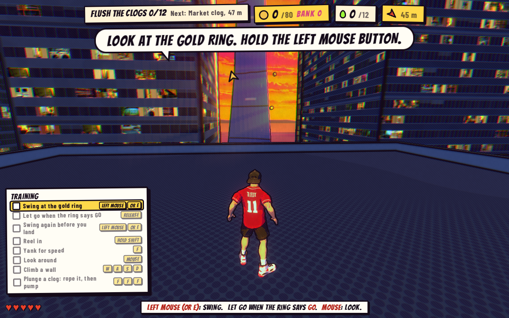

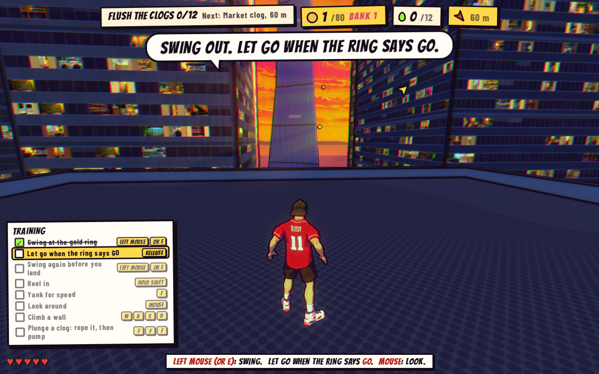

### Round 5 — 2026-10-21 — rubric v1

- What changed: After the Sludge Run, Mission 2 is Stop, Thief!, Mission 3 is Catch!, and Mission 4 is a rooftop brawl. Each starts near the hero, a miss starts that same mission again, and odd-job markers wait until the three are done. The mission card names the current one. The twelve clogs stay in the city and still wake the King, and the card returns to them when Mission 4 is over. The King card no longer calls itself Mission 3.
- Why it helped: The story after the bomb was twelve of the same plunge. Spider-Man 2 follows its opening with missions that change what you do. A 1280×800 play showed a street chase (THIEF, 51 m), a person on a roof edge (FALLING), and a roof fight (FIGHT, wave 1 of 2). None of those cards said to flush a clog. When the route ended, the clog card came back.
- Screenshots: `docs/gauntlet/fullswing-r5/thief.png`, `docs/gauntlet/fullswing-r5/catch.png`, `docs/gauntlet/fullswing-r5/brawl.png`.
- Next target: sound design (5). It is the lowest playability score. Variety is 7. The chase bed is still a click on the same groove.

| Dimension | Score | Why |
| --- | ---: | --- |
| Lighting | 5 | Held. Golden-hour sun and ink shadows. |
| Color palette | 6 | Held. Yellow, red and sludge green still separate the HUD from the blocks. |
| Detail density | 4 | Held. Open blocks more than a dressed borough. |
| Texture and material quality | 3 | Held. Flat fills. |
| Composition and camera | 4 | Held. The chase camera still leaves the thief low in the frame. The catch and the brawl are wider, and still not a led fight camera. |
| Atmosphere | 5 | Held. The dusk skyline has a mood. The street under the chase does not. |
| Character models | 3 | Held. Simple comic figures. The faller and the goons read at this distance. |
| Animation smoothness | 4 | Scored from still frames in software GL. Poses exist. Continuous motion was not watched. |
| Particles and VFX | 4 | Held. Beams and the sticker. No hit or trail in these frames. |
| UI polish | 6 | Held. The mission pill, the sticker and the training card share one ink-and-yellow system. |
| Responsiveness and input latency | 7 | Held. The card and the sticker were on the stepped frame that started each mission. |
| Controls feel | 6 | Held. One button still leaves the roof. These missions do not change the swing. |
| Mission clarity | 7 | Held at 7. Each card names its own mission and the sticker names THIEF, FALLING or FIGHT. The training card can still sit beside them. |
| Pacing | 7 | The lesson still waits. The next mission is a short chase, then a rescue, then a fight, not the clog list. The twelve clogs return after those three. |
| Fun factor | 6 | Held. The three missions are on the card. This play started them. It did not play one through to the payoff. |
| Difficulty curve | 6 | Held. The thief is a faster jog than the bomb runner, the catch gives time to swing there, and a miss retries. |
| Feedback | 6 | Held. The sticker and the timer are the new mission's feedback. No new hit or cue. |
| Sound design | 5 | Held. The chase clock is the click from round 3. This play ran with audio disabled. |
| Variety | 7 | Missions 2, 3 and 4 are a street chase, a falling rescue and a roof fight. The clog set is still the path to the King after that. |
| Performance stability | 6 | The 1280×800 play and the job checks passed with no page errors. Frame time on a real GPU was not measured. |

- Aesthetics raw: 44 / 10 dimensions, index 44
- Playability raw: 63 / 10 dimensions, index 63
- Total: 107 / 200
- Delta vs last round: +3 (round 4 was 104). Variety 5 → 7. Pacing 6 → 7. Every other score held.

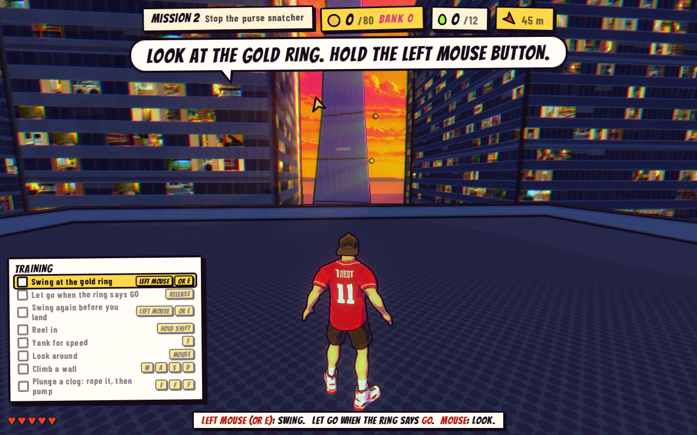

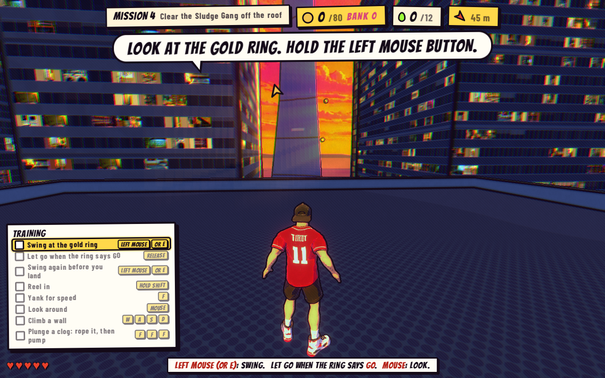

### Round 6 — 2026-10-21 — rubric v1

- What changed: The chase clock is a wood block under the click. Keeping pace is a light hit on the quarter notes. Falling behind is a heavier hit, and on the eighth notes. Closing and the first-lesson wait stay quiet. A fight still uses its own pulse.
- Why it helped: The old tick lived with the hats, so falling behind was barely brighter than the groove. A 4 s render of the same seed (speed 10) puts the keeping-pace clock 0.0033 RMS from the quiet groove, and falling behind 0.0114 RMS from it, about 3.4 times that clock. The whole mix only rises from 0.039 to 0.041, because the compressor holds the level. Closing and the lesson wait still report a chase of 0.
- Screenshots: `docs/gauntlet/fullswing-r6/falling-behind.png`. The picture shows the state. The loudness is the render, not the picture. No speaker listen.
- Next target: fun factor (6), tied with controls feel, difficulty, feedback, performance and sound. Fun is the one to change next: catching the thief, the faller or the roof still ends in a toast and a coin count.

| Dimension | Score | Why |
| --- | ---: | --- |
| Lighting | 5 | Held. Golden-hour sun and ink shadows. |
| Color palette | 6 | Held. Yellow, red and sludge green still separate the HUD from the blocks. |
| Detail density | 4 | Held. Open blocks more than a dressed borough. |
| Texture and material quality | 3 | Held. Flat fills. |
| Composition and camera | 4 | Held. The runner still sits low in the chase frame. |
| Atmosphere | 5 | Held. The dusk skyline has a mood. The street under the chase does not. |
| Character models | 3 | Held. Simple comic figures at this distance. |
| Animation smoothness | 4 | Scored from still frames in software GL. Continuous motion was not watched. |
| Particles and VFX | 4 | Held. The sticker and the street. No new hit or trail. |
| UI polish | 6 | Held. The FALLING BEHIND sticker is the same ink chip. |
| Responsiveness and input latency | 7 | Held. The chase state flipped on the stepped frames. |
| Controls feel | 6 | Held. One button still leaves the roof. The clock does not change the swing. |
| Mission clarity | 7 | Held. The sticker still says FALLING BEHIND when the clock is full. |
| Pacing | 7 | Held. The lesson waits, then the story missions, then the clogs. |
| Fun factor | 6 | Held. The chase is the same jog. The clock marks losing it. This play did not catch him. |
| Difficulty curve | 6 | Held. Falling behind is the same distance rule. The clock is heavier then, not a new fail. |
| Feedback | 6 | Held. The sticker was already the chase readout. The clock now backs the losing state. |
| Sound design | 6 | Falling behind is a wood block on the eighths, 3.4 times the keeping-pace clock in a seeded render. It is still one block on the same groove. Not heard on a speaker. |
| Variety | 7 | Held. Missions 2, 3 and 4 are still a chase, a rescue and a fight. |
| Performance stability | 6 | The chase-bed play and the render passed with no page errors. Frame time on a real GPU was not measured. |

- Aesthetics raw: 44 / 10 dimensions, index 44
- Playability raw: 64 / 10 dimensions, index 64
- Total: 108 / 200
- Delta vs last round: +1 (round 5 was 107). Sound design 5 → 6. Every other score held.

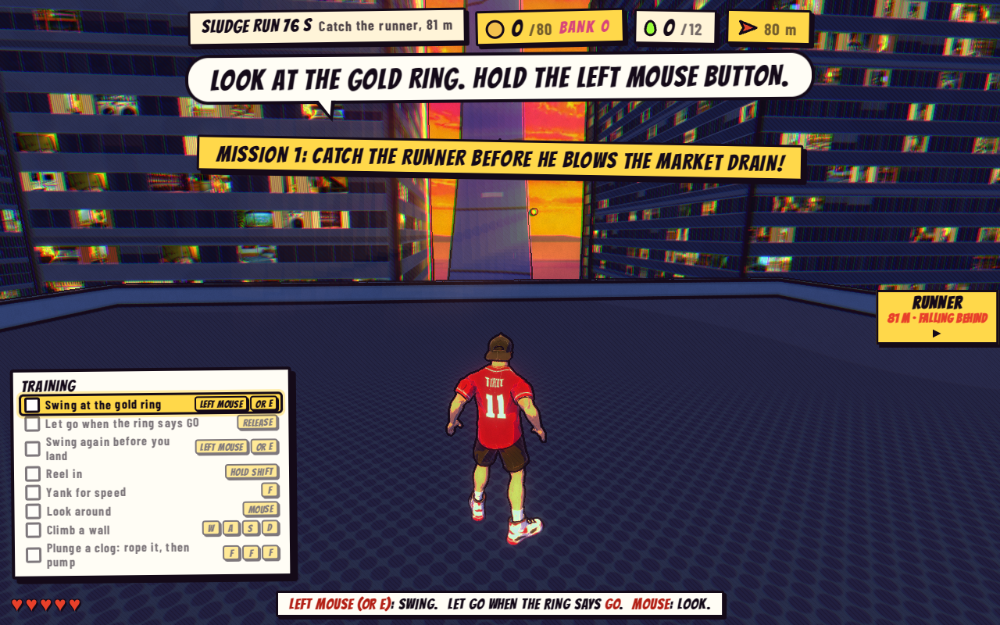

### Round 7 — 2026-10-21 — rubric v1

- What changed: A won job hangs in play before the next mission. A comic word fills about 62% of the view (FLUSH on the bomb, KASPLASH on every other win), a cheer plays with the old stinger, and the world slows for a short moment. The pill says GOT IT. The next mission card waits about 1.35 s, then the story scene and the next job. A miss stays a toast.
- Why it helped: Catching the thief, the faller, or the roof used to be a toast and a coin count, and Mission 3 opened in that same moment. Spider-Man 2 lets a clear land: time slows, a big title, a cheer, then the next objective. A 1280×800 play caught the purse snatcher. KASPLASH measured 61% of the view, the slow moment and the hit were on, the pill read GOT IT, and Mission 3 started after the hang. The cheer was not heard on a speaker (the play ran with audio disabled).
- Screenshots: `docs/gauntlet/fullswing-r7/gotcha.png`.
- Next target: controls feel (6), tied with difficulty, sound, and performance. Controls is the one to change next: one button leaves the roof, and the swing is still one held arc. Sound just moved, and this play did not listen. Performance still has no real-GPU frame time.

| Dimension | Score | Why |
| --- | ---: | --- |
| Lighting | 5 | Held. Golden-hour sun and ink shadows. |
| Color palette | 6 | Held. Yellow, red and sludge green still separate the HUD from the blocks. |
| Detail density | 4 | Held. Open blocks more than a dressed borough. |
| Texture and material quality | 3 | Held. Flat fills. |
| Composition and camera | 4 | Held. The chase camera still looks down the street. The word sits in the middle of that view. |
| Atmosphere | 5 | Held. The dusk skyline has a mood. The street under the chase does not. |
| Character models | 3 | Held. Simple comic figures at this distance. |
| Animation smoothness | 4 | Scored from still frames in software GL. Continuous motion was not watched. |
| Particles and VFX | 5 | The win frame is a KASPLASH across about 61% of the view. It is still one comic word, not a trail or a crowd. |
| UI polish | 6 | Held. GOT IT uses the same ink pill. The training card still sits beside it on a skip-intro start. |
| Responsiveness and input latency | 7 | Held. The word and the pill were on the stepped frame that ended the job. |
| Controls feel | 6 | Held. One button still leaves the roof. The payoff does not change the swing. |
| Mission clarity | 7 | Held. GOT IT names the job that just ended. Mission 3's card waits, then names the catch. |
| Pacing | 7 | Held. The hang is about a second and a third, then the next mission. The twelve clogs are still after Mission 4. |
| Fun factor | 7 | Catching the thief ends on a word bigger than a finisher, a short slow moment, and then the next mission. It is not a filmed finish. |
| Difficulty curve | 6 | Held. The thief is the same jog. The win is louder. The miss is still a toast. |
| Feedback | 7 | The win is a word, a hit, and a hang, not only a toast and a coin count. The cheer was not heard. |
| Sound design | 6 | Held. The cheer is the existing stinger. This play ran with audio disabled. The chase clock is unchanged. |
| Variety | 7 | Held. Missions 2, 3 and 4 are still a chase, a rescue and a fight. |
| Performance stability | 6 | The 1280×800 play passed with no page errors. Frame time on a real GPU was not measured. |

- Aesthetics raw: 45 / 10 dimensions, index 45
- Playability raw: 66 / 10 dimensions, index 66
- Total: 111 / 200
- Delta vs last round: +3 (round 6 was 108). Fun factor 6 → 7. Feedback 6 → 7. Particles and VFX 4 → 5. Every other score held.

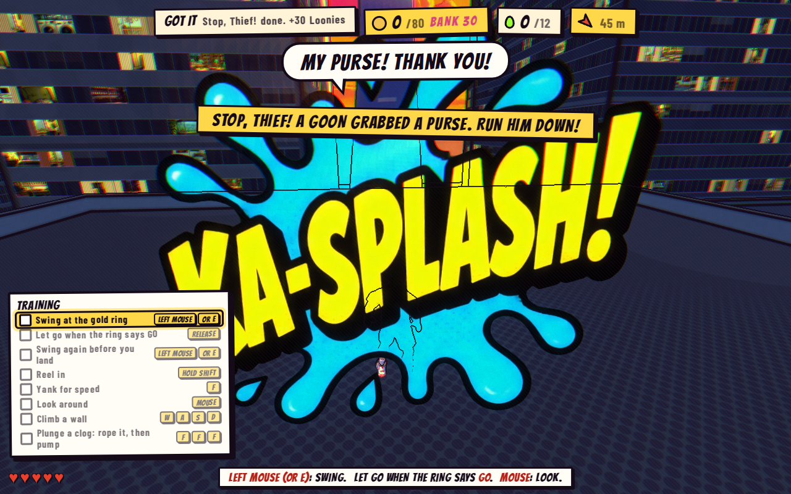

### Round 8 — 2026-10-21 — rubric v1

- What changed: On mouse and pad, letting go of a building rope while you are already moving at least 8 m/s carries the swing: 2.2 m/s along the flight and 1.6 m/s up. It does not cancel a fall and it does not flip the hero. The GO cue still does the larger boost and the flip. Under 8 m/s, a let-go is still just a let-go. The phone's own release is unchanged.
- Why it helped: A swing died when you let go outside the GO window, so each arc was one hold and a drop. Spider-Man 2 keeps a moving web flying into the next one. A 1280×800 play let go while falling, outside the cue, already moving across the rope. The carry added 2.2 m/s, the fall continued, and the pose stayed swing. A near-still let-go added nothing.
- Screenshots: `docs/gauntlet/fullswing-r8/carry.png`.
- Next target: difficulty curve (6), tied with sound and performance. Difficulty is the one to change next: the thief is still the same jog, and a miss is still a toast. Sound was not listened to. Performance still has no real-GPU frame time.

| Dimension | Score | Why |
| --- | ---: | --- |
| Lighting | 5 | Held. Golden-hour sun and ink shadows. |
| Color palette | 6 | Held. Yellow, red and sludge green still separate the HUD from the blocks. |
| Detail density | 4 | Held. Open blocks more than a dressed borough. |
| Texture and material quality | 3 | Held. Flat fills. |
| Composition and camera | 4 | Held. The chase camera still sits behind the hero. This frame is the swing, not a new view. |
| Atmosphere | 5 | Held. The dusk skyline has a mood. The street under the swing does not. |
| Character models | 3 | Held. Simple comic figures. |
| Animation smoothness | 4 | Scored from still frames in software GL. Continuous motion was not watched. |
| Particles and VFX | 5 | Held. The win word is still the effect from the last round. This frame is the swing. |
| UI polish | 6 | Held. The training card and the mission pill are the same. |
| Responsiveness and input latency | 7 | Held. The let-go carried on the stepped frame that released the rope. |
| Controls feel | 7 | A fast let-go outside the GO cue keeps the swing moving and does not flip. The timed let-go is still the real pop. It is not a chained web. |
| Mission clarity | 7 | Held. The missions are unchanged. |
| Pacing | 7 | Held. The story route and the win hang are unchanged. |
| Fun factor | 7 | Held. The win still lands on the big word. This round changes the let-go, not the mission finish. |
| Difficulty curve | 6 | Held. The thief is the same jog. A miss is still a toast. |
| Feedback | 7 | Held. The carry is a speed change. The GO cue and the win word are unchanged. |
| Sound design | 6 | Held. Not listened to. The carry can play the existing WHOOSH. The chase clock is unchanged. |
| Variety | 7 | Held. Missions 2, 3 and 4 are still a chase, a rescue and a fight. |
| Performance stability | 6 | The 1280×800 play passed with no page errors. Frame time on a real GPU was not measured. |

- Aesthetics raw: 45 / 10 dimensions, index 45
- Playability raw: 67 / 10 dimensions, index 67
- Total: 112 / 200
- Delta vs last round: +1 (round 7 was 111). Controls feel 6 → 7. Every other score held.

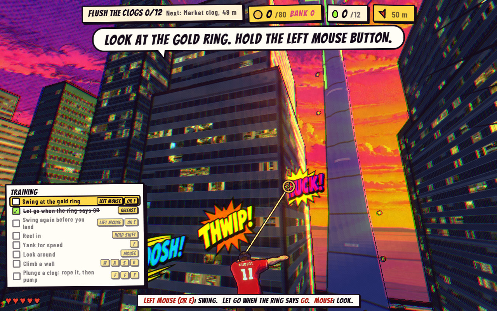

### Round 9 — 2026-10-21 — rubric v1

- What changed: The purse snatcher stays at a 6.3 m/s jog while the hero is within 28 m, and rises toward 9.2 m/s when the gap is wider. Closing the gap brings him back to the jog. The Sludge Run runner does the same, milder: 5.4 m/s within 46 m, toward 7.4 m/s past that, and the first-swing wait still holds him stopped. A miss holds a lesson card for 1.7 s. GOT AWAY says to stay close, because a swing beats a jog. The toast still says what happened. There is no payoff word. The story mission starts again after that card.
- Why it helped: The chase was one jog, and losing it was a toast. Spider-Man 2 pulls a pursuit away when you lose the gap, and a miss says what to do before the retry. A 1280×800 play stayed about 40 m behind the thief. His speed rose past 8 m/s and the card said he was pulling away. The clock running out showed GOT AWAY and the swing line, with no KASPLASH, and then Mission 2 started again.
- Screenshots: `docs/gauntlet/fullswing-r9/pull.png`, `docs/gauntlet/fullswing-r9/miss.png`.
- Next target: sound design (6), tied with performance. Sound is the one to change next: the pull-away and the miss are still the same mix, and a buffer can measure a new sting the way the chase clock was measured. Performance still has no real-GPU frame time.

| Dimension | Score | Why |
| --- | ---: | --- |
| Lighting | 5 | Held. Golden-hour sun and ink shadows. |
| Color palette | 6 | Held. Yellow, red and sludge green still separate the HUD from the blocks. |
| Detail density | 4 | Held. Open blocks more than a dressed borough. |
| Texture and material quality | 3 | Held. Flat fills. |
| Composition and camera | 4 | Held. The chase camera still sits behind the hero. The card is the new read. |
| Atmosphere | 5 | Held. The dusk skyline has a mood. The street under the chase does not. |
| Character models | 3 | Held. Simple comic figures. |
| Animation smoothness | 4 | Scored from still frames in software GL. Continuous motion was not watched. |
| Particles and VFX | 5 | Held. No new word on a miss. The win word is unchanged. |
| UI polish | 6 | Held. The lesson uses the same ink pill as the mission. |
| Responsiveness and input latency | 7 | Held. The speed and the card were on the stepped frames. |
| Controls feel | 7 | Held. The swing carry is unchanged. |
| Mission clarity | 7 | Held. The missions were already named. The new lines say the chase is getting away. |
| Pacing | 7 | Held. The lesson is under two seconds, then the same mission. The twelve clogs are still after Mission 4. |
| Fun factor | 7 | Held. The win still lands on the big word. This round changes the chase, not the finish. |
| Difficulty curve | 7 | Falling behind turns the jog into a run, and closing the gap brings the jog back. A miss holds a lesson, then the chase starts again. The later missions are still one pace. |
| Feedback | 7 | Held. The miss is a card and a toast, not a new hit. The win payoff is unchanged. |
| Sound design | 6 | Held. Not listened to. The pull-away and the miss add no new sting. The chase clock is unchanged. |
| Variety | 7 | Held. Missions 2, 3 and 4 are still a chase, a rescue and a fight. |
| Performance stability | 6 | The 1280×800 play passed with no page errors. Frame time on a real GPU was not measured. |

- Aesthetics raw: 45 / 10 dimensions, index 45
- Playability raw: 68 / 10 dimensions, index 68
- Total: 113 / 200
- Delta vs last round: +1 (round 8 was 112). Difficulty curve 6 → 7. Every other score held.

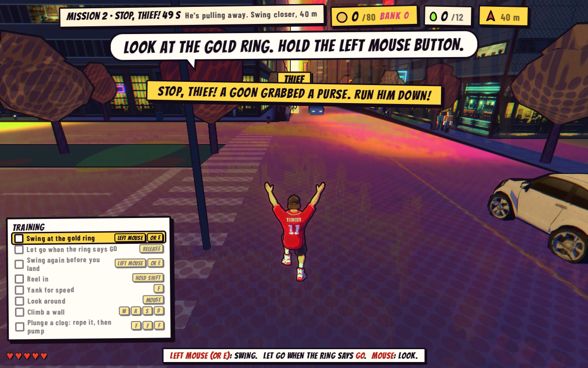

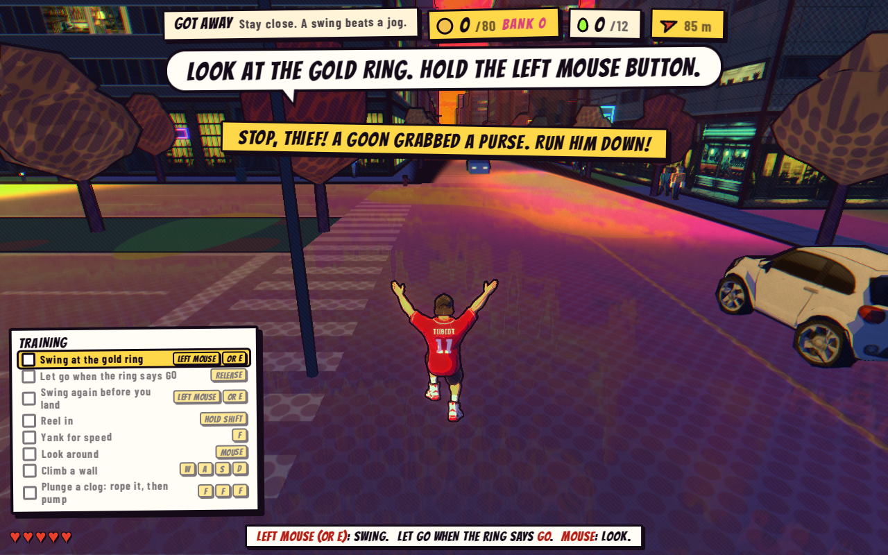

### Round 10 — 2026-10-21 — rubric v1

- What changed: While the purse snatcher or the sludge runner is pulling away, the chase clock stays on the fast tick even if the gap is holding steady. Closing still drops it. A miss plays a low falling sting (220 Hz down to 146 Hz, with a 73 Hz body) and does not play the win's rising brass.
- Why it helped: A steady gap used to sound like keeping pace while the card said he was pulling away, and a miss was silent next to the win fanfare. Spider-Man 2 tightens the chase music when you lose them, and a fail has its own sting. A 1280×800 play held about 40 m behind the thief: the clock stayed at full while the card said he was pulling away, and it dropped once the jog returned and the gap closed. An offline buffer put the miss lower than the win fanfare. A speaker was not used.
- Screenshots: `docs/gauntlet/fullswing-r10/clock.png`.
- Next target: performance stability (6). It is the only playability score still at 6. Frame time on a real GPU was not measured. The next change should be something a SwiftShader play can time.

| Dimension | Score | Why |
| --- | ---: | --- |
| Lighting | 5 | Held. Golden-hour sun and ink shadows. |
| Color palette | 6 | Held. Yellow, red and sludge green still separate the HUD from the blocks. |
| Detail density | 4 | Held. Open blocks more than a dressed borough. |
| Texture and material quality | 3 | Held. Flat fills. |
| Composition and camera | 4 | Held. The chase camera still sits behind the hero. This frame is the card and the clock. |
| Atmosphere | 5 | Held. The dusk skyline has a mood. The street under the chase does not. |
| Character models | 3 | Held. Simple comic figures. |
| Animation smoothness | 4 | Scored from still frames in software GL. Continuous motion was not watched. |
| Particles and VFX | 5 | Held. No new word. The win word is unchanged. |
| UI polish | 6 | Held. The lesson and the chase still use the same ink pill. |
| Responsiveness and input latency | 7 | Held. The clock value was on the stepped frame that held the gap. |
| Controls feel | 7 | Held. The swing carry is unchanged. |
| Mission clarity | 7 | Held. The card still says he is pulling away. |
| Pacing | 7 | Held. The story route is unchanged. The clock follows the pull. |
| Fun factor | 7 | Held. The win still lands on the big word. This round changes the chase music and the miss. |
| Difficulty curve | 7 | Held. Falling behind still turns the jog into a run. The clock now follows that. |
| Feedback | 7 | Held. The miss is still the lesson card. The new sting was measured, not heard on a speaker. |
| Sound design | 7 | The fast clock stays on while he is pulling away, even with the gap held. A miss is a low falling sting, and the buffer puts it under the win's brass. A speaker was not used. |
| Variety | 7 | Held. Missions 2, 3 and 4 are still a chase, a rescue and a fight. |
| Performance stability | 6 | The 1280×800 play passed with no page errors. Frame time on a real GPU was not measured. |

- Aesthetics raw: 45 / 10 dimensions, index 45
- Playability raw: 69 / 10 dimensions, index 69
- Total: 114 / 200
- Delta vs last round: +1 (round 9 was 113). Sound design 6 → 7. Every other score held.

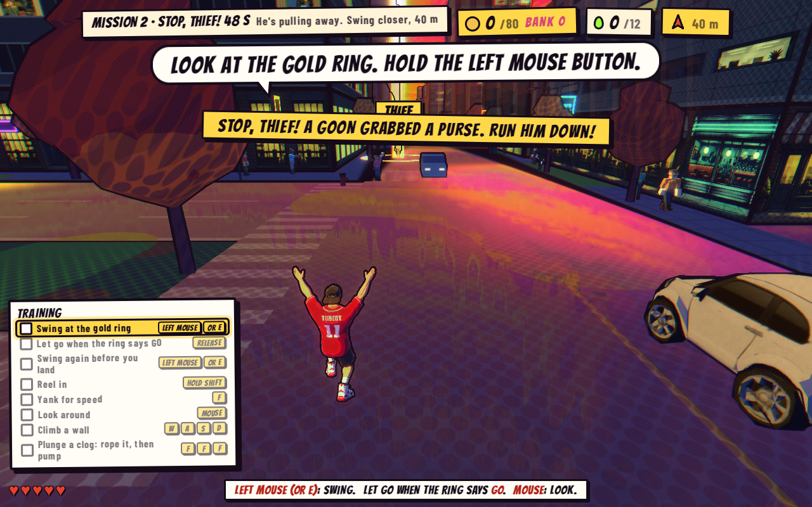

### Round 11 — 2026-10-21 — rubric v1

- What changed: A won job in flat play hops the hero off the ground: 8 m/s up and 3.5 m/s forward, and the view widens by 6 degrees. The feet leave the ground in that same moment, because a grounded step would zero the rise. Reduced motion and a headset keep the word and do not launch. A miss does not change the hero's speed.
- Why it helped: The win was a title while the hero stood still. Spider-Man 2 throws you back into motion when a mission clears. A 1280×800 play caught the purse snatcher. The body rose from 44 m to 46.4 m, the pose was jump, the pill read GOT IT, and Mission 3 waited. A miss left the hero at the same height with no upward speed. Reduced motion kept KASPLASH and stayed on the ground. A headset was not worn.
- Screenshots: `docs/gauntlet/fullswing-r11/hop.png`.
- Next target: variety (7). Fun just moved. Missions 2, 3 and 4 are still a chase, a rescue and a fight, then the twelve clogs. Performance stays at 6. This machine has no real GPU to time, so that score is not the next round.

| Dimension | Score | Why |
| --- | ---: | --- |
| Lighting | 5 | Held. Golden-hour sun and ink shadows. |
| Color palette | 6 | Held. Yellow, red and sludge green still separate the HUD from the blocks. |
| Detail density | 4 | Held. Open blocks more than a dressed borough. |
| Texture and material quality | 3 | Held. Flat fills. |
| Composition and camera | 4 | Held. The chase camera still sits behind the hero. The hop is in that same view. |
| Atmosphere | 5 | Held. The dusk skyline has a mood. The roof under the hop does not. |
| Character models | 3 | Held. Simple comic figures. |
| Animation smoothness | 4 | Scored from still frames in software GL. Continuous motion was not watched. |
| Particles and VFX | 5 | Held. The win word is unchanged. The hop is the body, not a new effect. |
| UI polish | 6 | Held. GOT IT is the same ink pill. |
| Responsiveness and input latency | 7 | Held. The hop was on the stepped frames after the catch. |
| Controls feel | 7 | Held. The swing carry is unchanged. |
| Mission clarity | 7 | Held. GOT IT names the job. Mission 3's card waits. |
| Pacing | 7 | Held. The hang is the same length. The hop happens inside it. |
| Fun factor | 8 | Catching the thief pops the hero 2.4 m into a jump, under the word, before the next mission. It is still one hop, not a filmed finish. |
| Difficulty curve | 7 | Held. Falling behind still turns the jog into a run. A miss still holds the lesson. |
| Feedback | 7 | Held. The word, the hang, and the lesson card are unchanged. The hop is the finish, not a new hit. |
| Sound design | 7 | Held. The cheer and the miss sting are unchanged. A speaker was not used. |
| Variety | 7 | Held. Missions 2, 3 and 4 are still a chase, a rescue and a fight. |
| Performance stability | 6 | The 1280×800 play passed with no page errors. Frame time on a real GPU was not measured. |

- Aesthetics raw: 45 / 10 dimensions, index 45
- Playability raw: 70 / 10 dimensions, index 70
- Total: 115 / 200
- Delta vs last round: +1 (round 10 was 114). Fun factor 7 → 8. Every other score held.

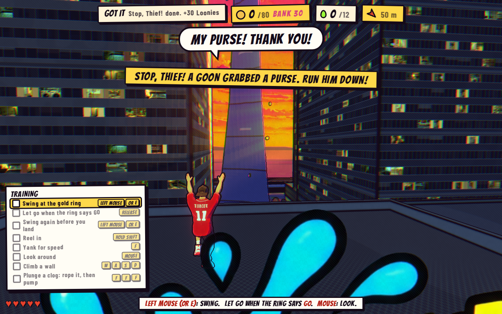

### Round 12 — 2026-10-21 — rubric v1

- What changed: After the roof fight, Mission 5 is a pizza delivery. The card says to get it to a roof 70 to 160 m out, a swing or two. An odd-job pizza still runs across town. Odd-job markers stay hidden until that delivery is done, and then the clog card returns. The twelve clogs still wake the King.
- Why it helped: After the bomb, every story mission was a chase, a rescue, or a fight. Spider-Man 2 changes what you do from one mission to the next. A 1280×800 play opened Mission 5. The pill read MISSION 5 and to get the pizza to the roof, the drop was 114 m, and no odd-job markers were out. Ending the route brought FLUSH THE CLOGS back. A skip-intro run that never wins the bomb still shows FLUSH THE CLOGS 1/12.
- Screenshots: `docs/gauntlet/fullswing-r12/pizza.png`.
- Next target: feedback (7). Variety just moved. The pull-away is still a line on the card, and the miss sting was measured, not heard. Performance stays at 6. This machine has no real GPU to time, so that score is not the next round.

| Dimension | Score | Why |
| --- | ---: | --- |
| Lighting | 5 | Held. Golden-hour sun and ink shadows. |
| Color palette | 6 | Held. Yellow, red and sludge green still separate the HUD from the blocks. |
| Detail density | 4 | Held. Open blocks more than a dressed borough. |
| Texture and material quality | 3 | Held. Flat fills. |
| Composition and camera | 4 | Held. The chase camera still sits behind the hero. This frame is the roof and the card. |
| Atmosphere | 5 | Held. The dusk skyline has a mood. The roof under the card does not. |
| Character models | 3 | Held. Simple comic figures. |
| Animation smoothness | 4 | Scored from still frames in software GL. Continuous motion was not watched. |
| Particles and VFX | 5 | Held. No new effect. The win word is unchanged. |
| UI polish | 6 | Held. Mission 5 uses the same ink pill. |
| Responsiveness and input latency | 7 | Held. The card was on the stepped frame that started the delivery. |
| Controls feel | 7 | Held. The swing carry is unchanged. |
| Mission clarity | 7 | Held. The card names the delivery and the roof. The missions were already named. |
| Pacing | 7 | Held. One more beat after the fight, then the clogs. The drop is a swing, not a hike across town. |
| Fun factor | 8 | Held. A win still hops the hero. This round changes the next mission, not the finish. |
| Difficulty curve | 7 | Held. Falling behind still turns the jog into a run. The delivery is a new job, not a new fail. |
| Feedback | 7 | Held. The card is the same kind of line. No new hit on the delivery or the pull-away. |
| Sound design | 7 | Held. Not listened to. The delivery uses the existing job start. |
| Variety | 8 | After the chase, the rescue and the fight, Mission 5 is a delivery to a roof. The twelve clogs are still the path after that. |
| Performance stability | 6 | The 1280×800 play passed with no page errors. Frame time on a real GPU was not measured. |

- Aesthetics raw: 45 / 10 dimensions, index 45
- Playability raw: 71 / 10 dimensions, index 71
- Total: 116 / 200
- Delta vs last round: +1 (round 11 was 115). Variety 7 → 8. Every other score held.

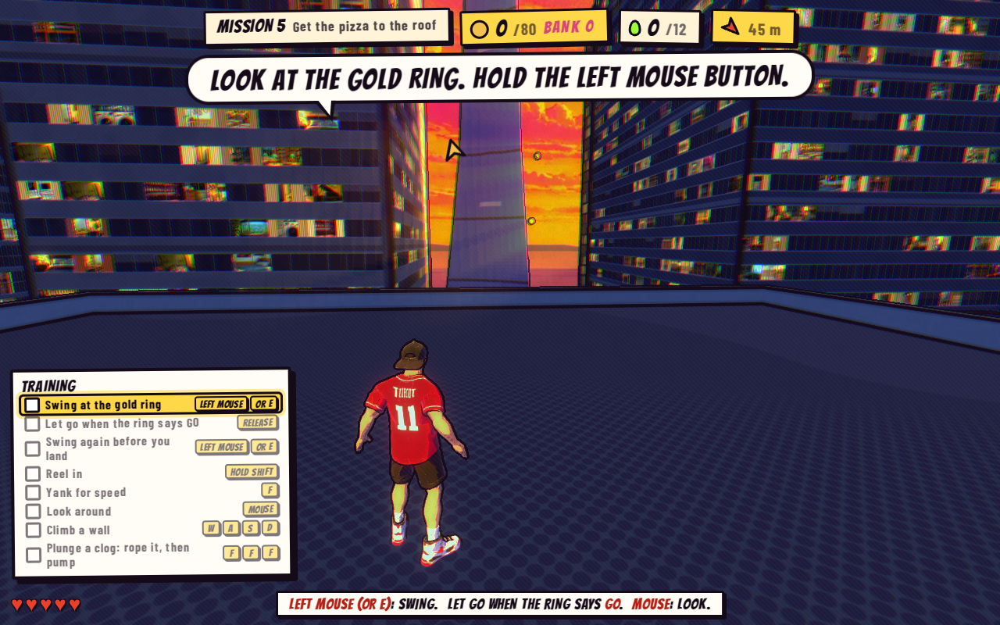

### Round 13 — 2026-10-21 — rubric v1

- What changed: While a chase card says he is pulling away, the pill itself turns hot: a warm fill and a magenta edge. Closing the gap brings the cream ink pill back with the jog line. The speed rule is unchanged.
- Why it helped: Losing the gap was a sentence on the same cream chip as every other card. Spider-Man 2 marks a pursuit you are losing on the objective, not only in the words. A 1280×800 play stayed about 40 m behind the thief. The pill read that he was pulling away, and its fill and edge measured as the warm card (`#ffd6c4`, magenta `#d8457a`). Coming back in, the line said to run him down and the magenta edge was gone.
- Screenshots: `docs/gauntlet/fullswing-r13/hot.png`.
- Next target: pacing (7), tied with responsiveness, controls, mission clarity, difficulty, and sound. Pacing is the one to change next: the story is four beats, then twelve of the same clog. Sound was not the round. Performance stays at 6. This machine has no real GPU to time, so that score is not the next round.

| Dimension | Score | Why |
| --- | ---: | --- |
| Lighting | 5 | Held. Golden-hour sun and ink shadows. |
| Color palette | 6 | Held. Yellow, red and sludge green still separate the HUD from the blocks. The hot card uses the magenta already in the HUD. |
| Detail density | 4 | Held. Open blocks more than a dressed borough. |
| Texture and material quality | 3 | Held. Flat fills. |
| Composition and camera | 4 | Held. The chase camera still sits behind the hero. This frame is the card. |
| Atmosphere | 5 | Held. The dusk skyline has a mood. The street under the chase does not. |
| Character models | 3 | Held. Simple comic figures. |
| Animation smoothness | 4 | Scored from still frames in software GL. Continuous motion was not watched. |
| Particles and VFX | 5 | Held. No new word or trail. The card is the change. |
| UI polish | 6 | Held. The hot state is a fill and an edge on the same pill. |
| Responsiveness and input latency | 7 | Held. The hot class was on the stepped frame after the line changed. |
| Controls feel | 7 | Held. The swing carry is unchanged. |
| Mission clarity | 7 | Held. The line already said he was pulling away. The color repeats that line. |
| Pacing | 7 | Held. The story route is unchanged. The card follows the pull. |
| Fun factor | 8 | Held. A win still hops the hero. This round changes the chase card, not the finish. |
| Difficulty curve | 7 | Held. Falling behind still turns the jog into a run. The card now shows that. |
| Feedback | 8 | Losing the gap turns the card hot, and closing the gap puts the ink pill back. It is a color, not a hit. |
| Sound design | 7 | Held. Not listened to. The fast clock and the miss sting are unchanged. |
| Variety | 8 | Held. Mission 5 is still the delivery after the fight. |
| Performance stability | 6 | The 1280×800 play passed with no page errors. Frame time on a real GPU was not measured. |

- Aesthetics raw: 45 / 10 dimensions, index 45
- Playability raw: 72 / 10 dimensions, index 72
- Total: 117 / 200
- Delta vs last round: +1 (round 12 was 116). Feedback 7 → 8. Every other score held.

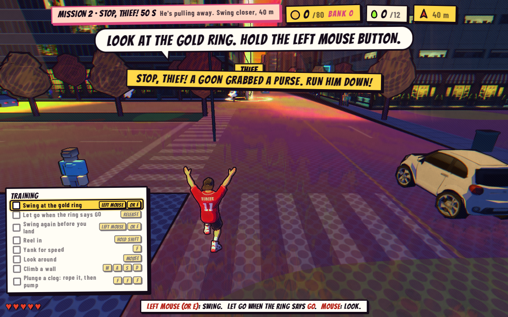

### Round 14 — 2026-10-21 — rubric v1

- What changed: The fourth flush starts UP FOR AIR, a balloon to bring back. The eighth starts GET HIM DOWN, a washer to carry to the street. The card names that job until it ends, then FLUSH THE CLOGS returns with the count. Three flushes, and the flushes between the beats, stay on the clog card. One flush does not start a beat. All twelve still wake the King. A beat waits while a story mission is running.
- Why it helped: After the story, the path to the King was twelve of the same pump. Spider-Man 2 breaks a long list with a different activity, then hands it back. A 1280×800 play flushed three clogs and the card stayed FLUSH THE CLOGS 3/12. The fourth named the balloon. Bringing it back returned the clog card at 4/12. Seven stayed on the clog card. The eighth named the washer, a carry, not the balloon. A skip-intro run that flushes one clog still shows FLUSH THE CLOGS 1/12.
- Screenshots: `docs/gauntlet/fullswing-r14/balloon.png`, `docs/gauntlet/fullswing-r14/washer.png`.
- Next target: difficulty curve (7), tied with responsiveness, controls, mission clarity, and sound. Difficulty is the one to change next: the later breather is the same 60 s grip as an odd-job washer, so the clog run does not get tighter. Sound was not the round. Performance stays at 6. This machine has no real GPU to time, so that score is not the next round.

| Dimension | Score | Why |
| --- | ---: | --- |
| Lighting | 5 | Held. Golden-hour sun and ink shadows. |
| Color palette | 6 | Held. Yellow, red and sludge green still separate the HUD from the blocks. |
| Detail density | 4 | Held. Open blocks more than a dressed borough. |
| Texture and material quality | 3 | Held. Flat fills. |
| Composition and camera | 4 | Held. The chase camera still sits behind the hero. These frames are the card. |
| Atmosphere | 5 | Held. The dusk skyline has a mood. The roof under the card does not. |
| Character models | 3 | Held. Simple comic figures. |
| Animation smoothness | 4 | Scored from still frames in software GL. Continuous motion was not watched. |
| Particles and VFX | 5 | Held. No new effect. The beats use the jobs already in the city. |
| UI polish | 6 | Held. The beats use the same ink pill. |
| Responsiveness and input latency | 7 | Held. The new card was on the stepped frames after the flush. |
| Controls feel | 7 | Held. The swing carry is unchanged. |
| Mission clarity | 7 | Held. The card names the balloon, then the washer, then the clogs again. The missions were already named. |
| Pacing | 8 | The fourth flush is a balloon and the eighth is a carry, and the clog card comes back between them. The other ten are still the same pump. |
| Fun factor | 8 | Held. A win still hops the hero. This round changes when the next job starts, not the finish. |
| Difficulty curve | 7 | Held. Falling behind still turns the jog into a run. The washer on the eighth flush has the same 60 s grip as an odd job. |
| Feedback | 8 | Held. A chase that is pulling away still turns the card hot. The beats did not add a new hit. |
| Sound design | 7 | Held. Not listened to. The beats use the existing job start. |
| Variety | 8 | Held. The balloon and the washer were already jobs. This round is when they show up in the clog run. |
| Performance stability | 6 | The 1280×800 play passed with no page errors. Frame time on a real GPU was not measured. |

- Aesthetics raw: 45 / 10 dimensions, index 45
- Playability raw: 73 / 10 dimensions, index 73
- Total: 118 / 200
- Delta vs last round: +1 (round 13 was 117). Pacing 7 → 8. Every other score held.

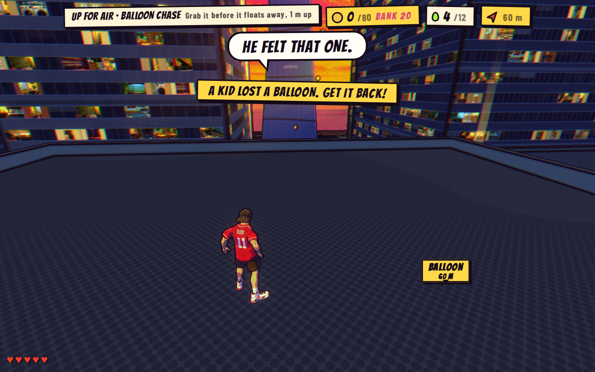

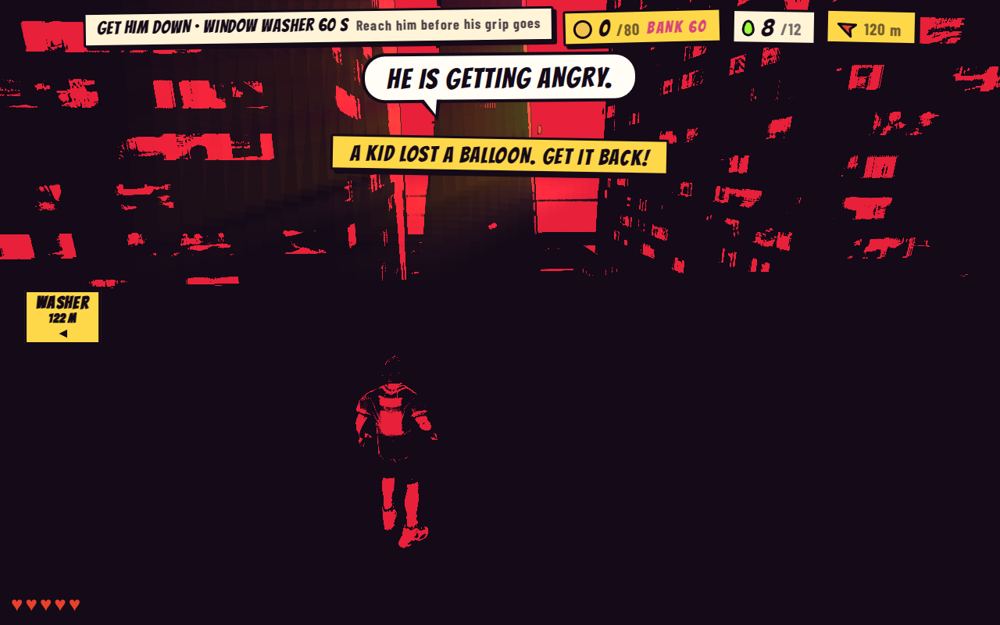

### Round 15 — 2026-10-21 — rubric v1

- What changed: The washer on the eighth flush hangs for 36 s when the tower is a swing away. The beat searches the towers in that band instead of sampling, so the carry is the nearby one. An odd-job washer still hangs for 60 s. A tower past a swing keeps a longer clock, up to that same minute. The balloon's slip and the falling rescue are unchanged.
- Why it helped: The later breather had the same minute as a marker washer, and the nearby tower was often missed, so the carry could land across town on a clock you could stroll. Spider-Man 2 tightens a later activity and still leaves a way to do it. A 1280×800 play flushed eight clogs. The card read GET HIM DOWN, WINDOW WASHER, 36 s. The node check started that washer inside the band and read 36 s, started an odd-job washer and read 60 s, and left a far tower on the full minute past 40 s.
- Screenshots: `docs/gauntlet/fullswing-r15/washer.png`.
- Next target: mission clarity (7), tied with responsiveness, controls, and sound. Clarity is the one to change next: the clog card names a district and a distance, and the compass picks the nearest clog on its own, so the two can point at different pumps. Sound was not the round. Performance stays at 6. This machine has no real GPU to time, so that score is not the next round.

| Dimension | Score | Why |
| --- | ---: | --- |
| Lighting | 5 | Held. Golden-hour sun and ink shadows. |
| Color palette | 6 | Held. Yellow, red and sludge green still separate the HUD from the blocks. |
| Detail density | 4 | Held. Open blocks more than a dressed borough. |
| Texture and material quality | 3 | Held. Flat fills. |
| Composition and camera | 4 | Held. The chase camera still sits behind the hero. This frame is the card. |
| Atmosphere | 5 | Held. The dusk skyline has a mood. The street under the card does not. |
| Character models | 3 | Held. Simple comic figures. |
| Animation smoothness | 4 | Scored from still frames in software GL. Continuous motion was not watched. |
| Particles and VFX | 5 | Held. No new effect. The clock is the change. |
| UI polish | 6 | Held. The same ink pill shows the shorter count. |
| Responsiveness and input latency | 7 | Held. The 36 s card was on the stepped frames after the eighth flush. |
| Controls feel | 7 | Held. The swing carry is unchanged. |
| Mission clarity | 7 | Held. The card already named the washer. The number on it changed. |
| Pacing | 8 | Held. The fourth flush is still the balloon and the eighth is still the carry. |
| Fun factor | 8 | Held. A win still hops the hero. This round changes the later clock, not the finish. |
| Difficulty curve | 8 | The eighth flush counts from 36 s on a tower a swing away. An odd-job washer still has the minute. A tower past a swing is not cut to 36. |
| Feedback | 8 | Held. A chase that is pulling away still turns the card hot. The clock did not add a new hit. |
| Sound design | 7 | Held. Not listened to. The shorter hang uses the existing washer clock. |
| Variety | 8 | Held. The washer was already the eighth-flush beat. |
| Performance stability | 6 | The 1280×800 play passed with no page errors. Frame time on a real GPU was not measured. |

- Aesthetics raw: 45 / 10 dimensions, index 45
- Playability raw: 74 / 10 dimensions, index 74
- Total: 119 / 200
- Delta vs last round: +1 (round 14 was 118). Difficulty 7 → 8. Every other score held.

### Round 16 — 2026-10-21 — rubric v1

- What changed: While the card says to flush the clogs, the compass points at the clog that card names, and its title names that district. A job still titles the compass as the job.
- Why it helped: The card named one pump and the compass was finding the nearest clog on its own, so the two could disagree. Spider-Man 2 keeps the objective and the waypoint on the same place. A 1280×800 play showed FLUSH THE CLOGS 0/12 and Next: Market clog, 47 m. The compass title was Market clog, and it pointed at that clog. Starting the Sludge Run put Your job back on the compass.
- Screenshots: `docs/gauntlet/fullswing-r16/compass.png`.
- Next target: responsiveness (7), tied with controls and sound. Responsiveness is the one to change next: the clog card's distance waits half a second while the compass metres move every frame, so the number you steer by lags the swing. Sound was not the round. Performance stays at 6. This machine has no real GPU to time, so that score is not the next round.

| Dimension | Score | Why |
| --- | ---: | --- |
| Lighting | 5 | Held. Golden-hour sun and ink shadows. |
| Color palette | 6 | Held. Yellow, red and sludge green still separate the HUD from the blocks. |
| Detail density | 4 | Held. Open blocks more than a dressed borough. |
| Texture and material quality | 3 | Held. Flat fills. |
| Composition and camera | 4 | Held. The chase camera still sits behind the hero. This frame is the card. |
| Atmosphere | 5 | Held. The dusk skyline has a mood. The street under the card does not. |
| Character models | 3 | Held. Simple comic figures. |
| Animation smoothness | 4 | Scored from still frames in software GL. Continuous motion was not watched. |
| Particles and VFX | 5 | Held. No new effect. The compass uses the clog that was already there. |
| UI polish | 6 | Held. The compass title is the district already written on the card. |
| Responsiveness and input latency | 7 | Held. The title was on the stepped frames after the card named the clog. The card's distance still waits half a second. |
| Controls feel | 7 | Held. The swing carry is unchanged. |
| Mission clarity | 8 | The compass title names the district on the card, and it points at that clog. A job puts Your job back. |
| Pacing | 8 | Held. The fourth flush is still the balloon and the eighth is still the carry. |
| Fun factor | 8 | Held. A win still hops the hero. This round changes which clog the compass follows. |
| Difficulty curve | 8 | Held. The eighth flush still counts from 36 s. An odd-job washer still has the minute. |
| Feedback | 8 | Held. A chase that is pulling away still turns the card hot. The compass did not add a new hit. |
| Sound design | 7 | Held. Not listened to. |
| Variety | 8 | Held. The jobs are unchanged. |
| Performance stability | 6 | The 1280×800 play passed with no page errors. Frame time on a real GPU was not measured. |

- Aesthetics raw: 45 / 10 dimensions, index 45
- Playability raw: 75 / 10 dimensions, index 75
- Total: 120 / 200
- Delta vs last round: +1 (round 15 was 119). Mission clarity 7 → 8. Every other score held.

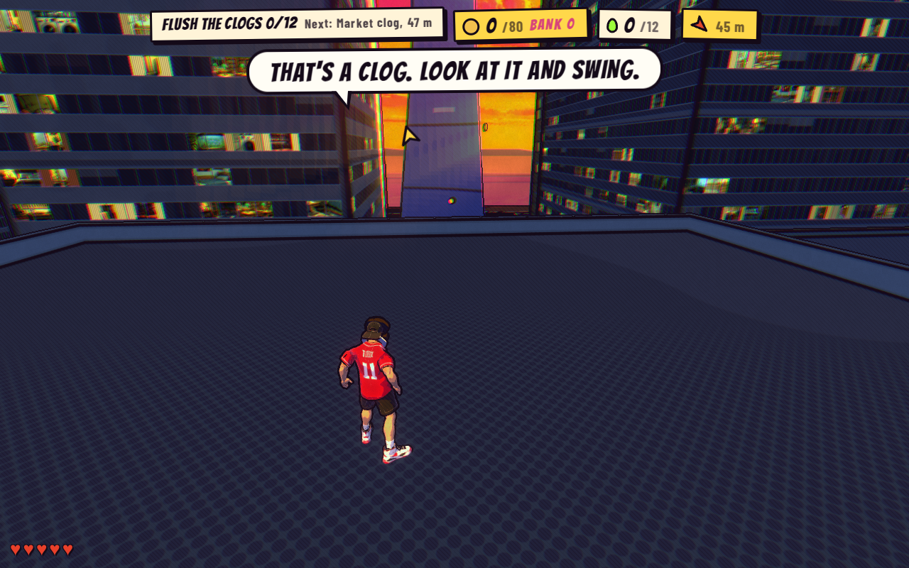

### Round 17 — 2026-10-21 — rubric v1

- What changed: The clog card rewrites its distance every frame. A move toward that clog changes the metres on the next frames. The compass keeps naming that same district.
- Why it helped: The card was rewriting its metres twice a second, so the number lagged the swing. Spider-Man 2 ticks the distance as you travel. A 1280×800 play moved toward the Market clog and stepped three frames. The card read FLUSH THE CLOGS 0/12, Next: Market clog, 28 m, and the drop was already more than 8 m. The compass title stayed Market clog.
- Screenshots: `docs/gauntlet/fullswing-r17/closer.png`.
- Next target: controls feel (7), tied with sound. Controls is the one to change next: on a mouse, the next web only starts on a fresh press, so a swing that lets go with the button still down does not catch the next building. Sound was not the round. Performance stays at 6. This machine has no real GPU to time, so that score is not the next round.

| Dimension | Score | Why |
| --- | ---: | --- |
| Lighting | 5 | Held. Golden-hour sun and ink shadows. |
| Color palette | 6 | Held. Yellow, red and sludge green still separate the HUD from the blocks. |
| Detail density | 4 | Held. Open blocks more than a dressed borough. |
| Texture and material quality | 3 | Held. Flat fills. |
| Composition and camera | 4 | Held. The chase camera still sits behind the hero. This frame is the card. |
| Atmosphere | 5 | Held. The dusk skyline has a mood. The street under the card does not. |
| Character models | 3 | Held. Simple comic figures. |
| Animation smoothness | 4 | Scored from still frames in software GL. Continuous motion was not watched. |
| Particles and VFX | 5 | Held. No new effect. The number on the card is the change. |
| UI polish | 6 | Held. The same ink pill shows the live metres. |
| Responsiveness and input latency | 8 | Moving toward the clog dropped the card's metres within three frames. The compass stayed on that clog. |
| Controls feel | 7 | Held. The swing carry is unchanged. A held swing button still does not start the next web. |
| Mission clarity | 8 | Held. The compass still names the district on the card. |
| Pacing | 8 | Held. The fourth flush is still the balloon and the eighth is still the carry. |
| Fun factor | 8 | Held. A win still hops the hero. This round changes how fast the number moves. |
| Difficulty curve | 8 | Held. The eighth flush still counts from 36 s. An odd-job washer still has the minute. |
| Feedback | 8 | Held. A chase that is pulling away still turns the card hot. The distance did not add a new hit. |
| Sound design | 7 | Held. Not listened to. |
| Variety | 8 | Held. The jobs are unchanged. |
| Performance stability | 6 | The 1280×800 play passed with no page errors. Frame time on a real GPU was not measured. |

- Aesthetics raw: 45 / 10 dimensions, index 45
- Playability raw: 76 / 10 dimensions, index 76
- Total: 121 / 200
- Delta vs last round: +1 (round 16 was 120). Responsiveness 7 → 8. Every other score held.

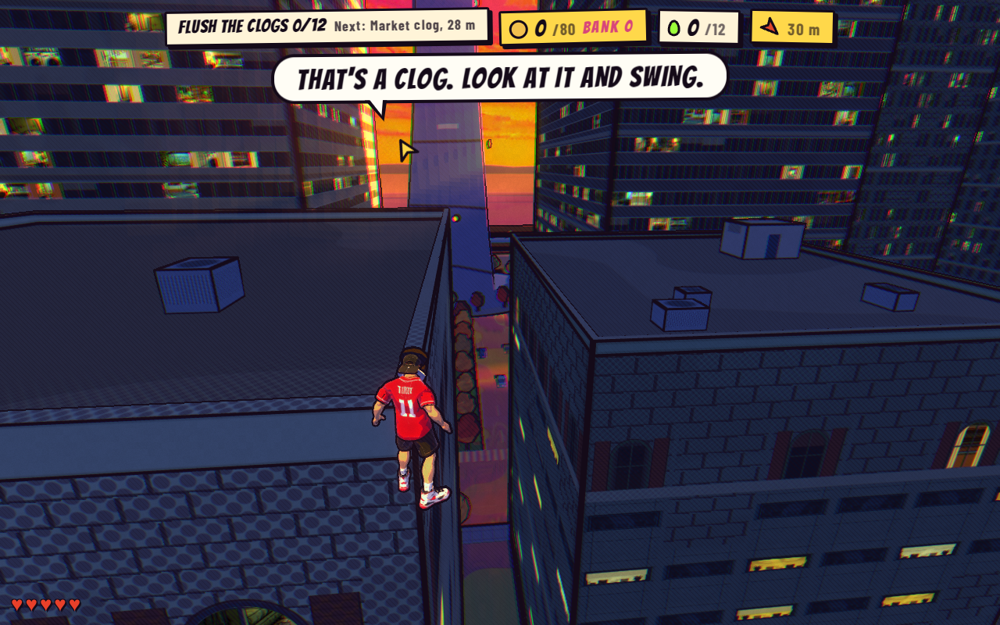

### Round 18 — 2026-10-21 — rubric v1

- What changed: Holding the swing button through the GO cue lets that rope go and catches the next building without a new press. The cue stays readable for a third of a second. Letting the button up still lets the rope go and does not fire another web.
- Why it helped: On a mouse, the next web only started on a fresh press, so a swing that let go with the button still down fell. Spider-Man 2 chains the next web from a held swing. A 1280×800 play held E in the air. The rope let go on the cue at frame 492 and attached to a different building (id 783) 10 frames later. There was no trigger-up and no dry fire. Letting E up left both ropes idle.
- Screenshots: `docs/gauntlet/fullswing-r18/chain.png`.
- Next target: performance stability (6), the lowest playability score. This machine has no real GPU to time, so that score is not the next implementation round. Sound design (7) was not listened to and is not the next implementation round either.

| Dimension | Score | Why |
| --- | ---: | --- |
| Lighting | 5 | Held. Golden-hour sun and ink shadows. |
| Color palette | 6 | Held. Yellow, red and sludge green still separate the HUD from the blocks. |
| Detail density | 4 | Held. Open blocks more than a dressed borough. |
| Texture and material quality | 3 | Held. Flat fills. |
| Composition and camera | 4 | Held. The chase camera still sits behind the hero. This frame is the swing. |
| Atmosphere | 5 | Held. The dusk skyline has a mood. The street under the swing does not. |
| Character models | 3 | Held. Simple comic figures. |
| Animation smoothness | 4 | Scored from still frames in software GL. Continuous motion was not watched. |
| Particles and VFX | 5 | Held. No new effect. The rope is the one already in the swing. |
| UI polish | 6 | Held. The GO cue is the same caption, left up long enough to read. |
| Responsiveness and input latency | 8 | Held. The clog card still rewrites its metres every frame. |
| Controls feel | 8 | Holding through the cue let the rope go and attached to a different building 10 frames later, with no new press. Letting the button up left the ropes idle. |
| Mission clarity | 8 | Held. The compass still names the district on the card. |
| Pacing | 8 | Held. The fourth flush is still the balloon and the eighth is still the carry. |
| Fun factor | 8 | Held. A win still hops the hero. This round changes the next web, not the payoff. |
| Difficulty curve | 8 | Held. The eighth flush still counts from 36 s. An odd-job washer still has the minute. |
| Feedback | 8 | Held. A chase that is pulling away still turns the card hot. The chain uses the cue that was already there. |
| Sound design | 7 | Held. Not listened to. |
| Variety | 8 | Held. The jobs are unchanged. |
| Performance stability | 6 | The 1280×800 play passed with no page errors. Frame time on a real GPU was not measured. |

- Aesthetics raw: 45 / 10 dimensions, index 45
- Playability raw: 77 / 10 dimensions, index 77
- Total: 122 / 200
- Delta vs last round: +1 (round 17 was 121). Controls feel 7 → 8. Every other score held.

### Round 19 — 2026-10-21 — rubric v1

- What changed: The sixth flush starts a pizza delivery. The card says HOT PIE and names the roof. The fifth flush stays on the clog card. After the pizza, the clog card returns. The fourth flush is still the balloon. The eighth is still the washer at 36 seconds. The King still roars only at the fourth and the eighth.
- Why it helped: After the balloon, four clogs in a row were the same pump before the washer. Spider-Man 2 breaks a repeated objective before it runs that long. A 1280×800 play flushed six clogs. The card read HOT PIE, PIZZA RUSH, Deliver to the roof, 37 m. Five flushes still read FLUSH THE CLOGS 5/12. After the pizza the clog card came back, and the eighth flush still counted from 36 s.
- Screenshots: `docs/gauntlet/fullswing-r19/pie.png`.
- Next target: performance stability (6), the lowest playability score. This machine has no real GPU to time, so that score is not the next implementation round. Sound design (7) was not listened to and is not the next implementation round either.

| Dimension | Score | Why |
| --- | ---: | --- |
| Lighting | 5 | Held. Golden-hour sun and ink shadows. |
| Color palette | 6 | Held. Yellow, red and sludge green still separate the HUD from the blocks. |
| Detail density | 4 | Held. Open blocks more than a dressed borough. |
| Texture and material quality | 3 | Held. Flat fills. |
| Composition and camera | 4 | Held. The chase camera still sits behind the hero. This frame is the card. |
| Atmosphere | 5 | Held. The dusk skyline has a mood. The street under the card does not. |
| Character models | 3 | Held. Simple comic figures. |
| Animation smoothness | 4 | Scored from still frames in software GL. Continuous motion was not watched. |
| Particles and VFX | 5 | Held. No new effect. The card is the change. |
| UI polish | 6 | Held. The same ink pill names the delivery. |
| Responsiveness and input latency | 8 | Held. The clog card still rewrites its metres every frame. |
| Controls feel | 8 | Held. A held swing still catches the next building. The first web over open roofs can still be the sky, because a building past the rope cap flies into the wall. |
| Mission clarity | 8 | Held. The compass still names the district on the clog card. The delivery card names the roof. |
| Pacing | 8 | The sixth flush is a roof delivery between the balloon and the washer. Nine of the twelve are still the same pump, so this is not a new point against Spider-Man 2. |
| Fun factor | 8 | Held. A win still hops the hero. This round changes the job in the middle, not the finish. |
| Difficulty curve | 8 | Held. The eighth flush still counts from 36 s. An odd-job washer still has the minute. |
| Feedback | 8 | Held. A chase that is pulling away still turns the card hot. The delivery uses the pizza card that was already there. |
| Sound design | 7 | Held. Not listened to. |
| Variety | 8 | Held. The pizza was already Mission 5. This round places that delivery inside the clog run. |
| Performance stability | 6 | The 1280×800 play passed with no page errors. Frame time on a real GPU was not measured. |

- Aesthetics raw: 45 / 10 dimensions, index 45
- Playability raw: 77 / 10 dimensions, index 77
- Total: 122 / 200
- Delta vs last round: 0 (round 18 was 122). The sixth flush is a different job, and nine clogs are still the same pump, so pacing stays at 8.

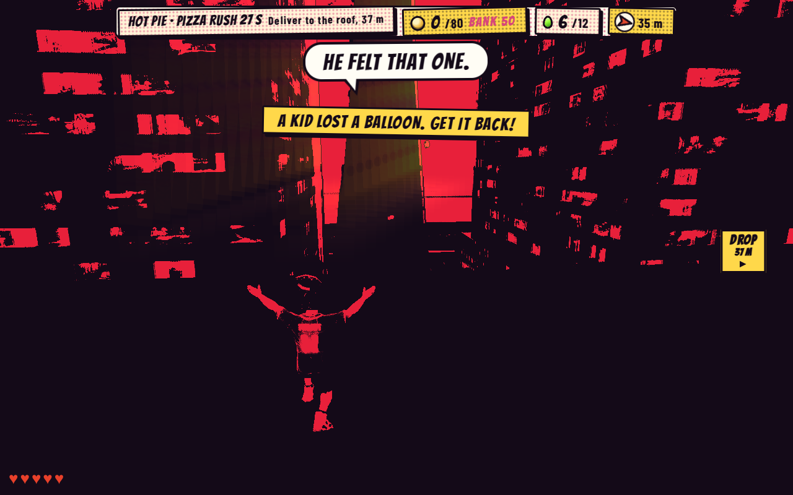

### Round 20 — 2026-10-21 — rubric v1

- What changed: A held swing skips the whole building it just left, including another tier and the antenna. A sky rope over open water stays while the button is held. Over the city, a sky rope still lets go once a building is ahead. Letting the button up still lets the rope go.
- Why it helped: The held chain compared collider ids, so the next web could be another piece of the same tower, and over water it dropped the sky rope and then refused to fire. Spider-Man 2 does not regrab the structure it just left, and it does not drop you while the button is still down. A 1280×800 play held E. The first web was the sky. It let go and attached to a different building (id 783) 10 frames later, with no new press and no dry fire. Letting E up left both ropes idle. Over open water the sky rope was still attached after 240 frames, at 51.9 m, with no detach.
- Screenshots: `docs/gauntlet/fullswing-r20/chain.png`, `docs/gauntlet/fullswing-r20/water.png`.
- Next target: performance stability (6), the lowest playability score. This machine has no real GPU to time, so that score is not the next implementation round. Sound design (7) was not listened to and is not the next implementation round either.

| Dimension | Score | Why |
| --- | ---: | --- |
| Lighting | 5 | Held. Golden-hour sun and ink shadows. |
| Color palette | 6 | Held. Yellow, red and sludge green still separate the HUD from the blocks. |
| Detail density | 4 | Held. Open blocks more than a dressed borough. |
| Texture and material quality | 3 | Held. Flat fills. |
| Composition and camera | 4 | Held. The chase camera still sits behind the hero. This frame is the swing. |
| Atmosphere | 5 | Held. The dusk skyline has a mood. The water under the second swing is open. |
| Character models | 3 | Held. Simple comic figures. |
| Animation smoothness | 4 | Scored from still frames in software GL. Continuous motion was not watched. |
| Particles and VFX | 5 | Held. No new effect. The rope is the one already in the swing. |
| UI polish | 6 | Held. The same ink pill and the GO cue. |
| Responsiveness and input latency | 8 | Held. The clog card still rewrites its metres every frame. |
| Controls feel | 8 | The chain attaches to a different building, and it skips another piece of the one just left. Over open water the sky rope stays while the button is down. The first web over open roofs can still be the sky. |
| Mission clarity | 8 | Held. The compass still names the district on the clog card. |
| Pacing | 8 | Held. The sixth flush is still the pizza, between the balloon and the washer. Nine clogs are still the same pump. |
| Fun factor | 8 | Held. A win still hops the hero. This round changes which anchor a held swing accepts. |
| Difficulty curve | 8 | Held. The eighth flush still counts from 36 s. An odd-job washer still has the minute. |
| Feedback | 8 | Held. A chase that is pulling away still turns the card hot. |
| Sound design | 7 | Held. Not listened to. |
| Variety | 8 | Held. The jobs are unchanged. |
| Performance stability | 6 | The 1280×800 play passed with no page errors. Frame time on a real GPU was not measured. |

- Aesthetics raw: 45 / 10 dimensions, index 45
- Playability raw: 77 / 10 dimensions, index 77
- Total: 122 / 200
- Delta vs last round: 0 (round 19 was 122). The chain no longer regrabs the building it left, and a sky rope stays over open water. That restores the held swing. It is not a new point against Spider-Man 2.

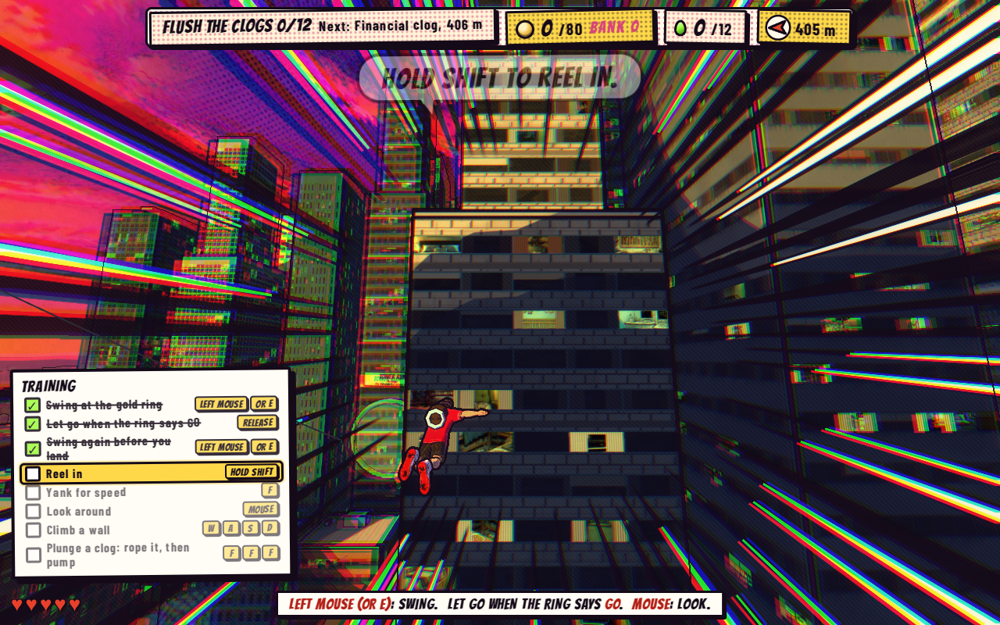

### Round 21 — 2026-10-21 — rubric v1

- What changed: The first easy web attaches to a building the hero can hang under, even past 16 body-heights. The rope is the real distance, so the swing starts on the sphere. A building the arc cannot clear is skipped. A sky rope stays at most 16 body-heights. Over open water the web stays in the sky.
- Why it helped: The first web over the roofs was the sky, because a farther building was a short rope and the hero flew into the wall. Spider-Man 2 swings from the building. A 1280×800 play held E in the air. The first web attached to a building (id 952). The rope was 39.7 m and the distance was 38.3 m. The hero was at 70.4 m and did not hit the wall. Holding through the cue then caught a different building (id 955) 57 frames later. Over open water the web stayed in the sky.
- Screenshots: `docs/gauntlet/fullswing-r21/building.png`.
- Next target: performance stability (6), the lowest playability score. This machine has no real GPU to time, so that score is not the next implementation round. Sound design (7) was not listened to and is not the next implementation round either.

| Dimension | Score | Why |
| --- | ---: | --- |
| Lighting | 5 | Held. Golden-hour sun and ink shadows. |
| Color palette | 6 | Held. Yellow, red and sludge green still separate the HUD from the blocks. |
| Detail density | 4 | Held. Open blocks more than a dressed borough. |
| Texture and material quality | 3 | Held. Flat fills. |
| Composition and camera | 4 | Held. The chase camera still sits behind the hero. This frame is the swing. |
| Atmosphere | 5 | Held. The dusk skyline has a mood. The street under the swing does not. |
| Character models | 3 | Held. Simple comic figures. |
| Animation smoothness | 4 | Scored from still frames in software GL. Continuous motion was not watched. |
| Particles and VFX | 5 | Held. No new effect. The rope is the one already in the swing. |
| UI polish | 6 | Held. The same ink pill and the GO cue. |
| Responsiveness and input latency | 8 | Held. The clog card still rewrites its metres every frame. |
| Controls feel | 9 | The first web attached to a building, rope 39.7 m against a distance of 38.3 m, and the hero did not hit the wall. A held button then caught a different building. Over open water the web stayed in the sky. It is still one pendulum. |
| Mission clarity | 8 | Held. The compass still names the district on the clog card. |
| Pacing | 8 | Held. The sixth flush is still the pizza, between the balloon and the washer. Nine clogs are still the same pump. |
| Fun factor | 8 | Held. A win still hops the hero. This round changes the first web, not the finish. |
| Difficulty curve | 8 | Held. The eighth flush still counts from 36 s. An odd-job washer still has the minute. |
| Feedback | 8 | Held. A chase that is pulling away still turns the card hot. |
| Sound design | 7 | Held. Not listened to. |
| Variety | 8 | Held. The jobs are unchanged. |
| Performance stability | 6 | The 1280×800 play passed with no page errors. Frame time on a real GPU was not measured. |

- Aesthetics raw: 45 / 10 dimensions, index 45
- Playability raw: 78 / 10 dimensions, index 78
- Total: 123 / 200
- Delta vs last round: +1 (round 20 was 122). Controls feel 8 → 9. Every other score held.

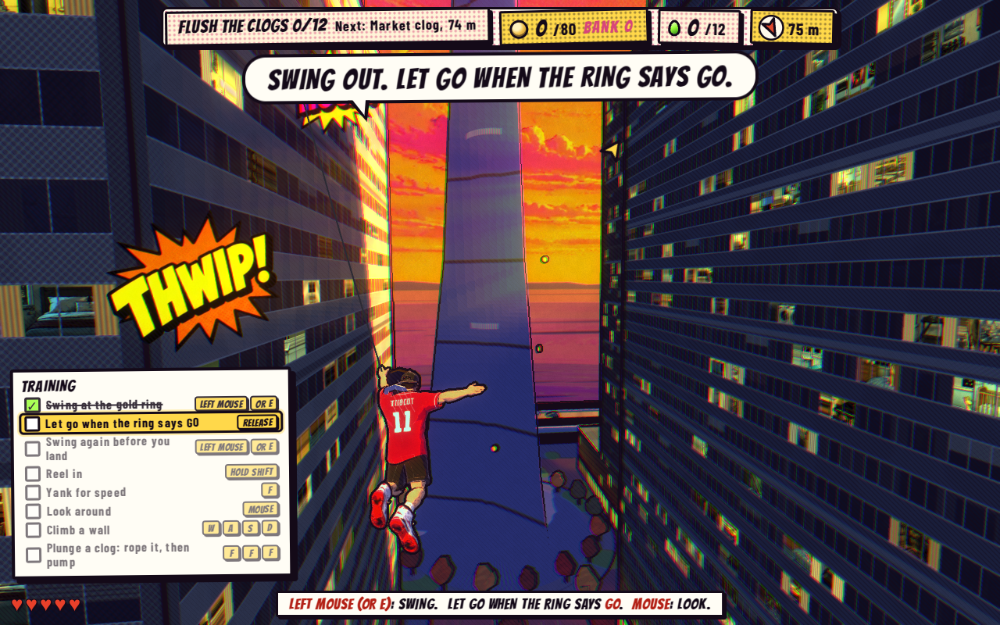

### Round 22 — 2026-10-21 — rubric v1

- What changed: The tenth flush starts a rooftop brawl. The card says ROOF CREW and names the wave. The ninth flush stays on the clog card. After the fight, the eleventh flush is the clog card again. The King still sleeps. He still roars only at the fourth and the eighth, and he still wakes at twelve. The balloon, the pizza, and the 36 second washer are unchanged.
- Why it helped: After the washer, three flushes in a row were the same pump before the King. Spider-Man 2 breaks a repeated objective before it runs into a boss. A 1280×800 play flushed through eleven clogs. Nine read FLUSH THE CLOGS 9/12. Ten read ROOF CREW, ROOFTOP BRAWL, Wave 1 of 2. Eleven read FLUSH THE CLOGS 11/12, and the King was still asleep.
- Screenshots: `docs/gauntlet/fullswing-r22/roof.png`.
- Next target: performance stability (6), the lowest playability score. This machine has no real GPU to time, so that score is not the next implementation round. Sound design (7) was not listened to and is not the next implementation round either.

| Dimension | Score | Why |
| --- | ---: | --- |
| Lighting | 5 | Held. Golden-hour sun and ink shadows. |
| Color palette | 6 | Held. Yellow, red and sludge green still separate the HUD from the blocks. |
| Detail density | 4 | Held. Open blocks more than a dressed borough. |
| Texture and material quality | 3 | Held. Flat fills. |
| Composition and camera | 4 | Held. The chase camera still sits behind the hero. This frame is the card. |
| Atmosphere | 5 | Held. The dusk skyline has a mood. The street under the card does not. |
| Character models | 3 | Held. Simple comic figures. |
| Animation smoothness | 4 | Scored from still frames in software GL. Continuous motion was not watched. |
| Particles and VFX | 5 | Held. No new effect. The card is the change. |
| UI polish | 6 | Held. The same ink pill names the fight. |
| Responsiveness and input latency | 8 | Held. The clog card still rewrites its metres every frame. |
| Controls feel | 9 | Held. The first web still hangs from a building at the real rope length. |
| Mission clarity | 8 | Held. The compass still names the district on the clog card. The fight card names the wave. |
| Pacing | 8 | The tenth flush is a roof fight, so nine and eleven are single pumps before the King. Eight of the twelve are still the same pump, so this is not a new point against Spider-Man 2. |
| Fun factor | 8 | Held. A win still hops the hero. This round changes the job before the King, not the finish. |
| Difficulty curve | 8 | Held. The eighth flush still counts from 36 s. An odd-job washer still has the minute. |
| Feedback | 8 | Held. A chase that is pulling away still turns the card hot. |
| Sound design | 7 | Held. Not listened to. |
| Variety | 8 | Held. The brawl was already Mission 4. This round places that fight inside the clog run. |
| Performance stability | 6 | The 1280×800 play passed with no page errors. Frame time on a real GPU was not measured. |

- Aesthetics raw: 45 / 10 dimensions, index 45
- Playability raw: 78 / 10 dimensions, index 78
- Total: 123 / 200
- Delta vs last round: 0 (round 21 was 123). The tenth flush breaks the three pumps before the King, and eight clogs are still the same pump, so pacing stays at 8.

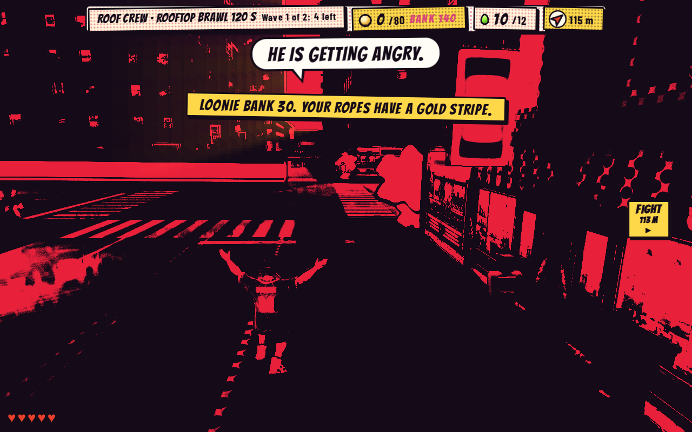

### Round 23 — 2026-10-21 — rubric v1

- What changed: The second flush starts a falling rescue. The card says OVER THE EDGE. The fifth flush starts a purse chase. The card says PURSE RUN. The seventh flush starts a mugging. The card says THE ALLEY. The first, third, ninth, and eleventh flushes stay on the clog card. The balloon, the pizza, the 36 second washer, and the roof fight are unchanged. The King still sleeps. He still roars only at the fourth and the eighth, and he still wakes at twelve. The fall rate is unchanged.
- Why it helped: Eight of the twelve flushes were the same pump. Spider-Man 2 does not leave a repeated objective as most of the chapter. A 1280×800 play flushed through eleven clogs. One read FLUSH THE CLOGS 1/12. Two read OVER THE EDGE, CATCH!, and the King was still asleep. After the rescue the card was FLUSH THE CLOGS 2/12. Three read FLUSH THE CLOGS 3/12. Five read PURSE RUN, STOP, THIEF!. Seven read THE ALLEY, MUGGING. Nine and eleven were the clog card again, and the King was still asleep. The eighth flush still counted from 36 s.
- Screenshots: `docs/gauntlet/fullswing-r23/edge.png`.
- Next target: performance stability (6), the lowest playability score. This machine has no real GPU to time, so that score is not the next implementation round. Sound design (7) was not listened to and is not the next implementation round either.

| Dimension | Score | Why |
| --- | ---: | --- |
| Lighting | 5 | Held. Golden-hour sun and ink shadows. |
| Color palette | 6 | Held. Yellow, red and sludge green still separate the HUD from the blocks. |
| Detail density | 4 | Held. Open blocks more than a dressed borough. |
| Texture and material quality | 3 | Held. Flat fills. |
| Composition and camera | 4 | Held. The chase camera still sits behind the hero. This frame is the card. |
| Atmosphere | 5 | Held. The dusk skyline has a mood. The street under the card does not. |
| Character models | 3 | Held. Simple comic figures. |
| Animation smoothness | 4 | Scored from still frames in software GL. Continuous motion was not watched. |
| Particles and VFX | 5 | Held. No new effect. The card is the change. |
| UI polish | 6 | Held. The same ink pill names the rescue. |
| Responsiveness and input latency | 8 | Held. The clog card still rewrites its metres every frame. |
| Controls feel | 9 | Held. The first web still hangs from a building at the real rope length. |
| Mission clarity | 8 | Held. The compass still names the district on the clog card. The rescue card names the edge. |
| Pacing | 9 | Seven of the twelve flushes are a different job, and the clog pump never runs three times in a row. Five flushes are still the same pump. |
| Fun factor | 8 | Held. A win still hops the hero. This round changes which jobs interrupt the clogs, not the finish. |
| Difficulty curve | 8 | Held. The eighth flush still counts from 36 s. The rescue still falls at the same rate. |
| Feedback | 8 | Held. A chase that is pulling away still turns the card hot. |
| Sound design | 7 | Held. Not listened to. |
| Variety | 8 | Held. The rescue, the chase, and the mugging were already in the city. This round places them in the clog run. |
| Performance stability | 6 | The 1280×800 play passed with no page errors. Frame time on a real GPU was not measured. |

- Aesthetics raw: 45 / 10 dimensions, index 45
- Playability raw: 79 / 10 dimensions, index 79
- Total: 124 / 200
- Delta vs last round: +1 (round 22 was 123). Pacing 8 → 9. Every other score held.

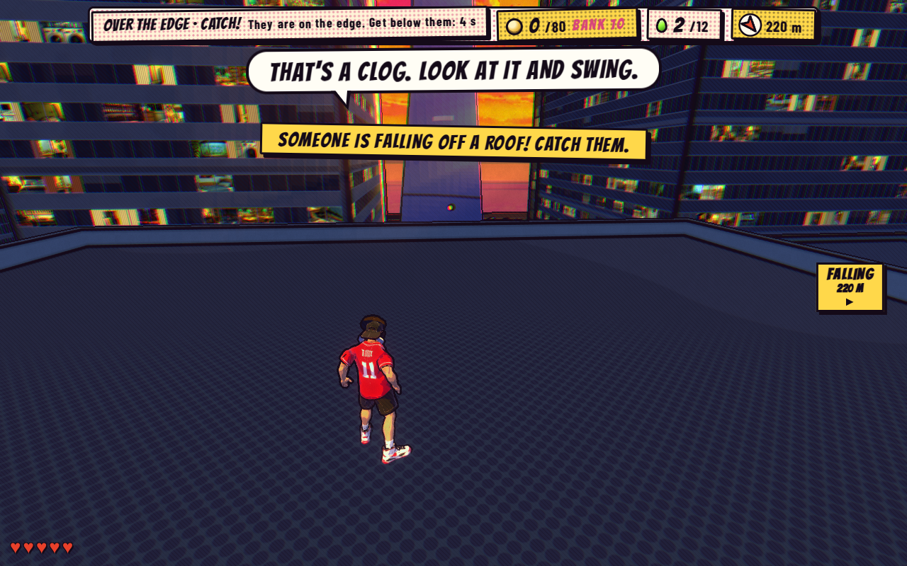

### Round 24 — 2026-10-21 — rubric v1

- What changed: While the King is awake, the card says FLUSH THE KING and names the nearest pipe that is still on him, with the distance in metres. That distance drops on the next frames when the hero moves toward the pipe. The compass title is The King's pipe and it points at that same pipe. A clog still in the city does not take the compass.
- Why it helped: The King card said to rope his pipes and did not say which one or how far, and the compass still hunted a clog. Spider-Man 2 points at the thing the mission just asked for. A 1280×800 play woke him. The card read FLUSH THE KING 0/3 and Next pipe. The compass title was The King's pipe, on a pipe that was still on him. Moving toward it dropped the metres by more than 8 within three frames. He was awake. The clogs were still in the city and did not take the compass.
- Screenshots: `docs/gauntlet/fullswing-r24/pipe.png`.
- Next target: performance stability (6), the lowest playability score. This machine has no real GPU to time, so that score is not the next implementation round. Sound design (7) was not listened to and is not the next implementation round either.

| Dimension | Score | Why |
| --- | ---: | --- |
| Lighting | 5 | Held. Golden-hour sun and ink shadows. |
| Color palette | 6 | Held. Yellow, red and sludge green still separate the HUD from the blocks. |
| Detail density | 4 | Held. Open blocks more than a dressed borough. |
| Texture and material quality | 3 | Held. Flat fills. |
| Composition and camera | 4 | Held. The chase camera still sits behind the hero. This frame is the card. |
| Atmosphere | 5 | Held. The dusk skyline has a mood. The street under the card does not. |
| Character models | 3 | Held. Simple comic figures. |
| Animation smoothness | 4 | Scored from still frames in software GL. Continuous motion was not watched. |
| Particles and VFX | 5 | Held. No new effect. The card is the change. |
| UI polish | 6 | Held. The same ink pill names the pipe. |
| Responsiveness and input latency | 8 | Held. The clog card still rewrites its metres every frame. The King card now does the same. |
| Controls feel | 9 | Held. The first web still hangs from a building at the real rope length. |
| Mission clarity | 9 | The card said FLUSH THE KING 0/3 and Next pipe, and the compass was The King's pipe. The metres dropped by more than 8 within three frames. The three pipes are still one marker. |
| Pacing | 9 | Held. Seven of the twelve flushes are a different job, and the clog pump never runs three times in a row. |
| Fun factor | 8 | Held. A win still hops the hero. This round changes where the King card points, not the finish. |
| Difficulty curve | 8 | Held. The eighth flush still counts from 36 s. The rescue still falls at the same rate. |
| Feedback | 8 | Held. A chase that is pulling away still turns the card hot. |
| Sound design | 7 | Held. Not listened to. |
| Variety | 8 | Held. The rescue, the chase, and the mugging are in the clog run. The King fight is the same three pipes. |
| Performance stability | 6 | The 1280×800 play passed with no page errors. Frame time on a real GPU was not measured. |

- Aesthetics raw: 45 / 10 dimensions, index 45
- Playability raw: 80 / 10 dimensions, index 80
- Total: 125 / 200
- Delta vs last round: +1 (round 23 was 124). Mission clarity 8 → 9. Every other score held.

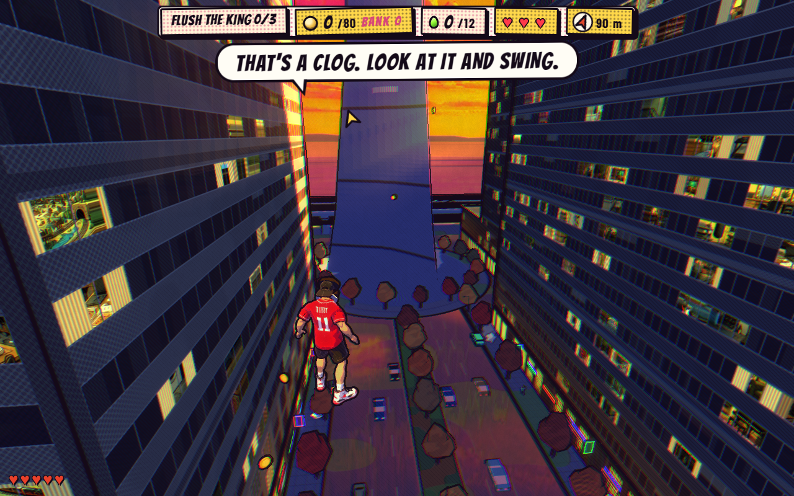

### Round 25 — 2026-10-21 — rubric v1

- What changed: A job that carries a mission name plays a short brass stab when it starts. A job with no mission name, a crime, and a trial still play the one-second countdown. The first flush plays neither. The second flush, the falling rescue, plays the stab.
- Why it helped: A clog beat took the card with the same countdown a trial uses, a full second of blips. Spider-Man 2 marks a mission change with a short sting. A rendered stab measured 0.051 in the first third of a second and 0.00005 after four fifths. The countdown was still at 0.024 then. A 1280×800 play flushed one clog with neither cue, then the second flush read OVER THE EDGE, CATCH!, and played the stab. An odd-job pizza still played the countdown. A speaker was not used.
- Screenshots: `docs/gauntlet/fullswing-r25/stab.png`.
- Next target: performance stability (6), the lowest playability score. This machine has no real GPU to time, so that score is not the next implementation round.

| Dimension | Score | Why |
| --- | ---: | --- |
| Lighting | 5 | Held. Golden-hour sun and ink shadows. |
| Color palette | 6 | Held. Yellow, red and sludge green still separate the HUD from the blocks. |
| Detail density | 4 | Held. Open blocks more than a dressed borough. |
| Texture and material quality | 3 | Held. Flat fills. |
| Composition and camera | 4 | Held. The chase camera still sits behind the hero. This frame is the card. |
| Atmosphere | 5 | Held. The dusk skyline has a mood. The street under the card does not. |
| Character models | 3 | Held. Simple comic figures. |
| Animation smoothness | 4 | Scored from still frames in software GL. Continuous motion was not watched. |
| Particles and VFX | 5 | Held. No new effect. The card is the change on screen. |
| UI polish | 6 | Held. The same ink pill names the rescue. |
| Responsiveness and input latency | 8 | Held. The clog card still rewrites its metres every frame. |
| Controls feel | 9 | Held. The first web still hangs from a building at the real rope length. |
| Mission clarity | 9 | Held. The King card still names the nearest pipe, and the compass still says The King's pipe. |
| Pacing | 9 | Held. Seven of the twelve flushes are a different job, and the clog pump never runs three times in a row. |
| Fun factor | 8 | Held. A win still hops the hero. This round changes the cue when a mission starts. |
| Difficulty curve | 8 | Held. The eighth flush still counts from 36 s. The rescue still falls at the same rate. |
| Feedback | 8 | Held. A chase that is pulling away still turns the card hot. |
| Sound design | 8 | The stab measured 0.051 in the first third of a second and 0.00005 after four fifths, while the trial countdown was still at 0.024. The second flush played the stab. An odd job still played the countdown. A speaker was not used. Every win is still the same fanfare. |
| Variety | 8 | Held. The rescue, the chase, and the mugging are in the clog run. This round changes the cue, not the jobs. |
| Performance stability | 6 | The 1280×800 play passed with no page errors. Frame time on a real GPU was not measured. |

- Aesthetics raw: 45 / 10 dimensions, index 45
- Playability raw: 81 / 10 dimensions, index 81
- Total: 126 / 200
- Delta vs last round: +1 (round 24 was 125). Sound design 7 → 8. Every other score held.

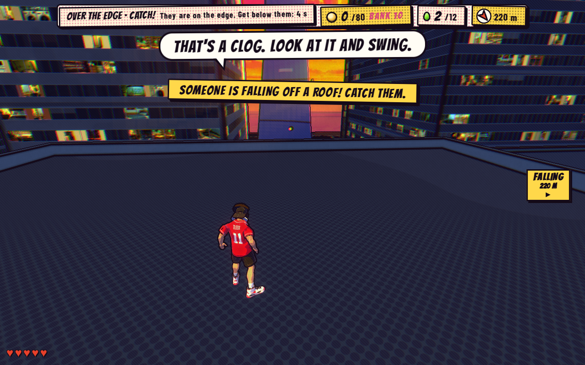

### Round 26 — 2026-10-21 — rubric v1

- What changed: A won flush plays a wet sting, a won fight plays a hit, a won chase or delivery plays a dash, and a won rescue plays a lift. A won job does not play the ring-trial fanfare. A finished ring trial still does. A miss plays none of the win stings. The cheer, the comic word, and the hop stay.
- Why it helped: Every won job played the same brass fanfare a finished ring trial plays. Spider-Man 2 marks a finished mission with a sting that fits it. A rendered flush, fight, dash and lift measured 0.030, 0.030, 0.025 and 0.046 in the first half-second, and under 0.0002 after eight tenths. The ring fanfare was still at 0.072 then. The closest two stings matched at 0.055. A 1280×800 play won the purse snatcher on GOT IT, Stop, Thief! done, and played the dash. The rescue played the lift, the roof fight played the hit, and the Sludge Run played the wet sting. A miss played the low sting and none of those. A speaker was not used.
- Screenshots: `docs/gauntlet/fullswing-r26/got.png`.
- Next target: performance stability (6), the lowest playability score. This machine has no real GPU to time, so that score is not the next implementation round.

| Dimension | Score | Why |
| --- | ---: | --- |
| Lighting | 5 | Held. Golden-hour sun and ink shadows. |
| Color palette | 6 | Held. Yellow, red and sludge green still separate the HUD from the blocks. |
| Detail density | 4 | Held. Open blocks more than a dressed borough. |
| Texture and material quality | 3 | Held. Flat fills. |
| Composition and camera | 4 | Held. The chase camera still sits behind the hero. This frame is the win card. |
| Atmosphere | 5 | Held. The dusk skyline has a mood. The street under the card does not. |
| Character models | 3 | Held. Simple comic figures. |
| Animation smoothness | 4 | Scored from still frames in software GL. Continuous motion was not watched. |
| Particles and VFX | 5 | Held. No new effect. The card is the change on screen. |
| UI polish | 6 | Held. The same ink pill says GOT IT. |
| Responsiveness and input latency | 8 | Held. The clog card still rewrites its metres every frame. |
| Controls feel | 9 | Held. The first web still hangs from a building at the real rope length. |
| Mission clarity | 9 | Held. The King card still names the nearest pipe, and the compass still says The King's pipe. |
| Pacing | 9 | Held. Seven of the twelve flushes are a different job, and the clog pump never runs three times in a row. |
| Fun factor | 8 | Held. A win still hops the hero. This round changes the sting, not the hop. |
| Difficulty curve | 8 | Held. The eighth flush still counts from 36 s. The rescue still falls at the same rate. |
| Feedback | 8 | Held. A chase that is pulling away still turns the card hot. |
| Sound design | 9 | A flush, a fight, a dash and a lift measured 0.030, 0.030, 0.025 and 0.046 in the first half-second, and under 0.0002 after eight tenths, while the ring fanfare was still at 0.072. The closest two matched at 0.055. The purse snatcher played the dash, the rescue the lift, the roof fight the hit, and the Sludge Run the wet sting. A miss played none of them. A speaker was not used. |
| Variety | 8 | Held. The rescue, the chase, and the mugging are in the clog run. This round changes the sting, not the jobs. |
| Performance stability | 6 | The 1280×800 play passed with no page errors. Frame time on a real GPU was not measured. |

- Aesthetics raw: 45 / 10 dimensions, index 45
- Playability raw: 82 / 10 dimensions, index 82
- Total: 127 / 200
- Delta vs last round: +1 (round 25 was 126). Sound design 8 → 9. Every other score held.

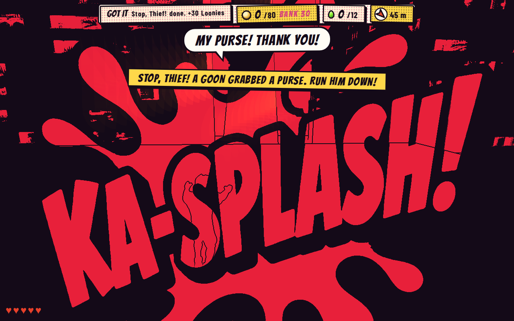

### Round 27 — 2026-10-21 — rubric v1

- What changed: The ninth flush starts a getaway car to rope. The card names STOP THAT CAR and does not say to flush the clogs. The King still sleeps. Stopping the car brings the clog card back at 9/12. The tenth flush is still the roof fight. The first, the third, and the eleventh stay clogs.
- Why it helped: The ninth flush was another clog, the same pump as the first and the third, just before the roof fight. Spider-Man 2 puts a different activity in front of a finale. A 1280×800 play read STOP THAT CAR, GETAWAY CAR, rope the car to stop it, 92 m, on a 38 s clock. The King was still asleep. Stopping the car returned FLUSH THE CLOGS 9/12, and the tenth flush was still the roof fight.
- Screenshots: `docs/gauntlet/fullswing-r27/car.png`.
- Next target: performance stability (6), the lowest playability score. This machine has no real GPU to time, so that score is not the next implementation round.

| Dimension | Score | Why |
| --- | ---: | --- |
| Lighting | 5 | Held. Golden-hour sun and ink shadows. |
| Color palette | 6 | Held. Yellow, red and sludge green still separate the HUD from the blocks. |
| Detail density | 4 | Held. Open blocks more than a dressed borough. |
| Texture and material quality | 3 | Held. Flat fills. |
| Composition and camera | 4 | Held. The chase camera still sits behind the hero. This frame is the car card. |
| Atmosphere | 5 | Held. The dusk skyline has a mood. The street under the card does not. |
| Character models | 3 | Held. Simple comic figures. |
| Animation smoothness | 4 | Scored from still frames in software GL. Continuous motion was not watched. |
| Particles and VFX | 5 | Held. No new effect. The card is the change on screen. |
| UI polish | 6 | Held. The same ink pill names the car. |
| Responsiveness and input latency | 8 | Held. The clog card still rewrites its metres every frame. |
| Controls feel | 9 | Held. The first web still hangs from a building at the real rope length. |
| Mission clarity | 9 | Held. The King card still names the nearest pipe, and the compass still says The King's pipe. |
| Pacing | 9 | Held. Eight of the twelve flushes are a different job, and the clog pump never runs three times in a row. Three flushes are still the same clog. |
| Fun factor | 8 | Held. A win still hops the hero. This round changes the ninth flush, not the hop. |
| Difficulty curve | 8 | Held. The eighth flush still counts from 36 s. The rescue still falls at the same rate. |
| Feedback | 8 | Held. A chase that is pulling away still turns the card hot. |
| Sound design | 9 | Held. A flush, a fight, a dash and a lift are still different stings, and the ring fanfare is still the trial. |
| Variety | 9 | The ninth flush read STOP THAT CAR, rope the car, 92 m. The rescue, the chase, the mugging and the roof fight are still in the run, and this one is a car none of them ask for. Three flushes are still the same clog. |
| Performance stability | 6 | The 1280×800 play passed with no page errors. Frame time on a real GPU was not measured. |

- Aesthetics raw: 45 / 10 dimensions, index 45
- Playability raw: 83 / 10 dimensions, index 83
- Total: 128 / 200
- Delta vs last round: +1 (round 26 was 127). Variety 8 → 9. Every other score held.

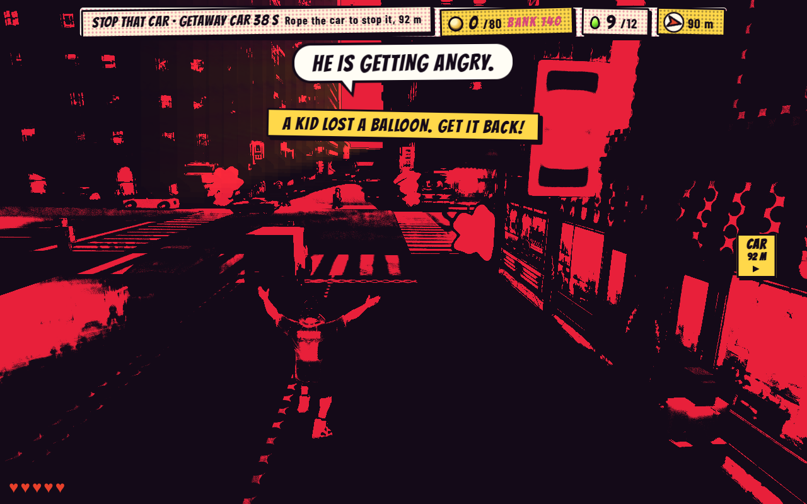

### Round 28 — 2026-10-21 — rubric v1

- What changed: A job whose opening clock is at least 12 seconds turns the card hot once 8 seconds remain, or a quarter of that opening, whichever is less. Putting time back above that line brings the ink pill back. A falling person, and a free balloon at or above 140 m, use that same card. A 3.5 second edge and a 1.2 second slip do not heat from the clock. A won job stays the ink pill. Pulling away still heats the card.
- Why it helped: A clock about to run out looked like any other card. Spider-Man 2 uses one urgent treatment when the objective is getting away. A 1280×800 play left the two-minute roof fight on the ink pill, turned it hot at 7 seconds (warm fill rgb(255, 214, 196), magenta edge rgb(216, 69, 122)), and brought the ink pill back at 30 seconds. The win card stayed GOT IT on the ink pill. A balloon under 140 m stayed ink and one at 140 m turned hot. The edge wait stayed ink, and a falling person turned the card hot. Closing a chase that is pulling away still brings the ink pill back.
- Screenshots: `docs/gauntlet/fullswing-r28/hot.png`.
- Next target: performance stability (6), the lowest playability score. This machine has no real GPU to time, so that score is not the next implementation round.

| Dimension | Score | Why |
| --- | ---: | --- |
| Lighting | 5 | Held. Golden-hour sun and ink shadows. |
| Color palette | 6 | Held. Yellow, red and sludge green still separate the HUD from the blocks. |
| Detail density | 4 | Held. Open blocks more than a dressed borough. |
| Texture and material quality | 3 | Held. Flat fills. |
| Composition and camera | 4 | Held. The chase camera still sits behind the hero. This frame is the hot clock. |
| Atmosphere | 5 | Held. The dusk skyline has a mood. The street under the card does not. |
| Character models | 3 | Held. Simple comic figures. |
| Animation smoothness | 4 | Scored from still frames in software GL. Continuous motion was not watched. |
| Particles and VFX | 5 | Held. No new effect. The card is the change on screen. |
| UI polish | 6 | Held. The hot pill is the one a chase already uses. |
| Responsiveness and input latency | 8 | Held. The clog card still rewrites its metres every frame. |
| Controls feel | 9 | Held. The first web still hangs from a building at the real rope length. |
| Mission clarity | 9 | Held. The King card still names the nearest pipe, and the compass still says The King's pipe. |
| Pacing | 9 | Held. Eight of the twelve flushes are a different job, and the clog pump never runs three times in a row. Three flushes are still the same clog. |
| Fun factor | 8 | Held. A win still hops the hero. This round changes the card, not the hop. |
| Difficulty curve | 8 | Held. The eighth flush still counts from 36 s. The rescue still falls at the same rate. |
| Feedback | 9 | Seven seconds left on the roof fight turned the card hot, warm fill rgb(255, 214, 196) and magenta edge rgb(216, 69, 122). Thirty seconds brought the ink pill back. A falling person and a balloon at 140 m used that same card. A win stayed on the ink pill. |
| Sound design | 9 | Held. A flush, a fight, a dash and a lift are still different stings, and the ring fanfare is still the trial. |
| Variety | 9 | Held. The ninth flush is still the getaway car. This round changes the card, not the jobs. |
| Performance stability | 6 | The 1280×800 play passed with no page errors. Frame time on a real GPU was not measured. |

- Aesthetics raw: 45 / 10 dimensions, index 45
- Playability raw: 84 / 10 dimensions, index 84
- Total: 129 / 200
- Delta vs last round: +1 (round 27 was 128). Feedback 8 → 9. Every other score held.

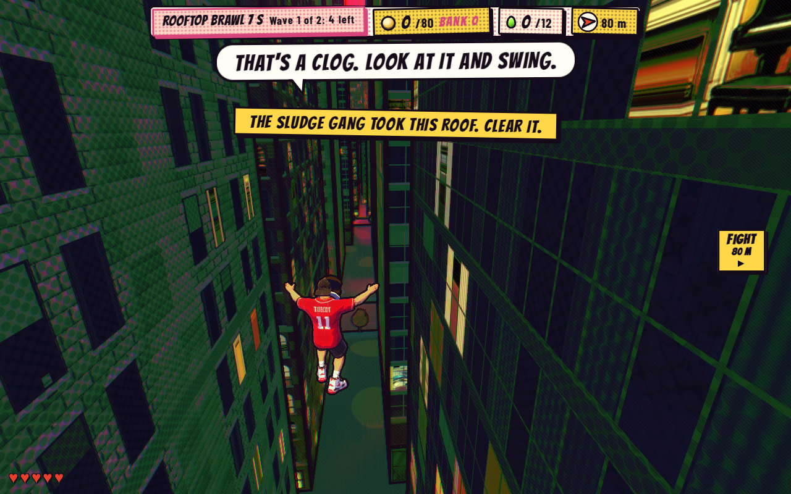

### Round 29 — 2026-10-21 — rubric v1

- What changed: A roof fight, a getaway, a sludge tanker, and the Sludge Run launch the hero at 14 m/s, hold the slow moment for 0.9 s, and keep the card up for 1.9 s. A chase, a rescue, and a delivery stay at 8 m/s, 0.55 s, and 1.35 s. Reduced motion still does not launch. A miss still does not. The comic word and the sting stay as they are.
- Why it helped: Every win hopped the same height, so a roof fight ended like a pizza delivery. Spider-Man 2 makes a set-piece finish bigger than an errand. A 1280×800 play caught the purse snatcher at 8 m/s with the card under 1.5 s, and cleared the roof fight at 14 m/s with the card past 1.7 s. After the same 18 frames the roof fight was more than a metre higher, and its slow moment was longer. The word was still KASPLASH.
- Screenshots: `docs/gauntlet/fullswing-r29/hop.png`.
- Next target: performance stability (6), the lowest playability score. This machine has no real GPU to time, so that score is not the next implementation round.

| Dimension | Score | Why |
| --- | ---: | --- |
| Lighting | 5 | Held. Golden-hour sun and ink shadows. |
| Color palette | 6 | Held. Yellow, red and sludge green still separate the HUD from the blocks. |
| Detail density | 4 | Held. Open blocks more than a dressed borough. |
| Texture and material quality | 3 | Held. Flat fills. |
| Composition and camera | 4 | Held. The chase camera still sits behind the hero. This frame is the higher hop. |
| Atmosphere | 5 | Held. The dusk skyline has a mood. The street under the card does not. |
| Character models | 3 | Held. Simple comic figures. |
| Animation smoothness | 4 | Scored from still frames in software GL. Continuous motion was not watched. |
| Particles and VFX | 5 | Held. No new effect. The hop is the change. |
| UI polish | 6 | Held. The win card is still GOT IT. |
| Responsiveness and input latency | 8 | Held. The clog card still rewrites its metres every frame. |
| Controls feel | 9 | Held. The first web still hangs from a building at the real rope length. |
| Mission clarity | 9 | Held. The King card still names the nearest pipe, and the compass still says The King's pipe. |
| Pacing | 9 | Held. Eight of the twelve flushes are a different job, and the clog pump never runs three times in a row. Three flushes are still the same clog. |
| Fun factor | 9 | The roof fight launched at 14 m/s and the card stayed past 1.7 s. The purse snatcher stayed at 8 m/s and under 1.5 s. After the same 18 frames the roof fight was more than a metre higher. |
| Difficulty curve | 8 | Held. The eighth flush still counts from 36 s. The rescue still falls at the same rate. |
| Feedback | 9 | Held. Seven seconds left still turns the card hot, and time put back still brings the ink pill. |
| Sound design | 9 | Held. A flush, a fight, a dash and a lift are still different stings, and the ring fanfare is still the trial. |
| Variety | 9 | Held. The ninth flush is still the getaway car. This round changes the hop, not the jobs. |
| Performance stability | 6 | The 1280×800 play passed with no page errors. Frame time on a real GPU was not measured. |

- Aesthetics raw: 45 / 10 dimensions, index 45
- Playability raw: 85 / 10 dimensions, index 85
- Total: 130 / 200
- Delta vs last round: +1 (round 28 was 129). Fun factor 8 → 9. Every other score held.

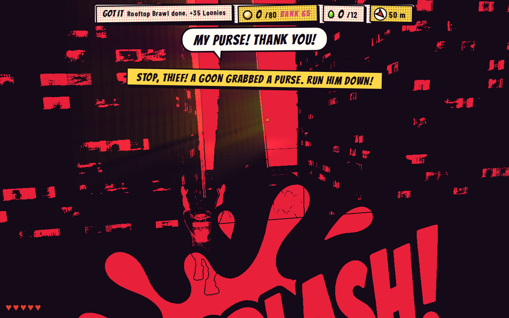

### Round 30 — 2026-10-21 — rubric v1

- What changed: A getaway started as a mission cruises at 24 m/s, and its clock is the length of the road at that pace plus the same 8 seconds of spare. An odd-job getaway stays at 17 m/s. The card still names STOP THAT CAR. The King still sleeps. The eighth flush still counts from 36 s, and the rescue still falls at the same rate.
- Why it helped: The car before the roof fight drove at the same speed as a fare across town. Spider-Man 2 makes the chase in front of a finale pull away harder. A 1280×800 play read an odd-job getaway at 17 m/s, then STOP THAT CAR at 24 m/s, with the card saying to rope the car. On one shared road the faster car had less time on the clock.
- Screenshots: `docs/gauntlet/fullswing-r30/car.png`.
- Next target: performance stability (6), the lowest playability score. This machine has no real GPU to time, so that score is not the next implementation round.

| Dimension | Score | Why |
| --- | ---: | --- |
| Lighting | 5 | Held. Golden-hour sun and ink shadows. |
| Color palette | 6 | Held. Yellow, red and sludge green still separate the HUD from the blocks. |
| Detail density | 4 | Held. Open blocks more than a dressed borough. |
| Texture and material quality | 3 | Held. Flat fills. |
| Composition and camera | 4 | Held. The chase camera still sits behind the hero. This frame is the faster car. |
| Atmosphere | 5 | Held. The dusk skyline has a mood. The street under the card does not. |
| Character models | 3 | Held. Simple comic figures. |
| Animation smoothness | 4 | Scored from still frames in software GL. Continuous motion was not watched. |
| Particles and VFX | 5 | Held. No new effect. The car is the change. |
| UI polish | 6 | Held. The card still names the car in the ink pill. |
| Responsiveness and input latency | 8 | Held. The clog card still rewrites its metres every frame. |
| Controls feel | 9 | Held. The first web still hangs from a building at the real rope length. |
| Mission clarity | 9 | Held. The King card still names the nearest pipe, and the compass still says The King's pipe. |
| Pacing | 9 | Held. Eight of the twelve flushes are a different job, and the clog pump never runs three times in a row. Three flushes are still the same clog. |
| Fun factor | 9 | Held. The roof fight still launches at 14 m/s and a chase still launches at 8. |
| Difficulty curve | 9 | The ninth-flush car cruises at 24 m/s. An odd-job getaway stays at 17 m/s, and the same road gives the faster car less time. The eighth flush still counts from 36 s, and the rescue still falls at the same rate. |
| Feedback | 9 | Held. Seven seconds left still turns the card hot, and time put back still brings the ink pill. |
| Sound design | 9 | Held. A flush, a fight, a dash and a lift are still different stings, and the ring fanfare is still the trial. |
| Variety | 9 | Held. The ninth flush is still the getaway car. This round changes its pace, not the job. |
| Performance stability | 6 | The 1280×800 play passed with no page errors. Frame time on a real GPU was not measured. |

- Aesthetics raw: 45 / 10 dimensions, index 45
- Playability raw: 86 / 10 dimensions, index 86
- Total: 131 / 200
- Delta vs last round: +1 (round 29 was 130). Difficulty curve 8 → 9. Every other score held.

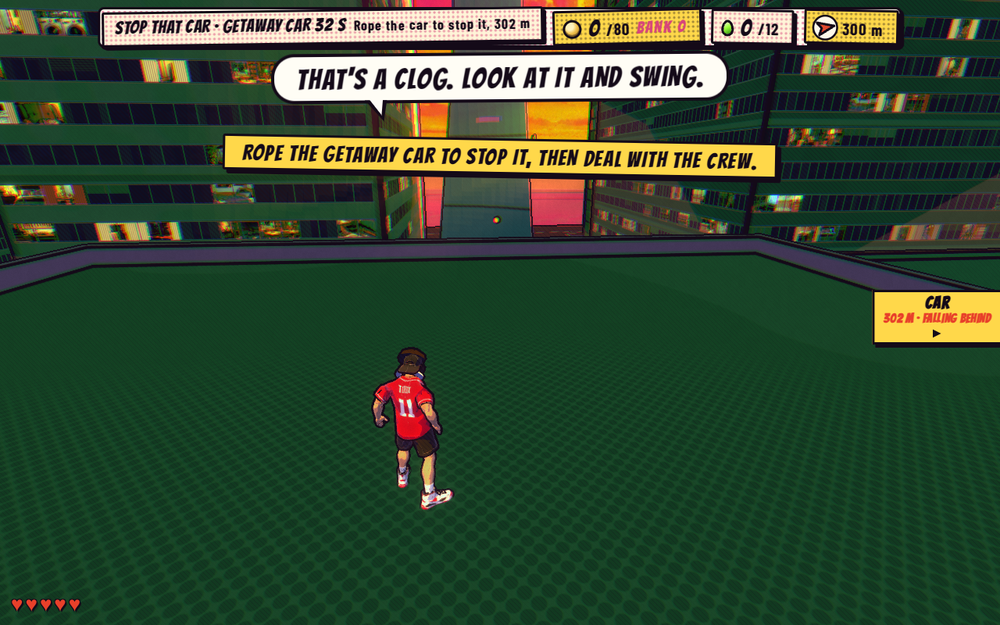

### Round 31 — 2026-10-21 — rubric v1

- What changed: The score-row card is painted again after the objective is written. A clock, the hot card, and a clog's metres are the ones from that frame. The HUD still reads input at the start of the frame.
- Why it helped: The pill was a frame behind the objective. One step after a fight clock was set to 7 seconds, the pill still said ROOFTOP BRAWL 120 s and stayed ink, while the objective already said 7 s and was hot. Spider-Man 2 shows the objective on the frame it changes. A 1280×800 play stepped once toward a clog and the metres on the pill dropped in that frame, then set the fight to 7 seconds and that same frame painted 7 s with the hot card.
- Screenshots: `docs/gauntlet/fullswing-r31/now.png`.
- Next target: a new mission type, then more than one way for the King to fight. Performance stability stays at 6. This machine has no real GPU to time, so that score is not the next implementation round.

| Dimension | Score | Why |
| --- | ---: | --- |
| Lighting | 5 | Held. Golden-hour sun and ink shadows. |
| Color palette | 6 | Held. Yellow, red and sludge green still separate the HUD from the blocks. |
| Detail density | 4 | Held. Open blocks more than a dressed borough. |
| Texture and material quality | 3 | Held. Flat fills. |
| Composition and camera | 4 | Held. The chase camera still sits behind the hero. This frame is the hot card. |
| Atmosphere | 5 | Held. The dusk skyline has a mood. The street under the card does not. |
| Character models | 3 | Held. Simple comic figures. |
| Animation smoothness | 4 | Scored from still frames in software GL. Continuous motion was not watched. |
| Particles and VFX | 5 | Held. No new effect. The card is the change. |
| UI polish | 6 | Held. The hot card is still the warm fill with the magenta edge. |
| Responsiveness and input latency | 9 | One frame after the clock dropped to 7 s, the pill said 7 s and was the hot card, matching the objective. One step toward a clog shortened the metres on that same pill. Before, that frame still said 120 s. |
| Controls feel | 9 | Held. The first web still hangs from a building at the real rope length. |
| Mission clarity | 9 | Held. The King card still names the nearest pipe, and the compass still says The King's pipe. |
| Pacing | 9 | Held. Eight of the twelve flushes are a different job, and the clog pump never runs three times in a row. Three flushes are still the same clog. |
| Fun factor | 9 | Held. The roof fight still launches at 14 m/s and a chase still launches at 8. |
| Difficulty curve | 9 | Held. The ninth-flush car still cruises at 24 m/s. An odd-job getaway stays at 17 m/s. |
| Feedback | 9 | Held. Seven seconds left still turns the card hot, and it does so on that same frame. |
| Sound design | 9 | Held. A flush, a fight, a dash and a lift are still different stings, and the ring fanfare is still the trial. |
| Variety | 9 | Held. The ninth flush is still the getaway car. This round changes when the card paints, not the jobs. |
| Performance stability | 6 | The 1280×800 play passed with no page errors. Frame time on a real GPU was not measured. |

- Aesthetics raw: 45 / 10 dimensions, index 45
- Playability raw: 87 / 10 dimensions, index 87
- Total: 132 / 200
- Delta vs last round: +1 (round 30 was 131). Responsiveness and input latency 8 → 9. Every other score held.

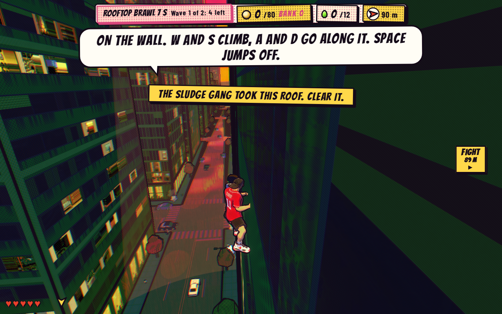

### Round 32 — 2026-10-21 — rubric v1

- What changed: After a pipe comes off, the King still throws, then he stomps the deck, and he keeps alternating. With every pipe on he only throws. On the ground within 28 m the stomp takes a heart. In the air it does not. During the wind-up the card says "He's stomping. Get off the deck".
- Why it helped: The King only threw sludge, so the fight after the first pipe was the same attack again. Spider-Man 2 gives a boss more than one move, and a ground attack you can leave by being in the air. A 1280×800 play watched a throw while every pipe was on, then one pipe came off and the attack after the next throw was a stomp. The card said to get off the deck. On the deck that stomp took a heart. The same stomp in the air took none.
- Screenshots: `docs/gauntlet/fullswing-r32/stomp.png`.
- Next target: a new mission type. Performance stability stays at 6. This machine has no real GPU to time, so that score is not the next implementation round.

| Dimension | Score | Why |
| --- | ---: | --- |
| Lighting | 5 | Held. Golden-hour sun and ink shadows. |
| Color palette | 6 | Held. Yellow, red and sludge green still separate the HUD from the blocks. |
| Detail density | 4 | Held. Open blocks more than a dressed borough. |
| Texture and material quality | 3 | Held. Flat fills. |
| Composition and camera | 4 | Held. The chase camera still sits behind the hero. This frame is the stomp card. |
| Atmosphere | 5 | Held. The dusk skyline has a mood. The street under the card does not. |
| Character models | 3 | Held. Simple comic figures. The King is still the same model. |
| Animation smoothness | 4 | Scored from still frames in software GL. Continuous motion was not watched. |
| Particles and VFX | 5 | Held. The stomp uses the ring and the comic words that were already there. |
| UI polish | 6 | Held. The card is still the ink pill. It names the stomp for that wind-up. |
| Responsiveness and input latency | 9 | Held. One frame after a clock drop, the pill still matches the objective. |
| Controls feel | 9 | Held. The first web still hangs from a building at the real rope length. |
| Mission clarity | 9 | Held. During a stomp the card says to get off the deck. The rest of the time it still names the nearest pipe. |
| Pacing | 9 | Held. Eight of the twelve flushes are a different job, and the clog pump never runs three times in a row. Three flushes are still the same clog. |
| Fun factor | 9 | Held. The roof fight still launches at 14 m/s and a chase still launches at 8. The stomp is a second King attack, and the fight is still those two moves. |
| Difficulty curve | 9 | Held. The ninth-flush car still cruises at 24 m/s. An odd-job getaway stays at 17 m/s. |
| Feedback | 9 | Held. Seven seconds left still turns the card hot on that same frame. |
| Sound design | 9 | Held. A flush, a fight, a dash and a lift are still different stings, and the ring fanfare is still the trial. |
| Variety | 9 | Held. The King now stomps between throws after a pipe is off, and with every pipe on he only throws. Two attacks on one boss is not the spread of a 2023 boss fight, so the score stays. |
| Performance stability | 6 | The 1280×800 play passed with no page errors. Frame time on a real GPU was not measured. |

- Aesthetics raw: 45 / 10 dimensions, index 45
- Playability raw: 87 / 10 dimensions, index 87
- Total: 132 / 200
- Delta vs last round: 0 (round 31 was 132). The stomp is a second King attack. No score moved.

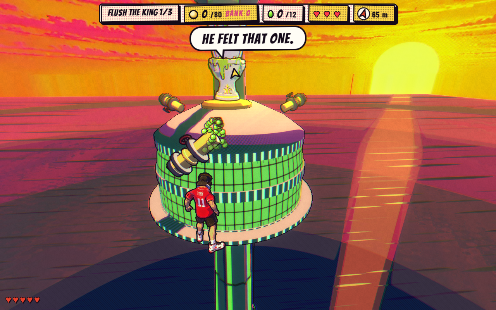

### Round 33 — 2026-10-21 — rubric v1

- What changed: The eleventh flush starts a lid to stand on. Standing on the ground within 4 m fills a 6 s hold. Leaving the circle or the ground slips that hold at twice the rate. Filling it seats the lid. A 24 s clock that runs out pops it. The card says HOLD IT DOWN and SEAT THE LID, and it does not say to flush the clogs. The King still sleeps. After the lid seats, the clog card returns at 11/12. The first and third flushes stay on the clog card.
- Why it helped: The eleventh flush was the same clog card as the first and the third. Spider-Man 2 breaks a repeated objective with a stay-in-place verb before the finale. A 1280×800 play cleared the roof fight and the next card said HOLD IT DOWN · SEAT THE LID, with the line "Stand on the lid." The King was still asleep. Seating it brought FLUSH THE CLOGS at 11/12.
- Screenshots: `docs/gauntlet/fullswing-r33/lid.png`.
- Next target: another King attack, past the throw and the stomp. Performance stability stays at 6. This machine has no real GPU to time, so that score is not the next implementation round.

| Dimension | Score | Why |
| --- | ---: | --- |
| Lighting | 5 | Held. Golden-hour sun and ink shadows. |
| Color palette | 6 | Held. Yellow, red and sludge green still separate the HUD from the blocks. |
| Detail density | 4 | Held. Open blocks more than a dressed borough. |
| Texture and material quality | 3 | Held. Flat fills. |
| Composition and camera | 4 | Held. The chase camera still sits behind the hero. This frame is the lid card. |
| Atmosphere | 5 | Held. The dusk skyline has a mood. The street under the card does not. |
| Character models | 3 | Held. Simple comic figures. |
| Animation smoothness | 4 | Scored from still frames in software GL. Continuous motion was not watched. |
| Particles and VFX | 5 | Held. The lid uses the gold goal beam that was already there. |
| UI polish | 6 | Held. The card is still the ink pill. It names the lid for that flush. |
| Responsiveness and input latency | 9 | Held. One frame after a clock drop, the pill still matches the objective. |
| Controls feel | 9 | Held. The first web still hangs from a building at the real rope length. |
| Mission clarity | 9 | Held. The lid card says to stand on the lid, and it does not say to flush the clogs. |
| Pacing | 9 | Nine of the twelve flushes are a different job. The first and the third are still the clog card, and the pump never runs three times in a row. Nine different jobs is not a 2023 mission list, so the score stays. |
| Fun factor | 9 | Held. The roof fight still launches at 14 m/s and a chase still launches at 8. The eleventh flush is a stay on the ground. |
| Difficulty curve | 9 | Held. The ninth-flush car still cruises at 24 m/s. An odd-job getaway stays at 17 m/s. |
| Feedback | 9 | Held. Seven seconds left still turns the card hot on that same frame. The lid clock is 24 s, so it heats in the last 6 s. |
| Sound design | 9 | Held. A flush, a fight, a dash and a lift are still different stings, and the ring fanfare is still the trial. |
| Variety | 9 | Held. The eleventh flush is a new job, standing on a lid until it seats. One new verb is not a 2023 mission list, so the score stays. |
| Performance stability | 6 | The 1280×800 play passed with no page errors. Frame time on a real GPU was not measured. |

- Aesthetics raw: 45 / 10 dimensions, index 45
- Playability raw: 87 / 10 dimensions, index 87
- Total: 132 / 200
- Delta vs last round: 0 (round 32 was 132). The eleventh flush is a new job. No score moved.

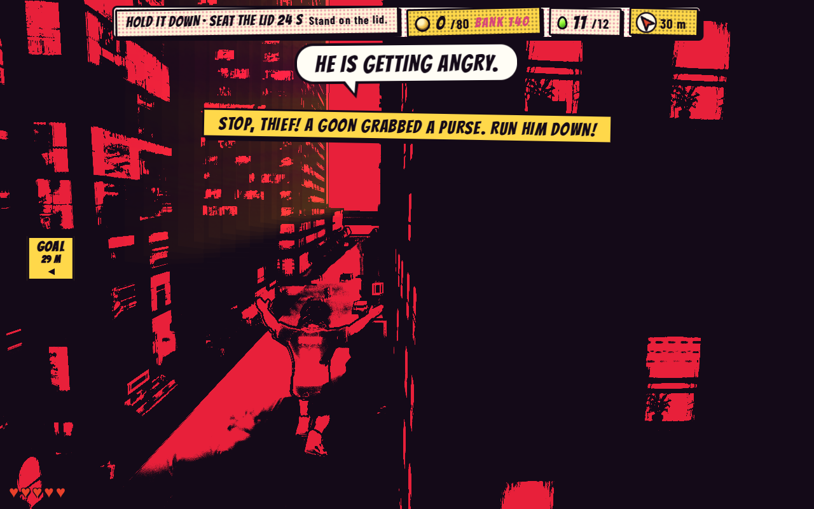

### Round 34 — 2026-10-21 — rubric v1

- What changed: After a pipe comes off, the King throws, then stomps, then pulls, and then throws again. With every pipe on he only throws. During the pull the card says "He's pulling. Shoot a web". In the air with no rope he drags you 14 m toward him. Ending within 16 m takes a heart. Farther out, the drag still happens and the heart stays. On the ground, or with a rope attached, you stay put and lose no heart.
- Why it helped: After the stomp the fight was the same two attacks again. Spider-Man 2 gives a boss a grab you answer by shooting a web. A 1280×800 play watched a throw while every pipe was on, then one pipe came off and the attack after the next throw was still a stomp. The attack after that stomp was a pull, and the card said to shoot a web. In the air with no web, 20 m out, that pull dragged the hero in and took a heart. At 40 m it dragged him and took none. On the deck, and in the air with a rope, he stayed put.
- Screenshots: `docs/gauntlet/fullswing-r34/pull.png`.
- Next target: performance stability (6). This machine has no real GPU to time, so that score is not the next implementation round.

| Dimension | Score | Why |
| --- | ---: | --- |
| Lighting | 5 | Held. Golden-hour sun and ink shadows. |
| Color palette | 6 | Held. Yellow, red and sludge green still separate the HUD from the blocks. |
| Detail density | 4 | Held. Open blocks more than a dressed borough. |
| Texture and material quality | 3 | Held. Flat fills. |
| Composition and camera | 4 | Held. The chase camera still sits behind the hero. This frame is the pull card. |
| Atmosphere | 5 | Held. The dusk skyline has a mood. The street under the card does not. |
| Character models | 3 | Held. Simple comic figures. The King is still the same model. |
| Animation smoothness | 4 | Scored from still frames in software GL. Continuous motion was not watched. |
| Particles and VFX | 5 | Held. The pull uses the ring and the comic words that were already there. |
| UI polish | 6 | Held. The card is still the ink pill. It names the pull for that wind-up. |
| Responsiveness and input latency | 9 | Held. One frame after a clock drop, the pill still matches the objective. |
| Controls feel | 9 | Held. The first web still hangs from a building at the real rope length. A rope that is still attached holds against the pull. |
| Mission clarity | 9 | Held. During a pull the card says to shoot a web. The rest of the time it still names the nearest pipe. |
| Pacing | 9 | Held. Nine of the twelve flushes are a different job. The first and the third are still the clog card, and the pump never runs three times in a row. Nine different jobs is not a 2023 mission list, so the score stays. |
| Fun factor | 9 | Held. The roof fight still launches at 14 m/s and a chase still launches at 8. The King now has a third attack, and the fight is still one boss. |
| Difficulty curve | 9 | Held. The ninth-flush car still cruises at 24 m/s. An odd-job getaway stays at 17 m/s. |
| Feedback | 9 | Held. Seven seconds left still turns the card hot on that same frame. |
| Sound design | 9 | Held. A flush, a fight, a dash and a lift are still different stings, and the ring fanfare is still the trial. |
| Variety | 9 | Held. The King now pulls after a stomp, once a pipe is off, and with every pipe on he only throws. Three attacks on one boss is not the spread of a 2023 boss fight, so the score stays. |
| Performance stability | 6 | The 1280×800 play passed with no page errors. Frame time on a real GPU was not measured. |

- Aesthetics raw: 45 / 10 dimensions, index 45
- Playability raw: 87 / 10 dimensions, index 87
- Total: 132 / 200
- Delta vs last round: 0 (round 33 was 132). The pull is a third King attack. No score moved.

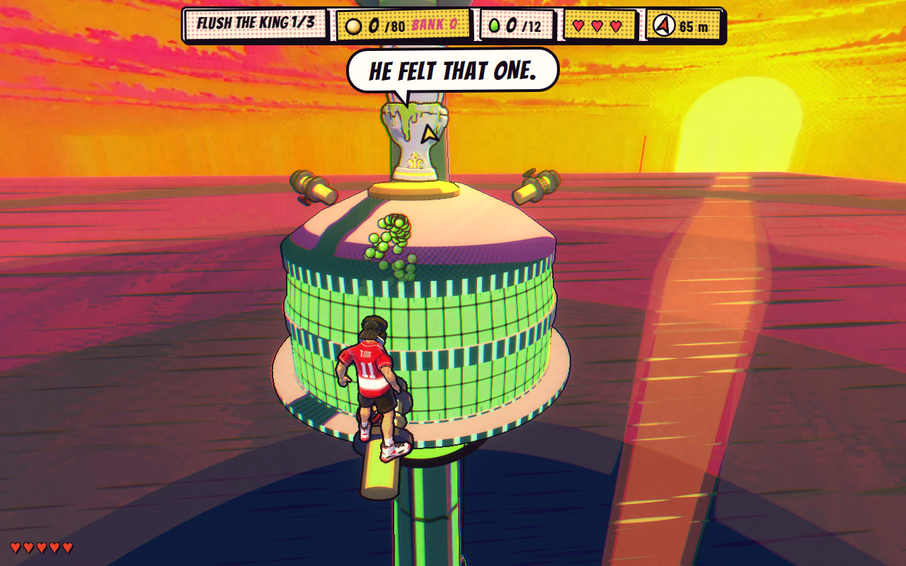

### Round 35 — 2026-10-21 — rubric v1

- What changed: After a pipe comes off, the King throws, then stomps, then pulls, then belches, and then throws again. With every pipe on he only throws. During the belch he paints the spot under the hero, and the card says "He's belching. Leave the spot". The spot does not follow. Still standing on the ground within 8 m of it takes a heart. A step outside that circle, or being in the air, keeps the heart.
- Why it helped: After the pull the fight was the same three attacks again. Spider-Man 2 gives a boss a ground tell you leave before it lands. A 1280×800 play watched a throw while every pipe was on, then one pipe came off and the attacks ran throw, stomp, pull, belch. The belch card said to leave the spot. Standing on it took a heart. Twelve metres out on the deck, and in the air over the spot, it took none.
- Screenshots: `docs/gauntlet/fullswing-r35/belch.png`.
- Next target: another King answer. Performance stability stays at 6. This machine has no real GPU to time, so that score is not the next implementation round.

| Dimension | Score | Why |
| --- | ---: | --- |
| Lighting | 5 | Held. Golden-hour sun and ink shadows. |
| Color palette | 6 | Held. Yellow, red and sludge green still separate the HUD from the blocks. |
| Detail density | 4 | Held. Open blocks more than a dressed borough. |
| Texture and material quality | 3 | Held. Flat fills. |
| Composition and camera | 4 | Held. The chase camera still sits behind the hero, off to his right. This frame is the belch card. |
| Atmosphere | 5 | Held. The dusk skyline has a mood. The street under the card does not. |
| Character models | 3 | Held. Simple comic figures. The King is still the same model. |
| Animation smoothness | 4 | Scored from still frames in software GL. Continuous motion was not watched. |
| Particles and VFX | 5 | Held. The belch uses the ring and the comic words that were already there. |
| UI polish | 6 | Held. The card is still the ink pill. It names the belch for that wind-up. |
| Responsiveness and input latency | 9 | Held. One frame after a clock drop, the pill still matches the objective. |
| Controls feel | 9 | Held. The first web still hangs from a building at the real rope length. A rope that is still attached holds against the pull. |
| Mission clarity | 9 | Held. During a belch the card says to leave the spot. The rest of the time it still names the nearest pipe. |
| Pacing | 9 | Held. Nine of the twelve flushes are a different job. The first and the third are still the clog card, and the pump never runs three times in a row. Nine different jobs is not a 2023 mission list, so the score stays. |
| Fun factor | 9 | Held. The roof fight still launches at 14 m/s and a chase still launches at 8. The King now has a fourth attack, and the fight is still one boss. |
| Difficulty curve | 9 | Held. The ninth-flush car still cruises at 24 m/s. An odd-job getaway stays at 17 m/s. |
| Feedback | 9 | Held. Seven seconds left still turns the card hot on that same frame. |
| Sound design | 9 | Held. A flush, a fight, a dash and a lift are still different stings, and the ring fanfare is still the trial. |
| Variety | 9 | Held. The King now belches after a pull, once a pipe is off, and with every pipe on he only throws. Four attacks on one boss is not the spread of a 2023 boss fight, so the score stays. |
| Performance stability | 6 | The 1280×800 play passed with no page errors. Frame time on a real GPU was not measured. |

- Aesthetics raw: 45 / 10 dimensions, index 45
- Playability raw: 87 / 10 dimensions, index 87
- Total: 132 / 200
- Delta vs last round: 0 (round 34 was 132). The belch is a fourth King attack. No score moved.

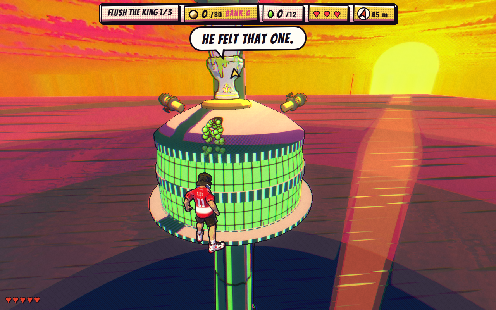

### Round 36 — 2026-10-21 — rubric v1

- What changed: After a pipe comes off, the King throws, then stomps, then pulls, then belches, then sweeps, and then throws again. With every pipe on he only throws. During the sweep he takes the heading from himself to the hero, and the card says "He's sweeping. Step aside". That heading does not follow. Still in that lane within 36 m takes a heart, on the ground or in the air. A step outside the lane, or a place farther than 36 m along the heading, keeps the heart. The sweep does not move the hero.
- Why it helped: After the belch the fight was the same four attacks again. Spider-Man 2 gives a boss a sweep you leave by stepping out of the lane. A jump in that lane still lands. A 1280×800 play watched a throw while every pipe was on, then one pipe came off and the attacks ran throw, stomp, pull, belch, sweep. The sweep card said to step aside. Standing in the lane took a heart. A step outside the lane kept it. Fifty metres along the same heading kept it. A jump in the lane took a heart.
- Screenshots: `docs/gauntlet/fullswing-r36/sweep.png`.
- Next target: another King answer. Performance stability stays at 6. This machine has no real GPU to time, so that score is not the next implementation round.

| Dimension | Score | Why |
| --- | ---: | --- |
| Lighting | 5 | Held. Golden-hour sun and ink shadows. |
| Color palette | 6 | Held. Yellow, red and sludge green still separate the HUD from the blocks. |
| Detail density | 4 | Held. Open blocks more than a dressed borough. |
| Texture and material quality | 3 | Held. Flat fills. |
| Composition and camera | 4 | Held. The chase camera still sits behind the hero, off to his right. This frame is the sweep card. |
| Atmosphere | 5 | Held. The dusk skyline has a mood. The street under the card does not. |
| Character models | 3 | Held. Simple comic figures. The King is still the same model. |
| Animation smoothness | 4 | Scored from still frames in software GL. Continuous motion was not watched. |
| Particles and VFX | 5 | Held. The sweep uses the ring and the comic words that were already there. |
| UI polish | 6 | Held. The card is still the ink pill. It names the sweep for that wind-up. |
| Responsiveness and input latency | 9 | Held. One frame after a clock drop, the pill still matches the objective. |
| Controls feel | 9 | Held. The first web still hangs from a building at the real rope length. A rope that is still attached holds against the pull. |
| Mission clarity | 9 | Held. During a sweep the card says to step aside. The rest of the time it still names the nearest pipe. |
| Pacing | 9 | Held. Nine of the twelve flushes are a different job. The first and the third are still the clog card, and the pump never runs three times in a row. Nine different jobs is not a 2023 mission list, so the score stays. |
| Fun factor | 9 | Held. The roof fight still launches at 14 m/s and a chase still launches at 8. The King now has a fifth attack, and the fight is still one boss. |
| Difficulty curve | 9 | Held. The ninth-flush car still cruises at 24 m/s. An odd-job getaway stays at 17 m/s. |
| Feedback | 9 | Held. Seven seconds left still turns the card hot on that same frame. |
| Sound design | 9 | Held. A flush, a fight, a dash and a lift are still different stings, and the ring fanfare is still the trial. |
| Variety | 9 | Held. The King now sweeps after a belch, once a pipe is off, and with every pipe on he only throws. Five attacks on one boss is not the spread of a 2023 boss fight, so the score stays. |
| Performance stability | 6 | The 1280×800 play passed with no page errors. Frame time on a real GPU was not measured. |

- Aesthetics raw: 45 / 10 dimensions, index 45
- Playability raw: 87 / 10 dimensions, index 87
- Total: 132 / 200
- Delta vs last round: 0 (round 35 was 132). The sweep is a fifth King attack. No score moved.

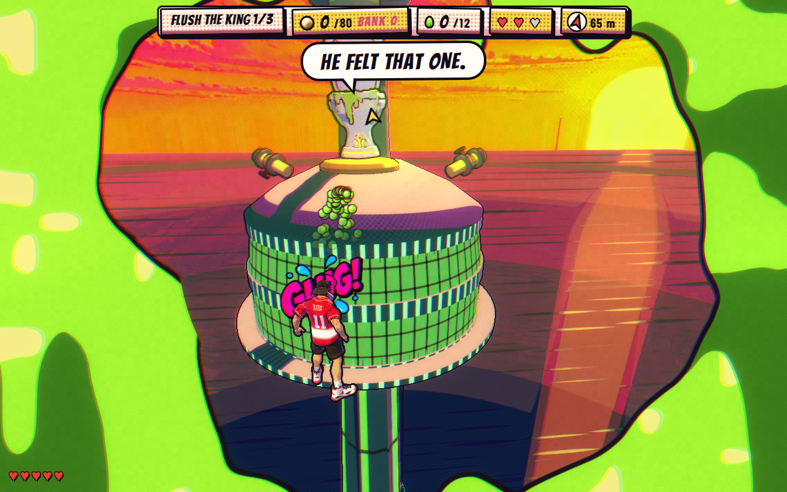

### Round 37 — 2026-10-21 — rubric v1

- What changed: After a pipe comes off, the King throws, then stomps, then pulls, then belches, then sweeps, then grabs, and then throws again. With every pipe on he only throws. During the grab the card says "He's grabbing. Get back". Within 8 m it takes a heart, on the ground or in the air, and a rope does not stop it. The grab does not move the hero. Farther than 8 m keeps the heart.
- Why it helped: After the sweep the fight was the same five attacks again. Spider-Man 2 gives a boss a close grab. A jump does not save you, and a web does not save you. A 1280×800 play watched a throw while every pipe was on, then one pipe came off and the attacks ran throw, stomp, pull, belch, sweep, grab. The grab card said to get back. Standing within 8 m took a heart and did not move the hero. Fourteen metres out kept the heart. In the air within 8 m, and with a rope, it still took a heart.
- Screenshots: `docs/gauntlet/fullswing-r37/grab.png`.
- Next target: another King answer. Performance stability stays at 6. This machine has no real GPU to time, so that score is not the next implementation round.

| Dimension | Score | Why |
| --- | ---: | --- |
| Lighting | 5 | Held. Golden-hour sun and ink shadows. |
| Color palette | 6 | Held. Yellow, red and sludge green still separate the HUD from the blocks. |
| Detail density | 4 | Held. Open blocks more than a dressed borough. |
| Texture and material quality | 3 | Held. Flat fills. |
| Composition and camera | 4 | Held. The chase camera still sits behind the hero, off to his right. This frame is the grab card. |
| Atmosphere | 5 | Held. The dusk skyline has a mood. The street under the card does not. |
| Character models | 3 | Held. Simple comic figures. The King is still the same model. |
| Animation smoothness | 4 | Scored from still frames in software GL. Continuous motion was not watched. |
| Particles and VFX | 5 | Held. The grab uses the ring and the comic words that were already there. |
| UI polish | 6 | Held. The card is still the ink pill. It names the grab for that wind-up. |
| Responsiveness and input latency | 9 | Held. One frame after a clock drop, the pill still matches the objective. |
| Controls feel | 9 | Held. The first web still hangs from a building at the real rope length. A rope that is still attached holds against the pull. |
| Mission clarity | 9 | Held. During a grab the card says to get back. The rest of the time it still names the nearest pipe. |
| Pacing | 9 | Held. Nine of the twelve flushes are a different job. The first and the third are still the clog card, and the pump never runs three times in a row. Nine different jobs is not a 2023 mission list, so the score stays. |
| Fun factor | 9 | Held. The roof fight still launches at 14 m/s and a chase still launches at 8. The King now has a sixth attack, and the fight is still one boss. |
| Difficulty curve | 9 | Held. The ninth-flush car still cruises at 24 m/s. An odd-job getaway stays at 17 m/s. |
| Feedback | 9 | Held. Seven seconds left still turns the card hot on that same frame. |
| Sound design | 9 | Held. A flush, a fight, a dash and a lift are still different stings, and the ring fanfare is still the trial. |
| Variety | 9 | Held. The King now grabs after a sweep, once a pipe is off, and with every pipe on he only throws. Six attacks on one boss is not the spread of a 2023 boss fight, so the score stays. |
| Performance stability | 6 | The 1280×800 play passed with no page errors. Frame time on a real GPU was not measured. |

- Aesthetics raw: 45 / 10 dimensions, index 45
- Playability raw: 87 / 10 dimensions, index 87
- Total: 132 / 200
- Delta vs last round: 0 (round 36 was 132). The grab is a sixth King attack. No score moved.

### Round 38 — 2026-10-21 — rubric v1

- What changed: flat map destinations show whole-metre horizontal distance below their names. The map labels this as distance across the map; ordering and travel actions stay the same.
- Why it helped: a player can compare nearby trials and other travel destinations without interpreting only the pins. Reopening at another location refreshes the distances.
- Screenshots: `docs/gauntlet/fullswing-r38/before-960.png`, `after-960.png`, `before-390.png`, `after-390.png`.
- Next target: a new evidenced navigation or mission-feedback weakness after outstanding reviews clear; preserve Tab-to-close.

| Dimension | Score | Why |
| --- | ---: | --- |
| Lighting | 5 | Carried mission-track baseline; not independently re-scored in this map-only round. |
| Color palette | 6 | Carried mission-track baseline; not independently re-scored in this map-only round. |
| Detail density | 4 | Carried mission-track baseline; not independently re-scored in this map-only round. |
| Texture and material quality | 3 | Carried mission-track baseline; not independently re-scored in this map-only round. |
| Composition and camera | 4 | Carried mission-track baseline; not independently re-scored in this map-only round. |
| Atmosphere | 5 | Carried mission-track baseline; not independently re-scored in this map-only round. |
| Character models | 3 | Carried mission-track baseline; not independently re-scored in this map-only round. |
| Animation smoothness | 4 | Carried mission-track baseline; not independently re-scored in this map-only round. |
| Particles and VFX | 5 | Carried mission-track baseline; not independently re-scored in this map-only round. |
| UI polish | 6 | Carried mission-track baseline; not independently re-scored in this map-only round. |
| Responsiveness and input latency | 9 | Carried mission-track baseline; not independently re-scored in this map-only round. |
| Controls feel | 9 | Carried mission-track baseline; not independently re-scored in this map-only round. |
| Mission clarity | 9 | Destination distance is now explicit and refreshes after movement; overall clarity score held. |
| Pacing | 9 | Carried mission-track baseline; not independently re-scored in this map-only round. |
| Fun factor | 9 | Carried mission-track baseline; not independently re-scored in this map-only round. |
| Difficulty curve | 9 | Carried mission-track baseline; not independently re-scored in this map-only round. |
| Feedback | 9 | Carried mission-track baseline; not independently re-scored in this map-only round. |
| Sound design | 9 | Carried mission-track baseline; not independently re-scored in this map-only round. |
| Variety | 9 | Carried mission-track baseline; not independently re-scored in this map-only round. |
| Performance stability | 6 | Carried mission-track baseline; not independently re-scored in this map-only round. |

- Aesthetics raw: 45 / 10 dimensions, index 45
- Playability raw: 87 / 10 dimensions, index 87
- Total: 132 / 200
- Delta vs last round: 0. Existing mission-track scores are explicitly carried baselines, not a fresh full-playthrough evaluation or a reconciled graphics-track score.

Validation: all 16 new browser checks pass at 960×540 and 390×844, covering two player positions, zero distance, refresh, sideways overflow and unchanged travel. The original build failed the eight distance expectations while its other eight checks passed. The existing `qa/vr/rings-map.e2e.mjs` also passes: trials, compass, map hover and travel. Physical devices, audio listening, hardware performance and OpenSpec CLI validation were not run.

Round 38 shipped in [PR #618](https://github.com/vdimarco/rouge-warden/pull/618), merged as `53c45f92` after rebasing onto main and passing all six fresh browser jobs, automated review and preview deployment. Authenticated preview verified startup, zero distance and map travel with no page errors. The regression waits for the travel fade to close the map. Score remains 132/200. Next: inspect another evidenced mission-guidance gap after the current graphics round.

### Round 39 — 2026-10-21 — rubric v1

- What changed: the flat compass shows a second line such as “30 m above” or “30 m below” when its selected target is at least five metres away vertically. The number is rounded to five metres. Near the same height, that line is empty. Horizontal distance, bearing, target selection and the headset HUD stay unchanged.
- Why it helped: the prior compass read 50 m both below and above a roof target; it now identifies which direction to move vertically. Height updates independently when horizontal distance stays constant.
- Screenshots: `docs/gauntlet/fullswing-r39/{before,after}-{960,390}.png`. These are held-frame UI probes using a real clog goal and controlled player heights, not full playthrough evidence.
- Next target: another evidenced navigation or mission-feedback weakness after pending rounds merge.

| Dimension | Score | Why |
| --- | ---: | --- |
| Lighting | 5 | Carried mission-track baseline; not independently re-scored in this compass-height round. |
| Color palette | 6 | Carried mission-track baseline; not independently re-scored in this compass-height round. |
| Detail density | 4 | Carried mission-track baseline; not independently re-scored in this compass-height round. |
| Texture and material quality | 3 | Carried mission-track baseline; not independently re-scored in this compass-height round. |
| Composition and camera | 4 | Carried mission-track baseline; not independently re-scored in this compass-height round. |
| Atmosphere | 5 | Carried mission-track baseline; not independently re-scored in this compass-height round. |
| Character models | 3 | Carried mission-track baseline; not independently re-scored in this compass-height round. |
| Animation smoothness | 4 | Carried mission-track baseline; not independently re-scored in this compass-height round. |
| Particles and VFX | 5 | Carried mission-track baseline; not independently re-scored in this compass-height round. |
| UI polish | 6 | Carried mission-track baseline; not independently re-scored in this compass-height round. |
| Responsiveness and input latency | 9 | Carried mission-track baseline; not independently re-scored in this compass-height round. |
| Controls feel | 9 | Carried mission-track baseline; not independently re-scored in this compass-height round. |
| Mission clarity | 9 | The compass now distinguishes above, below and near-height targets while retaining horizontal distance; overall score held. |
| Pacing | 9 | Carried mission-track baseline; not independently re-scored in this compass-height round. |
| Fun factor | 9 | Carried mission-track baseline; not independently re-scored in this compass-height round. |
| Difficulty curve | 9 | Carried mission-track baseline; not independently re-scored in this compass-height round. |
| Feedback | 9 | Carried mission-track baseline; not independently re-scored in this compass-height round. |
| Sound design | 9 | Carried mission-track baseline; not independently re-scored in this compass-height round. |
| Variety | 9 | Carried mission-track baseline; not independently re-scored in this compass-height round. |
| Performance stability | 6 | Carried mission-track baseline; not independently re-scored in this compass-height round. |

- Aesthetics raw: 45 / 10 dimensions, index 45
- Playability raw: 87 / 10 dimensions, index 87
- Total: 132 / 200
- Delta vs last round: 0. Unchanged dimensions retain the mission track's baseline; this does not reconcile that baseline with the graphics track or claim a fresh full-playthrough score.

Validation: all 16 targeted browser checks pass at 960×540 and 390×844: real clog goal, above/below/near height, constant horizontal distance, viewport fit and page errors. The baseline failed exactly four above/below expectations and passed 12 other checks. The existing King-compass suite and portrait layout suite also pass. OpenSpec structure and canonical scenarios were reviewed manually; CLI, physical-device, listening and hardware-performance checks were not run. Remote review, preview and CI remain required before merge.

Round 39 CI found a narrow touch-layout regression: the extra compass line expanded the score row, affected four near-border arrow angles, and overflowed the boss-heart row at 360 pixels. The correction keeps the existing 28-pixel compass height on compact phones, displaying ↑/↓ plus metres with the full above/below text retained. The full phone-controls suite is required again before merge; no CI tolerances were weakened.

The correction passes the full local `phone-controls.e2e.mjs` suite (162 checks), including all three CI failures; screenshot `docs/gauntlet/fullswing-r39/after-touch-360.png` shows the compact phone cue. Log: `/tmp/fullswing-height-phone-fixed.log`. Hardware performance remains unverified under the user's new performance priority; this correctness fix does not close that report.

Round 39 shipped in [PR #620](https://github.com/vdimarco/rouge-warden/pull/620), merged as `2a134ff0` after all six corrected-head browser jobs, review and deployed preview checks passed. Rebase was up to date immediately before the exact-head merge. The preview passed all 162 phone-controls checks, including the CI regressions. Historical score remains132/200; hardware responsiveness and stability are now subject to the performance evidence supplement and are not newly established by this UI round.

### Round 40 — 2026-10-22 — controller reconnect correctness, rubric v1

A standard controller disconnected while an action button was pressed retained its cached edge. Reconnecting with that button pressed lost the first jump, car, yank, view, menu or throw action. The existing no-pad branch now clears all cached button edges alongside trigger state. Connected holds still emit only one action, and a disconnected pad emits none. No graphics, saves or controls mapping changed.

Evidence: [before](fullswing-r40-pad/before.png), [after](fullswing-r40-pad/after.png), and corresponding logs. These are explicitly labelled synthetic-controller lifecycle probes over the title page, not physical-device or full-playthrough screenshots. Baseline fails seven reconnect expectations and passes15 other assertions; corrected code passes all22. Regression runs with the existing mouse-look CI step.

| Dimension | Score | Why |
| --- | ---: | --- |
| Lighting | 5 | Historical mission-track context only; not re-scored in this narrow correctness round. |
| Color palette | 6 | Historical mission-track context only; not re-scored in this narrow correctness round. |
| Detail density | 4 | Historical mission-track context only; not re-scored in this narrow correctness round. |
| Texture and material quality | 3 | Historical mission-track context only; not re-scored in this narrow correctness round. |
| Composition and camera | 4 | Historical mission-track context only; not re-scored in this narrow correctness round. |
| Atmosphere | 5 | Historical mission-track context only; not re-scored in this narrow correctness round. |
| Character models | 3 | Historical mission-track context only; not re-scored in this narrow correctness round. |
| Animation smoothness | 4 | Historical mission-track context only; not re-scored in this narrow correctness round. |
| Particles and VFX | 5 | Historical mission-track context only; not re-scored in this narrow correctness round. |
| UI polish | 6 | Historical mission-track context only; not re-scored in this narrow correctness round. |
| Responsiveness and input latency | Unverified | Affected user-profile Chrome remains inaccessible; no inherited hardware passing score. |
| Controls feel | 9 | Historical context only;22 synthetic checks prove lifecycle correctness, not physical feel or a score increase. |
| Mission clarity | 9 | Historical mission-track context only; not re-scored in this narrow correctness round. |
| Pacing | 9 | Historical mission-track context only; not re-scored in this narrow correctness round. |
| Fun factor | 9 | Historical mission-track context only; not re-scored in this narrow correctness round. |
| Difficulty curve | 9 | Historical mission-track context only; not re-scored in this narrow correctness round. |
| Feedback | 9 | Historical mission-track context only; not re-scored in this narrow correctness round. |
| Sound design | 9 | Historical mission-track context only; not re-scored in this narrow correctness round. |
| Variety | 9 | Historical mission-track context only; not re-scored in this narrow correctness round. |
| Performance stability | Unverified | Affected user-profile Chrome remains inaccessible; no inherited hardware passing score. |

Current total/delta withheld. Historical aesthetics45 across10dimensions and eight historical playability dimensions72 are not a new acceptance score; do not normalize a partial total. The graphics track has different historical baselines and is not silently reconciled here.

Performance remains a release consideration: [three prior production hardware repeats](fullswing-r28-performance/production-pacing.md) measured approximately60FPS and input-to-submit p9515.2–17.8ms. Those runs predate this controller correction and do not establish its hardware acceptance. This focused correctness change does not alter rendering or address the remaining user-Chrome report. No physical pad/headset, listening, full playthrough or OpenSpec CLI check is claimed. Specification scenarios manually reviewed. Remote review, full CI, deployed preview and a final rebase are required before merge.

Round40 shipped in [PR #625](https://github.com/vdimarco/rouge-warden/pull/625), merge `807dac35`, after all six CI jobs, review and current authenticated22-check preview passed. Rebase was up to date immediately before the exact-head merge. Production desktop.js returned HTTP200 and matched the merged file byte-for-byte. This closes the synthetic controller lifecycle regression; physical controller behavior and the reported Chrome slowdown remain unverified. Scores remain withheld as current hardware acceptance.

### Round 41 — 2026-10-22 — hidden flat-page simulation, rubric v1

Flat input always reported visible, bypassing the existing hidden-session simulation guard. In a controlled hidden-document probe the moving hero advanced from(3.94,198.77,0) to(11.38,189.35,0) over60callbacks. Flat input now reports document visibility, reusing that guard; position and velocity remain unchanged while hidden, then resume when visible. This applies to desktop and phone flat input. XR retains its session visibility path. No rendering technique, saved data or gameplay mapping changed.

Evidence: [before desktop](fullswing-r41-hidden/before-960.png), [after desktop](fullswing-r41-hidden/after-960.png), [before narrow viewport](fullswing-r41-hidden/before-390.png), [after narrow viewport](fullswing-r41-hidden/after-390.png), plus full logs. Screenshots are labelled synthetic lifecycle probes; displayed positions are rounded, assertions use full values. Actual browser throttling, phones and hardware performance are not established. Baseline6fail/8pass → corrected14pass, covering movement,60executed hidden callbacks, visibility, unchanged position/velocity, resume and page errors at960×540 and390×844. The fixture explicitly steps simulation and stops the render loop.

| Dimension | Score | Why |
| --- | ---: | --- |
| Lighting | 5 | Historical mission-track context only; not re-scored in this narrow correctness round. |
| Color palette | 6 | Historical mission-track context only; not re-scored in this narrow correctness round. |
| Detail density | 4 | Historical mission-track context only; not re-scored in this narrow correctness round. |
| Texture and material quality | 3 | Historical mission-track context only; not re-scored in this narrow correctness round. |
| Composition and camera | 4 | Historical mission-track context only; not re-scored in this narrow correctness round. |
| Atmosphere | 5 | Historical mission-track context only; not re-scored in this narrow correctness round. |
| Character models | 3 | Historical mission-track context only; not re-scored in this narrow correctness round. |
| Animation smoothness | 4 | Historical mission-track context only; not re-scored in this narrow correctness round. |
| Particles and VFX | 5 | Historical mission-track context only; not re-scored in this narrow correctness round. |
| UI polish | 6 | Historical mission-track context only; not re-scored in this narrow correctness round. |
| Responsiveness and input latency | Unverified | Affected user-profile Chrome remains inaccessible; no inherited hardware passing score. |
| Controls feel | 9 | Historical context only;14 synthetic checks prove lifecycle correctness, not physical feel or a score increase. |
| Mission clarity | 9 | Historical mission-track context only; not re-scored in this narrow correctness round. |
| Pacing | 9 | Historical mission-track context only; not re-scored in this narrow correctness round. |
| Fun factor | 9 | Historical mission-track context only; not re-scored in this narrow correctness round. |
| Difficulty curve | 9 | Historical mission-track context only; not re-scored in this narrow correctness round. |
| Feedback | 9 | Historical mission-track context only; not re-scored in this narrow correctness round. |
| Sound design | 9 | Historical mission-track context only; not re-scored in this narrow correctness round. |
| Variety | 9 | Historical mission-track context only; not re-scored in this narrow correctness round. |
| Performance stability | Unverified | Affected user-profile Chrome remains inaccessible; no inherited hardware passing score. |

Current total/delta withheld; historical aesthetics45 across10dimensions and eight historical playability dimensions72 are context, not current acceptance. No new score awarded, full playthrough or physical-device claim. Prior production FPS/latency evidence predates this correction and does not validate its hardware performance. This fixes an observed hidden-page correctness issue; it does not establish a fix for the affected Chrome session or reduced GPU/power use. OpenSpec scenarios manually reviewed; CLI unavailable. Review, all CI, deployed preview and final rebase remain required before merge.

Round41 shipped in [PR #627](https://github.com/vdimarco/rouge-warden/pull/627), merge `4fdb704a`, after all six CI jobs, review and current authenticated14-check preview passed. Fresh rebase was up to date immediately before the exact-head merge. Production desktop.js HTTP200 and byte-for-byte match verified. This closes the deterministic hidden-page physics regression; actual browser throttling, physical-device behavior and the reported Chrome slowdown remain unverified. Current performance scores remain withheld.

## Round42 — building-supported flat swings (pending release)

User reports overly easy swinging and asks for attachment to buildings. Removed playerEasy sky fallback; existing real-surface choices retained. Browser baseline2fail/1pass→3pass; integrated hold chain6pass includes actual building endpoints/different nextbuilding and no open-water rope. Evidence: fullswing-r42-building. No physics/rendering change or performance claim. All20dimension assessments remain as round41 historical context; responsiveness/stability unverified, total/delta withheld. Height wording still awaiting clarification; no arbitrary ceiling introduced. Review/CI/deployedpreview/rebase/production pending.

Round42 clarification: above-rooftop attachment allowed to reachable real buildings; tested113.5m player to111.5m roof. Ordinary rope physics handles real surfaces unsuitable for assisted clearance. Focused swing/bot54checks pass with original3building/30s goal (16.6/17.4/17.4s), plus4building-anchor checks and6chainchecks. Fresh remote gates pending.

Round42 shipped in PR#632, merge5d0cd1ca, after all6CI/review/exactauthenticatedpreview/rebase. Productionmain HTTP200 exactSHAedd1226e70c3f2fb08137e283d8d770a056c7db0f0df3f40724977d3f4780a41. Realbuildinganchors,noartificialceiling,reachableaboverooftopattachment. Canonical swing-moves scenarios published and OpenSpec archived. No affectedChrome/physicalcontroller/phone/performance claim.
