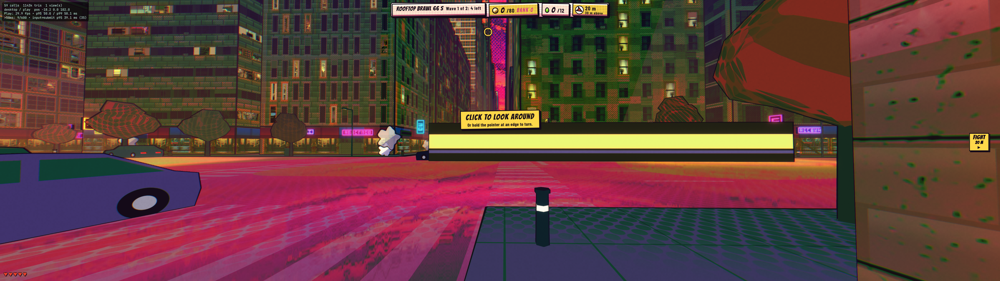
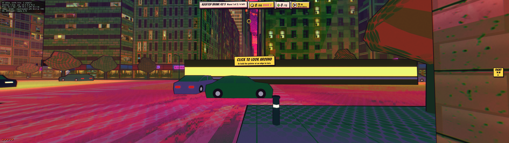
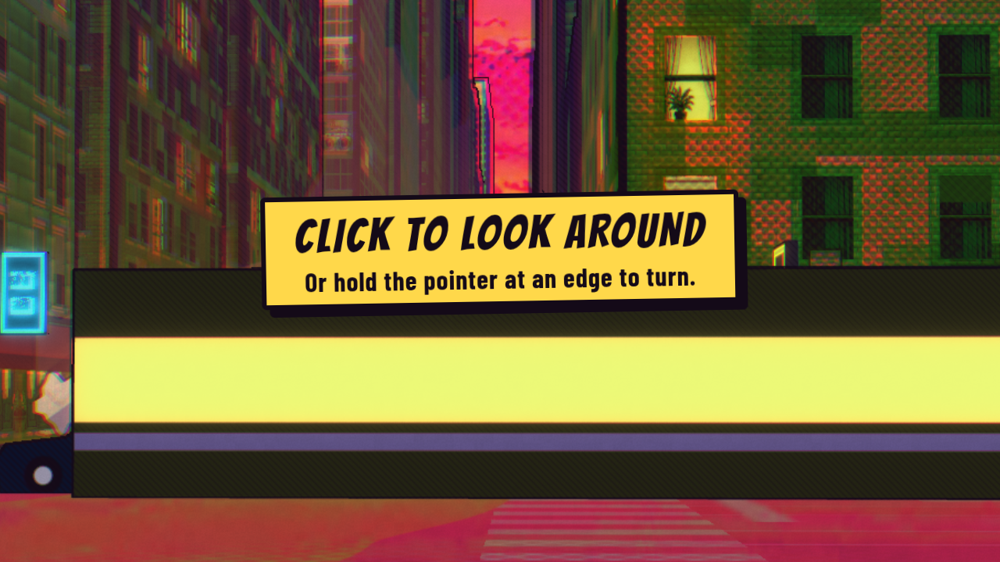
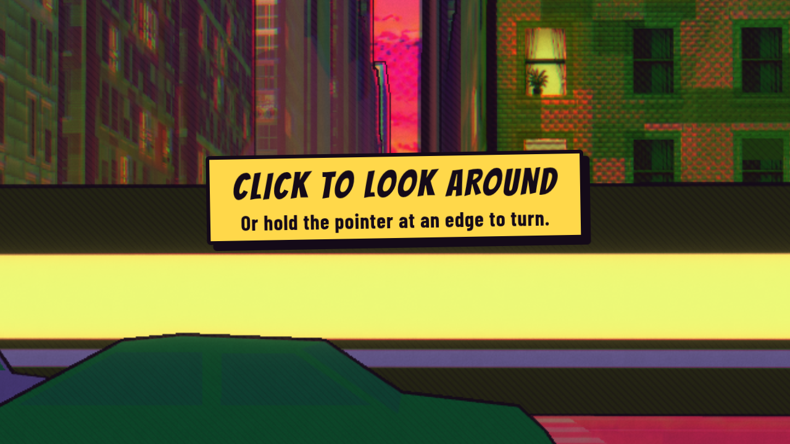

# Round29: adaptive flat rendering

The fixed drawing-buffer ceiling remains the default. After three active seconds averaging over25ms with a majority of slow intervals, flat gameplay trials15% lower linear3D resolution. It retains that trial only if the next window improves mean frame intervals by at least10%; otherwise it restores the prior ratio and stops trying until resize/reload. The floor is half the initial linear ratio. Hidden/inactive/held/XR frames break sampling; native DOM sizing and camera aspect are unchanged. Successful reductions remain until resize/reload to avoid upward probes causing new hitches. Fine3D sampling is softer when activated.

## Matched hardware results

Three paired runs per condition, serial baseline→candidate, each10s warmup then60s idle, W+E traversal and staged auto-healed brawl;35synthetic Shift inputs per workload. CSS3840×1080,DPR2. Isolated installed Chrome156 headless, ANGLE NVIDIA RTX4090 OpenGL ES3.2. Shared GPU load was preserved, not exclusive. Frozen main/helper hashes are in the source manifests; baseline is main60391d51, candidate runtime f846942b. Raw JSON retains full GPU timer samples and environment/load readings.

**Normal play:** all nine baseline and nine candidate workloads ran at60FPS, p9516.7–16.8ms, retaining the full5430×1527 buffer. No repeatable>10% FPS/frame-time/input-delay regression. Pair3 idle/combat input p95 increased from unusually lower~15ms baselines by>10%, but the other pairs did not repeat this; all raw values are retained.

**Six-draw rendering pressure:** deliberately rendering the complete bloom pipeline six times per frame keeps GPU work high enough to activate feedback consistently. This is synthetic capacity evidence, not a normal-game or actual-user acceptance workload. All nine paired FPS averages improved:25.11–31.38→43.89–56.29FPS. Input-to-CPU-submit p95 improved in all nine:30.5–46.8→20.8–26.4ms. Candidate p95 remains33.3–33.4ms, failing20ms; candidate p99 reaches33.5ms, failing33.3ms. All FPS results under this pressure still fail60. Long-frame percentages and every target miss remain in the table. No repeatable>10% regression.

**Four-draw exploratory pressure:** gains appeared only in cold pair1. Warmed pairs2/3 stayed~40–44FPS without retaining lower resolution. That evidence alone did not establish repeatable benefit; it motivated the distinct six-draw activation test. It is retained rather than hidden.

Input timing includes synthetic browser dispatch to CPU render submission, not GPU completion, scanout or physical input-to-photon. Rolling debug reports supply input samples; frame statistics use the complete60s external rAF sample. All54workloads have35inputs and zero inactive frames/page errors. These results do not establish performance in the affected user profile, windowed120Hz Chrome, physical phone/headset, audio listening or full playthrough. The original round28 misses/softness are not superseded. No slowdown-fixed claim or hardware passing score.

### Normal play

| Pair | Variant | Workload | FPS | p95 ms | p99 ms | >50ms % | Input p95 ms | 3D buffer |
|---:|---|---|---:|---:|---:|---:|---:|---|
| 1 | baseline | idle | 60.00 | 16.7 | 16.8 | 0.00 | 17.3 | 5430×1527 |
| 1 | baseline | traversal | 60.00 | 16.7 | 16.8 | 0.00 | 17.2 | 5430×1527 |
| 1 | baseline | combat | 60.00 | 16.7 | 16.8 | 0.00 | 16.5 | 5430×1527 |
| 1 | candidate | idle | 60.00 | 16.7 | 16.8 | 0.00 | 17.0 | 5430×1527 |
| 1 | candidate | traversal | 60.00 | 16.8 | 16.8 | 0.00 | 17.4 | 5430×1527 |
| 1 | candidate | combat | 60.00 | 16.7 | 16.8 | 0.00 | 16.7 | 5430×1527 |
| 2 | baseline | idle | 60.00 | 16.8 | 16.8 | 0.00 | 16.9 | 5430×1527 |
| 2 | baseline | traversal | 60.00 | 16.7 | 16.8 | 0.00 | 17.3 | 5430×1527 |
| 2 | baseline | combat | 60.00 | 16.7 | 16.8 | 0.00 | 17.8 | 5430×1527 |
| 2 | candidate | idle | 60.00 | 16.7 | 16.8 | 0.00 | 16.9 | 5430×1527 |
| 2 | candidate | traversal | 60.00 | 16.7 | 16.8 | 0.00 | 15.2 | 5430×1527 |
| 2 | candidate | combat | 60.00 | 16.7 | 16.8 | 0.00 | 17.5 | 5430×1527 |
| 3 | baseline | idle | 60.00 | 16.8 | 16.8 | 0.00 | 15.1 | 5430×1527 |
| 3 | baseline | traversal | 60.00 | 16.7 | 16.8 | 0.00 | 17.6 | 5430×1527 |
| 3 | baseline | combat | 60.00 | 16.8 | 16.8 | 0.00 | 15.2 | 5430×1527 |
| 3 | candidate | idle | 60.00 | 16.8 | 16.8 | 0.00 | 16.8 | 5430×1527 |
| 3 | candidate | traversal | 60.00 | 16.7 | 16.8 | 0.00 | 15.8 | 5430×1527 |
| 3 | candidate | combat | 60.00 | 16.8 | 16.8 | 0.00 | 17.5 | 5430×1527 |

### Six-draw synthetic pressure

| Pair | Variant | Workload | FPS | p95 ms | p99 ms | >50ms % | Input p95 ms | 3D buffer |
|---:|---|---|---:|---:|---:|---:|---:|---|
| 1 | baseline | idle | 28.76 | 50.0 | 50.1 | 1.51 | 37.1 | 5430×1527 |
| 1 | baseline | traversal | 28.03 | 50.0 | 50.1 | 3.87 | 46.8 | 5430×1527 |
| 1 | baseline | combat | 28.82 | 50.0 | 50.1 | 2.20 | 39.1 | 5430×1527 |
| 1 | candidate | idle | 49.65 | 33.4 | 33.4 | 0.13 | 26.4 | 3923×1103 |
| 1 | candidate | traversal | 52.27 | 33.4 | 33.4 | 0.06 | 23.8 | 3923×1103 |
| 1 | candidate | combat | 49.34 | 33.4 | 33.4 | 0.00 | 20.8 | 3923×1103 |
| 2 | baseline | idle | 31.38 | 33.4 | 33.5 | 0.11 | 30.5 | 5430×1527 |
| 2 | baseline | traversal | 30.95 | 50.0 | 50.1 | 1.18 | 40.0 | 5430×1527 |
| 2 | baseline | combat | 29.15 | 50.0 | 50.1 | 1.89 | 34.8 | 5430×1527 |
| 2 | candidate | idle | 47.77 | 33.4 | 33.4 | 0.14 | 22.9 | 3923×1103 |
| 2 | candidate | traversal | 51.47 | 33.4 | 33.4 | 0.06 | 22.0 | 3923×1103 |
| 2 | candidate | combat | 43.89 | 33.4 | 33.4 | 0.00 | 24.1 | 3923×1103 |
| 3 | baseline | idle | 29.06 | 50.0 | 50.1 | 1.32 | 34.3 | 5430×1527 |
| 3 | baseline | traversal | 29.80 | 50.0 | 50.1 | 2.18 | 32.2 | 5430×1527 |
| 3 | baseline | combat | 25.11 | 50.1 | 50.1 | 5.97 | 39.3 | 5430×1527 |
| 3 | candidate | idle | 45.06 | 33.4 | 33.5 | 0.18 | 22.3 | 3923×1103 |
| 3 | candidate | traversal | 56.29 | 33.3 | 33.4 | 0.12 | 24.5 | 3335×937 |
| 3 | candidate | combat | 52.57 | 33.4 | 33.4 | 0.00 | 21.6 | 3335×937 |

### Four-draw exploratory pressure

| Pair | Variant | Workload | FPS | p95 ms | p99 ms | >50ms % | Input p95 ms | 3D buffer |
|---:|---|---|---:|---:|---:|---:|---:|---|
| 1 | baseline | idle | 30.44 | 50.0 | 50.1 | 1.81 | 35.2 | 5430×1527 |
| 1 | baseline | traversal | 30.85 | 50.0 | 50.1 | 1.94 | 41.0 | 5430×1527 |
| 1 | baseline | combat | 28.81 | 50.0 | 50.1 | 2.26 | 38.3 | 5430×1527 |
| 1 | candidate | idle | 40.86 | 33.4 | 33.4 | 0.12 | 24.1 | 4615×1298 |
| 1 | candidate | traversal | 40.95 | 33.4 | 49.9 | 0.41 | 26.5 | 4615×1298 |
| 1 | candidate | combat | 43.85 | 33.4 | 33.4 | 0.11 | 28.4 | 4615×1298 |
| 2 | baseline | idle | 43.95 | 33.4 | 33.4 | 0.00 | 25.2 | 5430×1527 |
| 2 | baseline | traversal | 43.14 | 33.4 | 33.4 | 0.12 | 25.4 | 5430×1527 |
| 2 | baseline | combat | 40.00 | 33.4 | 33.4 | 0.00 | 26.3 | 5430×1527 |
| 2 | candidate | idle | 44.05 | 33.4 | 33.4 | 0.00 | 23.5 | 5430×1527 |
| 2 | candidate | traversal | 43.02 | 33.4 | 33.4 | 0.23 | 24.4 | 5430×1527 |
| 2 | candidate | combat | 39.78 | 33.4 | 33.4 | 0.00 | 28.2 | 5430×1527 |
| 3 | baseline | idle | 43.50 | 33.4 | 33.4 | 0.00 | 22.8 | 5430×1527 |
| 3 | baseline | traversal | 43.60 | 33.4 | 33.4 | 0.11 | 24.1 | 5430×1527 |
| 3 | baseline | combat | 39.84 | 33.4 | 33.4 | 0.00 | 27.1 | 5430×1527 |
| 3 | candidate | idle | 43.92 | 33.4 | 33.4 | 0.00 | 21.2 | 5430×1527 |
| 3 | candidate | traversal | 43.11 | 33.4 | 33.4 | 0.27 | 24.1 | 5430×1527 |
| 3 | candidate | combat | 39.65 | 33.4 | 33.4 | 0.00 | 28.7 | 5430×1527 |

## Visual evidence

Fixed street camera and G.time100 after the first six-draw pair. Foreground traffic positions differ because these follow live workloads; these are qualitative comparisons, not pixel-identical scene claims. Fine brick/window/hatch detail becomes softer, while native DOM hint text remains crisp and composition, objects and effects remain present. No aesthetic improvement awarded.

| Before | After |
|---|---|
|  |  |
|  |  |

## Functional checks and release gate

Feedback unit checks cover smooth frames, sustained slow frames, improvement, rollback/no-repeat, inactive continuity, isolated stalls, minimum and reset. All12synthetic deployed-preview integration checks pass at960×540/390×844, including rollback, paused/hidden/XR exclusion, resize restoration and native layout. Controlled callback timestamps and a no-op bloom pass isolate logic; this is not a physical-device test. Authenticated preview main/helper bytes match the frozen hardware sources. Initial fixture resize reads were corrected to wait for the event (10pass/2fail→12pass).

CI exposed a wall-clock-dependent pointer-lock fixture: its nominal140ms refusal check arrived after9036ms, so the mock correctly granted after1250ms. Scoped try/finally holds the initial mock/product performance clock and restores real time before automatic retry. Production pointer-lock behavior is unchanged. All six CI jobs, current review and deployed preview passed on1d671ac1. This evidence-only update still requires current remote checks/review and deployed-byte/preview verification, fresh rebase and exact-head merge. OpenSpec CLI unavailable; scenario artifacts reviewed manually. Production verification and archive remain pending.
