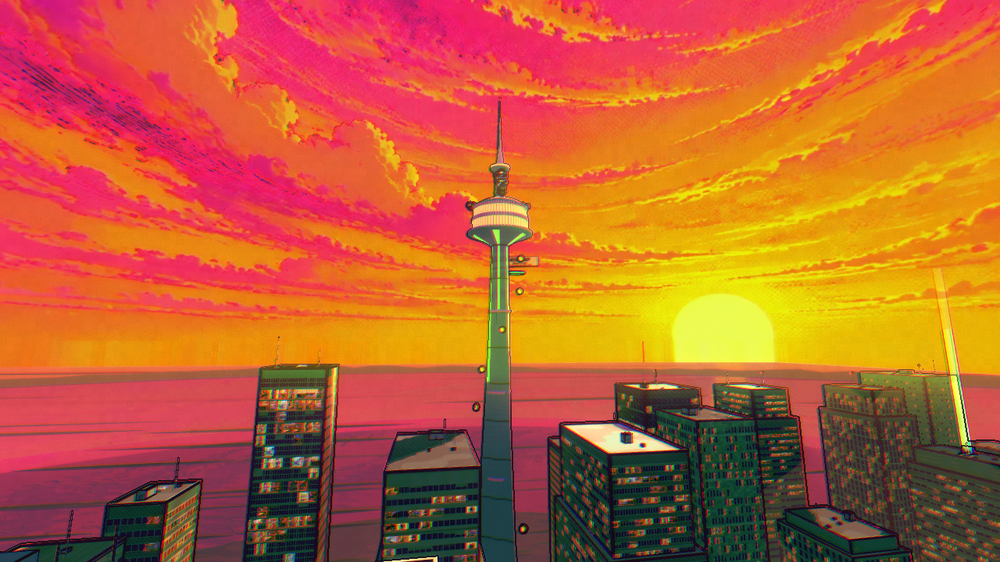

# Round30: zero-contribution sun-shaft gather

**Full release measurements are in progress; no acceptance claim yet.**

The existing shader computes16radial samples on fully sky pixels, then multiplies that contribution by(1-here), which is exactly zero there. Guarding the gather with here<1.0 retains the original samples/weights on city pixels and partial sky edges. No resolution, effect intensity, geometry, artwork, input or XR-path change.

Two preliminary activated-sun30s/15input comparisons under artificial6draw pressure gave GPU medians24.79/24.02→20.02/20.07ms and FPS33.88/34.03→38.18/38.50. These are diagnostics, not full60s/35input/three-pair acceptance. An earlier camera facing away from the sun did not exercise the path and cannot establish benefit. A separate stencil-copy trial had no consistent gain and was rejected.

Functional same-frame reference/candidate comparisons pass at640×360 and390×844 for active/inactive sun and comic effects full/off, with zero differing RGBA bytes in all eight cases. The reference forces the guard true, preserving the previous unguarded formula. This is functional coverage, not hardware performance or physical-device evidence. Recorded NVIDIA hardware equivalence and three matched normal-play/controlled-pressure pairs are running serially. Normal tests retain the current adaptive controller; controlled6draw tests disable it equally for both variants to isolate shader cost at fixed resolution. Sun activation is asserted; inactive-path measurements are rejected.

Actual user-profile Chrome/high-refresh/input-to-photon behavior remains unverified. Prior performance target misses remain disclosed; no inherited passing hardware scores or current rubric total. Full raw data, visual evidence and all review/CI/current-preview/rebase gates remain required before merge. OpenSpec CLI unavailable; proportional scenario artifacts reviewed manually.

Evidence capture reads PNG data in the same browser task as rendering because the canvas does not preserve its drawing buffer. Deferred screenshots can capture a cleared canvas; those initial PNGs are rejected. Equivalence checks also require varied scene pixels, so two blank frames cannot pass. Final corrected hardware capture remains required after the active timing queue.

## Corrected pixel evidence

The corrected test waits for play, requires varied scene content and records the actual NVIDIA renderer. All8 desktop/phone×sun/effect-mode comparisons have zero differing RGBA bytes,12hardware checks pass and there are no page errors. Same-task canvas-only before/after PNGs show actual city geometry; initial cleared-buffer PNGs are rejected. These captures exclude DOM UI. Full timing evidence remains pending.

| Before | After |
|---|---|
|  |  |

Only inspected desktop PNGs are retained; deferred phone PNGs were cleared and are rejected. Phone coverage uses same-frame varied-scene RGBA comparisons, not those screenshots. The capture pair now runs within one browser task, and the controlled shader fixture explicitly makes the city visible.

## Completed measurements and remaining release gates

All48 accepted60-second workloads completed with35 synthetic inputs each and no inactive frames/page errors:36 original normal/pressure comparisons,6 counterbalanced idle and6 same-browser counterbalanced staged-combat samples. Full JSON/source manifests and [tables](r30-final-tables.md) are retained. NVIDIA RTX4090/Chrome156 headless/OpenGL,5430×1527buffer, shared GPU load. Not actual user-profile120Hz acceptance.

Normal3pairs: roughly58–60FPS except first candidate idle55.24, with frame/input misses disclosed in the tables. Initial idle input p95 worsened17.4→22.7 and15→17.6ms in2pairs. A counterbalanced C,B,B,C,C,B follow-up did not reproduce this direction: candidate50.08/59.65/59.55FPS and23.1/18.5/17.3ms; baseline48.27/50.67/44.87FPS and51.5/39.8/34.6ms. This establishes strong run-condition confounding; it does not erase original misses.

Fixed-UV six-draw pressure lowers median GPU time in all9workload pairs. FPS generally improves but remains below60; p95/p99/long-frame and input targets are not uniformly met. Pair2combat input27.4→34.9ms and pair3combat37.9→50.2ms require causal follow-up, not dismissal. Pair3idle42.5→46.9ms (the transient70.4 reading in a running log belonged to traversal; final per-workload JSON is authoritative).

The distinct same-browser staged-combat follow-up keeps both exact bloom implementations resident, alternates B,C,C,B,B,C, keeps fixed UV/six draws/equal fixed resolution, and uses60s/35inputs per sample. BaselineFPS37.48/37.92/38.26→candidate42.15/42.66/43.05; input p9526.7/25.7/27.8→25.8/24.3/25.8ms. MedianFPS+12.5%, medianinput26.7→25.8ms; no repeatable>10% regression in this controlled check. p95/p99 remain33.4ms, missing20/33.3ms targets. No GPU query measurements are claimed for this follow-up. Resident extra targets, changing staged enemy locations and shared load limit scope; this is synthetic render capacity, not normal gameplay or physical input-to-photon latency.

The earlier pressure fixture lost shaft activation during traversal and was rejected; corrected pressure holds the first real projected sun UV for both variants. All earlier logs/source snapshots remain outside the checkout; invalid/incomplete attempts are excluded from accepted workload counts. Software deployed11-check sky regression passes; recorded hardware12-check regression has8varied scene comparisons with zero RGBA differences. Desktop images are byte-identical actual city frames; rejected blank/phone PNGs are excluded. Phone coverage is numeric same-frame readback only.

Aesthetic scores do not increase. Responsiveness/stability remain unverified for the affected Chrome; currenttotal/delta withheld. No resolution/effect reduction. Exact current preview bloom bytes, final review/checks/rebase, merge and production verification remain required. Runtime shader bytes unchanged throughout QA/evidence refinements.

Released PR#631/45b0243e; fresh integrated sixCI/review/current11checkauthenticatedpreview/rebase passed. Production bloom bytes exact; see production-verification.json. Canonical spec archived; CLI unavailable, structure/scenarios manually reviewed. Performance report above remains scoped to frozen measured runtime, not a post-#632 hardware rerun.
