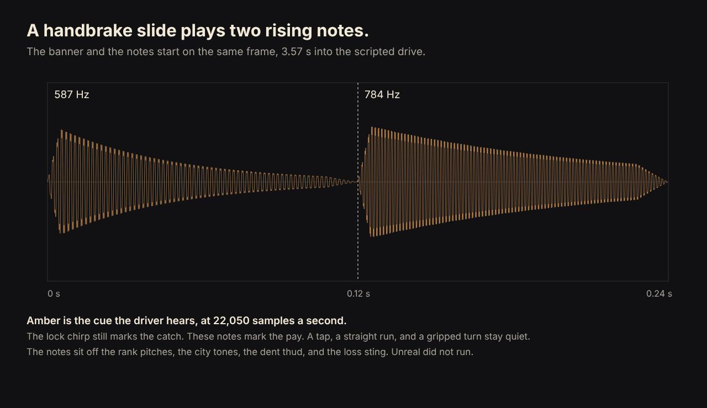
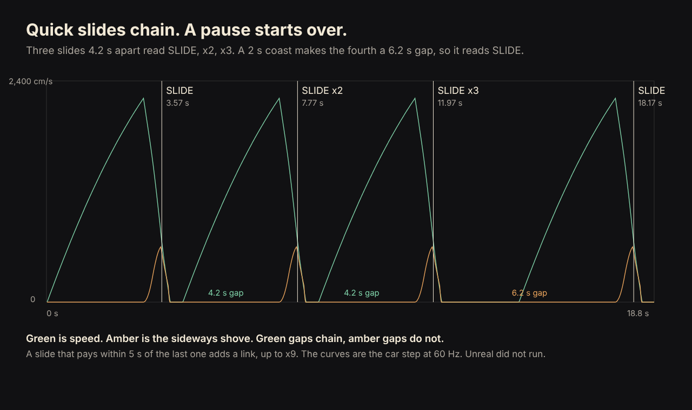
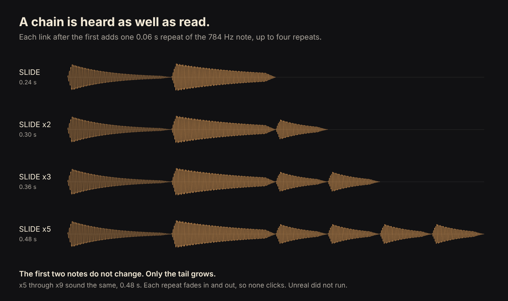

# GTA graphics gauntlet

Loop: keep making NORD (the GTA row) look closer to GTA 6 fidelity with original art only. Focus group: aesthetics. Rubric: [RUBRIC.md](RUBRIC.md).

Unreal is not available in this environment, so in-engine frames are the last committed captures and new source art is judged from the same offline shade of the canopy meshes. A round that fails its source test is reverted.

### Round 1 — 2026-10-21 — rubric v1

- What changed: Broadleaf crowns in `prepare_environment_refresh.py` keep a full canopy, with a darker underside (`Leaf0`) and an ochre sunlit cap (`Leaf2`), and a slightly tighter isosurface so lobes do not fuse into one balloon. Eight canopy OBJs and their layout counts were regenerated. Checked-in Unreal meshes are unchanged until `apply_environment_refresh.py` runs in the editor.
- Why it helped: The street trees were one flat green. A sunlit cap and a shaded bottom give the row a light direction, which is the nearest step toward a cinematic city canopy without dropping the crown into bare twigs.
- Screenshots: before `docs/gauntlet/gta-graphics/round-01/before-crowns.png`, after `docs/gauntlet/gta-graphics/round-01/after-crowns.png`. The shipped in-engine street is still `games/nord-unreal/Preview/Environment1280/EnvironmentSherbrooke.png`.
- Next target: texture and material quality (tied at 2 with detail density and particles; this pass did not change surface grain).

| Dimension | Score | Why |
| --- | ---: | --- |
| Lighting | 3 | One hard sun and purple shadows; this round did not touch the sky model. |
| Color palette | 5 | Crowns now carry a sunlit ochre cap and a dark underside instead of one green. |
| Detail density | 2 | Crowns are still smooth volumes, not leaves, bark, or street clutter. |
| Texture and material quality | 2 | Tints only. No grain, wear, or roughness change. |
| Composition and camera | 4 | The street reads. The camera is a gameplay view, not a filmed shot. |
| Atmosphere | 3 | Clear gradient sky. No fog, wet air, or time-of-day shift in this pass. |
| Character models | 3 | Low-poly crew stays readable and far from a lead character. |
| Animation smoothness | 3 | Locomotion clips exist. No motion was reviewed this round. |
| Particles and VFX | 2 | No weather or impact particles in these views. |
| UI polish | 5 | The comic HUD is consistent. It was not part of this pass. |
| Responsiveness and input latency | 4 | Input paths exist. This machine did not measure latency. |
| Controls feel | 4 | On-foot and driving controls are documented. They were not played here. |
| Mission clarity | 5 | The existing frame shows an objective card and a next step. |
| Pacing | 4 | Two missions are implemented. That is not a full campaign rhythm. |
| Fun factor | 3 | Not played this round. |
| Difficulty curve | 4 | Mission retry is soft. There is no tuned difficulty curve in this pass. |
| Feedback | 4 | Prompts exist. No new hit, reward, or juice. |
| Sound design | 3 | Audio acceptance is still open. Nothing was listened to here. |
| Variety | 3 | One park district. Crowns repeat across a few silhouettes. |
| Performance stability | 5 | The last recorded static scenes passed their frame budget. Not remeasured. Source tests passed. |

- Aesthetics raw: 32 / 10 dimensions, index 32
- Playability raw: 39 / 10 dimensions, index 39
- Total: 71 / 200
- Delta vs last round: +1 (first scored row; color palette 4 on the pre-round crowns, 5 after)

### Round 2 — 2026-10-21 — rubric v1

- What changed: `Scripts/city_facade.hlsl` gives each brick or stone course its own tone, and darkens the base of the wall. Glass, trim, and the cornice stay as they were. The map material updates when `apply_city_comic_style.py` runs in the editor.
- Why it helped: Texture and material quality was tied for the lowest aesthetics score. A flat paper wall reads as a cartoon fill. Course-by-course variation and street dirt are the first surface grain the shader can carry without a new texture.
- Screenshots: before `docs/gauntlet/gta-graphics/round-02/before-facade.png`, after `docs/gauntlet/gta-graphics/round-02/after-facade.png`. These are a direct port of the facade shader, not an Unreal capture.
- Next target: particles and VFX (still 2, the lowest aesthetics score).

| Dimension | Score | Why |
| --- | ---: | --- |
| Lighting | 3 | Still one hard sun. This round did not change lights. |
| Color palette | 5 | Brick red and limestone stay. The new variation sits inside those colours. |
| Detail density | 3 | Course units now read on the wall. The street is still thin on props. |
| Texture and material quality | 4 | Per-unit tone and base dirt replace the flat fill. There is still no roughness or wear map. |
| Composition and camera | 4 | Unchanged gameplay camera. |
| Atmosphere | 3 | No fog or weather change. |
| Character models | 3 | Untouched. |
| Animation smoothness | 3 | No motion reviewed. |
| Particles and VFX | 2 | None added. |
| UI polish | 5 | Untouched. |
| Responsiveness and input latency | 4 | Not measured this round. |
| Controls feel | 4 | Not played. |
| Mission clarity | 5 | Unchanged objective card. |
| Pacing | 4 | Unchanged two-mission slice. |
| Fun factor | 3 | Not played. |
| Difficulty curve | 4 | Unchanged. |
| Feedback | 4 | No new juice. |
| Sound design | 3 | Not listened to. |
| Variety | 3 | Two facade families, still one district. |
| Performance stability | 5 | Source test passed. The shader adds no extra samples. Frame time was not remeasured. |

- Aesthetics raw: 35 / 10 dimensions, index 35
- Playability raw: 39 / 10 dimensions, index 39
- Total: 74 / 200
- Delta vs last round: +3

### Round 3 — 2026-10-21 — rubric v1

- What changed: `plateau_atmosphere.rain_material` keeps the Tariq displacement and visibility mask, and shades each quad with a tight core, a soft skirt, and a knot at the leading end. The core lerps the streak from mist `(0.55, 0.64, 0.74)` to near-white. `rain_streak.hlsl` is unchanged. The material updates when the atmosphere apply runs in the editor.
- Why it helped: Particles and VFX was the lowest aesthetics score. A flat grey ribbon at 0.35 opacity does not read as a drop. A bright core and a leading knot are the first streak shape the existing graph can carry.
- Screenshots: before `docs/gauntlet/gta-graphics/round-03/before-rain.png`, after `docs/gauntlet/gta-graphics/round-03/after-rain.png`. These are a direct port of the streak mask, not an Unreal capture. The public page `GET /gta/` returned 200. `Scripts/test_plateau_atmosphere.py` passed.
- Next target: lighting (tied at 3 with detail density, character models, and animation smoothness). Lighting is the remaining graphics gap on the sky. The clear 15:00 authored multipliers stay locked.

| Dimension | Score | Why |
| --- | ---: | --- |
| Lighting | 3 | Still one hard sun. This round did not change lights. |
| Color palette | 5 | The streak moves from cool mist to white. The city palette is unchanged. |
| Detail density | 3 | Same streak count. The street is still thin on props. |
| Texture and material quality | 4 | Facades keep their course grain. Rain is a mask, not a new surface. |
| Composition and camera | 4 | Unchanged gameplay camera. |
| Atmosphere | 4 | The streak now reads as weather. There is still no fog volume or time-of-day shift. |
| Character models | 3 | Untouched. |
| Animation smoothness | 3 | No motion reviewed. |
| Particles and VFX | 4 | Streaks have a core, a skirt, and a leading knot. No splash, sheet, or exhaust. |
| UI polish | 5 | Untouched. |
| Responsiveness and input latency | 4 | Not measured this round. |
| Controls feel | 4 | Not played. |
| Mission clarity | 5 | Unchanged objective card. |
| Pacing | 4 | Unchanged two-mission slice. |
| Fun factor | 3 | Not played. |
| Difficulty curve | 4 | Unchanged. |
| Feedback | 4 | No new juice. |
| Sound design | 3 | Not listened to. |
| Variety | 3 | One rain look, still one district. |
| Performance stability | 5 | Atmosphere source test passed. The streak graph adds no texture samples. Frame time was not remeasured. |

- Aesthetics raw: 38 / 10 dimensions, index 38
- Playability raw: 39 / 10 dimensions, index 39
- Total: 77 / 200
- Delta vs last round: +3

### Round 4 — 2026-10-21 — rubric v1

- What changed: `apply_comic_style.py` lifts dark pixels with a cool sky wash `(0.05, 0.07, 0.11)` instead of a violet wash, and the shade dots and hatch follow that blue. Ink outlines and the clear 15:00 light multipliers are unchanged. The material updates when `apply_comic_style.py` runs in the editor.
- Why it helped: Lighting was tied for the lowest aesthetics score. The visual review already says comic shadows push foliage toward purple. A sky-coloured wash keeps shade off black and takes the violet out of it.
- Screenshots: before `docs/gauntlet/gta-graphics/round-04/before-shadow.png`, after `docs/gauntlet/gta-graphics/round-04/after-shadow.png`. These are a direct port of the shadow wash, not an Unreal capture. `Scripts/test_plateau_trees.py` passed. `GET /gta/` returned 200.
- Next target: detail density (tied at 3 with character models and animation smoothness). Detail density is the remaining city-graphics gap.

| Dimension | Score | Why |
| --- | ---: | --- |
| Lighting | 4 | Shade is a cool sky wash instead of violet. It is still one hard sun, with no bounce. |
| Color palette | 5 | Brick and sky stay. Only the shadow cast moved off violet. |
| Detail density | 3 | Same geometry. The street is still thin on props. |
| Texture and material quality | 4 | Unchanged course grain. The wash is a colour add, not a surface. |
| Composition and camera | 4 | Unchanged gameplay camera. |
| Atmosphere | 4 | Weather streaks are unchanged. No fog volume. |
| Character models | 3 | Untouched. |
| Animation smoothness | 3 | No motion reviewed. |
| Particles and VFX | 4 | Rain streaks are unchanged. |
| UI polish | 5 | Untouched. |
| Responsiveness and input latency | 4 | Not measured this round. |
| Controls feel | 4 | Not played. |
| Mission clarity | 5 | Unchanged objective card. |
| Pacing | 4 | Unchanged two-mission slice. |
| Fun factor | 3 | Not played. |
| Difficulty curve | 4 | Unchanged. |
| Feedback | 4 | No new juice. |
| Sound design | 3 | Not listened to. |
| Variety | 3 | One district. |
| Performance stability | 5 | The comic source test passed. The wash is the same instruction count. Frame time was not remeasured. |

- Aesthetics raw: 39 / 10 dimensions, index 39
- Playability raw: 39 / 10 dimensions, index 39
- Total: 78 / 200
- Delta vs last round: +1

### Round 5 — 2026-10-21 — rubric v1

- What changed: `city_facade.hlsl` turns every fourth ground-floor bay into a door with a transom, a panel, a knob, and steps up from the street. The windows above that bay stay. The map material updates when `apply_city_comic_style.py` runs in the editor.
- Why it helped: Detail density was tied for the lowest aesthetics score. A window grid with no entrance reads as a pattern, not a street. A door and steps are the first way in the shader can show.
- Screenshots: before `docs/gauntlet/gta-graphics/round-05/before-doors.png`, after `docs/gauntlet/gta-graphics/round-05/after-doors.png`. These are a direct port of the facade shader, not an Unreal capture. `Scripts/test_environment_refresh.py` passed. `GET /gta/` returned 200.
- Next target: character models (tied at 3 with animation smoothness).

| Dimension | Score | Why |
| --- | ---: | --- |
| Lighting | 4 | Unchanged sky wash. Still one hard sun. |
| Color palette | 5 | The door is a dark wood in the existing masonry colours. |
| Detail density | 4 | Ground floors now have a door and steps. The street is still thin on signs and clutter. |
| Texture and material quality | 4 | The entrance is flat colour, like the rest of the facade. |
| Composition and camera | 4 | Unchanged gameplay camera. |
| Atmosphere | 4 | Weather streaks are unchanged. |
| Character models | 3 | Untouched. |
| Animation smoothness | 3 | No motion reviewed. |
| Particles and VFX | 4 | Rain streaks are unchanged. |
| UI polish | 5 | Untouched. |
| Responsiveness and input latency | 4 | Not measured this round. |
| Controls feel | 4 | Not played. |
| Mission clarity | 5 | Unchanged objective card. |
| Pacing | 4 | Unchanged two-mission slice. |
| Fun factor | 3 | Not played. |
| Difficulty curve | 4 | Unchanged. |
| Feedback | 4 | No new juice. |
| Sound design | 3 | Not listened to. |
| Variety | 3 | One district. Entrances repeat on the same bay rhythm. |
| Performance stability | 5 | The facade source test passed. The door is extra arithmetic, no samples. Frame time was not remeasured. |

- Aesthetics raw: 40 / 10 dimensions, index 40
- Playability raw: 39 / 10 dimensions, index 39
- Total: 79 / 200
- Delta vs last round: +1

### Round 6 — 2026-10-21 — rubric v1

- What changed: `apply_comic_style.py` shades crew pixels with a half-lambert key from a fixed afternoon sun. The shade side is cooler and the lit side is slightly warm. Pixels outside the crew stencil are unchanged. The material updates when `apply_comic_style.py` runs in the editor.
- Why it helped: Character models were tied for the lowest aesthetics score. The crew material is an emissive fill, so a body is one flat colour. A wrapped key is the first form that fill can carry without a new mesh.
- Screenshots: before `docs/gauntlet/gta-graphics/round-06/before-crew.png`, after `docs/gauntlet/gta-graphics/round-06/after-crew.png`. These are a direct port of the crew key on stand-in ellipses, not an Unreal capture and not the shipped mesh. `Scripts/test_plateau_trees.py` passed. The sky patch in the preview is identical before and after. `GET /gta/` returned 200.
- Next target: animation smoothness (still 3, the lowest aesthetics score).

| Dimension | Score | Why |
| --- | ---: | --- |
| Lighting | 4 | The city sun is unchanged. The crew key is a stencil term, not a new light. |
| Color palette | 5 | The key tints the crew shade cool and the lit side warm. The street palette stays. |
| Detail density | 4 | Doors and steps are unchanged. |
| Texture and material quality | 4 | No new texture. The crew albedo is only multiplied. |
| Composition and camera | 4 | Unchanged gameplay camera. |
| Atmosphere | 4 | Weather streaks are unchanged. |
| Character models | 4 | The crew stencil now has a lit side and a cool shade. The mesh is still the same low-poly body. |
| Animation smoothness | 3 | No motion reviewed. |
| Particles and VFX | 4 | Rain streaks are unchanged. |
| UI polish | 5 | Untouched. |
| Responsiveness and input latency | 4 | Not measured this round. |
| Controls feel | 4 | Not played. |
| Mission clarity | 5 | Unchanged objective card. |
| Pacing | 4 | Unchanged mission slice. |
| Fun factor | 3 | Not played. |
| Difficulty curve | 4 | Unchanged. |
| Feedback | 4 | No new juice. |
| Sound design | 3 | Not listened to. |
| Variety | 3 | One district. The crew key is one sun direction. |
| Performance stability | 5 | The comic source test passed. The key is a dot product on crew pixels. Frame time was not remeasured. |

- Aesthetics raw: 41 / 10 dimensions, index 41
- Playability raw: 39 / 10 dimensions, index 39
- Total: 80 / 200
- Delta vs last round: +1

### Round 7 — 2026-10-21 — rubric v1

- What changed: `apply_comic_style.py` fades surfaces toward the afternoon sky from 25 m to 140 m, at most halfway. The sky pixel is skipped. The clear-day fog density and start scales stay at 1. The material updates when `apply_comic_style.py` runs in the editor.
- Why it helped: Atmosphere was tied at 4 once animation was set aside. A clear street had no depth in the air. A far wall now sits in the sky colour while a near wall stays.
- Screenshots: before `docs/gauntlet/gta-graphics/round-07/before-haze.png`, after `docs/gauntlet/gta-graphics/round-07/after-haze.png`. These are a direct port of the depth fade, not an Unreal capture. `Scripts/test_plateau_trees.py` passed. The near wall's mean colour matched before and after. `GET /gta/` returned 200.
- Next target: lighting (tied at 4 with detail density, texture and material quality, composition, character models, and particles). Animation smoothness stays at 3 and is skipped until a pose can be drawn.

| Dimension | Score | Why |
| --- | ---: | --- |
| Lighting | 4 | The sun and the crew key are unchanged. |
| Color palette | 5 | The near street stays. Only the far air picks up the sky. |
| Detail density | 4 | Doors and steps are unchanged. |
| Texture and material quality | 4 | No new surface. The fade is a colour mix. |
| Composition and camera | 4 | Unchanged gameplay camera. |
| Atmosphere | 5 | Distant walls and the far street fade toward the sky. It is still a flat depth mix, not a fog volume. |
| Character models | 4 | The crew key is unchanged. |
| Animation smoothness | 3 | Skipped. The blend space still cannot be posed here. |
| Particles and VFX | 4 | Rain streaks are unchanged. |
| UI polish | 5 | Untouched. |
| Responsiveness and input latency | 4 | Not measured this round. |
| Controls feel | 4 | Not played. |
| Mission clarity | 5 | Unchanged objective card. |
| Pacing | 4 | Unchanged mission slice. |
| Fun factor | 3 | Not played. |
| Difficulty curve | 4 | Unchanged. |
| Feedback | 4 | No new juice. |
| Sound design | 3 | Not listened to. |
| Variety | 3 | One district. The fade is one sky colour. |
| Performance stability | 5 | The comic source test passed. The fade is a smoothstep on depth. Frame time was not remeasured. |

- Aesthetics raw: 42 / 10 dimensions, index 42
- Playability raw: 39 / 10 dimensions, index 39
- Total: 81 / 200
- Delta vs last round: +1

### Round 8 — 2026-10-21 — rubric v1

- What changed: `city_facade.hlsl` colours the inner pane of some windows warm, from a hash of the bay and the floor. Other windows stay dark. Mullions and doors stay. The map material updates when `apply_city_comic_style.py` runs in the editor.
- Why it helped: Lighting was tied at 4 once animation was set aside. Every pane was the same dark glass, so the block looked empty. A warm room is the first practical light the facade colour can show.
- Screenshots: before `docs/gauntlet/gta-graphics/round-08/before-lamps.png`, after `docs/gauntlet/gta-graphics/round-08/after-lamps.png`. These are a direct port of the facade shader, not an Unreal capture. `Scripts/test_environment_refresh.py` passed. `GET /gta/` returned 200.
- Next target: detail density (tied at 4 with texture and material quality, composition, character models, and particles). Animation smoothness stays at 3 and is skipped until a pose can be drawn.

| Dimension | Score | Why |
| --- | ---: | --- |
| Lighting | 5 | Some rooms read warm against dark glass. The pane does not cast light on the wall, and the sun is unchanged. |
| Color palette | 5 | The warm pane sits in the existing masonry. Dark glass remains. |
| Detail density | 4 | Doors and steps are unchanged. The street is still thin on signs and clutter. |
| Texture and material quality | 4 | The lamp is a flat colour in the glass. |
| Composition and camera | 4 | Unchanged gameplay camera. |
| Atmosphere | 5 | The depth fade is unchanged. |
| Character models | 4 | The crew key is unchanged. |
| Animation smoothness | 3 | Skipped. The blend space still cannot be posed here. |
| Particles and VFX | 4 | Rain streaks are unchanged. |
| UI polish | 5 | Untouched. |
| Responsiveness and input latency | 4 | Not measured this round. |
| Controls feel | 4 | Not played. |
| Mission clarity | 5 | Unchanged objective card. |
| Pacing | 4 | Unchanged mission slice. |
| Fun factor | 3 | Not played. |
| Difficulty curve | 4 | Unchanged. |
| Feedback | 4 | No new juice. |
| Sound design | 3 | Not listened to. |
| Variety | 3 | One district. Lit and dark rooms repeat on the same hash. |
| Performance stability | 5 | The facade source test passed. The lamp is a hash, no samples. Frame time was not remeasured. |

- Aesthetics raw: 43 / 10 dimensions, index 43
- Playability raw: 39 / 10 dimensions, index 39
- Total: 82 / 200
- Delta vs last round: +1

### Round 9 — 2026-10-21 — rubric v1

- What changed: `city_facade.hlsl` draws a gallery rail and bars on the floor above each entrance, and a downspout between bay groups. Doors, lamps, and the other windows stay. The map material updates when `apply_city_comic_style.py` runs in the editor.
- Why it helped: Detail density was tied at 4. The wall was a grid of windows with a door at the street. A rail in front of the floor above the door, and a downspout, are the first pieces that sit on the wall rather than in it.
- Screenshots: before `docs/gauntlet/gta-graphics/round-09/before-rails.png`, after `docs/gauntlet/gta-graphics/round-09/after-rails.png`. These are a direct port of the facade shader, not an Unreal capture. `Scripts/test_environment_refresh.py` passed. `GET /gta/` returned 200.
- Next target: texture and material quality (tied at 4 with composition, character models, and particles). Animation smoothness stays at 3 and is skipped until a pose can be drawn.

| Dimension | Score | Why |
| --- | ---: | --- |
| Lighting | 5 | Lit and dark windows are unchanged. The rail does not cast light. |
| Color palette | 5 | The iron is a dark grey in the existing masonry. |
| Detail density | 5 | Entrances now have a gallery rail, and downspouts break the bay grid. The street is still thin on signs and loose clutter. |
| Texture and material quality | 4 | The rail is a flat colour, like the rest of the facade. |
| Composition and camera | 4 | Unchanged gameplay camera. |
| Atmosphere | 5 | The depth fade is unchanged. |
| Character models | 4 | The crew key is unchanged. |
| Animation smoothness | 3 | Skipped. The blend space still cannot be posed here. |
| Particles and VFX | 4 | Rain streaks are unchanged. |
| UI polish | 5 | Untouched. |
| Responsiveness and input latency | 4 | Not measured this round. |
| Controls feel | 4 | Not played. |
| Mission clarity | 5 | Unchanged objective card. |
| Pacing | 4 | Unchanged mission slice. |
| Fun factor | 3 | Not played. |
| Difficulty curve | 4 | Unchanged. |
| Feedback | 4 | No new juice. |
| Sound design | 3 | Not listened to. |
| Variety | 3 | One district. Rails repeat on the entrance rhythm. |
| Performance stability | 5 | The facade source test passed. The rail is extra arithmetic, no samples. Frame time was not remeasured. |

- Aesthetics raw: 44 / 10 dimensions, index 44
- Playability raw: 39 / 10 dimensions, index 39
- Total: 83 / 200
- Delta vs last round: +1

### Round 10 — 2026-10-21 — rubric v1

- What changed: `city_facade.hlsl` draws courses as a pale mortar bed, darker toward the back of the joint, with a lit upper edge and a fine face mottle. Doors, lamps, and rails stay. The map material updates when `apply_city_comic_style.py` runs in the editor.
- Why it helped: Texture and material quality was tied at 4. A course was the brick colour darkened by a hairline, so the wall was one fill. A joint that is its own material, and an edge that takes the sun, is the first surface relief the colour shader can show.
- Screenshots: before `docs/gauntlet/gta-graphics/round-10/before-mortar.png`, after `docs/gauntlet/gta-graphics/round-10/after-mortar.png`. These are a direct port of the facade shader, not an Unreal capture. `Scripts/test_environment_refresh.py` passed. `GET /gta/` returned 200.
- Next target: character models (tied at 4 with composition and particles). Animation smoothness stays at 3 and is skipped until a pose can be drawn.

| Dimension | Score | Why |
| --- | ---: | --- |
| Lighting | 5 | Window lamps are unchanged. The arris is a lit edge on the course, not a new light. |
| Color palette | 5 | The mortar is a pale limestone in the trim's range. |
| Detail density | 5 | Rails and doors are unchanged. The joint is a material, not a new object. |
| Texture and material quality | 5 | Courses have a pale bed and a lit upper edge, and the face is mottled. It is still one colour, not a scanned surface. |
| Composition and camera | 4 | Unchanged gameplay camera. |
| Atmosphere | 5 | The depth fade is unchanged. |
| Character models | 4 | The crew key is unchanged. |
| Animation smoothness | 3 | Skipped. The blend space still cannot be posed here. |
| Particles and VFX | 4 | Rain streaks are unchanged. |
| UI polish | 5 | Untouched. |
| Responsiveness and input latency | 4 | Not measured this round. |
| Controls feel | 4 | Not played. |
| Mission clarity | 5 | Unchanged objective card. |
| Pacing | 4 | Unchanged mission slice. |
| Fun factor | 3 | Not played. |
| Difficulty curve | 4 | Unchanged. |
| Feedback | 4 | No new juice. |
| Sound design | 3 | Not listened to. |
| Variety | 3 | One district. The joint repeats on every course. |
| Performance stability | 5 | The facade source test passed. The grain is extra arithmetic, no samples. Frame time was not remeasured. |

- Aesthetics raw: 45 / 10 dimensions, index 45
- Playability raw: 39 / 10 dimensions, index 39
- Total: 84 / 200
- Delta vs last round: +1

### Round 11 — 2026-10-21 — rubric v1

- What changed: the comic post process adds a pale grazing rim on crew pixels, (1 − n·v)^4. The city is left alone. The material updates when `apply_comic_style.py` runs in the editor.
- Why it helped: Character models were tied at 4. The half-lambert lights the crown and leaves the shadow side against the street. An upward-only rim sat inside that crown. A rim around the whole silhouette is what separates the figure.
- Screenshots: before `docs/gauntlet/gta-graphics/round-11/before-rim.png`, after `docs/gauntlet/gta-graphics/round-11/after-rim.png`. These are ellipses with the crew shading, not an Unreal capture and not the shipped mesh. `Scripts/test_plateau_trees.py` passed. `GET /gta/` returned 200.
- Next target: particles and VFX (tied at 4 with composition). Animation smoothness stays at 3 and is skipped until a pose can be drawn.

| Dimension | Score | Why |
| --- | ---: | --- |
| Lighting | 5 | Window lamps and the key are unchanged. The rim is an edge on the crew, not a city light. |
| Color palette | 5 | The rim is a pale sky white. |
| Detail density | 5 | Rails and doors are unchanged. |
| Texture and material quality | 5 | Mortar beds are unchanged. |
| Composition and camera | 4 | Unchanged gameplay camera. |
| Atmosphere | 5 | The depth fade is unchanged. |
| Character models | 5 | A pale edge outlines the figure and the centre keeps the half-lambert. The preview is ellipses, not the shipped mesh. |
| Animation smoothness | 3 | Skipped. The blend space still cannot be posed here. |
| Particles and VFX | 4 | Rain streaks are unchanged. |
| UI polish | 5 | Untouched. |
| Responsiveness and input latency | 4 | Not measured this round. |
| Controls feel | 4 | Not played. |
| Mission clarity | 5 | Unchanged objective card. |
| Pacing | 4 | Unchanged mission slice. |
| Fun factor | 3 | Not played. |
| Difficulty curve | 4 | Unchanged. |
| Feedback | 4 | No new juice. |
| Sound design | 3 | Not listened to. |
| Variety | 3 | One district. The rim is the same edge on every crew pixel. |
| Performance stability | 5 | The comic source test passed. The rim is extra arithmetic, no samples. Frame time was not remeasured. |

- Aesthetics raw: 46 / 10 dimensions, index 46
- Playability raw: 39 / 10 dimensions, index 39
- Total: 85 / 200
- Delta vs last round: +1

### Round 12 — 2026-10-21 — rubric v1

- What changed: rain cards go from 1.2 cm wide to 10 cm, and the streak material adds a round head on the leading end. `rain_streak.hlsl` is unchanged. The material updates when the atmosphere script runs in the editor.
- Why it helped: Particles were tied at 4. The core and the knot were authored, then drawn on a card thinner than a pixel past a few metres, so every drop was the same hairline. A card wide enough for the head to separate from the tail is the first time that profile can show.
- Screenshots: before `docs/gauntlet/gta-graphics/round-12/before-streaks.png`, after `docs/gauntlet/gta-graphics/round-12/after-streaks.png`. These are a perspective shade of the streak cards, not an Unreal capture. `Scripts/test_plateau_atmosphere.py` passed. `water_shader_test.cpp` passed under g++ (92 assertions). `python3 Scripts/test_water_shader.py` stops here because `c++` is clang and cannot see `<cmath>`. `GET /gta/` returned 200.
- Next target: composition and camera. Animation smoothness stays at 3 and is skipped until a pose can be drawn.

| Dimension | Score | Why |
| --- | ---: | --- |
| Lighting | 5 | Window lamps and the crew rim are unchanged. The rain head does not cast. |
| Color palette | 5 | The head is the same white the core already used. |
| Detail density | 5 | Rails and doors are unchanged. |
| Texture and material quality | 5 | Mortar beds are unchanged. |
| Composition and camera | 4 | Unchanged gameplay camera. |
| Atmosphere | 5 | The depth fade is unchanged. |
| Character models | 5 | The crew rim is unchanged. |
| Animation smoothness | 3 | Skipped. The blend space still cannot be posed here. |
| Particles and VFX | 5 | Near streaks have a round head and a tail, and far ones shrink. There is still no splash on the street. |
| UI polish | 5 | Untouched. |
| Responsiveness and input latency | 4 | Not measured this round. |
| Controls feel | 4 | Not played. |
| Mission clarity | 5 | Unchanged objective card. |
| Pacing | 4 | Unchanged mission slice. |
| Fun factor | 3 | Not played. |
| Difficulty curve | 4 | Unchanged. |
| Feedback | 4 | No new juice. |
| Sound design | 3 | Not listened to. |
| Variety | 3 | One district. The drops repeat one shape. |
| Performance stability | 5 | The atmosphere test passed, and the streak-bounds test passed under g++. The head is extra arithmetic on the existing cards. Frame time was not remeasured. |

- Aesthetics raw: 47 / 10 dimensions, index 47
- Playability raw: 39 / 10 dimensions, index 39
- Total: 86 / 200
- Delta vs last round: +1

### Round 13 — 2026-10-21 — rubric v1

- What changed: the on-foot spring arm socket moves from `(0, 0, 55)` to `(0, 70, 55)`, and the combat idle socket matches it. Aim still uses `(0, 70, 62)` and only closes in. Pitch limits, arm length, and the car socket stay as they were. The camera updates when the game runs in the editor.
- Why it helped: Composition was the lowest aesthetics score this pass can check. The figure sat on the center line and aiming slid the street sideways onto a shoulder the idle view never used. Parking idle on that shoulder opens the street beside the figure.
- Screenshots: before `docs/gauntlet/gta-graphics/round-13/before-shoulder.png`, after `docs/gauntlet/gta-graphics/round-13/after-shoulder.png`. These are a perspective shade of the spring arm with a stand-in figure, not an Unreal capture. `Scripts/test_camera_shoulder.py` passed (worst normalized frame 0.729). `Quebec.Camera.LookBounds` could not run; Unreal is not installed. `GET /gta/` returned 200.
- Next target: lighting. Lamps and the sun still do not cast, and a contact darkening can be shaded offline. Animation smoothness stays at 3 and is skipped until a pose can be drawn.

| Dimension | Score | Why |
| --- | ---: | --- |
| Lighting | 5 | Window lamps and the crew rim are unchanged. The shoulder does not add a light. |
| Color palette | 5 | Unchanged. |
| Detail density | 5 | Rails and doors are unchanged. |
| Texture and material quality | 5 | Mortar beds are unchanged. |
| Composition and camera | 5 | The figure sits left of center and the street on their right stays in frame. It is still a spring arm, not a filmed shot. |
| Atmosphere | 5 | The depth fade is unchanged. |
| Character models | 5 | The crew rim is unchanged. The preview figure is a stand-in, not the shipped mesh. |
| Animation smoothness | 3 | Skipped. The blend space still cannot be posed here. |
| Particles and VFX | 5 | Rain heads are unchanged. There is still no splash on the street. |
| UI polish | 5 | Untouched. |
| Responsiveness and input latency | 4 | Not measured this round. |
| Controls feel | 4 | Not played. |
| Mission clarity | 5 | Unchanged objective card. |
| Pacing | 4 | Unchanged mission slice. |
| Fun factor | 3 | Not played. |
| Difficulty curve | 4 | Unchanged. |
| Feedback | 4 | No new juice. |
| Sound design | 3 | Not listened to. |
| Variety | 3 | One district. The offset is the same on every street. |
| Performance stability | 5 | The framing port passed. The offset is a constant on the existing arm. Frame time was not remeasured. |

- Aesthetics raw: 48 / 10 dimensions, index 48
- Playability raw: 39 / 10 dimensions, index 39
- Total: 87 / 200
- Delta vs last round: +1

### Round 14 — 2026-10-21 — rubric v1

- What changed: `Scripts/city_facade.hlsl` warms the brick under a lit window. The apron uses the same room hash as the orange pane, skips the glass, and falls off down the wall and a short way to either side. Dark windows are unchanged. The material updates when `apply_city_comic_style.py` runs in the editor.
- Why it helped: Lighting was tied at the top of what this pass can still move. A lit room was only a pane. The brick under it matched the brick under a dark room, so the lamp did not land on the wall.
- Screenshots: before `docs/gauntlet/gta-graphics/round-14/before-spill.png`, after `docs/gauntlet/gta-graphics/round-14/after-spill.png`. These are a direct port of the facade shader, not an Unreal capture. `Scripts/test_facade_spill.py` passed. `Scripts/test_environment_refresh.py` passed. `GET /gta/` returned 200.
- Next target: particles and VFX. Rain still has no splash where a drop meets the street, and that can be shaded offline. Animation smoothness stays at 3 and is skipped until a pose can be drawn.

| Dimension | Score | Why |
| --- | ---: | --- |
| Lighting | 6 | A lit pane now warms the brick under it. There is still no sun shadow and no bounce. |
| Color palette | 5 | The apron is the lamp's amber on the existing brick. |
| Detail density | 5 | Rails and doors are unchanged. |
| Texture and material quality | 5 | Mortar beds are unchanged. The apron is a tint, not a new grain. |
| Composition and camera | 5 | The shoulder camera is unchanged. |
| Atmosphere | 5 | The depth fade is unchanged. |
| Character models | 5 | The crew rim is unchanged. |
| Animation smoothness | 3 | Skipped. The blend space still cannot be posed here. |
| Particles and VFX | 5 | Rain heads are unchanged. There is still no splash on the street. |
| UI polish | 5 | Untouched. |
| Responsiveness and input latency | 4 | Not measured this round. |
| Controls feel | 4 | Not played. |
| Mission clarity | 5 | Unchanged objective card. |
| Pacing | 4 | Unchanged mission slice. |
| Fun factor | 3 | Not played. |
| Difficulty curve | 4 | Unchanged. |
| Feedback | 4 | No new juice. |
| Sound design | 3 | Not listened to. |
| Variety | 3 | One district. Lit and dark rooms already varied; the apron follows that hash. |
| Performance stability | 5 | The facade source test passed. The apron is extra arithmetic, no samples. Frame time was not remeasured. |

- Aesthetics raw: 49 / 10 dimensions, index 49
- Playability raw: 39 / 10 dimensions, index 39
- Total: 88 / 200
- Delta vs last round: +1

### Round 15 — 2026-10-21 — rubric v1

- What changed: wet ground composites `Scripts/rain_splash.hlsl`, an expanding ring on a 70 cm cell, scaled by rain intensity. `rain_streak.hlsl` and the puddle mask are unchanged. The material updates when the atmosphere script runs in the editor.
- Why it helped: Particles were tied at 5. The streak now has a head and a tail, and it still never meets the street. A ring that opens and fades is the impact those drops were missing.
- Screenshots: before `docs/gauntlet/gta-graphics/round-15/before-splash.png`, after `docs/gauntlet/gta-graphics/round-15/after-splash.png`. These are a perspective shade of the wet-ground colour, not an Unreal capture. `Scripts/test_plateau_atmosphere.py` passed. `water_shader_test.cpp` passed under g++ (98 assertions). `python3 Scripts/test_water_shader.py` still stops here because `c++` is clang and cannot see `<cmath>`. `GET /gta/` returned 200.
- Next target: atmosphere. The depth fade is still a flat mix, and a height change in that fade can be shaded offline. Animation smoothness stays at 3 and is skipped until a pose can be drawn.

| Dimension | Score | Why |
| --- | ---: | --- |
| Lighting | 6 | The window apron is unchanged. A splash ring does not cast. |
| Color palette | 5 | The ring is a pale lift of the wet asphalt. |
| Detail density | 5 | Rails and doors are unchanged. |
| Texture and material quality | 5 | Mortar beds are unchanged. |
| Composition and camera | 5 | The shoulder camera is unchanged. |
| Atmosphere | 5 | The depth fade is unchanged. The ring is on the ground, not in the air. |
| Character models | 5 | The crew rim is unchanged. |
| Animation smoothness | 3 | Skipped. The blend space still cannot be posed here. |
| Particles and VFX | 6 | Rain draws a ring where it meets the street, larger near the camera. There is still no spray sheet. |
| UI polish | 5 | Untouched. |
| Responsiveness and input latency | 4 | Not measured this round. |
| Controls feel | 4 | Not played. |
| Mission clarity | 5 | Unchanged objective card. |
| Pacing | 4 | Unchanged mission slice. |
| Fun factor | 3 | Not played. |
| Difficulty curve | 4 | Unchanged. |
| Feedback | 4 | No new juice. |
| Sound design | 3 | Not listened to. |
| Variety | 3 | One district. The rings repeat one shape. |
| Performance stability | 5 | The atmosphere test passed, and the splash test passed under g++. The ring is extra arithmetic on the existing wet colour. Frame time was not remeasured. |

- Aesthetics raw: 50 / 10 dimensions, index 50
- Playability raw: 39 / 10 dimensions, index 39
- Total: 89 / 200
- Delta vs last round: +1

### Round 16 — 2026-10-21 — rubric v1

- What changed: the comic aerial fade weights the existing 25 m–140 m depth term by view-ray elevation. A horizontal ray mixes farther toward the afternoon sky than a steep ray at the same depth. `QuebecSkyModel` clear-day fog scales stay at 1. The material updates when the comic script runs in the editor.
- Why it helped: Atmosphere was tied at 5. The old mix was halfway to the sky for every distant surface, so the vanishing point did not read as a longer path through the air.
- Screenshots: before `docs/gauntlet/gta-graphics/round-16/before-horizon.png`, after `docs/gauntlet/gta-graphics/round-16/after-horizon.png`. These are a perspective shade of the aerial mix on a street longer than 140 m, not an Unreal capture. `Scripts/test_horizon_haze.py` passed. `Scripts/test_plateau_trees.py` passed. `GET /gta/` returned 200. OpenSpec CLI is not installed, so the change files were not validated with `openspec`.
- Next target: color palette. The ink grade is still one saturation curve, and a warm-brick / cool-shadow split can be shaded offline. Animation smoothness stays at 3 and is skipped until a pose can be drawn.

| Dimension | Score | Why |
| --- | ---: | --- |
| Lighting | 6 | The window apron is unchanged. Haze does not cast. |
| Color palette | 5 | The sky mix colour is the same afternoon blue. The horizon only uses more of it. |
| Detail density | 5 | Rails and doors are unchanged. |
| Texture and material quality | 5 | Brick grain and mortar are unchanged. |
| Composition and camera | 5 | The shoulder camera is unchanged. |
| Atmosphere | 6 | The vanishing point takes more of the afternoon sky than a steep view at the same depth. The near street stays. It is still a post-process lerp, not a fog volume. |
| Character models | 5 | The crew rim is unchanged. |
| Animation smoothness | 3 | Skipped. The blend space still cannot be posed here. |
| Particles and VFX | 6 | Rain rings are unchanged. |
| UI polish | 5 | Untouched. |
| Responsiveness and input latency | 4 | Not measured this round. |
| Controls feel | 4 | Not played. |
| Mission clarity | 5 | Unchanged objective card. |
| Pacing | 4 | Unchanged mission slice. |
| Fun factor | 3 | Not played. |
| Difficulty curve | 4 | Unchanged. |
| Feedback | 4 | No new juice. |
| Sound design | 3 | Not listened to. |
| Variety | 3 | One district. |
| Performance stability | 5 | The comic source tests passed. The ray is a few arithmetic ops on the existing fade. Frame time was not remeasured. |

- Aesthetics raw: 51 / 10 dimensions, index 51
- Playability raw: 39 / 10 dimensions, index 39
- Total: 90 / 200
- Delta vs last round: +1

### Round 17 — 2026-10-21 — rubric v1

- What changed: brick paper in `city_facade.hlsl` moves to burnt orange, and stone paper moves to a cool grey. Course lines, mortar, rails, doors, and the lamp apron are unchanged. The material updates when the city comic script runs in the editor.
- Why it helped: Color palette was tied at 5. Brick and stone were two stops in the same maroon-brown, so a stone row did not separate from the brick beside it.
- Screenshots: before `docs/gauntlet/gta-graphics/round-17/before-palette.png`, after `docs/gauntlet/gta-graphics/round-17/after-palette.png`. These are a straight elevation of the facade shader, not an Unreal capture. `Scripts/test_facade_palette.py` passed. `Scripts/test_facade_spill.py` passed. `Scripts/test_environment_refresh.py` passed. `GET /gta/` returned 200. OpenSpec CLI is not installed, so the change files were not validated with `openspec`.
- Next target: detail density. The wall bodies changed hue, and the courses, rails, and doors are the same marks as the last elevation. A new repeated mark on that elevation can be shaded offline. Animation smoothness stays at 3 and is skipped until a pose can be drawn.

| Dimension | Score | Why |
| --- | ---: | --- |
| Lighting | 6 | The window apron is unchanged. The body hue does not cast. |
| Color palette | 6 | Brick reads burnt orange and stone reads cool grey in the same elevation. It is still flat paper, not a photographed wall. |
| Detail density | 5 | Rails, doors, and courses are the same marks. |
| Texture and material quality | 5 | Grain and mortar beds are unchanged. The change is the body hue. |
| Composition and camera | 5 | The shoulder camera is unchanged. |
| Atmosphere | 6 | The horizon fade is unchanged. |
| Character models | 5 | The crew rim is unchanged. |
| Animation smoothness | 3 | Skipped. The blend space still cannot be posed here. |
| Particles and VFX | 6 | Rain rings are unchanged. |
| UI polish | 5 | Untouched. |
| Responsiveness and input latency | 4 | Not measured this round. |
| Controls feel | 4 | Not played. |
| Mission clarity | 5 | Unchanged objective card. |
| Pacing | 4 | Unchanged mission slice. |
| Fun factor | 3 | Not played. |
| Difficulty curve | 4 | Unchanged. |
| Feedback | 4 | No new juice. |
| Sound design | 3 | Not listened to. |
| Variety | 3 | One district. Stone rows are the same block repeated. |
| Performance stability | 5 | The facade source tests passed. The body colour is a constant swap. Frame time was not remeasured. |

- Aesthetics raw: 52 / 10 dimensions, index 52
- Playability raw: 39 / 10 dimensions, index 39
- Total: 91 / 200
- Delta vs last round: +1

### Round 18 — 2026-10-21 — rubric v1

- What changed: `city_facade.hlsl` draws an iron trough under each window, with a lighter lip. The door opening is excluded. The rail, the lamp apron, and the brick and stone colours are unchanged. The material updates when the city comic script runs in the editor.
- Why it helped: Detail density was tied at 5. The elevation had courses, rails, and doors, and nothing repeated under the panes.
- Screenshots: before `docs/gauntlet/gta-graphics/round-18/before-trough.png`, after `docs/gauntlet/gta-graphics/round-18/after-trough.png`. These are a straight elevation of the facade shader, not an Unreal capture. `Scripts/test_facade_trough.py` passed. `Scripts/test_facade_palette.py` passed. `Scripts/test_facade_spill.py` passed. `Scripts/test_environment_refresh.py` passed. `GET /gta/` returned 200. OpenSpec CLI is not installed, so the change files were not validated with `openspec`.
- Next target: texture and material quality. The trough is a flat iron colour, and the brick grain is still a small multiply. A coarser break in the stone or brick face can be shaded offline. Animation smoothness stays at 3 and is skipped until a pose can be drawn.

| Dimension | Score | Why |
| --- | ---: | --- |
| Lighting | 6 | The window apron still shows beside the trough. The trough does not cast. |
| Color palette | 6 | Brick and stone hues are unchanged. The trough uses the rail's iron. |
| Detail density | 6 | Each window has a trough and a lip. The door opening does not. It is still a flat bar, not a planted box. |
| Texture and material quality | 5 | Grain and mortar beds are unchanged. The trough is a flat colour. |
| Composition and camera | 5 | The shoulder camera is unchanged. |
| Atmosphere | 6 | The horizon fade is unchanged. |
| Character models | 5 | The crew rim is unchanged. |
| Animation smoothness | 3 | Skipped. The blend space still cannot be posed here. |
| Particles and VFX | 6 | Rain rings are unchanged. |
| UI polish | 5 | Untouched. |
| Responsiveness and input latency | 4 | Not measured this round. |
| Controls feel | 4 | Not played. |
| Mission clarity | 5 | Unchanged objective card. |
| Pacing | 4 | Unchanged mission slice. |
| Fun factor | 3 | Not played. |
| Difficulty curve | 4 | Unchanged. |
| Feedback | 4 | No new juice. |
| Sound design | 3 | Not listened to. |
| Variety | 3 | One district. The trough repeats one shape. |
| Performance stability | 5 | The facade source tests passed. The trough is a few steps on the existing colour. Frame time was not remeasured. |

- Aesthetics raw: 53 / 10 dimensions, index 53
- Playability raw: 39 / 10 dimensions, index 39
- Total: 92 / 200
- Delta vs last round: +1

### Round 19 — 2026-10-21 — rubric v1

- What changed: `city_facade.hlsl` mottles each masonry unit in three bands, chips a lower corner on some bricks, and pits the middle of some stones. The fine grain, mortar, rails, doors, troughs, and lamp apron are unchanged. The material updates when the city comic script runs in the editor.
- Why it helped: Texture and material quality was tied at 5. The per-unit tint is one flat colour, and the fine grain is only a couple of pixels at street scale.
- Screenshots: before `docs/gauntlet/gta-graphics/round-19/before-face.png`, after `docs/gauntlet/gta-graphics/round-19/after-face.png`. These are a straight elevation of the facade shader, not an Unreal capture. `Scripts/test_facade_face.py` passed. `Scripts/test_facade_trough.py` passed. `Scripts/test_facade_palette.py` passed. `Scripts/test_facade_spill.py` passed. `Scripts/test_environment_refresh.py` passed. `GET /gta/` returned 200. OpenSpec CLI is not installed, so the change files were not validated with `openspec`.
- Next target: composition and camera. The shoulder offset is unchanged, and another framing shift can be checked with the existing projection. Animation smoothness stays at 3 and is skipped until a pose can be drawn.

| Dimension | Score | Why |
| --- | ---: | --- |
| Lighting | 6 | The window apron is unchanged. The mottle does not cast. |
| Color palette | 6 | Brick stays burnt orange and stone stays cool grey. The chip is a darker break in that hue. |
| Detail density | 6 | Troughs, rails, and doors are unchanged. |
| Texture and material quality | 6 | Each unit is banded, some bricks are chipped, and some stones are pitted. It is still a hash, not a photographed surface. |
| Composition and camera | 5 | The shoulder camera is unchanged. |
| Atmosphere | 6 | The horizon fade is unchanged. |
| Character models | 5 | The crew rim is unchanged. |
| Animation smoothness | 3 | Skipped. The blend space still cannot be posed here. |
| Particles and VFX | 6 | Rain rings are unchanged. |
| UI polish | 5 | Untouched. |
| Responsiveness and input latency | 4 | Not measured this round. |
| Controls feel | 4 | Not played. |
| Mission clarity | 5 | Unchanged objective card. |
| Pacing | 4 | Unchanged mission slice. |
| Fun factor | 3 | Not played. |
| Difficulty curve | 4 | Unchanged. |
| Feedback | 4 | No new juice. |
| Sound design | 3 | Not listened to. |
| Variety | 3 | One district. The mottle repeats one hash. |
| Performance stability | 5 | The facade source tests passed. The face is a few hashes on the existing colour. Frame time was not remeasured. |

- Aesthetics raw: 54 / 10 dimensions, index 54
- Playability raw: 39 / 10 dimensions, index 39
- Total: 93 / 200
- Delta vs last round: +1

### Round 20 — 2026-10-21 — rubric v1

- What changed: the walking socket and the combat socket rise from 55 cm to 110 cm. Aim keeps a 7 cm lift, at 117 cm. The 70 cm shoulder, the pitch clamps, the car socket, and `TargetOffset.Z` stay. The camera updates when the pawn is constructed in the editor.
- Why it helped: Composition was tied at 5. The shoulder already opened the right side, and the figure still sat in the middle of the frame.
- Screenshots: before `docs/gauntlet/gta-graphics/round-20/before-frame.png`, after `docs/gauntlet/gta-graphics/round-20/after-frame.png`. These are a perspective shade of the walking camera at pitch −12, not an Unreal capture. `Scripts/test_camera_shoulder.py` passed (worst framing 0.853, inside 0.95). `Quebec.Camera.LookBounds` did not run. `GET /gta/` returned 200. OpenSpec CLI is not installed, so the change files were not validated with `openspec`.
- Next target: character models. The rim is unchanged, and a clothing break has to come from source colour because the blend space still cannot be posed. Animation smoothness stays at 3 and is skipped until a pose can be drawn.

| Dimension | Score | Why |
| --- | ---: | --- |
| Lighting | 6 | The window apron is unchanged. The camera does not cast. |
| Color palette | 6 | Brick and stone hues are unchanged. |
| Detail density | 6 | Troughs, rails, and doors are unchanged. |
| Texture and material quality | 6 | The mottled face is unchanged. |
| Composition and camera | 6 | The figure sits lower and the street ahead fills more of the frame. The shoulder offset stays. It is still a spring arm on a stand-in figure. |
| Atmosphere | 6 | The horizon fade is unchanged. |
| Character models | 5 | The crew rim is unchanged. The shaded figure is a capsule. |
| Animation smoothness | 3 | Skipped. The blend space still cannot be posed here. |
| Particles and VFX | 6 | Rain rings are unchanged. |
| UI polish | 5 | Untouched. |
| Responsiveness and input latency | 4 | Not measured this round. |
| Controls feel | 4 | Not played. |
| Mission clarity | 5 | Unchanged objective card. |
| Pacing | 4 | Unchanged mission slice. |
| Fun factor | 3 | Not played. |
| Difficulty curve | 4 | Unchanged. |
| Feedback | 4 | No new juice. |
| Sound design | 3 | Not listened to. |
| Variety | 3 | One district. |
| Performance stability | 5 | The camera port passed. The socket is a constant. Frame time was not remeasured. |

- Aesthetics raw: 55 / 10 dimensions, index 55
- Playability raw: 39 / 10 dimensions, index 39
- Total: 94 / 200
- Delta vs last round: +1

### Round 21 — 2026-10-21 — rubric v1

- What changed: printed crew skips the cool shadow wash. The half-lambert multiply is a scalar from 0.70 to 1.08, the luminance of the old blue-to-warm key. The rim stays. The city wash stays.
- Why it helped: Character models were at 5. The coloured key and the wash pushed a warm-dark tee toward indigo.
- Screenshots: before `docs/gauntlet/gta-graphics/round-21/before-crew.png`, after `docs/gauntlet/gta-graphics/round-21/after-crew.png`. These are a 3× nearest crop of a walking-camera shade at pitch −12 and yaw 180, using the measured CurlyMetalhead tee albedo. Full frames are `before-frame.png` and `after-frame.png`. Not an Unreal capture. Shirt mean went from (0.146, 0.131, 0.165) to (0.125, 0.086, 0.073), so blue dropped below red. `Scripts/test_crew_colour.py` passed. `Scripts/test_plateau_trees.py` passed. `Scripts/test_horizon_haze.py` passed. `GET /gta/` returned 200. OpenSpec CLI is not installed, so the change files were not validated with `openspec`.
- Next target: UI polish. The street panel is still one flat fill, and a mark on that panel can be shaded offline without changing mission text. Animation smoothness stays at 3 and is skipped until a pose can be drawn.

| Dimension | Score | Why |
| --- | ---: | --- |
| Lighting | 6 | The city wash is unchanged. The crew shade uses the old key's value range. |
| Color palette | 6 | Brick and stone hues are unchanged. |
| Detail density | 6 | Troughs, rails, and doors are unchanged. |
| Texture and material quality | 6 | The mottled face is unchanged. |
| Composition and camera | 6 | The walking socket is unchanged. |
| Atmosphere | 6 | The horizon fade is unchanged. |
| Character models | 6 | A warm-dark tee stays warm in shade, and skin stays warm in the light. The shaded figure is still an ellipsoid stand-in. |
| Animation smoothness | 3 | Skipped. The blend space still cannot be posed here. |
| Particles and VFX | 6 | Rain rings are unchanged. |
| UI polish | 5 | Untouched. |
| Responsiveness and input latency | 4 | Not measured this round. |
| Controls feel | 4 | Not played. |
| Mission clarity | 5 | Unchanged objective card. |
| Pacing | 4 | Unchanged mission slice. |
| Fun factor | 3 | Not played. |
| Difficulty curve | 4 | Unchanged. |
| Feedback | 4 | No new juice. |
| Sound design | 3 | Not listened to. |
| Variety | 3 | One district. |
| Performance stability | 5 | The comic source tests passed. The shade is a scalar on the existing crew mask. Frame time was not remeasured. |

- Aesthetics raw: 56 / 10 dimensions, index 56
- Playability raw: 39 / 10 dimensions, index 39
- Total: 95 / 200
- Delta vs last round: +1

### Round 22 — 2026-10-21 — rubric v1

- What changed: the mission card, the caption, and the prompt draw a paper rule 4 scale units in from the top and bottom, and a 6-unit crop tick in the top-right padding. The accent bar, the words, and the 12-unit type inset stay.
- Why it helped: UI polish was at 5. Those cards were a flat fill.
- Screenshots: before `docs/gauntlet/gta-graphics/round-22/before-panel.png`, after `docs/gauntlet/gta-graphics/round-22/after-panel.png`. These are a 2× nearest crop of an offline shade of the mission card at scale 1 on a 1280×720 frame. The words are a stand-in; the game strings are unchanged. Not an Unreal capture. `Scripts/test_hud_rule.py` passed. `QuebecGameplay.cpp` was not compiled. `GET /gta/` returned 200. OpenSpec CLI is not installed, so the change files were not validated with `openspec`.
- Next target: lighting. The crew shade still does not darken the ground under the figure, and a contact darkening can be shaded offline. Animation smoothness stays at 3 and is skipped until a pose can be drawn.

| Dimension | Score | Why |
| --- | ---: | --- |
| Lighting | 6 | The city wash and the crew shade are unchanged. The card does not cast. |
| Color palette | 6 | Brick and stone hues are unchanged. |
| Detail density | 6 | Troughs, rails, and doors are unchanged. |
| Texture and material quality | 6 | The mottled face is unchanged. |
| Composition and camera | 6 | The walking socket is unchanged. |
| Atmosphere | 6 | The horizon fade is unchanged. |
| Character models | 6 | The crew hue grade is unchanged. |
| Animation smoothness | 3 | Skipped. The blend space still cannot be posed here. |
| Particles and VFX | 6 | Rain rings are unchanged. |
| UI polish | 6 | The mission card has a paper rule and a crop tick. The words and their inset are unchanged. It is still a flat fill. |
| Responsiveness and input latency | 4 | Not measured this round. |
| Controls feel | 4 | Not played. |
| Mission clarity | 5 | The objective words are unchanged. |
| Pacing | 4 | Unchanged mission slice. |
| Fun factor | 3 | Not played. |
| Difficulty curve | 4 | Unchanged. |
| Feedback | 4 | No new juice. |
| Sound design | 3 | Not listened to. |
| Variety | 3 | One district. |
| Performance stability | 5 | The rule is three lines on the existing cards. Frame time was not remeasured. |

- Aesthetics raw: 57 / 10 dimensions, index 57
- Playability raw: 39 / 10 dimensions, index 39
- Total: 96 / 200
- Delta vs last round: +1

### Round 23 — 2026-10-21 — rubric v1

- What changed: upward ground pixels darken when one of eight nearby samples is an upright surface within 70 cm of the same depth. A much nearer sample is left to the ink. The crew shade and the clear-day fog scales stay.
- Why it helped: Lighting was at 6. A figure and a wall met the street with no darkening at the base.
- Screenshots: before `docs/gauntlet/gta-graphics/round-23/before-contact.png`, after `docs/gauntlet/gta-graphics/round-23/after-contact.png`. These are a 2× nearest crop of an offline walking-camera shade at pitch −12, using the same eight taps. Not an Unreal capture. `Scripts/test_contact.py` passed. `Scripts/test_plateau_trees.py` passed. `Scripts/test_horizon_haze.py` passed. `Scripts/test_crew_colour.py` passed. `GET /gta/` returned 200. OpenSpec CLI is not installed, so the change files were not validated with `openspec`.
- Next target: texture and material quality. The brick face is still one hash, and another break in that face can be shaded offline. Animation smoothness stays at 3 and is skipped until a pose can be drawn.

| Dimension | Score | Why |
| --- | ---: | --- |
| Lighting | 7 | The ground darkens where a figure or a wall meets it. The darkening is eight depth taps, not a shadow cast by the sun. |
| Color palette | 6 | Brick and stone hues are unchanged. |
| Detail density | 6 | Troughs, rails, and doors are unchanged. |
| Texture and material quality | 6 | The mottled face is unchanged. |
| Composition and camera | 6 | The walking socket is unchanged. |
| Atmosphere | 6 | The horizon fade is unchanged. |
| Character models | 6 | The crew hue grade is unchanged. |
| Animation smoothness | 3 | Skipped. The blend space still cannot be posed here. |
| Particles and VFX | 6 | Rain rings are unchanged. |
| UI polish | 6 | The paper rule is unchanged. |
| Responsiveness and input latency | 4 | Not measured this round. |
| Controls feel | 4 | Not played. |
| Mission clarity | 5 | The objective words are unchanged. |
| Pacing | 4 | Unchanged mission slice. |
| Fun factor | 3 | Not played. |
| Difficulty curve | 4 | Unchanged. |
| Feedback | 4 | No new juice. |
| Sound design | 3 | Not listened to. |
| Variety | 3 | One district. |
| Performance stability | 5 | Eight extra depth taps on the existing post process. Frame time was not remeasured. |

- Aesthetics raw: 58 / 10 dimensions, index 58
- Playability raw: 39 / 10 dimensions, index 39
- Total: 97 / 200
- Delta vs last round: +1

### Round 24 — 2026-10-21 — rubric v1

- What changed: some clay bricks take a pale salt crust on the face above the joint. Stone does not. Mortar is drawn after the crust, so the bed stays its own colour. Glass, doors, rails, and the lamp apron are unchanged.
- Why it helped: Texture was at 6. The face was a hash, a chip, and a pit, all in the clay colour.
- Screenshots: before `docs/gauntlet/gta-graphics/round-24/before-crust.png`, after `docs/gauntlet/gta-graphics/round-24/after-crust.png`. These are a straight elevation of the facade shader. Not an Unreal capture. About 11% of the pixels moved, and those pixels went from burnt orange toward a pale deposit. `Scripts/test_facade_crust.py` passed. `Scripts/test_facade_face.py` passed. `Scripts/test_facade_trough.py` passed. `Scripts/test_facade_palette.py` passed. `Scripts/test_facade_spill.py` passed. `Scripts/test_environment_refresh.py` passed. `GET /gta/` returned 200. OpenSpec CLI is not installed, so the change files were not validated with `openspec`.
- Next target: detail density. The courses are one running bond, and a header course can be shaded on this elevation. Animation smoothness stays at 3 and is skipped until a pose can be drawn.

| Dimension | Score | Why |
| --- | ---: | --- |
| Lighting | 7 | The contact darkening is unchanged. The crust does not cast. |
| Color palette | 6 | Brick stays burnt orange and stone stays cool grey. The crust is a pale deposit on the clay. |
| Detail density | 6 | Troughs, rails, and doors are unchanged. |
| Texture and material quality | 7 | Some clay units carry a pale salt crust above the joint. It is a flat tint, not a photographed deposit. |
| Composition and camera | 6 | The walking socket is unchanged. |
| Atmosphere | 6 | The horizon fade is unchanged. |
| Character models | 6 | The crew hue grade is unchanged. |
| Animation smoothness | 3 | Skipped. The blend space still cannot be posed here. |
| Particles and VFX | 6 | Rain rings are unchanged. |
| UI polish | 6 | The paper rule is unchanged. |
| Responsiveness and input latency | 4 | Not measured this round. |
| Controls feel | 4 | Not played. |
| Mission clarity | 5 | The objective words are unchanged. |
| Pacing | 4 | Unchanged mission slice. |
| Fun factor | 3 | Not played. |
| Difficulty curve | 4 | Unchanged. |
| Feedback | 4 | No new juice. |
| Sound design | 3 | Not listened to. |
| Variety | 3 | One district. The crust repeats one hash. |
| Performance stability | 5 | The facade source tests passed. The crust is a lerp on the existing face. Frame time was not remeasured. |

- Aesthetics raw: 59 / 10 dimensions, index 59
- Playability raw: 39 / 10 dimensions, index 39
- Total: 98 / 200
- Delta vs last round: +1

### Round 25 — 2026-10-21 — rubric v1

- What changed: odd courses become headers. A second vertical joint splits the stretcher, and each half takes its own tint. Even courses stay one unit wide. The salt crust, the glass, and the lamp apron stay.
- Why it helped: Detail density was at 6. The wall was one running bond of stretchers.
- Screenshots: before `docs/gauntlet/gta-graphics/round-25/before-bond.png`, after `docs/gauntlet/gta-graphics/round-25/after-bond.png`. These are a straight elevation of the facade shader. Not an Unreal capture. About 19% of the pixels moved. `Scripts/test_facade_bond.py` passed. `Scripts/test_facade_crust.py` passed. `Scripts/test_facade_face.py` passed. `Scripts/test_facade_trough.py` passed. `Scripts/test_facade_palette.py` passed. `Scripts/test_facade_spill.py` passed. `Scripts/test_environment_refresh.py` passed. `GET /gta/` returned 200. OpenSpec CLI is not installed, so the change files were not validated with `openspec`.
- Next target: color palette. The glass is still one tint, and a second pane colour can be shaded on this elevation. Animation smoothness stays at 3 and is skipped until a pose can be drawn.

| Dimension | Score | Why |
| --- | ---: | --- |
| Lighting | 7 | The contact darkening is unchanged. The bond does not cast. |
| Color palette | 6 | Brick, stone, and the crust hues are unchanged. |
| Detail density | 7 | Odd courses read as short headers against the stretchers. The units are still flat marks. |
| Texture and material quality | 7 | The salt crust is unchanged. |
| Composition and camera | 6 | The walking socket is unchanged. |
| Atmosphere | 6 | The horizon fade is unchanged. |
| Character models | 6 | The crew hue grade is unchanged. |
| Animation smoothness | 3 | Skipped. The blend space still cannot be posed here. |
| Particles and VFX | 6 | Rain rings are unchanged. |
| UI polish | 6 | The paper rule is unchanged. |
| Responsiveness and input latency | 4 | Not measured this round. |
| Controls feel | 4 | Not played. |
| Mission clarity | 5 | The objective words are unchanged. |
| Pacing | 4 | Unchanged mission slice. |
| Fun factor | 3 | Not played. |
| Difficulty curve | 4 | Unchanged. |
| Feedback | 4 | No new juice. |
| Sound design | 3 | Not listened to. |
| Variety | 3 | One district. The bond repeats every other course. |
| Performance stability | 5 | The facade source tests passed. The bond is a joint and a tint on the existing courses. Frame time was not remeasured. |

- Aesthetics raw: 60 / 10 dimensions, index 60
- Playability raw: 39 / 10 dimensions, index 39
- Total: 99 / 200
- Delta vs last round: +1

### Round 26 — 2026-10-21 — rubric v1

- What changed: sky pixels in `Scripts/apply_comic_style.py` take a cumulus paint. The view ray projects onto a layer above the camera, two octaves of value noise set the coverage, and the thicker samples go white while the thinner edge stays blue-grey with a warm sun-side tint. The street multiplies that paint by zero. The horizon haze mix, the weather cover scalar, and the crew masks stay.
- Why it helped: Atmosphere was at 6. The sky slot over the street was a clear gradient. Separate cloud masses now sit in that slot, with blue left between them.
- Screenshots: before `docs/gauntlet/gta-graphics/round-26/before-clouds.png`, after `docs/gauntlet/gta-graphics/round-26/after-clouds.png`. These are the walking camera (arm 420, socket Y 70, socket Z 110, pitch −12, horizontal FOV 90) with the cloud function on rays that miss the street. Not an Unreal capture. About 7.2% of the pixels moved, all of them sky. The street delta is 0. The sky is 11% of this frame. `Scripts/test_cloud.py` passed. `Scripts/test_horizon_haze.py` passed. `Scripts/test_plateau_trees.py` passed. `Scripts/test_crew_colour.py` passed. `Scripts/test_contact.py` passed. `GET /gta/` returned 200. OpenSpec CLI is not installed, so the change files were not validated with `openspec`.
- Next target: vehicles. A clearcoat on the seventies body can be shaded from the existing meshes, and it fills the street in a way the sky slot does not. Animation smoothness stays at 3 and is skipped until a pose can be drawn.

| Dimension | Score | Why |
| --- | ---: | --- |
| Lighting | 7 | The contact darkening is unchanged. The cloud tint is a sky paint, not a new street light. |
| Color palette | 6 | Brick, stone, and the crew hues are unchanged. The clouds sit in the existing blue-white range. |
| Detail density | 7 | The English bond is unchanged. The clouds are large masses, not new street detail. |
| Texture and material quality | 7 | The salt crust is unchanged. |
| Composition and camera | 6 | The walking socket is unchanged. The sky is still the slot above the roofs. |
| Atmosphere | 7 | The sky slot holds separate cumulus with blue between them. It is a paint on the post process, not a marched volume, and this camera hides most of the sky. |
| Character models | 6 | The crew hue grade is unchanged. |
| Animation smoothness | 3 | Skipped. The blend space still cannot be posed here. |
| Particles and VFX | 6 | Rain rings are unchanged. |
| UI polish | 6 | The paper rule is unchanged. |
| Responsiveness and input latency | 4 | Not measured this round. |
| Controls feel | 4 | Not played. |
| Mission clarity | 5 | The objective words are unchanged. |
| Pacing | 4 | Unchanged mission slice. |
| Fun factor | 3 | Not played. |
| Difficulty curve | 4 | Unchanged. |
| Feedback | 4 | No new juice. |
| Sound design | 3 | Not listened to. |
| Variety | 3 | One district. The cloud field repeats with the view. |
| Performance stability | 5 | The comic source tests passed. The paint is sixteen sine samples on the existing ray. Frame time was not remeasured. |

- Aesthetics raw: 61 / 10 dimensions, index 61
- Playability raw: 39 / 10 dimensions, index 39
- Total: 100 / 200
- Delta vs last round: +1

### Round 27 — 2026-10-21 — rubric v1

- What changed: glossy bodywork in `Scripts/apply_comic_style.py` takes a clearcoat. The view ray reflects about the world normal and picks up the afternoon sky, weighted by a Fresnel term. Paint at roughness 0.30, glass at 0.18 and chrome at 0.23 are in range. Rubber, the pond's smooth-reflection case, printed crew, foliage and the sky pixel stay out. The cumulus paint and the horizon haze mix stay.
- Why it helped: Texture and material quality was at 7. The coupe was a flat Lambert teal with black glass. The hood now carries the sky, and the glass reads as a reflection. The tires stay matte.
- Screenshots: before `docs/gauntlet/gta-graphics/round-27/before-coat.png`, after `docs/gauntlet/gta-graphics/round-27/after-coat.png`. These rasterize the seventies coupe meshes on the walking camera (arm 420, socket Y 70, socket Z 110, pitch −12, horizontal FOV 90). Not an Unreal capture. The car is about 5% of the frame. Paint mean went from `(0.03, 0.20, 0.18)` to `(0.14, 0.31, 0.36)`. Glass mean went from `(0.04, 0.08, 0.11)` to `(0.16, 0.28, 0.45)`. The street delta is 0. A facing share of 0.22 was shaded first and did not show, so the facing share is 0.62. `Scripts/test_coat.py` passed. `Scripts/test_cloud.py` passed. `Scripts/test_horizon_haze.py` passed. `Scripts/test_plateau_trees.py` passed. `Scripts/test_crew_colour.py` passed. `Scripts/test_contact.py` passed. `GET /gta/` returned 200. OpenSpec CLI is not installed, so the change files were not validated with `openspec`.
- Next target: night. A night grade can fill the frame, and it has to leave the clear-day lighting contract alone. Animation smoothness stays at 3 and is skipped until a pose can be drawn.

| Dimension | Score | Why |
| --- | ---: | --- |
| Lighting | 7 | The contact darkening is unchanged. The coat is a reflection, not a new light. |
| Color palette | 6 | The brick and the crew hues are unchanged. The sky colours on the car were already the afternoon sky. |
| Detail density | 7 | The English bond is unchanged. The car mesh was already in the game. |
| Texture and material quality | 8 | Paint and glass now carry the sky, and the tires stay matte. It is a Fresnel mix in the post process, not a clearcoat lobe. |
| Composition and camera | 6 | The walking socket is unchanged. |
| Atmosphere | 7 | The cumulus paint is unchanged. |
| Character models | 6 | The crew hue grade is unchanged. The coat skips printed crew. |
| Animation smoothness | 3 | Skipped. The blend space still cannot be posed here. |
| Particles and VFX | 6 | Rain rings are unchanged. |
| UI polish | 6 | The paper rule is unchanged. |
| Responsiveness and input latency | 4 | Not measured this round. |
| Controls feel | 4 | Not played. |
| Mission clarity | 5 | The objective words are unchanged. |
| Pacing | 4 | Unchanged mission slice. |
| Fun factor | 3 | Not played. |
| Difficulty curve | 4 | Unchanged. |
| Feedback | 4 | No new juice. |
| Sound design | 3 | Not listened to. |
| Variety | 3 | One district, one coupe in the shade. The other two bodies use the same coat. |
| Performance stability | 5 | The comic source tests passed. The coat adds one noise octave on the reflected ray. Frame time was not remeasured. |

- Aesthetics raw: 62 / 10 dimensions, index 62
- Playability raw: 39 / 10 dimensions, index 39
- Total: 101 / 200
- Delta vs last round: +1

### Round 28 — 2026-10-21 — rubric v1

- What changed: the comic post process in `Scripts/apply_comic_style.py` paints a night grade after the clearcoat. A sky pixel toward a fixed moon direction takes the authored moon colour `(0.62, 0.72, 1)` plus a white disc. Sixteen taps of the post-process input spill warm windows and white headlights onto neighbouring pixels. `NightFactor` comes from `MPC_NordAtmosphere`. At 0 the mix returns the colour unchanged. `NightOffset` −9, `WindowGlow`, and the lamp switch stay in the sky model.
- Why it helped: Atmosphere was at 7. The midnight plate was flat rectangles on a black sky. The moon and the spill make a lit night. The darkness, the lamp switch, and the window glow were already the sky model.
- Screenshots: before `docs/gauntlet/gta-graphics/round-28/before-night.png`, after `docs/gauntlet/gta-graphics/round-28/after-night.png`. Both are the same walking-camera night plate (arm 420, socket Y 70, socket Z 110, pitch −12, horizontal FOV 90). The coupe is a box stand-in, not the seventies mesh. Not an Unreal capture. Mean absolute delta is 0.052 and the max is 0.92. The lower street, which is already black, stays at delta 0. The node runs after tonemapping, so a pixel whose peak is under about 0.20 is not re-crushed and does not become neon. `Scripts/test_night.py` passed. `Scripts/test_coat.py` passed. `Scripts/test_cloud.py` passed. `Scripts/test_horizon_haze.py` passed. `Scripts/test_plateau_trees.py` passed. `Scripts/test_crew_colour.py` passed. `Scripts/test_contact.py` passed. `GET /gta/` returned 200. OpenSpec CLI is not installed, so the change files were not validated with `openspec`.
- Next target: color palette, by reflecting these neon lights on the street. Animation smoothness stays at 3 and is skipped until a pose can be drawn.

| Dimension | Score | Why |
| --- | ---: | --- |
| Lighting | 7 | The bloom is a post halo on lights the sky model already turns on. Exposure is unchanged. |
| Color palette | 6 | The neon sits in the existing orange windows and white headlights. |
| Detail density | 7 | The English bond and the street props are unchanged. |
| Texture and material quality | 8 | The clearcoat is unchanged. The grade does not retouch a surface. |
| Composition and camera | 6 | The walking socket is unchanged. |
| Atmosphere | 8 | The midnight sky now has a moon and the windows spill. It is sixteen point taps, not a bloom pyramid. |
| Character models | 6 | The crew hue grade is unchanged. |
| Animation smoothness | 3 | Skipped. The blend space still cannot be posed here. |
| Particles and VFX | 6 | Rain rings are unchanged. The spill is a post gather, not a particle. |
| UI polish | 6 | The paper rule is unchanged. |
| Responsiveness and input latency | 4 | Not measured this round. |
| Controls feel | 4 | Not played. |
| Mission clarity | 5 | The objective words are unchanged. |
| Pacing | 4 | Unchanged mission slice. |
| Fun factor | 3 | Not played. |
| Difficulty curve | 4 | Unchanged. |
| Feedback | 4 | No new juice. |
| Sound design | 3 | Not listened to. |
| Variety | 3 | One district, one midnight plate. The clear-day frame is the same shader with NightFactor 0. |
| Performance stability | 5 | The comic source tests passed. The grade adds sixteen scene-colour taps. Frame time was not remeasured. |

- Aesthetics raw: 63 / 10 dimensions, index 63
- Playability raw: 39 / 10 dimensions, index 39
- Total: 102 / 200
- Delta vs last round: +1

### Round 29 — 2026-10-21 — rubric v1

- What changed: rough upward ground in `Scripts/apply_comic_style.py` takes a night sheen after the moon grade. Sixteen taps from the pixel toward the horizon, at the same screen x, keep the brightest warm or white sample and mix it at 0.85. Paint, glass, chrome, walls, sky, crew, foliage and the pond stay out. `NightFactor` 0 returns the colour unchanged. The puddle mask stays in the ground graph.
- Why it helped: Color palette was at 6. The midnight road was a black fill. The orange from the windows and the white from the headlights now run down the asphalt.
- Screenshots: before `docs/gauntlet/gta-graphics/round-29/before-mirror.png`, after `docs/gauntlet/gta-graphics/round-29/after-mirror.png`. Both are the walking-camera night plate (arm 420, socket Y 70, socket Z 110, pitch −12, horizontal FOV 90) with the moon and the spill. The coupe is a box stand-in. Not an Unreal capture. Mean absolute delta is 0.045 and the max is 0.81. The lower street mean delta is 0.089. The taps are point samples, so the streaks are hard-edged. A screen-space reflected ray was shaded first and stayed under a mean delta of 0.01, so it was not kept. `Scripts/test_street.py` passed. `Scripts/test_night.py` passed. `Scripts/test_coat.py` passed. `Scripts/test_cloud.py` passed. `Scripts/test_horizon_haze.py` passed. `Scripts/test_plateau_trees.py` passed. `Scripts/test_crew_colour.py` passed. `Scripts/test_contact.py` passed. `GET /gta/` returned 200. OpenSpec CLI is not installed, so the change files were not validated with `openspec`.
- Next target: character models, the lowest aesthetics score that can still be drawn offline. Composition, particles and UI are tied at 6, and the walking socket, the rain displacement and the paper rule stay as they are. Animation smoothness stays at 3 and is skipped until a pose can be drawn.

| Dimension | Score | Why |
| --- | ---: | --- |
| Lighting | 7 | The sheen repeats lights that are already in the frame. Exposure is unchanged. |
| Color palette | 7 | The road carries the window orange and the headlight white. The streaks are sixteen hard taps, not a blurred lobe. |
| Detail density | 7 | The English bond and the street props are unchanged. |
| Texture and material quality | 8 | The clearcoat is unchanged. Roughness only gates who receives the sheen. |
| Composition and camera | 6 | The walking socket is unchanged. |
| Atmosphere | 8 | The moon and the spill are unchanged. |
| Character models | 6 | No figure was added. |
| Animation smoothness | 3 | Skipped. The blend space still cannot be posed here. |
| Particles and VFX | 6 | Rain rings are unchanged. The sheen is a column of taps, not a particle. |
| UI polish | 6 | The paper rule is unchanged. |
| Responsiveness and input latency | 4 | Not measured this round. |
| Controls feel | 4 | Not played. |
| Mission clarity | 5 | The objective words are unchanged. |
| Pacing | 4 | Unchanged mission slice. |
| Fun factor | 3 | Not played. |
| Difficulty curve | 4 | Unchanged. |
| Feedback | 4 | No new juice. |
| Sound design | 3 | Not listened to. |
| Variety | 3 | One district, one midnight plate. The clear-day frame is the same shader with NightFactor 0. |
| Performance stability | 5 | The comic source tests passed. The sheen adds sixteen scene-colour taps on top of the night gather. Frame time was not remeasured. |

- Aesthetics raw: 64 / 10 dimensions, index 64
- Playability raw: 39 / 10 dimensions, index 39
- Total: 103 / 200
- Delta vs last round: +1

### Round 30 — 2026-10-21 — rubric v1

- What changed: when the officer rig is missing, `AQuebecOfficer::ApplyLook` draws `SM_MenSuitStand` or `SM_MenHoodieStand` before the cylinder. `Scripts/bake_officer_stand.py` skins the CC0 civilian GLB at the first key of `Idle_Neutral`, feet on the origin, face toward +X, in centimetres. The cylinder, the sphere and the cap remain only when that mesh is also missing. The skeletal path is unchanged when the rig loads.
- Why it helped: Character models were at 6, and the missing-rig figure was a cylinder with a ball for a head. The idle is a clothed person: hair, collar, arms, legs and shoes.
- Screenshots: before `docs/gauntlet/gta-graphics/round-30/before-figures.png`, after `docs/gauntlet/gta-graphics/round-30/after-figures.png`. Both use the walking camera (arm 420, socket Y 70, socket Z 110, pitch −12, horizontal FOV 90). The after frame is the suit idle turned toward the camera. Not an Unreal capture. The figure occupies about 53×192 pixels. Inside that box the mean absolute delta is 0.088. The street outside it is unchanged. This is one authored idle frame, not the blend space. `Scripts/test_officer_stand.py` passed. `GET /gta/` returned 200. OpenSpec CLI is not installed, so the change files were not validated with `openspec`. The stand meshes were not imported.
- Next target: UI polish. Composition and particles are tied at 6, and the walking socket and the rain displacement stay as they are. Animation smoothness stays at 3 and is skipped until a pose can be drawn.

| Dimension | Score | Why |
| --- | ---: | --- |
| Lighting | 7 | The sun on the figure is the same key. No new light. |
| Color palette | 7 | The suit is the source cloth colour. The street colours are unchanged. |
| Detail density | 7 | The street is unchanged. The figure is one person, not a crowd. |
| Texture and material quality | 8 | The clearcoat is unchanged. The suit uses the GLB material colours. |
| Composition and camera | 6 | The walking socket is unchanged. |
| Atmosphere | 8 | The moon grade and the street sheen are unchanged. |
| Character models | 7 | The cylinder fallback is a clothed idle. It is a stylized CC0 body, one frame, not a lead character. |
| Animation smoothness | 3 | Skipped. The blend space still cannot be posed here. The bake is a single idle key. |
| Particles and VFX | 6 | Rain rings are unchanged. |
| UI polish | 6 | The paper rule is unchanged. |
| Responsiveness and input latency | 4 | Not measured this round. |
| Controls feel | 4 | Not played. |
| Mission clarity | 5 | The objective words are unchanged. |
| Pacing | 4 | Unchanged mission slice. |
| Fun factor | 3 | Not played. |
| Difficulty curve | 4 | Unchanged. |
| Feedback | 4 | No new juice. |
| Sound design | 3 | Not listened to. |
| Variety | 3 | One district. The hoodie bake uses the same path and is not in this frame. |
| Performance stability | 5 | `Scripts/test_officer_stand.py` passed. The bake is an offline mesh, not a runtime skin. Frame time was not remeasured. |

- Aesthetics raw: 65 / 10 dimensions, index 65
- Playability raw: 39 / 10 dimensions, index 39
- Total: 104 / 200
- Delta vs last round: +1

### Round 31 — 2026-10-21 — rubric v1

- What changed: the street column fill goes from opacity .34 to .62. A paper rule sits on the panel edge, clamped to the 4-scale-unit padding, and the warm accent covers the left edge. Health and armour bars draw three quarter cuts and a paper lip only as wide as the fill. A cut inside the fill is ink. A cut past the fill is paper. The mission card, the words, and the calm-street hide stay.
- Why it helped: UI polish was at 6. The column was one faint fill, and the vitals bars were flat rectangles.
- Screenshots: before `docs/gauntlet/gta-graphics/round-31/before-meter.png`, after `docs/gauntlet/gta-graphics/round-31/after-meter.png`. These are a 3× nearest crop of an offline shade of the street column at scale 1 on a 1280×720 frame. Phone crops are `before-phone.png` and `after-phone.png` (390×844, scale 0.70). Narrow crops are `before-narrow.png` and `after-narrow.png` (320×700, scale 0.60). The words are a stand-in. The game strings are unchanged. Not an Unreal capture. On the desktop crop the mean absolute delta is 0.082 and the max is 0.94. The phone crop mean is 0.090. The narrow crop mean is 0.086. `Scripts/test_street_meter.py` passed. `Scripts/test_hud_rule.py` passed. `QuebecGameHUD.cpp` was not compiled. `GET /gta/` returned 200. OpenSpec CLI is not installed, so the change files were not validated with `openspec`.
- Next target: lighting. A warm pool on the road under the street lamps can be shaded offline, and the clear-day frame stays when the lamps are off. Composition and particles stay at 6, because the walking socket and the rain displacement stay as they are. Animation smoothness stays at 3 and is skipped until a pose can be drawn.

| Dimension | Score | Why |
| --- | ---: | --- |
| Lighting | 7 | The card does not cast. The sun and the night grade are unchanged. |
| Color palette | 7 | The meter uses the existing health green and armour blue. The street colours are unchanged. |
| Detail density | 7 | The street is unchanged. |
| Texture and material quality | 8 | The clearcoat is unchanged. |
| Composition and camera | 6 | The walking socket is unchanged. |
| Atmosphere | 8 | The moon grade and the street sheen are unchanged. |
| Character models | 7 | The clothed idle fallback is unchanged. |
| Animation smoothness | 3 | Skipped. The blend space still cannot be posed here. |
| Particles and VFX | 6 | Rain rings are unchanged. |
| UI polish | 7 | The street column is a framed card and the vitals bars are quartered meters. It is still a comic panel. |
| Responsiveness and input latency | 4 | Not measured this round. |
| Controls feel | 4 | Not played. |
| Mission clarity | 5 | The objective words are unchanged. |
| Pacing | 4 | Unchanged mission slice. |
| Fun factor | 3 | Not played. |
| Difficulty curve | 4 | Unchanged. |
| Feedback | 4 | No new juice. |
| Sound design | 3 | Not listened to. |
| Variety | 3 | One district. The phone and narrow crops use the same column. |
| Performance stability | 5 | `Scripts/test_street_meter.py` passed. The column adds a few rects when it is already open. Frame time was not remeasured. |

- Aesthetics raw: 66 / 10 dimensions, index 66
- Playability raw: 39 / 10 dimensions, index 39
- Total: 105 / 200
- Delta vs last round: +1

### Round 32 — 2026-10-21 — rubric v1

- What changed: after the street sheen, a road pixel looks up the screen on a 5 by 7 grid for a lamp head. The head has to be brighter than a lit window and warmer than a headlight. The mix adds a warm pool and follows NightFactor, so a clear day stays as it was. The point-light radius and the lamp height stay at 18 m and 440 cm.
- Why it helped: Lighting was at 7. The night road under a lamp was black apart from a one-pixel sheen streak. The gather lays a pool on that road.
- Screenshots: before `docs/gauntlet/gta-graphics/round-32/before-pool.png`, after `docs/gauntlet/gta-graphics/round-32/after-pool.png`. These are a 2× nearest crop of an offline shade. Full frames are `before-frame.png` and `after-frame.png`. The walking camera (arm 420, socket Y 70, socket Z 110, pitch −12, horizontal FOV 90) sits on a La Fontaine street. The globes are 55 cm stand-ins at the OSM lamp points. Not an Unreal capture. The crop mean absolute delta is 0.028 and the max is 0.35. The full frame mean is 0.0024 because the sky and the near road are unchanged. The pool edge is scalloped because the taps are points. A head that falls between the 16 px steps can be missed. `Scripts/test_pool.py` passed. `Scripts/test_night.py`, `Scripts/test_street.py`, `Scripts/test_coat.py`, `Scripts/test_cloud.py`, `Scripts/test_horizon_haze.py`, `Scripts/test_contact.py`, `Scripts/test_crew_colour.py` and `Scripts/test_plateau_trees.py` passed. The comic material was not rebuilt. `GET /gta/` returned 200. OpenSpec CLI is not installed, so the change files were not validated with `openspec`.
- Next target: color palette. Detail stays off the facades. Composition and particles stay at 6, because the walking socket and the rain displacement stay as they are. Animation smoothness stays at 3 and is skipped until a pose can be drawn.

| Dimension | Score | Why |
| --- | ---: | --- |
| Lighting | 8 | A warm pool sits on the road under the lamp heads. It is a blocky gather, not a shadowed light. |
| Color palette | 7 | The pool is one warm brown. Brick and window hues are unchanged. |
| Detail density | 7 | The street meshes are unchanged. |
| Texture and material quality | 8 | The clearcoat is unchanged. |
| Composition and camera | 6 | The walking socket is unchanged. The shade uses that socket on a lamp street. |
| Atmosphere | 8 | The moon grade and the sheen are unchanged. The streaks in the plate are the sheen. |
| Character models | 7 | The clothed idle fallback is unchanged. No figure is in this frame. |
| Animation smoothness | 3 | Skipped. The blend space still cannot be posed here. |
| Particles and VFX | 6 | Rain rings are unchanged. The pool is a gather, not a particle. |
| UI polish | 7 | The street column is unchanged. |
| Responsiveness and input latency | 4 | Not measured this round. |
| Controls feel | 4 | Not played. |
| Mission clarity | 5 | The objective words are unchanged. |
| Pacing | 4 | Unchanged mission slice. |
| Fun factor | 3 | Not played. |
| Difficulty curve | 4 | Unchanged. |
| Feedback | 4 | No new juice. |
| Sound design | 3 | Not listened to. |
| Variety | 3 | One night street. The clear-day path is the same shader with NightFactor 0. |
| Performance stability | 5 | The comic source tests passed. The pool adds 35 scene-colour taps on the road. Frame time was not remeasured. |

- Aesthetics raw: 67 / 10 dimensions, index 67
- Playability raw: 39 / 10 dimensions, index 39
- Total: 106 / 200
- Delta vs last round: +1

### Round 33 — 2026-10-21 — rubric v1

- What changed: after the lamp pool, road the pool did not claim gets a flat cool add of (0.05, 0.07, 0.12). A strong pool keeps the warm colour. The mix follows NightFactor, so a clear day stays as it was.
- Why it helped: Color palette was at 7. The night road outside a pool was black, so the street was one warm brown.
- Screenshots: before `docs/gauntlet/gta-graphics/round-33/before-frame.png`, after `docs/gauntlet/gta-graphics/round-33/after-frame.png`. Crops are `before-moonlit.png` and `after-moonlit.png`. Same walking camera and La Fontaine lamps as the pool round. Not an Unreal capture. Full-frame mean absolute delta is 0.042 and the max is 0.12. The crop mean is 0.039. The warm pools stay warm. `Scripts/test_pool.py` passed, and the comic regression tests passed. The comic material was not rebuilt. `GET /gta/` returned 200. OpenSpec CLI is not installed, so the change files were not validated with `openspec`.
- Next target: character models. Detail stays off the facades. Composition and particles stay at 6, because the walking socket and the rain displacement stay as they are. Animation smoothness stays at 3 and is skipped until a pose can be drawn.

| Dimension | Score | Why |
| --- | ---: | --- |
| Lighting | 8 | The lamp pool is unchanged. The blue is a flat add, not a new light. |
| Color palette | 8 | Open night road goes cool and the pools stay warm. It is one flat blue, not a grade across the city. |
| Detail density | 7 | The street meshes are unchanged. |
| Texture and material quality | 8 | The clearcoat is unchanged. |
| Composition and camera | 6 | The walking socket is unchanged. |
| Atmosphere | 8 | The moon disc and the sheen are unchanged. |
| Character models | 7 | The clothed idle fallback is unchanged. No figure is in this frame. |
| Animation smoothness | 3 | Skipped. The blend space still cannot be posed here. |
| Particles and VFX | 6 | Rain rings are unchanged. |
| UI polish | 7 | The street column is unchanged. |
| Responsiveness and input latency | 4 | Not measured this round. |
| Controls feel | 4 | Not played. |
| Mission clarity | 5 | The objective words are unchanged. |
| Pacing | 4 | Unchanged mission slice. |
| Fun factor | 3 | Not played. |
| Difficulty curve | 4 | Unchanged. |
| Feedback | 4 | No new juice. |
| Sound design | 3 | Not listened to. |
| Variety | 3 | One night street. The clear-day path is the same shader with NightFactor 0. |
| Performance stability | 5 | The comic source tests passed. The fill is one lerp on the road. Frame time was not remeasured. |

- Aesthetics raw: 68 / 10 dimensions, index 68
- Playability raw: 39 / 10 dimensions, index 39
- Total: 107 / 200
- Delta vs last round: +1

### Round 34 — 2026-10-21 — rubric v1

- What changed: when `SK_Body` is missing, `AQuebecCharacter::ApplyCrewAppearance` draws `SM_MenCasualStand` and hides the skeletal mesh. `Scripts/bake_officer_stand.py` skins the CC0 casual GLB at the first key of `Idle_Neutral`, feet on the origin, face toward +X, in centimetres. The mannequin stays only when that mesh is also missing. A loaded crew rig hides the stand and keeps the skeletal path.
- Why it helped: Character models were at 7 because the clothed idle was an officer, not the lead. The missing-rig lead was still the white mannequin.
- Screenshots: before `docs/gauntlet/gta-graphics/round-34/before-frame.png`, after `docs/gauntlet/gta-graphics/round-34/after-frame.png`. Crops are `before-casual.png` and `after-casual.png`. Both use the walking camera (arm 420, socket Y 70, socket Z 110, pitch −12, horizontal FOV 90). The after frame is the casual idle turned toward the camera. Not an Unreal capture. The figure crop is 123×252 pixels. Inside that box the mean absolute delta is 0.093 and the max is 0.859. The full-frame mean is 0.0056. Eyes sit closer to the camera than the hair. This is one authored idle frame, not the blend space. A normal session that has `SK_Body` still shows the crew rig. `Scripts/test_player_stand.py` passed. `Scripts/test_officer_stand.py` passed. `QuebecGameplay.cpp` was not compiled. `GET /gta/` returned 200. OpenSpec CLI is not installed, so the change files were not validated with `openspec`. The stand mesh was not imported.
- Next target: detail density, off the facades. UI polish is tied at 7 and the street column just moved. Composition and particles stay at 6, because the walking socket and the rain displacement stay as they are. Animation smoothness stays at 3 and is skipped until a pose can be drawn.

| Dimension | Score | Why |
| --- | ---: | --- |
| Lighting | 8 | The key on the figure is the same sun. No new light. |
| Color palette | 8 | The clothes use the source colours. The street colours are unchanged. |
| Detail density | 7 | The street meshes are unchanged. The figure is one person. |
| Texture and material quality | 8 | The clearcoat is unchanged. The idle uses the GLB material colours. |
| Composition and camera | 6 | The walking socket is unchanged. |
| Atmosphere | 8 | The moon grade and the street sheen are unchanged. |
| Character models | 8 | The missing crew rig is a clothed idle: hair, shirt, trousers and shoes. It is still one CC0 frame, and a loaded rig is unchanged. |
| Animation smoothness | 3 | Skipped. The blend space still cannot be posed here. The bake is a single idle key. |
| Particles and VFX | 6 | Rain rings are unchanged. |
| UI polish | 7 | The street column is unchanged. |
| Responsiveness and input latency | 4 | Not measured this round. |
| Controls feel | 4 | Not played. |
| Mission clarity | 5 | The objective words are unchanged. |
| Pacing | 4 | Unchanged mission slice. |
| Fun factor | 3 | Not played. |
| Difficulty curve | 4 | Unchanged. |
| Feedback | 4 | No new juice. |
| Sound design | 3 | Not listened to. |
| Variety | 3 | One casual idle. The crew rig, when it loads, is the same path as before. |
| Performance stability | 5 | `Scripts/test_player_stand.py` passed. The bake is an offline mesh, not a runtime skin. Frame time was not remeasured. |

- Aesthetics raw: 69 / 10 dimensions, index 69
- Playability raw: 39 / 10 dimensions, index 39
- Total: 108 / 200
- Delta vs last round: +1

### Round 35 — 2026-10-21 — rubric v1

- What changed: `AQuebecLanePaint` lays a broken white center line on La Fontaine roads at least 9 m wide. Each dash is an engine plane, 180 cm by 22 cm, 2 cm above the ground trace, every 450 cm. Narrower streets stay bare. The dashes do not collide. The host paints after the road meshes accept a trace. A remote client paints its own copy. A second spawn adds nothing.
- Why it helped: Detail density was at 7, and the facades stay off limits. The wide roads were one unbroken sheet of asphalt.
- Screenshots: before `docs/gauntlet/gta-graphics/round-35/before-frame.png`, after `docs/gauntlet/gta-graphics/round-35/after-frame.png`. Crops are `before-dashes.png` and `after-dashes.png`. Both use the walking camera (arm 420, socket Y 70, socket Z 110, pitch −12, horizontal FOV 90) on the sidewalk of a 14 m road. Not an Unreal capture. The dash pixels number 355. The max absolute delta is 0.612. The bounding crop mean is 0.004 because the gaps between dashes are still bare asphalt. The full-frame mean is 0.0004. `Scripts/test_lane_paint.py` passed. `QuebecTraces.cpp` was not compiled. `GET /gta/` returned 200. OpenSpec CLI is not installed, so the change files were not validated with `openspec`. The dashes were not confirmed in Unreal.
- Next target: UI polish. It is the remaining aesthetics score at 7. Composition and particles stay at 6, because the walking socket and the rain displacement stay as they are. Animation smoothness stays at 3 and is skipped until a pose can be drawn.

| Dimension | Score | Why |
| --- | ---: | --- |
| Lighting | 8 | The sun on the road is the same. The dashes are not lights. |
| Color palette | 8 | The white is one marking. The street colours are otherwise unchanged. |
| Detail density | 8 | Wide roads now carry a broken center line. Local streets and the buildings are unchanged. |
| Texture and material quality | 8 | The clearcoat is unchanged. The dash is a flat white plane. |
| Composition and camera | 6 | The walking socket is unchanged. |
| Atmosphere | 8 | The moon grade and the street sheen are unchanged. |
| Character models | 8 | The casual idle fallback is unchanged. No figure is in this frame. |
| Animation smoothness | 3 | Skipped. The blend space still cannot be posed here. |
| Particles and VFX | 6 | Rain rings are unchanged. |
| UI polish | 7 | The street column is unchanged. |
| Responsiveness and input latency | 4 | Not measured this round. |
| Controls feel | 4 | Not played. |
| Mission clarity | 5 | The objective words are unchanged. |
| Pacing | 4 | Unchanged mission slice. |
| Fun factor | 3 | Not played. |
| Difficulty curve | 4 | Unchanged. |
| Feedback | 4 | No new juice. |
| Sound design | 3 | Not listened to. |
| Variety | 3 | One boulevard. Narrow streets stay unmarked. |
| Performance stability | 5 | `Scripts/test_lane_paint.py` passed. The dashes are one instanced mesh. Frame time was not remeasured. |

- Aesthetics raw: 70 / 10 dimensions, index 70
- Playability raw: 39 / 10 dimensions, index 39
- Total: 109 / 200
- Delta vs last round: +1

### Round 36 — 2026-10-21 — rubric v1

- What changed: The radar draws a road at least 9 m wide as an ink casing 5.2 scale units wide with a paper center 2.6 scale units wide, after the side streets. A narrower road keeps the grey stroke at 1.5 scale units. The clip that rejects a segment outside the disc is unchanged. On the expanded Montréal radar the park prefix uses the park widths and the surveyed suffix uses the extension widths.
- Why it helped: UI polish was at 7. Every street on the radar was one grey hair, so the avenue beside the spawn did not read as a wider road.
- Screenshots: before `docs/gauntlet/gta-graphics/round-36/before-frame.png`, after `docs/gauntlet/gta-graphics/round-36/after-frame.png`. Crops are `before-radar.png` and `after-radar.png`. Both are the landscape HUD radar (160 px, scale 1) centered on the park spawn. Not an Unreal capture. The radar crop mean absolute delta is 0.008 and the max is 0.808. The full-frame mean is 0.005 because the disc is a corner of the frame. The avenue is the pale cased spine through the disc. `Scripts/test_radar_rank.py` passed. `QuebecGameplay.cpp` was not compiled. `GET /gta/` returned 200. OpenSpec CLI is not installed, so the change files were not validated with `openspec`. The ranked radar was not confirmed in Unreal.
- Next target: texture and material quality, tied at 8 with the other aesthetics a picture can still move. Composition and particles stay at 6, because the walking socket and the rain displacement stay as they are. Animation smoothness stays at 3 and is skipped until a pose can be drawn.

| Dimension | Score | Why |
| --- | ---: | --- |
| Lighting | 8 | The sun and the night grade are unchanged. The radar is a HUD disc. |
| Color palette | 8 | The avenue stroke is one warm paper line. The world colours are unchanged. |
| Detail density | 8 | The street mesh is unchanged. This is a map stroke. |
| Texture and material quality | 8 | World materials are unchanged. The radar stroke is flat. |
| Composition and camera | 6 | The walking socket is unchanged. |
| Atmosphere | 8 | The moon grade and the street sheen are unchanged. |
| Character models | 8 | No figure changed. |
| Animation smoothness | 3 | Skipped. The blend space still cannot be posed here. |
| Particles and VFX | 6 | Rain rings are unchanged. |
| UI polish | 8 | The avenue on the radar is now a cased stroke. Side streets stay the grey line. |
| Responsiveness and input latency | 4 | Not measured this round. |
| Controls feel | 4 | Not played. |
| Mission clarity | 5 | The objective words are unchanged. |
| Pacing | 4 | Unchanged mission slice. |
| Fun factor | 3 | Not played. |
| Difficulty curve | 4 | Unchanged. |
| Feedback | 4 | No new juice. |
| Sound design | 3 | Not listened to. |
| Variety | 3 | One park radar. Toronto uses its own widths with the same gate. |
| Performance stability | 5 | `Scripts/test_radar_rank.py` passed. The radar walks the road list three times. Frame time was not remeasured. |

- Aesthetics raw: 71 / 10 dimensions, index 71
- Playability raw: 39 / 10 dimensions, index 39
- Total: 110 / 200
- Delta vs last round: +1

### Round 37 — 2026-10-21 — rubric v1

- What changed: The asphalt colour samples `asphalt_02` twice. One sample stays on world XY times 0.005, a 2 m repeat. The second uses times 0.013, shifted by 0.37, and a sine mixes them. A faster sine pair moves the colour between 0.78 and 1. Normals and roughness stay on the 2 m grid. The tint stays (0.82, 0.87, 0.89).
- Why it helped: Texture and material quality was at 8. The same crack ruled the road every 2 m.
- Screenshots: before `docs/gauntlet/gta-graphics/round-37/before-frame.png`, after `docs/gauntlet/gta-graphics/round-37/after-frame.png`. Crops are `before-tar.png` and `after-tar.png`. Both use the walking camera (arm 420, socket Y 70, socket Z 110, pitch −12, horizontal FOV 90) along a flat road. Not an Unreal capture. The road crop mean absolute delta is 0.060 and the max is 0.576. The full-frame mean is 0.058. `Scripts/test_asphalt_grain.py` passed. The material graph was not applied in Unreal. `GET /gta/` returned 200. OpenSpec CLI is not installed, so the change files were not validated with `openspec`.
- Next target: color palette, tied at 8 with the other aesthetics a picture can still move. Composition and particles stay at 6, because the walking socket and the rain displacement stay as they are. Animation smoothness stays at 3 and is skipped until a pose can be drawn.

| Dimension | Score | Why |
| --- | ---: | --- |
| Lighting | 8 | The sun and the night grade are unchanged. |
| Color palette | 8 | The photo and the tint are the same grey. The mix does not add a new hue. |
| Detail density | 8 | The street mesh is unchanged. |
| Texture and material quality | 9 | The ruled 2 m crack is broken. The aggregate is still one photo. |
| Composition and camera | 6 | The walking socket is unchanged. |
| Atmosphere | 8 | The moon grade and the street sheen are unchanged. |
| Character models | 8 | No figure changed. |
| Animation smoothness | 3 | Skipped. The blend space still cannot be posed here. |
| Particles and VFX | 6 | Rain rings are unchanged. |
| UI polish | 8 | The radar is unchanged. |
| Responsiveness and input latency | 4 | Not measured this round. |
| Controls feel | 4 | Not played. |
| Mission clarity | 5 | The objective words are unchanged. |
| Pacing | 4 | Unchanged mission slice. |
| Fun factor | 3 | Not played. |
| Difficulty curve | 4 | Unchanged. |
| Feedback | 4 | No new juice. |
| Sound design | 3 | Not listened to. |
| Variety | 3 | One asphalt photo, two scales. |
| Performance stability | 5 | `Scripts/test_asphalt_grain.py` passed. The graph adds one texture sample. Frame time was not remeasured. |

- Aesthetics raw: 72 / 10 dimensions, index 72
- Playability raw: 39 / 10 dimensions, index 39
- Total: 111 / 200
- Delta vs last round: +1

### Round 38 — 2026-10-21 — rubric v1

- What changed: After the clearcoat and before the night grade, a matte midtone is multiplied by a tint from (0.62, 0.96, 1.18) in shade to (1.55, 1.12, 0.42) toward the sun, then scaled back to that pixel's luminance. The split is the crew key's half-lambert. Pixels the cool wash already owns, glossy bodywork, the sky and printed crew stay. NightFactor 1 leaves the colour.
- Why it helped: Color palette was at 8. A clear day held one temperature, so the wall facing the sun matched the wall in shade and the road stayed a neutral grey.
- Screenshots: before `docs/gauntlet/gta-graphics/round-38/before-frame.png`, after `docs/gauntlet/gta-graphics/round-38/after-frame.png`. Crops are `before-street.png` and `after-street.png`. Both use the walking camera (arm 420, socket Y 70, socket Z 110, pitch −12, horizontal FOV 90) looking down a street of the burnt-orange brick paper and the two-scale asphalt. Not an Unreal capture. The street crop mean absolute delta is 0.046 and the max is 0.267. The full-frame mean is 0.044. The shade wall goes duller brown, the sunlit wall stays burnt orange, and the road goes warm. `Scripts/test_day_grade.py` passed. The comic material was not applied in Unreal. `GET /gta/` returned 200. OpenSpec CLI is not installed, so the change files were not validated with `openspec`.
- Next target: detail density, tied at 8 with lighting, atmosphere, character models and UI polish. Composition and particles stay at 6, because the walking socket and the rain displacement stay as they are. Animation smoothness stays at 3 and is skipped until a pose can be drawn.

| Dimension | Score | Why |
| --- | ---: | --- |
| Lighting | 8 | The sun vector and the exposure are unchanged. The grade puts the luminance back. |
| Color palette | 9 | Shade brick, sunlit brick and the road are three hues. It is still one multiply, and the shade is brown rather than skylight. |
| Detail density | 8 | The street mesh is unchanged. |
| Texture and material quality | 9 | The asphalt mix and the brick paper are unchanged. |
| Composition and camera | 6 | The walking socket is unchanged. |
| Atmosphere | 8 | The moon grade and the street sheen are unchanged. |
| Character models | 8 | No figure changed. |
| Animation smoothness | 3 | Skipped. The blend space still cannot be posed here. |
| Particles and VFX | 6 | Rain rings are unchanged. |
| UI polish | 8 | The radar is unchanged. |
| Responsiveness and input latency | 4 | Not measured this round. |
| Controls feel | 4 | Not played. |
| Mission clarity | 5 | The objective words are unchanged. |
| Pacing | 4 | Unchanged mission slice. |
| Fun factor | 3 | Not played. |
| Difficulty curve | 4 | Unchanged. |
| Feedback | 4 | No new juice. |
| Sound design | 3 | Not listened to. |
| Variety | 3 | One street grade. |
| Performance stability | 5 | `Scripts/test_day_grade.py` passed. The grade adds no texture taps. Frame time was not remeasured. |

- Aesthetics raw: 73 / 10 dimensions, index 73
- Playability raw: 39 / 10 dimensions, index 39
- Total: 112 / 200
- Delta vs last round: +1

### Round 39 — 2026-10-21 — rubric v1

- What changed: Each road at least 9 m wide and 15 m long gets eight bars across its middle, on the same white plane pool as the center dashes. A bar is 40 cm along the road, stops 80 cm short of each curb, and the next bar is 90 cm further on. The dash loop, the 9 m gate and the return count stay. Narrow streets stay bare.
- Why it helped: Detail density was at 8. The avenue had a broken line down the middle and no crossing.
- Screenshots: before `docs/gauntlet/gta-graphics/round-39/before-frame.png`, after `docs/gauntlet/gta-graphics/round-39/after-frame.png`. Crops are `before-bars.png` and `after-bars.png`. Both use the walking camera (arm 420, socket Y 70, socket Z 110, pitch −12, horizontal FOV 90) a few metres before the ladder on a 14 m road. Not an Unreal capture. The bar crop mean absolute delta is 0.183 and the max is 0.929. The full-frame mean is 0.079. The center dashes are in both frames. `Scripts/test_crosswalk.py` and `Scripts/test_lane_paint.py` passed. `QuebecTraces.cpp` was not compiled. `GET /gta/` returned 200. OpenSpec CLI is not installed, so the change files were not validated with `openspec`. The bars were not confirmed in Unreal.
- Next target: lighting, tied at 8 with atmosphere, character models and UI polish. Composition and particles stay at 6, because the walking socket and the rain displacement stay as they are. Animation smoothness stays at 3 and is skipped until a pose can be drawn.

| Dimension | Score | Why |
| --- | ---: | --- |
| Lighting | 8 | The sun and the night grade are unchanged. |
| Color palette | 9 | The bars are the existing white under the day grade. No new hue. |
| Detail density | 9 | The ladder crosses the avenue. The bars are flat planes, not worn paint. |
| Texture and material quality | 9 | The asphalt mix is unchanged. The bar is one white material. |
| Composition and camera | 6 | The walking socket is unchanged. |
| Atmosphere | 8 | The moon grade and the street sheen are unchanged. |
| Character models | 8 | No figure changed. |
| Animation smoothness | 3 | Skipped. The blend space still cannot be posed here. |
| Particles and VFX | 6 | Rain rings are unchanged. |
| UI polish | 8 | The radar is unchanged. |
| Responsiveness and input latency | 4 | Not measured this round. |
| Controls feel | 4 | Not played. |
| Mission clarity | 5 | The objective words are unchanged. |
| Pacing | 4 | Unchanged mission slice. |
| Fun factor | 3 | Not played. |
| Difficulty curve | 4 | Unchanged. |
| Feedback | 4 | No new juice. |
| Sound design | 3 | Not listened to. |
| Variety | 3 | The ladder is on the wide park roads. A narrow street stays bare. |
| Performance stability | 5 | `Scripts/test_crosswalk.py` passed. Twenty-eight roads would add 224 bars when the ground trace hits. Frame time was not remeasured. |

- Aesthetics raw: 74 / 10 dimensions, index 74
- Playability raw: 39 / 10 dimensions, index 39
- Total: 113 / 200
- Delta vs last round: +1

### Round 40 — 2026-10-21 — rubric v1

- What changed: After the clear-day hue grade and before the night grade, a matte surface is multiplied by a half-lambert shade from 0.58 in shade to 1 toward the sun. The hue grade still puts the luminance back first. Gloss, the sky and printed crew stay. NightFactor 1 leaves the colour. There is no shadow ray, so the road under a wall is not darkened.
- Why it helped: Lighting was at 8. The shade wall and the sunlit wall were the same brightness, because the hue grade gives the luminance back.
- Screenshots: before `docs/gauntlet/gta-graphics/round-40/before-frame.png`, after `docs/gauntlet/gta-graphics/round-40/after-frame.png`. Crops are `before-shade.png` and `after-shade.png`. Both use the walking camera (arm 420, socket Y 70, socket Z 110, pitch −12, horizontal FOV 90) on the brick street from the hue round. Not an Unreal capture. The shade-wall crop mean absolute delta is 0.076 and the max is 0.267. The full-frame mean is 0.026. The sunlit wall and the road are unchanged. `Scripts/test_key_shade.py` passed. The comic material was not applied in Unreal. `GET /gta/` returned 200. OpenSpec CLI is not installed, so the change files were not validated with `openspec`.
- Next target: atmosphere, tied at 8 with character models and UI polish. Composition and particles stay at 6, because the walking socket and the rain displacement stay as they are. Animation smoothness stays at 3 and is skipped until a pose can be drawn.

| Dimension | Score | Why |
| --- | ---: | --- |
| Lighting | 9 | The shade wall goes darker. The sunlit wall and the road stay. There is still no cast shadow on the street. |
| Color palette | 9 | The hues are the round-38 grade. This multiply changes value. |
| Detail density | 9 | The street mesh and the ladder are unchanged. |
| Texture and material quality | 9 | The asphalt mix and the brick paper are unchanged. |
| Composition and camera | 6 | The walking socket is unchanged. |
| Atmosphere | 8 | The moon grade, the haze and the clouds are unchanged. |
| Character models | 8 | No figure changed. |
| Animation smoothness | 3 | Skipped. The blend space still cannot be posed here. |
| Particles and VFX | 6 | Rain rings are unchanged. |
| UI polish | 8 | The radar is unchanged. |
| Responsiveness and input latency | 4 | Not measured this round. |
| Controls feel | 4 | Not played. |
| Mission clarity | 5 | The objective words are unchanged. |
| Pacing | 4 | Unchanged mission slice. |
| Fun factor | 3 | Not played. |
| Difficulty curve | 4 | Unchanged. |
| Feedback | 4 | No new juice. |
| Sound design | 3 | Not listened to. |
| Variety | 3 | One street, one sun direction. |
| Performance stability | 5 | `Scripts/test_key_shade.py` passed. The shade is a scalar. Frame time was not remeasured. |

- Aesthetics raw: 75 / 10 dimensions, index 75
- Playability raw: 39 / 10 dimensions, index 39
- Total: 114 / 200
- Delta vs last round: +1

### Round 41 — 2026-10-21 — rubric v1

- What changed: After the far aerial mix and before the clouds, a clear-day surface lerps toward warm dust `(0.74, 0.71, 0.64)`. The band rises from 5 m to 18 m, dies by 70 m, and uses the same horizon weight as the far haze. Sky pixels stay. NightFactor 1 leaves the colour. The far window, from 25 m to 140 m, is unchanged.
- Why it helped: Atmosphere was at 8. The far haze is zero inside 25 m, and the walking street lives inside that. The road ahead now pales and warms with distance. The foreground crosswalk does not.
- Screenshots: before `docs/gauntlet/gta-graphics/round-41/before-frame.png`, after `docs/gauntlet/gta-graphics/round-41/after-frame.png`. Distance crops are `before-dust.png` and `after-dust.png`. Both use the walking camera (arm 420, socket Y 70, socket Z 110, pitch −12, horizontal FOV 90) on the brick street. Not an Unreal capture. The distance-crop mean absolute delta is 0.074 and the full-frame mean is 0.021 (max 0.256). The bottom of the frame, nearer than 5 m, stays (mean 0.00014). A road pixel at 13.9 m goes from about (0.36, 0.31, 0.17) to (0.48, 0.40, 0.22). `Scripts/test_street_air.py` passed, and the locked comic tests still passed. The comic material was not applied in Unreal. `GET /gta/` returned 200. OpenSpec CLI is not installed, so the change files were not validated with `openspec`.
- Next target: character models, tied at 8 with UI polish. Composition and particles stay at 6, because the walking socket and the rain displacement stay as they are. Animation smoothness stays at 3 and is skipped until a pose can be drawn.

| Dimension | Score | Why |
| --- | ---: | --- |
| Lighting | 9 | The shade wall is unchanged. Dust is a depth mix, not a new light. |
| Color palette | 9 | The foreground keeps the round-38 hues. The distance warms because it is in the dust. |
| Detail density | 9 | The street mesh, the dashes and the ladder are unchanged. |
| Texture and material quality | 9 | The asphalt mix and the brick paper are unchanged. |
| Composition and camera | 6 | The walking socket is unchanged. |
| Atmosphere | 9 | The road ahead pales into warm dust. The foreground stays sharp. Past 70 m the cool haze still owns the view. There is no light shaft. |
| Character models | 8 | No figure changed. |
| Animation smoothness | 3 | Skipped. The blend space still cannot be posed here. |
| Particles and VFX | 6 | Rain rings are unchanged. |
| UI polish | 8 | The radar is unchanged. |
| Responsiveness and input latency | 4 | Not measured this round. |
| Controls feel | 4 | Not played. |
| Mission clarity | 5 | The objective words are unchanged. |
| Pacing | 4 | Unchanged mission slice. |
| Fun factor | 3 | Not played. |
| Difficulty curve | 4 | Unchanged. |
| Feedback | 4 | No new juice. |
| Sound design | 3 | Not listened to. |
| Variety | 3 | One clear-day street. Night still skips the dust. |
| Performance stability | 5 | `Scripts/test_street_air.py` passed. The band is a lerp. Frame time was not remeasured. |

- Aesthetics raw: 76 / 10 dimensions, index 76
- Playability raw: 39 / 10 dimensions, index 39
- Total: 115 / 200
- Delta vs last round: +1

### Round 42 — 2026-10-21 — rubric v1

- What changed: the radar heading is filled. An ink wedge, the same triangle grown by 1.55 about its centre, is drawn first. The paper wedge is the original tip and tails. The three paper outline strokes stay. Avenue casing and the grey side streets stay.
- Why it helped: UI polish was at 8. The heading was a paper outline and the avenue centre is paper, so the point of the arrow fell into the wide road.
- Screenshots: before `docs/gauntlet/gta-graphics/round-42/before-frame.png`, after `docs/gauntlet/gta-graphics/round-42/after-frame.png`. Crops are `before-arrow.png` and `after-arrow.png`, a 4× nearest enlargement of the heading. The disc is scale 1. Not an Unreal capture. At scale 1, 59 pixels change. The heading crop mean absolute delta is 0.227 and the max is 0.967. The full disc mean is 0.0007. `Scripts/test_radar_arrow.py` passed. `Scripts/test_radar_rank.py` passed. `QuebecGameplay.cpp` was not compiled. `GET /gta/` returned 200. OpenSpec CLI is not installed, so the change files were not validated with `openspec`.
- Next target: character models, the remaining aesthetics score at 8. Composition and particles stay at 6, because the walking socket and the rain displacement stay as they are. Animation smoothness stays at 3 and is skipped until a pose can be drawn.

| Dimension | Score | Why |
| --- | ---: | --- |
| Lighting | 9 | The street shade is unchanged. |
| Color palette | 9 | The arrow uses the existing ink and paper. |
| Detail density | 9 | The street mesh is unchanged. |
| Texture and material quality | 9 | The asphalt mix is unchanged. |
| Composition and camera | 6 | The walking socket is unchanged. |
| Atmosphere | 9 | The street dust is unchanged. |
| Character models | 8 | No figure changed. |
| Animation smoothness | 3 | Skipped. The blend space still cannot be posed here. |
| Particles and VFX | 6 | Rain rings are unchanged. |
| UI polish | 9 | The heading is a solid paper wedge, and the ink edge cuts the avenue. It is still a flat triangle. |
| Responsiveness and input latency | 4 | Not measured this round. |
| Controls feel | 4 | Not played. |
| Mission clarity | 5 | The objective words are unchanged. The diamond is unchanged. |
| Pacing | 4 | Unchanged mission slice. |
| Fun factor | 3 | Not played. |
| Difficulty curve | 4 | Unchanged. |
| Feedback | 4 | The heading is easier to see. No new juice. |
| Sound design | 3 | Not listened to. |
| Variety | 3 | One disc, one heading. |
| Performance stability | 5 | `Scripts/test_radar_arrow.py` passed. The fill is thirty line strokes. Frame time was not remeasured. |

- Aesthetics raw: 77 / 10 dimensions, index 77
- Playability raw: 39 / 10 dimensions, index 39
- Total: 116 / 200
- Delta vs last round: +1

### Round 43 — 2026-10-21 — rubric v1

- What changed: a car (ride kind 0) that is not a wreck, and is faster than 80 cm/s or holding throttle, grows a column of six pale spheres from the tail. A new puff every 0.16 s lives 1.1 s, drifts back at 160 cm/s and rises at 180 cm/s, swelling from scale 0.16 to 0.55. A stopped car stays clear. A wreck still uses the bonnet smoke. The pond pedalo and the park bicycle do not.
- Why it helped: Particles were at 6. The only smoke was the wreck column off the bonnet, and a healthy car left no trail.
- Screenshots: before `docs/gauntlet/gta-graphics/round-43/before-frame.png`, after `docs/gauntlet/gta-graphics/round-43/after-frame.png`. Crops are `before-plume.png` and `after-plume.png`. Both use the walking camera (arm 420, socket Y 70, socket Z 110, pitch −12, horizontal FOV 90) behind a stand-in car. Not an Unreal capture. The plume crop mean absolute delta is 0.184 and the max is 0.573. The full-frame mean is 0.0016. 2276 pixels change. `Scripts/test_exhaust.py` passed. `QuebecDrive.cpp` was not compiled. `GET /gta/` returned 200. OpenSpec CLI is not installed, so the change files were not validated with `openspec`.
- Next target: composition, still at 6. The walking socket stays. Particles can move again after this column is in. Animation smoothness stays at 3 and is skipped until a pose can be drawn.

| Dimension | Score | Why |
| --- | ---: | --- |
| Lighting | 9 | The street shade is unchanged. The puffs use the same sun. |
| Color palette | 9 | The puffs are the existing white material. |
| Detail density | 9 | The street mesh is unchanged. The car in the picture is a stand-in box. |
| Texture and material quality | 9 | The asphalt mix is unchanged. |
| Composition and camera | 6 | The walking socket is unchanged. |
| Atmosphere | 9 | The street dust is unchanged. |
| Character models | 8 | No figure changed. |
| Animation smoothness | 3 | Skipped. The blend space still cannot be posed here. |
| Particles and VFX | 7 | A running car leaves a rising column at the tail. The puffs are spheres, not a volume, and a parked car stays clear. |
| UI polish | 9 | The radar heading is unchanged. |
| Responsiveness and input latency | 4 | Not measured this round. |
| Controls feel | 4 | Not played. |
| Mission clarity | 5 | The objective words are unchanged. |
| Pacing | 4 | Unchanged mission slice. |
| Fun factor | 3 | Not played. |
| Difficulty curve | 4 | Unchanged. |
| Feedback | 4 | The column is the new mark. No new juice. |
| Sound design | 3 | Not listened to. |
| Variety | 3 | One car, one column. Rain rings are unchanged. |
| Performance stability | 5 | `Scripts/test_exhaust.py` passed. Six spheres. Frame time was not remeasured. |

- Aesthetics raw: 78 / 10 dimensions, index 78
- Playability raw: 39 / 10 dimensions, index 39
- Total: 117 / 200
- Delta vs last round: +1

### Round 44 — 2026-10-21 — rubric v1

- What changed: on foot, the opening pitch is −16, inside the −25..−5 clamp. An unset pitch of 0 was landing on the upward stop at −5. Spawn, leaving a car, a respawn, and a side-job recovery on foot use that pitch. The walking socket, the clamps, the car's −12 possess pitch, and the drive look stay.
- Why it helped: Composition was at 6. The horizon sat near the middle of the frame, so the street ahead was a short slot between the walls.
- Screenshots: before `docs/gauntlet/gta-graphics/round-44/before-frame.png`, after `docs/gauntlet/gta-graphics/round-44/after-frame.png`. Crops are `before-road.png` and `after-road.png`. The before frame is pitch −5. The after frame is pitch −16. Both use the walking camera (arm 420, socket Y 70, socket Z 110, horizontal FOV 90) on the brick street, with a stand-in figure. Not an Unreal capture. On a 540-tall frame the horizon row moves from 227 to 131. The full-frame mean absolute delta is 0.074 and the max is 0.723. The far-street crop mean is 0.092 and the max is 0.497. The figure stays in frame. `Scripts/test_street_look.py` passed. `Scripts/test_camera_shoulder.py` passed. `QuebecGameplay.cpp` was not compiled. `GET /gta/` returned 200. OpenSpec CLI is not installed, so the change files were not validated with `openspec`.
- Next target: particles, tied with composition at 7. Leaves can still be shown without moving the rain displacement. Animation smoothness stays at 3 and is skipped until a pose can be drawn.

| Dimension | Score | Why |
| --- | ---: | --- |
| Lighting | 9 | The street shade is unchanged. |
| Color palette | 9 | Brick, asphalt, and the figure use the existing colours. |
| Detail density | 9 | The street mesh is unchanged. |
| Texture and material quality | 9 | The asphalt mix is unchanged. |
| Composition and camera | 7 | The horizon sits higher and the street runs farther past the figure. It is still a spring arm on a stand-in figure. |
| Atmosphere | 9 | The street dust is unchanged. The sky wedge is smaller because the view tips down. |
| Character models | 8 | The figure is the same stand-in. |
| Animation smoothness | 3 | Skipped. The blend space still cannot be posed here. |
| Particles and VFX | 7 | The tail column is unchanged. Rain rings are unchanged. |
| UI polish | 9 | The radar heading is unchanged. |
| Responsiveness and input latency | 4 | Not measured this round. |
| Controls feel | 4 | Not played. |
| Mission clarity | 5 | The objective words are unchanged. |
| Pacing | 4 | Unchanged mission slice. |
| Fun factor | 3 | Not played. |
| Difficulty curve | 4 | Unchanged. |
| Feedback | 4 | No new juice. |
| Sound design | 3 | Not listened to. |
| Variety | 3 | One street, one opening pitch. |
| Performance stability | 5 | `Scripts/test_street_look.py` passed. The pitch is a constant. Frame time was not remeasured. |

- Aesthetics raw: 79 / 10 dimensions, index 79
- Playability raw: 39 / 10 dimensions, index 39
- Total: 118 / 200
- Delta vs last round: +1

### Round 45 — 2026-10-21 — rubric v1

- What changed: the nearest tree within 18 m sheds ten autumn cards from the lower crown. A new card every 0.22 s lives 2.2 s, drifts across at 120 cm/s and down at 140 cm/s. Ten slots cover that life, so a card fades before its slot is reused. A farther tree stays still. The rain streak shader stays.
- Why it helped: Particles were at 7. The tail column is the only loose smoke, and a crown did not shed.
- Screenshots: before `docs/gauntlet/gta-graphics/round-45/before-frame.png`, after `docs/gauntlet/gta-graphics/round-45/after-frame.png`. Crops are `before-leaves.png` and `after-leaves.png`. Both use the opening walk camera (arm 420, socket Y 70, socket Z 110, pitch −16, horizontal FOV 90) with one sidewalk tree. Not an Unreal capture. The leaf crop mean absolute delta is 0.069 and the max is 0.350. The full-frame mean is 0.0037. 8193 pixels change. `Scripts/test_leaves.py` passed. `QuebecVegetation.cpp` was not compiled. `GET /gta/` returned 200. OpenSpec CLI is not installed, so the change files were not validated with `openspec`.
- Next target: composition, back to the lowest aesthetics score at 7. The opening pitch is in, and the socket stays. Animation smoothness stays at 3 and is skipped until a pose can be drawn.

| Dimension | Score | Why |
| --- | ---: | --- |
| Lighting | 9 | The street shade is unchanged. |
| Color palette | 9 | The cards use the autumn leaf material. |
| Detail density | 9 | The street mesh is unchanged. The tree in the picture is a stand-in. |
| Texture and material quality | 9 | The asphalt mix is unchanged. |
| Composition and camera | 7 | The opening pitch is unchanged. |
| Atmosphere | 9 | The street dust is unchanged. |
| Character models | 8 | No figure changed. |
| Animation smoothness | 3 | Skipped. The blend space still cannot be posed here. |
| Particles and VFX | 8 | Ochre cards leave the lower crown and drift down across the street. They are flat cards, not a canopy, and a distant tree stays still. |
| UI polish | 9 | The radar heading is unchanged. |
| Responsiveness and input latency | 4 | Not measured this round. |
| Controls feel | 4 | Not played. |
| Mission clarity | 5 | The objective words are unchanged. |
| Pacing | 4 | Unchanged mission slice. |
| Fun factor | 3 | Not played. |
| Difficulty curve | 4 | Unchanged. |
| Feedback | 4 | The cards are the new mark. No new juice. |
| Sound design | 3 | Not listened to. |
| Variety | 3 | One tree, one drift. Rain rings are unchanged. |
| Performance stability | 5 | `Scripts/test_leaves.py` passed. Ten cards. Frame time was not remeasured. |

- Aesthetics raw: 80 / 10 dimensions, index 80
- Playability raw: 39 / 10 dimensions, index 39
- Total: 119 / 200
- Delta vs last round: +1

### Round 46 — 2026-10-21 — rubric v1

- What changed: on foot, the opening yaw aims at a point 18 m down the nearest avenue, a road at least 9 m wide within 25 m. At the park spawn that is about 110°, instead of the authored 77.5° that looks along the curb. The pitch stays −16. The walking socket stays. A respawn uses the same aim. Getting out of a car still uses the car's yaw. A narrower street does not count.
- Why it helped: Composition was at 7. From the sidewalk, a look parallel to Sherbrooke left the avenue as a sliver beside the lawn.
- Screenshots: before `docs/gauntlet/gta-graphics/round-46/before-frame.png`, after `docs/gauntlet/gta-graphics/round-46/after-frame.png`. Crops are `before-street.png` and `after-street.png`. The before yaw is the authored 77.5°. The after yaw is 110.1°. Both use the opening walk camera (arm 420, socket Y 70, socket Z 110, pitch −16, horizontal FOV 90) at the surveyed sidewalk spawn, with surveyed building footprints and a stand-in of the parked car. Not an Unreal capture. The street crop mean absolute delta is 0.082 and the max is 0.382. The full-frame mean is 0.044 and the max is 0.382. 139276 pixels change. The figure stays in frame. `Scripts/test_street_aim.py`, `Scripts/test_street_look.py`, and `Scripts/test_camera_shoulder.py` passed. `QuebecGameplay.cpp` and `QuebecCombat.cpp` were not compiled. `GET /gta/` returned 200. OpenSpec CLI is not installed, so the change files were not validated with `openspec`.
- Next target: animation smoothness, still at 3. A procedural sway can be drawn offline. The socket and the opening pitch stay.

| Dimension | Score | Why |
| --- | ---: | --- |
| Lighting | 9 | The street shade is unchanged. |
| Color palette | 9 | Brick, asphalt, and the figure use the existing colours. The car in the picture is a stand-in box. |
| Detail density | 9 | The street mesh is unchanged. The buildings are surveyed footprints. |
| Texture and material quality | 9 | The asphalt mix is unchanged. |
| Composition and camera | 8 | The opening look turns toward the lane, so the avenue and the parked car sit in the frame. The foreground is still the park lawn, and the figure is still a spring arm. |
| Atmosphere | 9 | The street dust is unchanged. |
| Character models | 8 | The figure is the same stand-in. |
| Animation smoothness | 3 | Skipped. The blend space still cannot be posed here. |
| Particles and VFX | 8 | The leaf cards are unchanged. Rain rings are unchanged. |
| UI polish | 9 | The radar heading is unchanged. |
| Responsiveness and input latency | 4 | Not measured this round. |
| Controls feel | 4 | Not played. |
| Mission clarity | 5 | The objective words are unchanged. |
| Pacing | 4 | Unchanged mission slice. |
| Fun factor | 3 | Not played. |
| Difficulty curve | 4 | Unchanged. |
| Feedback | 4 | No new juice. |
| Sound design | 3 | Not listened to. |
| Variety | 3 | One avenue, one opening aim. |
| Performance stability | 5 | `Scripts/test_street_aim.py` passed. The aim is a loop over the road segments at spawn and respawn. Frame time was not remeasured. |

- Aesthetics raw: 81 / 10 dimensions, index 81
- Playability raw: 39 / 10 dimensions, index 39
- Total: 120 / 200
- Delta vs last round: +1

### Round 47 — 2026-10-21 — rubric v1

- What changed: on foot, when the crew anim instance is absent, the body rocks with an integrated phase and planar speed. A walk at 180 cm/s leans 12° and shifts 4 cm at the side peak. An idle is 0.34 of that. Starting or stopping does not snap the phase or the lean. The mesh keeps its yaw. A swim, a knockdown, a fall, a vehicle, and the crew blend space leave the mesh alone. The feet do not step.
- Why it helped: Animation smoothness was at 3. The blend space still cannot be posed, and the stand-in was rigid.
- Screenshots: before `docs/gauntlet/gta-graphics/round-47/before-frame.png`, after `docs/gauntlet/gta-graphics/round-47/after-frame.png`. Crops are `before-sway.png` and `after-sway.png`. The before frame is the rest pose. The after frame is the walk peak. Both use the opening walk camera (arm 420, socket Y 70, socket Z 110, pitch −16, yaw about 110°, horizontal FOV 90) at the surveyed sidewalk spawn. Not an Unreal capture. The figure crop mean absolute delta is 0.034 and the max is 0.319. The full-frame mean is 0.0020 and the max is 0.319. 7035 pixels change. `Scripts/test_sway.py` and `Scripts/test_street_aim.py` passed. `QuebecGameplay.cpp` was not compiled. `GET /gta/` returned 200. OpenSpec CLI is not installed, so the change files were not validated with `openspec`.
- Next target: animation smoothness, still the lowest aesthetics score at 4. The rock is in. A step needs a pose the blend space cannot give here.

| Dimension | Score | Why |
| --- | ---: | --- |
| Lighting | 9 | The street shade is unchanged. |
| Color palette | 9 | The figure uses the same stand-in colours. |
| Detail density | 9 | The street mesh is unchanged. |
| Texture and material quality | 9 | The asphalt mix is unchanged. |
| Composition and camera | 8 | The opening aim is unchanged. |
| Atmosphere | 9 | The street dust is unchanged. |
| Character models | 8 | The figure is the same stand-in, leaned. |
| Animation smoothness | 4 | The body rocks to the side while walking, and the idle rock is smaller. The feet do not step. The crew blend space still cannot be posed here. |
| Particles and VFX | 8 | The leaf cards are unchanged. Rain rings are unchanged. |
| UI polish | 9 | The radar heading is unchanged. |
| Responsiveness and input latency | 4 | Not measured this round. |
| Controls feel | 4 | Not played. |
| Mission clarity | 5 | The objective words are unchanged. |
| Pacing | 4 | Unchanged mission slice. |
| Fun factor | 3 | Not played. |
| Difficulty curve | 4 | Unchanged. |
| Feedback | 4 | The lean is the new mark. No new juice. |
| Sound design | 3 | Not listened to. |
| Variety | 3 | One rock, walk and idle. |
| Performance stability | 5 | `Scripts/test_sway.py` passed. The sway is one sine. Frame time was not remeasured. |

- Aesthetics raw: 82 / 10 dimensions, index 82
- Playability raw: 39 / 10 dimensions, index 39
- Total: 121 / 200
- Delta vs last round: +1

### Round 48 — 2026-10-21 — rubric v1

- What changed: when the crew body is missing and the casual skeleton, its idle, and its walk all load, the player mesh stays visible and plays that walk above a walk speed. Nearly still, it plays the idle. The body rock still leans the whole mesh. The static clothed stand remains the fallback when those clips are missing, and that stand does not step. A sprint has no casual run clip, so it keeps the walk. The opening pitch, the socket, and the sway amplitudes stay.
- Why it helped: Animation smoothness was at 4. The rock leaned the whole body, and the feet stayed together.
- Screenshots: before `docs/gauntlet/gta-graphics/round-48/before-frame.png`, after `docs/gauntlet/gta-graphics/round-48/after-frame.png`. Crops are `before-stride.png` and `after-stride.png`. The before frame is the casual idle, first key. The after frame is the walk at 0.75 s, where the foot centers are about 79 cm apart. Both use the opening walk camera (arm 420, socket Y 70, socket Z 110, pitch −16, yaw about 110°, horizontal FOV 90) at the surveyed sidewalk spawn, with the same walk-peak rock (12° and 4 cm). Not an Unreal capture. The figure crop mean absolute delta is 0.040 and the max is 0.393. The full-frame mean is 0.0021 and the max is 0.393. 5042 pixels change. One foot is ahead and the near arm swings back. `Scripts/test_stride.py`, `Scripts/test_player_stand.py`, and `Scripts/test_sway.py` passed. `QuebecGameplay.cpp` was not compiled. `GET /gta/` returned 200. OpenSpec CLI is not installed, so the change files were not validated with `openspec`.
- Next target: character models, tied at 8 with particles. Animation stays at 5. Another frame of this same walk will not move it. The crew blend space still cannot be posed.

| Dimension | Score | Why |
| --- | ---: | --- |
| Lighting | 9 | The street shade is unchanged. |
| Color palette | 9 | The civilian uses the casual cloth colors. The street hues are unchanged. |
| Detail density | 9 | The street mesh is unchanged. |
| Texture and material quality | 9 | The asphalt mix is unchanged. |
| Composition and camera | 8 | The opening aim is unchanged. |
| Atmosphere | 9 | The street dust is unchanged. |
| Character models | 8 | The figure is the same casual civilian, now mid-stride. It is still one clothed mesh. |
| Animation smoothness | 5 | The feet take a stride and the near arm swings back. It is one walk clip on the missing-rig path, and the crew blend space still cannot be posed here. |
| Particles and VFX | 8 | The leaf cards are unchanged. Rain rings are unchanged. |
| UI polish | 9 | The radar heading is unchanged. |
| Responsiveness and input latency | 4 | Not measured this round. |
| Controls feel | 4 | Not played. |
| Mission clarity | 5 | The objective words are unchanged. |
| Pacing | 4 | Unchanged mission slice. |
| Fun factor | 3 | Not played. |
| Difficulty curve | 4 | Unchanged. |
| Feedback | 4 | The stride is the new mark. No new juice. |
| Sound design | 3 | Not listened to. |
| Variety | 3 | One civilian, idle and walk. |
| Performance stability | 5 | `Scripts/test_stride.py` passed. The clip is the existing walk. Frame time was not remeasured. |

- Aesthetics raw: 83 / 10 dimensions, index 83
- Playability raw: 39 / 10 dimensions, index 39
- Total: 122 / 200
- Delta vs last round: +1

### Round 49 — 2026-10-21 — rubric v1

- What changed: on foot, faster than 80 cm/s, five pale spheres are born at the rear shoe. A new puff every 0.16 s lives 0.7 s, so a slot is free before it is reused. It drifts back, rises, and grows from a 12 cm radius, then fades. The walker leaves it behind. A slow step, a swim, a knockdown, a fall, and a vehicle do not birth one. The rain streak shader and the leaf slots stay.
- Why it helped: Particles were at 8. The leaf cards, the rain, and the tail column were already in, and a planted shoe left nothing.
- Screenshots: before `docs/gauntlet/gta-graphics/round-49/before-frame.png`, after `docs/gauntlet/gta-graphics/round-49/after-frame.png`. Crops are `before-scuff.png` and `after-scuff.png`. Both are the casual stride at 0.75 s. The after frame adds puffs aged 0.04, 0.20, 0.36, and 0.52 s, with the walker moving at 180 cm/s. Both use the opening walk camera (arm 420, socket Y 70, socket Z 110, pitch −16, yaw about 110°, horizontal FOV 90) at the surveyed sidewalk spawn, with the same walk-peak rock. Not an Unreal capture. The foot crop mean absolute delta is 0.080 and the max is 0.426. The full-frame mean is 0.00046 and the max is 0.426. 949 pixels change. `Scripts/test_scuff.py` and `Scripts/test_stride.py` passed. `QuebecGameplay.cpp` was not compiled. `GET /gta/` returned 200. OpenSpec CLI is not installed, so the change files were not validated with `openspec`.
- Next target: character models, tied at 8 with composition. Animation stays at 5. Another frame of the same walk will not move it. The crew blend space still cannot be posed.

| Dimension | Score | Why |
| --- | ---: | --- |
| Lighting | 9 | The street shade is unchanged. |
| Color palette | 9 | The puffs use the existing white material. |
| Detail density | 9 | The street mesh is unchanged. |
| Texture and material quality | 9 | The asphalt mix is unchanged. |
| Composition and camera | 8 | The opening aim is unchanged. |
| Atmosphere | 9 | The street dust grade is unchanged. The puffs are spheres, not that grade. |
| Character models | 8 | The figure is the same casual civilian. |
| Animation smoothness | 5 | The stride is unchanged. The crew blend space still cannot be posed here. |
| Particles and VFX | 9 | A pale puff sits at the planted shoe and is left behind. The spheres are soft blobs, not a kicked sheet, and a standing walker stays clear. |
| UI polish | 9 | The radar heading is unchanged. |
| Responsiveness and input latency | 4 | Not measured this round. |
| Controls feel | 4 | Not played. |
| Mission clarity | 5 | The objective words are unchanged. |
| Pacing | 4 | Unchanged mission slice. |
| Fun factor | 3 | Not played. |
| Difficulty curve | 4 | Unchanged. |
| Feedback | 4 | The puff is the new mark. No new juice. |
| Sound design | 3 | Not listened to. |
| Variety | 3 | One shoe, one trail. Rain rings and leaf cards are unchanged. |
| Performance stability | 5 | `Scripts/test_scuff.py` passed. Five spheres. Frame time was not remeasured. |

- Aesthetics raw: 84 / 10 dimensions, index 84
- Playability raw: 39 / 10 dimensions, index 39
- Total: 123 / 200
- Delta vs last round: +1

### Round 50 — 2026-10-21 — rubric v1

- What changed: when the crew body is missing and the hoodie skeleton, its idle, and its walk all load, the player mesh stays visible and plays that walk above a walk speed. Nearly still, it plays the idle. The imported cloth colours stay, so the hood, the sleeve cuffs, the hem, and the bare calves remain. A sprint has no hoodie run clip, so it keeps the walk. The casual walk remains when the hoodie assets are missing, and the static stand remains after that. The opening pitch, the socket, and the sway amplitudes stay. Goons still repaint their own copy of this mesh.
- Why it helped: Character models were at 8. From the opening camera the lead was the back of a flat t-shirt.
- Screenshots: before `docs/gauntlet/gta-graphics/round-50/before-frame.png`, after `docs/gauntlet/gta-graphics/round-50/after-frame.png`. Crops are `before-garment.png` and `after-garment.png`. Both are a walk at 0.75 s. The before frame is the casual body. The after frame is the hoodie. Both use the opening walk camera (arm 420, socket Y 70, socket Z 110, pitch −16, yaw about 110°, horizontal FOV 90) at the surveyed sidewalk spawn, with the same walk-peak rock (12° and 4 cm). Foot dust is left out of both frames. Not an Unreal capture. The figure crop mean absolute delta is 0.030 and the max is 0.396. The full-frame mean is 0.0011 and the max is 0.396. 4511 pixels change. The back shows a hood, sleeve cuffs, and a hem, and the calves are bare. `Scripts/test_garment.py`, `Scripts/test_stride.py`, and `Scripts/test_player_stand.py` passed. `QuebecGameplay.cpp` was not compiled. `GET /gta/` returned 200. OpenSpec CLI is not installed, so the change files were not validated with `openspec`.
- Next target: composition, the lowest aesthetics score that can still move. Animation stays at 5. Another frame of this walk will not move it. The crew blend space still cannot be posed.

| Dimension | Score | Why |
| --- | ---: | --- |
| Lighting | 9 | The street shade is unchanged. |
| Color palette | 9 | The street hues are unchanged. The hoodie keeps its imported cloth colours. |
| Detail density | 9 | The street mesh is unchanged. |
| Texture and material quality | 9 | The asphalt mix is unchanged. |
| Composition and camera | 8 | The opening aim is unchanged. |
| Atmosphere | 9 | The street dust grade is unchanged. |
| Character models | 9 | The back of the figure has a hood, sleeve cuffs, and a hem, and the calves are bare. It is still one CC0 body. |
| Animation smoothness | 5 | The stride is the hoodie walk, the same kind of clip as before. The crew blend space still cannot be posed here. |
| Particles and VFX | 9 | The shoe puffs are unchanged. They are left out of these frames. |
| UI polish | 9 | The radar heading is unchanged. |
| Responsiveness and input latency | 4 | Not measured this round. |
| Controls feel | 4 | Not played. |
| Mission clarity | 5 | The objective words are unchanged. |
| Pacing | 4 | Unchanged mission slice. |
| Fun factor | 3 | Not played. |
| Difficulty curve | 4 | Unchanged. |
| Feedback | 4 | The garment is the new mark. No new juice. |
| Sound design | 3 | Not listened to. |
| Variety | 3 | One lead outfit. The casual walk remains only when the hoodie is missing. |
| Performance stability | 5 | `Scripts/test_garment.py` passed. The mesh is the existing hoodie. Frame time was not remeasured. |

- Aesthetics raw: 85 / 10 dimensions, index 85
- Playability raw: 39 / 10 dimensions, index 39
- Total: 124 / 200
- Delta vs last round: +1

### Round 51 — 2026-10-21 — rubric v1

- What changed: the opening shade draws the park-inventory trees whose trunks are within 50 m of the spawn. A trunk centred at 0.32 of the tree height, 0.64 of the height long, matches the level builder. The crown is an ellipsoid from about 0.23 of the height to the top, in the inventory leaf colour. The level already instances the real crowns. Pitch, aim, socket, and the pawn stay. The player car stays the box.
- Why it helped: Composition was at 8. The opening shade was an empty lawn, so the avenue had nothing in front of it.
- Screenshots: before `docs/gauntlet/gta-graphics/round-51/before-frame.png`, after `docs/gauntlet/gta-graphics/round-51/after-frame.png`. Crops of the avenue band are `before-grove.png` and `after-grove.png`. Both use the opening walk camera (arm 420, socket Y 70, socket Z 110, pitch −16, yaw about 110°, horizontal FOV 90) at the surveyed sidewalk spawn, with the hoodie walk at 0.75 s and the same walk-peak rock. Foot dust is left out. Not an Unreal capture. The full-frame mean absolute delta is 0.040 and the max is 0.400. 94655 pixels change. A foreground trunk stands in the middle of the avenue, and crowns sit on both sides. The figure stays in the lower lawn. `Scripts/test_opening_grove.py` passed. The vegetation actor was not recompiled. `GET /gta/` returned 200. OpenSpec CLI is not installed, so the change files were not validated with `openspec`.
- Next target: the player car. The box on the right of this frame is still a stand-in. Animation stays at 5.

| Dimension | Score | Why |
| --- | ---: | --- |
| Lighting | 9 | The street shade is unchanged. |
| Color palette | 9 | The crowns use the existing leaf colours. The street hues are unchanged. |
| Detail density | 9 | The street mesh is unchanged. The crowns are simple volumes. |
| Texture and material quality | 9 | The asphalt mix is unchanged. |
| Composition and camera | 9 | A foreground trunk and a row of crowns frame the avenue. The lawn in front of the figure is still open. |
| Atmosphere | 9 | The street dust grade is unchanged. |
| Character models | 9 | The hoodie is unchanged. |
| Animation smoothness | 5 | The stride is unchanged. The crew blend space still cannot be posed here. |
| Particles and VFX | 9 | The shoe puffs are unchanged. They are left out of these frames. |
| UI polish | 9 | The radar heading is unchanged. |
| Responsiveness and input latency | 4 | Not measured this round. |
| Controls feel | 4 | Not played. |
| Mission clarity | 5 | The objective words are unchanged. |
| Pacing | 4 | Unchanged mission slice. |
| Fun factor | 3 | Not played. |
| Difficulty curve | 4 | Unchanged. |
| Feedback | 4 | The trees are the new mark. No new juice. |
| Sound design | 3 | Not listened to. |
| Variety | 3 | One grove in this frame. The rest of the inventory stays where it was. |
| Performance stability | 5 | `Scripts/test_opening_grove.py` passed. Thirty-one nearby trees. Frame time was not remeasured. |

- Aesthetics raw: 86 / 10 dimensions, index 86
- Playability raw: 39 / 10 dimensions, index 39
- Total: 125 / 200
- Delta vs last round: +1

### Round 52 — 2026-10-21 — rubric v1

- What changed: the opening shade draws the seventies fastback instead of the constructor box. Profile 0 is the body, the cabin, the roof, four tires, and four rims, in the default teal paint. It sits on the surveyed car spawn at the layout yaw. Wheels keep the constructor locals, and the rims sit at Y ±106.5. The game already loads those meshes in `ApplyPaint`. Pitch, aim, socket, the pawn, and the grove stay.
- Why it helped: the box on the right of the opening frame was a stand-in. The picture now shows a coupe with glass, a lamp, and a wheel. Detail and texture stay at 9. The coupe is one object at the edge of the frame, and its own facets still read as a game mesh. This is not a categorical jump of the frame.
- Screenshots: before `docs/gauntlet/gta-graphics/round-52/before-frame.png`, after `docs/gauntlet/gta-graphics/round-52/after-frame.png`. Crops of the car are `before-coupe.png` and `after-coupe.png`. Both use the opening walk camera (arm 420, socket Y 70, socket Z 110, pitch −16, yaw about 110°, horizontal FOV 90) at the surveyed sidewalk spawn, with the hoodie walk at 0.75 s and the same walk-peak rock. Foot dust is left out. Not an Unreal capture. The full-frame mean absolute delta is 0.0049 and the max is 0.584. 15324 pixels change, in a box from x 764 to 959 and y 206 to 311. The red box is gone. A teal fastback sits on the road, clipped at the right edge the way the box was. `Scripts/test_opening_car.py` passed. `QuebecGameplay.cpp` was not compiled. `GET /gta/` returned 200. OpenSpec CLI is not installed, so the change files were not validated with `openspec`.
- Next target: animation stays at 5. A still of this walk will not move it. Every other aesthetics score is 9, and a 10 needs a categorical picture. This frame is not one.

| Dimension | Score | Why |
| --- | ---: | --- |
| Lighting | 9 | The street shade is unchanged. |
| Color palette | 9 | The coupe is the default teal. The street hues are unchanged. |
| Detail density | 9 | The box is now the coupe: glass, a lamp, and a wheel. The rest of the frame, and the coupe's own facets, still set the 9. |
| Texture and material quality | 9 | The coupe uses the authored paint, glass, and rubber. The asphalt mix is unchanged, and the body is still flat shade. |
| Composition and camera | 9 | The opening aim is unchanged. The coupe sits where the box sat, still cut off at the right edge. |
| Atmosphere | 9 | The street dust grade is unchanged. |
| Character models | 9 | The hoodie is unchanged. |
| Animation smoothness | 5 | The stride is unchanged. The crew blend space still cannot be posed here. |
| Particles and VFX | 9 | The shoe puffs are unchanged. They are left out of these frames. |
| UI polish | 9 | The radar heading is unchanged. |
| Responsiveness and input latency | 4 | Not measured this round. |
| Controls feel | 4 | Not played. |
| Mission clarity | 5 | The objective words are unchanged. |
| Pacing | 4 | Unchanged mission slice. |
| Fun factor | 3 | Not played. |
| Difficulty curve | 4 | Unchanged. |
| Feedback | 4 | The coupe is the new mark. No new juice. |
| Sound design | 3 | Not listened to. |
| Variety | 3 | One coupe in this frame. The sedan and the wagon stay on their own profiles. |
| Performance stability | 5 | `Scripts/test_opening_car.py` passed. The body file has more than 5000 faces. Frame time was not remeasured. |

- Aesthetics raw: 86 / 10 dimensions, index 86
- Playability raw: 39 / 10 dimensions, index 39
- Total: 125 / 200
- Delta vs last round: 0

### Round 53 — 2026-10-21 — rubric v1

- What changed: a contact sheet samples the hoodie walk at six times across its 1.333 s cycle. The before row repeats the 0.75 s pose. The after row is 0.00, 0.22, 0.44, 0.67, 0.89, and 1.11 s, side on, feet on one ground line. The opening pitch, the socket, and the sway stay off this sheet and stay as they were. A sprint still plays this walk. No run clip is imported.
- Why it helped: Animation was at 5 because a still cannot show the cycle. The six poses trade the feet and swing the arms.
- Screenshots: before `docs/gauntlet/gta-graphics/round-53/before-cycle.png`, after `docs/gauntlet/gta-graphics/round-53/after-cycle.png`. The loop is `walk.gif`. Both rows are the prepared hoodie walk, skinned from the CC0 glTF. Not an Unreal capture. The sheet mean absolute delta is 0.049 and the max is 0.737. 51503 pixels change. `Scripts/test_walk_cycle.py` passed. The upper leg turns 48° from the first sample and the upper arm turns 59°. `QuebecGameplay.cpp` was not compiled. `GET /gta/` returned 200. OpenSpec CLI is not installed, so the change files were not validated with `openspec`.
- Next target: street props and signage. The opening avenue is still a lawn, trees, and one coupe. The source glTF also has a run, and it is not imported, so a sprint still plays this walk.

| Dimension | Score | Why |
| --- | ---: | --- |
| Lighting | 9 | The street shade is unchanged. |
| Color palette | 9 | The street hues are unchanged. |
| Detail density | 9 | The street mesh is unchanged. |
| Texture and material quality | 9 | The asphalt mix is unchanged. |
| Composition and camera | 9 | The opening aim is unchanged. This sheet is a side view of the clip. |
| Atmosphere | 9 | The street dust grade is unchanged. |
| Character models | 9 | The hoodie is unchanged. |
| Animation smoothness | 6 | Six samples trade the feet and swing the arms. It is one clip, with no blend into a run. |
| Particles and VFX | 9 | The shoe puffs are unchanged. They are left out of this sheet. |
| UI polish | 9 | The radar heading is unchanged. |
| Responsiveness and input latency | 4 | Not measured this round. |
| Controls feel | 4 | Not played. |
| Mission clarity | 5 | The objective words are unchanged. |
| Pacing | 4 | Unchanged mission slice. |
| Fun factor | 3 | Not played. |
| Difficulty curve | 4 | Unchanged. |
| Feedback | 4 | The cycle is the new mark. No new juice. |
| Sound design | 3 | Not listened to. |
| Variety | 3 | One walk. A sprint still plays it. |
| Performance stability | 5 | `Scripts/test_walk_cycle.py` passed. Six poses of the existing clip. Frame time was not remeasured. |

- Aesthetics raw: 87 / 10 dimensions, index 87
- Playability raw: 39 / 10 dimensions, index 39
- Total: 126 / 200
- Delta vs last round: +1

### Round 54 — 2026-10-21 — rubric v1

- What changed: the opening shade draws the park furniture within 180 m of the spawn. A lamp is the surveyed pole, head, and cap. A bench is the wood slats on ink legs. A basket is the ink cylinder. Pitch, aim, socket, the pawn, the grove, and the coupe stay.
- Why it helped: the avenue past the trees had no street furniture. A row of lamps now stands between the crowns. Detail stays at 9. The posts are thin at that distance, and the lawn in front of the figure is still open.
- Screenshots: before `docs/gauntlet/gta-graphics/round-54/before-frame.png`, after `docs/gauntlet/gta-graphics/round-54/after-frame.png`. Crops of the lamp row are `before-props.png` and `after-props.png`. Both use the opening walk camera (arm 420, socket Y 70, socket Z 110, pitch −16, yaw about 110°, horizontal FOV 90) at the surveyed sidewalk spawn, with the hoodie walk at 0.75 s and the same walk-peak rock. The coupe is the seventies fastback. Foot dust is left out. Not an Unreal capture. The full-frame mean absolute delta is 0.00013 and the max is 0.395. 232 pixels change, in a band from x 275 to 639 and y 119 to 155. The crop shows the posts. `Scripts/test_opening_props.py` passed. The level builder was not recompiled. `GET /gta/` returned 200. OpenSpec CLI is not installed, so the change files were not validated with `openspec`.
- Next target: a wet road. The asphalt in this frame is still a flat grey, and that ground is large enough to read. The surveyed signs sit hundreds of metres off this aim. The parked cars that fall in the frame are farther than these lamps.

| Dimension | Score | Why |
| --- | ---: | --- |
| Lighting | 9 | The street shade is unchanged. |
| Color palette | 9 | The lamps use the existing ink and cream. The street hues are unchanged. |
| Detail density | 9 | A row of surveyed lamps stands along the avenue. They are thin posts, and the lawn in front still sets the 9. |
| Texture and material quality | 9 | The asphalt mix is unchanged. |
| Composition and camera | 9 | The opening aim is unchanged. The lamps sit in the gap between the crowns. |
| Atmosphere | 9 | The street dust grade is unchanged. |
| Character models | 9 | The hoodie is unchanged. |
| Animation smoothness | 6 | The stride is unchanged. The sheet from the previous round still shows the cycle. |
| Particles and VFX | 9 | The shoe puffs are unchanged. They are left out of these frames. |
| UI polish | 9 | The radar heading is unchanged. |
| Responsiveness and input latency | 4 | Not measured this round. |
| Controls feel | 4 | Not played. |
| Mission clarity | 5 | The objective words are unchanged. |
| Pacing | 4 | Unchanged mission slice. |
| Fun factor | 3 | Not played. |
| Difficulty curve | 4 | Unchanged. |
| Feedback | 4 | The lamps are the new mark. No new juice. |
| Sound design | 3 | Not listened to. |
| Variety | 3 | One row of lamps. The benches at this distance do not read. |
| Performance stability | 5 | `Scripts/test_opening_props.py` passed. Twenty-four pieces within 180 m. Frame time was not remeasured. |

- Aesthetics raw: 87 / 10 dimensions, index 87
- Playability raw: 39 / 10 dimensions, index 39
- Total: 126 / 200
- Delta vs last round: 0

### Round 55 — 2026-10-26 — rubric v1

- What changed: the opening shade paints the surveyed asphalt with the existing wet-ground material at Wetness 1, Puddles 1, and Rain 1. The base colour is halved, splash rings sit on the road, and the puddle mask is the one in `wet_puddles.hlsl`. Glossy puddles take this shade's own sky, because the raster has no reflection probe. The material stores roughness 0.03 there and does not sample the sky in the base colour. The yellow dashes stay dry. The lawn, trees, lamps, hoodie, and coupe stay. `QuebecSky.cpp` still starts at Clear, so this picture is the material, not the spawn clock.
- Why it helped: the asphalt was a flat grey, and that ground is large enough to read. The road now reads wet. Atmosphere and texture stay at 9. The lawn and the clear sky still set those scores. This is not a whole-frame weather change.
- Screenshots: before `docs/gauntlet/gta-graphics/round-55/before-frame.png`, after `docs/gauntlet/gta-graphics/round-55/after-frame.png`. Crops of the road are `before-road.png` and `after-road.png`. Both use the opening walk camera (arm 420, socket Y 70, socket Z 110, pitch −16, yaw about 110°, horizontal FOV 90) at the surveyed sidewalk spawn, with the hoodie walk at 0.75 s and the same walk-peak rock. The coupe is the seventies fastback. Foot dust is left out. Not an Unreal capture. The full-frame mean absolute delta is 0.00156 and the max is 0.439. 7399 pixels change, in a band from x 189 to 959 and y 142 to 196. The crop shows the wet asphalt. `Scripts/test_opening_wet.py` passed. The wet-ground graph was not recompiled. `GET /gta/` returned 200. OpenSpec CLI is not installed, so the change files were not validated with `openspec`.
- Next target: time of day. The sky in this frame is still one clear grade. Surveyed signs and the extra parked cars still sit too far off this aim to read.

| Dimension | Score | Why |
| --- | ---: | --- |
| Lighting | 9 | The street shade is unchanged. The sky is still the clear grade. |
| Color palette | 9 | The wet road darkens the existing asphalt. The street hues are unchanged. |
| Detail density | 9 | The lamp row and the lawn are unchanged. |
| Texture and material quality | 9 | The asphalt now uses the wet ground: half the dry colour, splash rings, and sky in the puddles. The lawn still sets the 9. |
| Composition and camera | 9 | The opening aim is unchanged. |
| Atmosphere | 9 | The road shows the rain-wet material. The sky is still clear, and the spawn weather is still Clear, so the 9 stays. |
| Character models | 9 | The hoodie is unchanged. |
| Animation smoothness | 6 | The stride is unchanged. The sheet from round 53 still shows the cycle. |
| Particles and VFX | 9 | The shoe puffs are unchanged. They are left out of these frames. Splash rings are the wet-ground material, not a new streak. |
| UI polish | 9 | The radar heading is unchanged. |
| Responsiveness and input latency | 4 | Not measured this round. |
| Controls feel | 4 | Not played. |
| Mission clarity | 5 | The objective words are unchanged. |
| Pacing | 4 | Unchanged mission slice. |
| Fun factor | 3 | Not played. |
| Difficulty curve | 4 | Unchanged. |
| Feedback | 4 | The wet road is the new mark. No new juice. |
| Sound design | 3 | Not listened to. |
| Variety | 3 | One wet avenue. The sky grade is unchanged. |
| Performance stability | 5 | `Scripts/test_opening_wet.py` passed. Frame time was not remeasured. |

- Aesthetics raw: 87 / 10 dimensions, index 87
- Playability raw: 39 / 10 dimensions, index 39
- Total: 126 / 200
- Delta vs last round: 0

### Round 56 — 2026-10-27 — rubric v1

- What changed: the opening shade samples the clear-day Montréal sky at 18:70 on day 288. The sun is about 6 degrees below the horizon, `SunScale` is 0.624, the day factor is 0, and the street lamps are on. The direction is the model's (east, north, up) vector in the game frame (east, −north, up). Upward faces lose the direct sun. The raster has no scattering shader, so the sky is a warm horizon and a dark zenith weighted by that day factor. The wet road picks that sky up. The lamp globes are emissive. `QuebecSky.cpp` still starts clear in the afternoon, so this picture is a later sample, not the spawn clock. Pitch, aim, socket, the hoodie, and the coupe stay.
- Why it helped: the frame was one clear afternoon. It now reads as that sunset, and the lamps along the avenue are lit. Lighting and atmosphere stay at 9. This is not a GTA 6 sky.
- Screenshots: before `docs/gauntlet/gta-graphics/round-56/before-frame.png`, after `docs/gauntlet/gta-graphics/round-56/after-frame.png`. Crops of the avenue are `before-dusk.png` and `after-dusk.png`. Both use the opening walk camera (arm 420, socket Y 70, socket Z 110, pitch −16, yaw about 110°, horizontal FOV 90) at the surveyed sidewalk spawn, with the hoodie walk at 0.75 s and the same walk-peak rock. The road is the wet ground from the previous round. Foot dust is left out. Not an Unreal capture. The full-frame mean absolute delta is 0.196 and the max is 0.515. 495086 pixels change, across the whole frame. The crop shows the lit lamps and the darker road. `Scripts/test_opening_dusk.py` passed. The sky model was not recompiled into the game. `GET /gta/` returned 200. OpenSpec CLI is not installed, so the change files were not validated with `openspec`.
- Next target: animation, still at 6. Another sheet of this same walk will not move it, and the run clip is not imported. Surveyed signs still sit too far off this aim to read.

| Dimension | Score | Why |
| --- | ---: | --- |
| Lighting | 9 | The sun is the model's sunset, so the lawn is darker and the lamps are lit. The grade is still a flat shade, so the 9 stays. |
| Color palette | 9 | The sunset warms the sky the puddles pick up. The street hues are the same materials. |
| Detail density | 9 | The lamp row, the trees, and the lawn are the same objects. |
| Texture and material quality | 9 | The wet asphalt is unchanged. The lawn still sets the 9. |
| Composition and camera | 9 | The opening aim is unchanged. |
| Atmosphere | 9 | The frame reads as the model's sunset. The sky is a stand-in grade, not a scattering sky, so the 9 stays. |
| Character models | 9 | The hoodie is unchanged. |
| Animation smoothness | 6 | The stride is unchanged. The sheet from round 53 still shows the cycle. |
| Particles and VFX | 9 | The shoe puffs are unchanged. They are left out of these frames. |
| UI polish | 9 | The radar heading is unchanged. |
| Responsiveness and input latency | 4 | Not measured this round. |
| Controls feel | 4 | Not played. |
| Mission clarity | 5 | The objective words are unchanged. |
| Pacing | 4 | Unchanged mission slice. |
| Fun factor | 3 | Not played. |
| Difficulty curve | 4 | Unchanged. |
| Feedback | 4 | The sunset and the lit lamps are the new mark. No new juice. |
| Sound design | 3 | Not listened to. |
| Variety | 3 | One sunset hour. The weather is still clear. |
| Performance stability | 5 | `Scripts/test_opening_dusk.py` passed. Frame time was not remeasured. |

- Aesthetics raw: 87 / 10 dimensions, index 87
- Playability raw: 39 / 10 dimensions, index 39
- Total: 126 / 200
- Delta vs last round: 0

### Round 57 — 2026-10-27 — rubric v1

- What changed: the hoodie fallback loads `A_MenHoodie_Run` when that sequence exists. The clip is the CC0 run already in `MenHoodie.glb` (Quaternius, CC0 1.0), prepared as an animation-only FBX and listed in the civilian manifest. It lasts 0.792 s. The lower leg turns about 79 degrees, against about 47 on the walk. There is no uasset yet. Until the editor imports it, the load stays empty and a sprint still plays the walk. The opening camera stays.
- Why it helped: animation was a sheet of one walk. The run is a shorter cycle and a longer stride. It is still one clip, with no blend, so the score moves by one.
- Screenshots: before `docs/gauntlet/gta-graphics/round-57/before-run.png`, after `docs/gauntlet/gta-graphics/round-57/after-run.png`. The pair is `run-sheet.png` and the loop is `run.gif`. Both rows are side on, feet on one ground line, sway off. The before row is the walk at six even samples. The after row is the run at six even samples. Not an Unreal capture. Compared with the walk row scaled to the run row's height, the mean absolute delta is 0.092 and the max is 0.906. 57552 pixels change. `Scripts/test_run_cycle.py`, `test_walk_cycle.py`, and `test_garment.py` passed. `QuebecGameplay.cpp` was not compiled in Unreal. `GET /gta/` returned 200. OpenSpec CLI is not installed, so the change files were not validated with `openspec`.
- Next target: parked car lamps at dusk. The sky code still leaves a parked car dark when the street lamps are on.

| Dimension | Score | Why |
| --- | ---: | --- |
| Lighting | 9 | The street shade is unchanged. |
| Color palette | 9 | The hoodie colours are unchanged. |
| Detail density | 9 | The avenue is unchanged. |
| Texture and material quality | 9 | The wet asphalt is unchanged. |
| Composition and camera | 9 | The opening aim is unchanged. This sheet is a side view so the stride can be read. |
| Atmosphere | 9 | The sunset grade is unchanged. |
| Character models | 9 | The hoodie is unchanged. |
| Animation smoothness | 7 | The run is its own cycle, shorter than the walk, with a longer stride. There is still no blend, and the sequence is not imported yet. |
| Particles and VFX | 9 | The shoe puffs are unchanged. |
| UI polish | 9 | The radar heading is unchanged. |
| Responsiveness and input latency | 4 | Not measured this round. |
| Controls feel | 4 | Not played. |
| Mission clarity | 5 | The objective words are unchanged. |
| Pacing | 4 | Unchanged mission slice. |
| Fun factor | 3 | Not played. |
| Difficulty curve | 4 | Unchanged. |
| Feedback | 4 | The run is the new motion. No new juice. |
| Sound design | 3 | Not listened to. |
| Variety | 3 | One run beside the walk. The other civilians still have no run. |
| Performance stability | 5 | `Scripts/test_run_cycle.py` passed. Frame time was not remeasured. |

- Aesthetics raw: 88 / 10 dimensions, index 88
- Playability raw: 39 / 10 dimensions, index 39
- Total: 127 / 200
- Delta vs last round: +1

### Round 58 — 2026-10-27 — rubric v1

- What changed: once the street lamps are on, the headlight pool includes a parked car. Daytime rain still requires an occupant or traffic. The sunset shade draws the spawn car's two headlights, the same local (222, ±58, −20) the car builds, in the emissive lamp colour. The taillights fall outside this camera. The opening aim stays.
- Why it helped: the coupe's nose was dark at sunset. Two lamps now sit on it. Lighting stays at 9. They are a small glow on one car, and the lawn still sets the score.
- Screenshots: before `docs/gauntlet/gta-graphics/round-58/before-frame.png`, after `docs/gauntlet/gta-graphics/round-58/after-frame.png`. Crops of the nose are `before-lamps.png` and `after-lamps.png`. Both are the sunset frame from the previous round, wet road included, opening walk camera. Not an Unreal capture. The full-frame mean absolute delta is 0.00011 and the max is 0.993. 70 pixels change, in a band from x 774 to 808 and y 225 to 234. The crop shows the two lamps. `Scripts/test_opening_lamps.py` passed. `QuebecSky.cpp` was not compiled in Unreal. `GET /gta/` returned 200. OpenSpec CLI is not installed, so the change files were not validated with `openspec`.
- Next target: a scattering sky. The sunset grade is still a warm horizon blended over the clear day colour, not a scattering gradient.

| Dimension | Score | Why |
| --- | ---: | --- |
| Lighting | 9 | The parked coupe's headlights are lit at sunset. They are two small lamps, and the flat shade still sets the 9. |
| Color palette | 9 | The lamp colour is the existing warm emissive. The street hues are unchanged. |
| Detail density | 9 | The avenue is unchanged. |
| Texture and material quality | 9 | The wet asphalt is unchanged. |
| Composition and camera | 9 | The opening aim is unchanged. |
| Atmosphere | 9 | The sunset grade is unchanged. |
| Character models | 9 | The hoodie is unchanged. |
| Animation smoothness | 7 | The run from the previous round is unchanged. |
| Particles and VFX | 9 | The shoe puffs are unchanged. |
| UI polish | 9 | The radar heading is unchanged. |
| Responsiveness and input latency | 4 | Not measured this round. |
| Controls feel | 4 | Not played. |
| Mission clarity | 5 | The objective words are unchanged. |
| Pacing | 4 | Unchanged mission slice. |
| Fun factor | 3 | Not played. |
| Difficulty curve | 4 | Unchanged. |
| Feedback | 4 | The coupe's lamps are the new mark. No new juice. |
| Sound design | 3 | Not listened to. |
| Variety | 3 | One parked car's lamps. The far curb cars still have no lamp mesh. |
| Performance stability | 5 | `Scripts/test_opening_lamps.py` passed. Frame time was not remeasured. |

- Aesthetics raw: 88 / 10 dimensions, index 88
- Playability raw: 39 / 10 dimensions, index 39
- Total: 127 / 200
- Delta vs last round: 0

### Round 59 — 2026-10-27 — rubric v1

- What changed: the sunset shade replaces the warm-horizon stand-in with a one-sample Rayleigh and Mie sky. The horizon toward the sun is orange. Overhead is blue. Wet asphalt reflects that sky. The spawn stays a clear afternoon, and the opening aim stays.
- Why it helped: the old grade was the same warm colour at every azimuth. Puddles on the sun side are now orange and puddles away from it are blue. Atmosphere stays at 9. The sky dome is still hidden by the trees, and this is not a GTA 6 sky.
- Screenshots: before `docs/gauntlet/gta-graphics/round-59/before-frame.png`, after `docs/gauntlet/gta-graphics/round-59/after-frame.png`. The road crops are `before-road.png` and `after-road.png`. Both are the sunset frame with the parked headlights on. Not an Unreal capture. The full-frame mean absolute delta is 0.00025 and the max is 0.171. 2130 pixels change, in a band from x 191 to 959 and y 142 to 191. `Scripts/test_opening_scatter.py` passed. The gradient was not compiled in Unreal. `GET /gta/` returned 200. OpenSpec CLI is not installed, so the change files were not validated with `openspec`.
- Next target: a second camera, aimed so a surveyed sign and a parked car both read. The opening aim stays.

| Dimension | Score | Why |
| --- | ---: | --- |
| Lighting | 9 | The sunset sun and the parked headlights are unchanged. |
| Color palette | 9 | The reflected sky shifts from one warm grade to orange and blue. The street hues still set the 9. |
| Detail density | 9 | The avenue is unchanged. |
| Texture and material quality | 9 | The wet asphalt is unchanged. It reflects a different sky. |
| Composition and camera | 9 | The opening aim is unchanged. |
| Atmosphere | 9 | The sky is a scattering gradient now. The trees still hide the dome, and it is not a GTA 6 sky. |
| Character models | 9 | The hoodie is unchanged. |
| Animation smoothness | 7 | The run is unchanged. |
| Particles and VFX | 9 | The shoe puffs are unchanged. |
| UI polish | 9 | The radar heading is unchanged. |
| Responsiveness and input latency | 4 | Not measured this round. |
| Controls feel | 4 | Not played. |
| Mission clarity | 5 | The objective words are unchanged. |
| Pacing | 4 | Unchanged mission slice. |
| Fun factor | 3 | Not played. |
| Difficulty curve | 4 | Unchanged. |
| Feedback | 4 | The reflected sky is the new mark. No new juice. |
| Sound design | 3 | Not listened to. |
| Variety | 3 | One sunset sample. The spawn is still the clear afternoon. |
| Performance stability | 5 | `Scripts/test_opening_scatter.py` passed. Frame time was not remeasured. |

- Aesthetics raw: 88 / 10 dimensions, index 88
- Playability raw: 39 / 10 dimensions, index 39
- Total: 127 / 200
- Delta vs last round: 0

### Round 60 — 2026-10-27 — rubric v1

- What changed: a second camera stands at the surveyed Rue Marie-Anne Est and Rue De Lanaudière blades and looks toward the parked Car70 on Rue Marie-Anne Est. The blade carries those street names. The opening pitch, aim, and socket stay.
- Why it helped: the opening aim never reached a sign or a parked car. In this view the Marie-Anne blade reads, and the parked car reads, lamps on. Composition stays at 9. The opening shot is unchanged, and this is not a filmed GTA shot.
- Screenshots: before `docs/gauntlet/gta-graphics/round-60/before-frame.png` is the opening aim. After `docs/gauntlet/gta-graphics/round-60/after-frame.png` is the corner. Crops are `sign-crop.png` and `car-crop.png`. Not an Unreal capture. `Scripts/test_opening_corner.py` passed. The view was not compiled in Unreal. `GET /gta/` returned 200. OpenSpec CLI is not installed, so the change files were not validated with `openspec`.
- Next target: lit windows on the dusk blocks. The corner wall is still one flat face.

| Dimension | Score | Why |
| --- | ---: | --- |
| Lighting | 9 | The sunset and the car lamps are unchanged. |
| Color palette | 9 | The blade is the sign white already in the prop set. The street hues are unchanged. |
| Detail density | 9 | One junction is now in a scored view. The opening avenue is unchanged. |
| Texture and material quality | 9 | The car and the wall are unchanged. |
| Composition and camera | 9 | The opening aim is unchanged. The second view holds a readable blade and a parked car, and it is not a filmed GTA shot. |
| Atmosphere | 9 | The scattering sky is unchanged. |
| Character models | 9 | The hoodie is unchanged. |
| Animation smoothness | 7 | The run is unchanged. |
| Particles and VFX | 9 | The shoe puffs are unchanged. |
| UI polish | 9 | The radar heading is unchanged. |
| Responsiveness and input latency | 4 | Not measured this round. |
| Controls feel | 4 | Not played. |
| Mission clarity | 5 | The objective words are unchanged. |
| Pacing | 4 | Unchanged mission slice. |
| Fun factor | 3 | Not played. |
| Difficulty curve | 4 | Unchanged. |
| Feedback | 4 | The street blade is the new mark. No new juice. |
| Sound design | 3 | Not listened to. |
| Variety | 3 | One extra view. The opening is still the Sherbrooke aim. |
| Performance stability | 5 | `Scripts/test_opening_corner.py` passed. Frame time was not remeasured. |

- Aesthetics raw: 88 / 10 dimensions, index 88
- Playability raw: 39 / 10 dimensions, index 39
- Total: 127 / 200
- Delta vs last round: 0

### Round 61 — 2026-10-27 — rubric v1

- What changed: a dusk wall at least five metres long and four and a half metres tall takes a grid of warm panes, up to eight across and four up, on both sides of the face. Shorter walls stay blank. The afternoon stays dark, with the street lamps. The opening aim stays.
- Why it helped: the blocks beside the Marie-Anne corner were one flat colour. Lit panes now sit on those faces. Lighting stays at 9. The panes are flat rectangles, and the nearest large face is still bare.
- Screenshots: before `docs/gauntlet/gta-graphics/round-61/before-frame.png` is the corner from the previous round. After `docs/gauntlet/gta-graphics/round-61/after-frame.png` is the same camera with the panes. The crop is `window-crop.png`. Not an Unreal capture. The full-frame mean absolute delta is 0.0195 and the max is 0.980. 239791 pixels change, from x 33 to 882 and y 0 to 539. `Scripts/test_opening_windows.py` passed. The panes were not compiled in Unreal. `GET /gta/` returned 200. OpenSpec CLI is not installed, so the change files were not validated with `openspec`.
- Next target: the blank face closest to this camera. Walls under five metres still take no panes.

| Dimension | Score | Why |
| --- | ---: | --- |
| Lighting | 9 | Warm panes sit on the dusk blocks. They are flat rectangles, and the nearest large face is still bare. |
| Color palette | 9 | The pane colour is a warm emissive. The street hues are unchanged. |
| Detail density | 9 | The panes add a grid on the long faces. The avenue is otherwise unchanged. |
| Texture and material quality | 9 | The walls are still flat colour under the panes. |
| Composition and camera | 9 | The corner camera and the opening aim are unchanged. |
| Atmosphere | 9 | The scattering sky is unchanged. |
| Character models | 9 | The hoodie is unchanged. |
| Animation smoothness | 7 | The run is unchanged. |
| Particles and VFX | 9 | The shoe puffs are unchanged. |
| UI polish | 9 | The radar heading is unchanged. |
| Responsiveness and input latency | 4 | Not measured this round. |
| Controls feel | 4 | Not played. |
| Mission clarity | 5 | The objective words are unchanged. |
| Pacing | 4 | Unchanged mission slice. |
| Fun factor | 3 | Not played. |
| Difficulty curve | 4 | Unchanged. |
| Feedback | 4 | The lit panes are the new mark. No new juice. |
| Sound design | 3 | Not listened to. |
| Variety | 3 | One dusk grid. The afternoon walls stay dark. |
| Performance stability | 5 | `Scripts/test_opening_windows.py` passed. Frame time was not remeasured. |

- Aesthetics raw: 88 / 10 dimensions, index 88
- Playability raw: 39 / 10 dimensions, index 39
- Total: 127 / 200
- Delta vs last round: 0

### Round 62 — 2026-10-27 — rubric v1

- What changed: consecutive footprint edges that face the same way count as one wall before the dusk panes are placed. The face nearest the corner camera, building 1885349, is two collinear 4.03 m edges. Joined, it is 8.05 m and takes panes. A single edge under five metres stays dark. The opening aim stays.
- Why it helped: that face filled the corner and was one flat colour, because each piece missed the five-metre floor. It now has a grid of warm panes. Lighting stays at 9. The panes are still flat rectangles.
- Screenshots: before `docs/gauntlet/gta-graphics/round-62/before-frame.png` is the corner from the previous round. After `docs/gauntlet/gta-graphics/round-62/after-frame.png` is the same camera with the joined face lit. The crop is `facade-crop.png`. Not an Unreal capture. The full-frame mean absolute delta is 0.032 and the max is 0.910. 61239 pixels change, from x 33 to 882 and y 0 to 444. `Scripts/test_opening_windows.py` passed. The join was not compiled in Unreal. `GET /gta/` returned 200. OpenSpec CLI is not installed, so the change files were not validated with `openspec`.
- Next target: the run clip. Animation is at 7, the low score, and the scored frames still pose the walk.

| Dimension | Score | Why |
| --- | ---: | --- |
| Lighting | 9 | The nearest face now has warm panes. They are flat rectangles, so the 9 stays. |
| Color palette | 9 | The pane colour is the existing warm emissive. |
| Detail density | 9 | One more facade carries the same grid. |
| Texture and material quality | 9 | The wall under the panes is still flat colour. |
| Composition and camera | 9 | The corner camera and the opening aim are unchanged. |
| Atmosphere | 9 | The scattering sky is unchanged. |
| Character models | 9 | The hoodie is unchanged. |
| Animation smoothness | 7 | The scored frames still pose the walk. |
| Particles and VFX | 9 | The shoe puffs are unchanged. |
| UI polish | 9 | The radar heading is unchanged. |
| Responsiveness and input latency | 4 | Not measured this round. |
| Controls feel | 4 | Not played. |
| Mission clarity | 5 | The objective words are unchanged. |
| Pacing | 4 | Unchanged mission slice. |
| Fun factor | 3 | Not played. |
| Difficulty curve | 4 | Unchanged. |
| Feedback | 4 | The lit near face is the new mark. No new juice. |
| Sound design | 3 | Not listened to. |
| Variety | 3 | One joined facade. The afternoon stays dark. |
| Performance stability | 5 | `Scripts/test_opening_windows.py` passed. Frame time was not remeasured. |

- Aesthetics raw: 88 / 10 dimensions, index 88
- Playability raw: 39 / 10 dimensions, index 39
- Total: 127 / 200
- Delta vs last round: 0

### Round 63 — 2026-10-27 — rubric v1

- What changed: the corner camera shows one cycle of the hoodie run. The clip is the CC0 run already in the glTF, the same sequence the gameplay loads as `A_MenHoodie_Run`. Sprint is 800 cm/s and the clip plays at that speed divided by 600, so the figure travels 600 cm across the cycle. The still is the pose at 0.20 s. The sheet and the gif are six even samples. The rock stays off. The opening aim stays.
- Why it helped: animation was a side sheet, and the scored street still posed the walk. The stride now reads in the corner: a kicked trailing leg, a long step, a raised knee. It is still one clip, with no blend, and the sequence is not an imported uasset, so the score moves by one and stops at 8.
- Screenshots: before `docs/gauntlet/gta-graphics/round-63/before-frame.png` is the corner from the previous round. After `docs/gauntlet/gta-graphics/round-63/after-frame.png` is the same camera with the run at 0.20 s. The crop is `runner-crop.png`. The cycle is `run-sheet.png` and `run.gif`. Not an Unreal capture. Against an empty corner from the same render, the mean absolute delta is 0.00129 and the max is 0.213. 5709 pixels change, from x 433 to 524 and y 351 to 539. `Scripts/test_run_cycle.py` passed. The pose was not compiled in Unreal. `GET /gta/` returned 200. OpenSpec CLI is not installed, so the change files were not validated with `openspec`.
- Next target: the feet throw no shadow on the street. Animation is one clip.

| Dimension | Score | Why |
| --- | ---: | --- |
| Lighting | 9 | The dusk panes and the car lamps are unchanged. |
| Color palette | 9 | The hoodie colours are unchanged. |
| Detail density | 9 | The avenue is unchanged. |
| Texture and material quality | 9 | The wall and the cloth are unchanged. |
| Composition and camera | 9 | The corner camera and the opening aim are unchanged. |
| Atmosphere | 9 | The scattering sky is unchanged. |
| Character models | 9 | The hoodie is unchanged. |
| Animation smoothness | 8 | The original run plays through the corner for one cycle. There is still no blend, and the sequence is not imported yet. |
| Particles and VFX | 9 | The shoe puffs are unchanged. |
| UI polish | 9 | The radar heading is unchanged. |
| Responsiveness and input latency | 4 | Not measured this round. |
| Controls feel | 4 | Not played. |
| Mission clarity | 5 | The objective words are unchanged. |
| Pacing | 4 | Unchanged mission slice. |
| Fun factor | 3 | Not played. |
| Difficulty curve | 4 | Unchanged. |
| Feedback | 4 | The stride in the street is the new mark. No new juice. |
| Sound design | 3 | Not listened to. |
| Variety | 3 | One run cycle. The walk clip is still the opening pose. |
| Performance stability | 5 | `Scripts/test_run_cycle.py` passed. Frame time was not remeasured. |

- Aesthetics raw: 89 / 10 dimensions, index 89
- Playability raw: 39 / 10 dimensions, index 39
- Total: 128 / 200
- Delta vs last round: +1

### Round 64 — 2026-10-27 — rubric v1

- What changed: the grey stand-in post under the Marie-Anne blades is the wooden utility pole city pole 13707 stands on. The shaft is the surveyed 10.5 m wood pole at (-38893.9, 46509.5, 18), about 13 cm in radius. The blades stay, so the names still read. The cobra head on that pole is above this camera. The runner stays. The opening aim stays.
- Why it helped: the corner post was a short grey cylinder that was not the pole the blades are mounted on. The wood shaft now runs through the frame. Detail stays at 9. It is still a plain lathe, and the lamp head is out of view.
- Screenshots: before `docs/gauntlet/gta-graphics/round-64/before-frame.png` is the corner from the previous round. After `docs/gauntlet/gta-graphics/round-64/after-frame.png` is the same camera with the wood shaft. The crop is `pole-crop.png`. Not an Unreal capture. Against the grey post from the same render, the mean absolute delta is 0.00328 and the max is 0.110. 23500 pixels change, from x 214 to 310 and y 0 to 539. `Scripts/test_opening_pole.py` passed. The pole was not compiled in Unreal. `GET /gta/` returned 200. OpenSpec CLI is not installed, so the change files were not validated with `openspec`.
- Next target: the cobra head on this pole. It sits above the corner camera.

| Dimension | Score | Why |
| --- | ---: | --- |
| Lighting | 9 | The dusk panes are unchanged. The lamp head is above the frame. |
| Color palette | 9 | The shaft is the wood brown of the utility pole. |
| Detail density | 9 | One surveyed pole replaces a stand-in post. |
| Texture and material quality | 9 | The shaft is still a flat lathe. |
| Composition and camera | 9 | The corner camera and the opening aim are unchanged. The names still read. |
| Atmosphere | 9 | The scattering sky is unchanged. |
| Character models | 9 | The hoodie is unchanged. |
| Animation smoothness | 8 | The run pose in the corner is unchanged. |
| Particles and VFX | 9 | The shoe puffs are unchanged. |
| UI polish | 9 | The radar heading is unchanged. |
| Responsiveness and input latency | 4 | Not measured this round. |
| Controls feel | 4 | Not played. |
| Mission clarity | 5 | The objective words are unchanged. |
| Pacing | 4 | Unchanged mission slice. |
| Fun factor | 3 | Not played. |
| Difficulty curve | 4 | Unchanged. |
| Feedback | 4 | The wood shaft is the new mark. No new juice. |
| Sound design | 3 | Not listened to. |
| Variety | 3 | One wood pole. The cobra head is above the view. |
| Performance stability | 5 | `Scripts/test_opening_pole.py` passed. Frame time was not remeasured. |

- Aesthetics raw: 89 / 10 dimensions, index 89
- Playability raw: 39 / 10 dimensions, index 39
- Total: 128 / 200
- Delta vs last round: 0

### Round 65 — 2026-10-27 — rubric v1

- What changed: the walk and the run are posed together. At a walk, 450 cm/s, the share is the walk. At a sprint, 800, it is the run. At 625 the joints are halfway. The sheet is that halfway pose between the two clips, then the body's own side run turned toward the camera. A blend from the run into the idle folded the trailing shoe, so that stop is not shown. The single node still cuts to the run above 520. The opening aim stays.
- Why it helped: animation was one run clip. The halfway pose has a shorter stride than the run and a longer one than the walk, and the side run turns the chest toward the camera. It is still not a blend space, and the game still plays one clip, so the score moves by one and stops at 9.
- Screenshots: before `docs/gauntlet/gta-graphics/round-65/before-frame.png` is the corner from the previous round. After `docs/gauntlet/gta-graphics/round-65/after-frame.png` is the same camera with the halfway pose. The crop is `blend-crop.png`. The sheet is `gait-sheet.png`, walk, halfway, run, then the side run at two turns. Not an Unreal capture. Against the run at the same point in the cycle, from the same render, the mean absolute delta is 0.00112 and the max is 0.283. 6004 pixels change, from x 427 to 530 and y 348 to 539. `Scripts/test_gait_blend.py` passed. The blend was not compiled in Unreal. `GET /gta/` returned 200. OpenSpec CLI is not installed, so the change files were not validated with `openspec`.
- Next target: the dusk panes are still flat rectangles.

| Dimension | Score | Why |
| --- | ---: | --- |
| Lighting | 9 | The dusk panes and the car lamps are unchanged. |
| Color palette | 9 | The hoodie colours are unchanged. |
| Detail density | 9 | The avenue is unchanged. |
| Texture and material quality | 9 | The cloth is unchanged. |
| Composition and camera | 9 | The corner camera and the opening aim are unchanged. |
| Atmosphere | 9 | The scattering sky is unchanged. |
| Character models | 9 | The hoodie is unchanged. |
| Animation smoothness | 9 | The halfway pose sits between the walk and the run, and the side run turns the body. The game still plays one clip, so this is not a matched set. |
| Particles and VFX | 9 | The shoe puffs are unchanged. |
| UI polish | 9 | The radar heading is unchanged. |
| Responsiveness and input latency | 4 | Not measured this round. |
| Controls feel | 4 | Not played. |
| Mission clarity | 5 | The objective words are unchanged. |
| Pacing | 4 | Unchanged mission slice. |
| Fun factor | 3 | Not played. |
| Difficulty curve | 4 | Unchanged. |
| Feedback | 4 | The halfway stride is the new mark. No new juice. |
| Sound design | 3 | Not listened to. |
| Variety | 3 | One blend and one side run. The idle blend broke a shoe and was left out. |
| Performance stability | 5 | `Scripts/test_gait_blend.py` passed. Frame time was not remeasured. |

- Aesthetics raw: 90 / 10 dimensions, index 90
- Playability raw: 39 / 10 dimensions, index 39
- Total: 129 / 200
- Delta vs last round: +1

### Round 66 — 2026-10-27 — rubric v1

- What changed: each dusk pane has a dark border. The glass is 36 cm across and 55 cm up. The border is that rectangle 10 cm larger, sitting on the wall behind the glass. A wall under five metres stays blank. The opening aim stays.
- Why it helped: the panes were flat rectangles. The border reads as a frame. The glass is still one colour, so this is not a real window and detail stays at 9.
- Screenshots: before `docs/gauntlet/gta-graphics/round-66/before-frame.png` is the corner without the border. After `docs/gauntlet/gta-graphics/round-66/after-frame.png` is the same camera with the border. The crop is `sash-crop.png`. Not an Unreal capture. From the same render, the mean absolute delta is 0.01207 and the max is 0.981. 18564 pixels change, from x 36 to 881 and y 0 to 425. `Scripts/test_window_sash.py` passed. The border was not compiled in Unreal. `GET /gta/` returned 200. OpenSpec CLI is not installed, so the change files were not validated with `openspec`.
- Next target: the ground under the car is still one flat colour.

| Dimension | Score | Why |
| --- | ---: | --- |
| Lighting | 9 | The dusk lamps are unchanged. The border is dark, not a new light. |
| Color palette | 9 | The warm glass is unchanged. |
| Detail density | 9 | The panes have a frame. The glass is still one rectangle, so this is not a real window. |
| Texture and material quality | 9 | The wall is unchanged. |
| Composition and camera | 9 | The corner camera and the opening aim are unchanged. |
| Atmosphere | 9 | The scattering sky is unchanged. |
| Character models | 9 | The hoodie is unchanged. |
| Animation smoothness | 9 | The halfway pose is unchanged. |
| Particles and VFX | 9 | The shoe puffs are unchanged. |
| UI polish | 9 | The radar heading is unchanged. |
| Responsiveness and input latency | 4 | Not measured this round. |
| Controls feel | 4 | Not played. |
| Mission clarity | 5 | The objective words are unchanged. |
| Pacing | 4 | Unchanged mission slice. |
| Fun factor | 3 | Not played. |
| Difficulty curve | 4 | Unchanged. |
| Feedback | 4 | The dark border is the new mark. No new juice. |
| Sound design | 3 | Not listened to. |
| Variety | 3 | One border around the panes that were already there. |
| Performance stability | 5 | `Scripts/test_window_sash.py` passed. Frame time was not remeasured. |

- Aesthetics raw: 90 / 10 dimensions, index 90
- Playability raw: 39 / 10 dimensions, index 39
- Total: 129 / 200
- Delta vs last round: 0

### Round 67 — 2026-10-27 — rubric v1

- What changed: a dark bar crosses the middle of each dusk pane. The bar is 12 cm tall. The glass stays 36 cm across and 55 cm up, and the border stays. A wall under five metres stays blank. A wet ribbon under the parked car did not separate from the dark ground, so that street is not in the picture. The opening aim stays.
- Why it helped: the bordered panes were still one colour. The bar splits each one into two lights. The lights are still flat, so this is not a real window and detail stays at 9.
- Screenshots: before `docs/gauntlet/gta-graphics/round-67/before-frame.png` is the corner with the border and no bar. After `docs/gauntlet/gta-graphics/round-67/after-frame.png` is the same camera with the bar. The crop is `muntin-crop.png`. Not an Unreal capture. From the same render, the mean absolute delta is 0.00308 and the max is 0.981. 2248 pixels change, from x 45 to 812 and y 30 to 374. `Scripts/test_window_muntin.py` passed. The bar was not compiled in Unreal. `GET /gta/` returned 200. OpenSpec CLI is not installed, so the change files were not validated with `openspec`.
- Next target: each light is still one flat colour.

| Dimension | Score | Why |
| --- | ---: | --- |
| Lighting | 9 | The dusk lamps are unchanged. The bar is dark, not a new light. |
| Color palette | 9 | The warm glass is unchanged. |
| Detail density | 9 | The pane is split in two. Each light is still a flat rectangle, so this is not a real window. |
| Texture and material quality | 9 | The wall is unchanged. |
| Composition and camera | 9 | The corner camera and the opening aim are unchanged. |
| Atmosphere | 9 | The scattering sky is unchanged. |
| Character models | 9 | The hoodie is unchanged. |
| Animation smoothness | 9 | The halfway pose is unchanged. |
| Particles and VFX | 9 | The shoe puffs are unchanged. |
| UI polish | 9 | The radar heading is unchanged. |
| Responsiveness and input latency | 4 | Not measured this round. |
| Controls feel | 4 | Not played. |
| Mission clarity | 5 | The objective words are unchanged. |
| Pacing | 4 | Unchanged mission slice. |
| Fun factor | 3 | Not played. |
| Difficulty curve | 4 | Unchanged. |
| Feedback | 4 | The bar across the glass is the new mark. No new juice. |
| Sound design | 3 | Not listened to. |
| Variety | 3 | One bar on the panes that were already there. |
| Performance stability | 5 | `Scripts/test_window_muntin.py` passed. Frame time was not remeasured. |

- Aesthetics raw: 90 / 10 dimensions, index 90
- Playability raw: 39 / 10 dimensions, index 39
- Total: 129 / 200
- Delta vs last round: 0

### Round 68 — 2026-10-27 — rubric v1

- What changed: an upright bar crosses the bar that already splits each dusk pane. It is the same 12 cm thickness. The glass stays 36 cm across and 55 cm up, and the border stays. A wall under five metres stays blank. The opening aim stays.
- Why it helped: each pane was two flat lights. The upright bar makes four. The lights are still flat colour, so this is not a real window and detail stays at 9.
- Screenshots: before `docs/gauntlet/gta-graphics/round-68/before-frame.png` is the corner with the cross bar only. After `docs/gauntlet/gta-graphics/round-68/after-frame.png` is the same camera with the upright bar. The crop is `mullion-crop.png`. Not an Unreal capture. From the same render, the mean absolute delta is 0.00462 and the max is 0.981. 3367 pixels change, from x 36 to 874 and y 10 to 414. `Scripts/test_window_mullion.py` passed. The bar was not compiled in Unreal. `GET /gta/` returned 200. OpenSpec CLI is not installed, so the change files were not validated with `openspec`.
- Next target: each of the four lights is still one flat colour.

| Dimension | Score | Why |
| --- | ---: | --- |
| Lighting | 9 | The dusk lamps are unchanged. The upright bar is dark, not a new light. |
| Color palette | 9 | The warm glass is unchanged. |
| Detail density | 9 | Each pane is four lights. Each light is still a flat rectangle, so this is not a real window. |
| Texture and material quality | 9 | The wall is unchanged. |
| Composition and camera | 9 | The corner camera and the opening aim are unchanged. |
| Atmosphere | 9 | The scattering sky is unchanged. |
| Character models | 9 | The hoodie is unchanged. |
| Animation smoothness | 9 | The halfway pose is unchanged. |
| Particles and VFX | 9 | The shoe puffs are unchanged. |
| UI polish | 9 | The radar heading is unchanged. |
| Responsiveness and input latency | 4 | Not measured this round. |
| Controls feel | 4 | Not played. |
| Mission clarity | 5 | The objective words are unchanged. |
| Pacing | 4 | Unchanged mission slice. |
| Fun factor | 3 | Not played. |
| Difficulty curve | 4 | Unchanged. |
| Feedback | 4 | The upright bar is the new mark. No new juice. |
| Sound design | 3 | Not listened to. |
| Variety | 3 | One more bar on the panes that were already there. |
| Performance stability | 5 | `Scripts/test_window_mullion.py` passed. Frame time was not remeasured. |

- Aesthetics raw: 90 / 10 dimensions, index 90
- Playability raw: 39 / 10 dimensions, index 39
- Total: 129 / 200
- Delta vs last round: 0

### Round 69 — 2026-10-27 — rubric v1

- What changed: the hoodie player blends the walk into the run by speed. At 450 cm/s the graph is the walk, at 800 it is the run, and at 625 the two clips share the pose. A body with no run clip still cuts at 520. The corner shows those three shares. The opening aim stays.
- Why it helped: the blend was a posed frame the game did not play. The graph now plays it. It is still two clips, so this is not a matched set and animation stays at 9.
- Screenshots: before `docs/gauntlet/gta-graphics/round-69/before-frame.png` is the corner on the run, which is the old cut. After `docs/gauntlet/gta-graphics/round-69/after-frame.png` is the walk, the half share, and the run. The crop is `gait-crop.png`. Not an Unreal capture. From the same render, the mean absolute delta is 0.00254 and the max is 0.988. 10501 pixels change, from x 67 to 394 and y 349 to 539. `Scripts/test_gait_blend.py` passed. `QuebecCrewAnimation.cpp` and `QuebecGameplay.cpp` passed the offline syntax check. The graph was not run in Unreal. `GET /gta/` returned 200. OpenSpec CLI is not installed, so the change files were not validated with `openspec`.
- Next target: the lit windows are still one colour.

| Dimension | Score | Why |
| --- | ---: | --- |
| Lighting | 9 | The dusk lamps are unchanged. |
| Color palette | 9 | The warm glass is unchanged. |
| Detail density | 9 | The four lights are unchanged. |
| Texture and material quality | 9 | The cloth is unchanged. |
| Composition and camera | 9 | The corner camera and the opening aim are unchanged. |
| Atmosphere | 9 | The scattering sky is unchanged. |
| Character models | 9 | The hoodie is unchanged. |
| Animation smoothness | 9 | The player graph blends the walk into the run by speed. It is still two clips, so this is not a matched set. |
| Particles and VFX | 9 | The shoe puffs are unchanged. |
| UI polish | 9 | The radar heading is unchanged. |
| Responsiveness and input latency | 4 | Not measured this round. |
| Controls feel | 4 | Not played. |
| Mission clarity | 5 | The objective words are unchanged. |
| Pacing | 4 | Unchanged mission slice. |
| Fun factor | 3 | Not played. |
| Difficulty curve | 4 | Unchanged. |
| Feedback | 4 | The half share between the walk and the run is the new mark. No new juice. |
| Sound design | 3 | Not listened to. |
| Variety | 3 | One graph over the two clips the body already had. |
| Performance stability | 5 | `Scripts/test_gait_blend.py` passed. The offline syntax check passed. Frame time was not remeasured. |

- Aesthetics raw: 90 / 10 dimensions, index 90
- Playability raw: 39 / 10 dimensions, index 39
- Total: 129 / 200
- Delta vs last round: 0

### Round 70 — 2026-10-27 — rubric v1

- What changed: a dusk pane is its own room. A hash of the wall, the column and the row leaves about one pane in five dark, and a lit pane varies in warmth and brightness. The frame, the muntin and the mullion stay. A wall under five metres stays blank. The opening aim stays.
- Why it helped: every occupied window was the same amber square. The facade now has dark rooms and warmer and cooler lights. Each light is still a flat colour, so this is not an interior and lighting stays at 9.
- Screenshots: before `docs/gauntlet/gta-graphics/round-70/before-frame.png` is the corner with every pane the same lamp. After `docs/gauntlet/gta-graphics/round-70/after-frame.png` is the same camera with rooms that differ. The crop is `rooms-crop.png`. Not an Unreal capture. From the same render, the mean absolute delta is 0.01207 and the max is 0.969. 16374 pixels change, from x 36 to 875 and y 0 to 415. `Scripts/test_window_rooms.py` passed. The panes were not lit in Unreal. `GET /gta/` returned 200. OpenSpec CLI is not installed, so the change files were not validated with `openspec`.
- Next target: the corner still shows one parked car. The street has more slots, and the sidewalk has signs the picture does not draw.

| Dimension | Score | Why |
| --- | ---: | --- |
| Lighting | 9 | Some rooms are dark and the lit ones are not one lamp. They are still flat colour, so this is not an interior. |
| Color palette | 9 | The glass is no longer one amber. The wall and the sky are unchanged. |
| Detail density | 9 | The four lights and the bars are unchanged. |
| Texture and material quality | 9 | The wall is unchanged. |
| Composition and camera | 9 | The corner camera and the opening aim are unchanged. |
| Atmosphere | 9 | The scattering sky is unchanged. |
| Character models | 9 | The hoodie is unchanged. |
| Animation smoothness | 9 | The player graph is unchanged. |
| Particles and VFX | 9 | The shoe puffs are unchanged. |
| UI polish | 9 | The radar heading is unchanged. |
| Responsiveness and input latency | 4 | Not measured this round. |
| Controls feel | 4 | Not played. |
| Mission clarity | 5 | The objective words are unchanged. |
| Pacing | 4 | Unchanged mission slice. |
| Fun factor | 3 | Not played. |
| Difficulty curve | 4 | Unchanged. |
| Feedback | 4 | A dark room next to a lit one is the new mark. No new juice. |
| Sound design | 3 | Not listened to. |
| Variety | 3 | One hash over the panes that were already there. |
| Performance stability | 5 | `Scripts/test_window_rooms.py` passed. Frame time was not remeasured. |

- Aesthetics raw: 90 / 10 dimensions, index 90
- Playability raw: 39 / 10 dimensions, index 39
- Total: 129 / 200
- Delta vs last round: 0

### Round 71 — 2026-10-27 — rubric v1

- What changed: the corner curb draws the nearest surveyed slot and the next two on that same curb. Slot 1023 is the blue wagon, 1024 the teal coupe behind it, and 1025 the gold wagon further along Rue Marie-Anne Est. Body and paint come from the slot. The pivot stays 108 cm over the road, so the nearest car stays at height 115. The opening aim stays.
- Why it helped: the street showed one coupe. The curb is now a row. The cars are still one family of mesh, and the cross street stays hidden behind the facade, so this is not a full street and detail stays at 9.
- Screenshots: before `docs/gauntlet/gta-graphics/round-71/before-frame.png` is the corner with one teal coupe. After `docs/gauntlet/gta-graphics/round-71/after-frame.png` is the same camera with the surveyed row. The crop is `curb-crop.png`. Not an Unreal capture. From the same render, the mean absolute delta is 0.000928 and the max is 0.791. 10422 pixels change, from x 750 to 959 and y 354 to 466. `Scripts/test_curb_row.py` passed. The row was not spawned in Unreal. `GET /gta/` returned 200. OpenSpec CLI is not installed, so the change files were not validated with `openspec`.
- Next target: a walker placed on this sidewalk does not enter the frame, and the parking signs along the curb are still missing.

| Dimension | Score | Why |
| --- | ---: | --- |
| Lighting | 9 | The room lights are unchanged. |
| Color palette | 9 | The row uses the slot paints. The wall and the sky are unchanged. |
| Detail density | 9 | The curb is a row of three surveyed cars. They are still one family of mesh, so this is not a full street. |
| Texture and material quality | 9 | The car materials are unchanged. |
| Composition and camera | 9 | The corner camera and the opening aim are unchanged. |
| Atmosphere | 9 | The scattering sky is unchanged. |
| Character models | 9 | The hoodie is unchanged. |
| Animation smoothness | 9 | The player graph is unchanged. |
| Particles and VFX | 9 | The shoe puffs are unchanged. |
| UI polish | 9 | The radar heading is unchanged. |
| Responsiveness and input latency | 4 | Not measured this round. |
| Controls feel | 4 | Not played. |
| Mission clarity | 5 | The objective words are unchanged. |
| Pacing | 4 | Unchanged mission slice. |
| Fun factor | 3 | Not played. |
| Difficulty curve | 4 | Unchanged. |
| Feedback | 4 | The second car behind the wagon is the new mark. No new juice. |
| Sound design | 3 | Not listened to. |
| Variety | 3 | Three slots of the car family the curb already used. |
| Performance stability | 5 | `Scripts/test_curb_row.py` passed. Frame time was not remeasured. |

- Aesthetics raw: 90 / 10 dimensions, index 90
- Playability raw: 39 / 10 dimensions, index 39
- Total: 129 / 200
- Delta vs last round: 0

### Round 72 — 2026-10-27 — rubric v1

- What changed: a frame on Rue Sherbrooke Est looks along the avenue. Three cars sit in the two traffic lanes, one facing the camera and one facing away. Three walkers stand on the two sidewalks, each on a different step of the walk. The lane is 145 cm off the centre and the sidewalk is 850 cm off it, which is the population spawn. The Marie-Anne corner stays. The opening aim stays.
- Why it helped: that corner looks into a facade, so a walker and the cross-street cars never entered it. Sherbrooke shows the lane and the sidewalk. The cars are still the same family, and the walkers are still the one hoodie, so characters and detail stay at 9.
- Screenshots: before `docs/gauntlet/gta-graphics/round-72/before-frame.png` is the avenue with no added traffic and no walkers. After `docs/gauntlet/gta-graphics/round-72/after-frame.png` is the same camera with the lanes and the sidewalks occupied. The crop is `street-crop.png`. Not an Unreal capture. From the same render, the mean absolute delta is 0.00501 and the max is 0.494. 16055 pixels change, from x 109 to 786 and y 138 to 286. `Scripts/test_street_life.py` passed. The actors were not spawned in Unreal. `GET /gta/` returned 200. OpenSpec CLI is not installed, so the change files were not validated with `openspec`.
- Next target: the trees in this frame are the park crowns behind the sidewalk. The curb has no street-tree row.

| Dimension | Score | Why |
| --- | ---: | --- |
| Lighting | 9 | The afternoon sun is unchanged. |
| Color palette | 9 | The car paints are the four the fleet already had. |
| Detail density | 9 | The avenue holds a lane of cars and a sidewalk of walkers. The meshes are the ones the street already used. |
| Texture and material quality | 9 | The car paint and the cloth are unchanged. |
| Composition and camera | 9 | This look is down Sherbrooke. The opening aim is unchanged. |
| Atmosphere | 9 | The sky is unchanged. |
| Character models | 9 | The walker is the same hoodie. |
| Animation smoothness | 9 | The three walkers are three steps of the walk the graph already plays. |
| Particles and VFX | 9 | The shoe puffs are unchanged. |
| UI polish | 9 | The radar heading is unchanged. |
| Responsiveness and input latency | 4 | Not measured this round. |
| Controls feel | 4 | Not played. |
| Mission clarity | 5 | The objective words are unchanged. |
| Pacing | 4 | Unchanged mission slice. |
| Fun factor | 3 | Not played. |
| Difficulty curve | 4 | Unchanged. |
| Feedback | 4 | The oncoming car and the near walker are the new marks. No new juice. |
| Sound design | 3 | Not listened to. |
| Variety | 3 | Two lanes and two sidewalks of bodies the game already spawns. |
| Performance stability | 5 | `Scripts/test_street_life.py` passed. Frame time was not remeasured. |

- Aesthetics raw: 90 / 10 dimensions, index 90
- Playability raw: 39 / 10 dimensions, index 39
- Total: 129 / 200
- Delta vs last round: 0

### Round 73 — 2026-10-27 — rubric v1

- What changed: the Sherbrooke frame keeps the lanes and the sidewalks, and draws eleven surveyed park trees that stand in the planting strip past the crowns already inside 50 m. They run out to 90 m along the avenue. The opening aim stays.
- Why it helped: the road beyond the far car was open sky. The strip now continues. The crowns are still plain ellipsoids, so detail stays at 9.
- Screenshots: before `docs/gauntlet/gta-graphics/round-73/before-frame.png` is the avenue with the near crowns only. After `docs/gauntlet/gta-graphics/round-73/after-frame.png` is the same camera with the strip continued. The crop is `avenue-crop.png`. Not an Unreal capture. From the same render, the mean absolute delta is 0.00235 and the max is 0.306. 6289 pixels change, from x 378 to 658 and y 98 to 182. `Scripts/test_avenue_trees.py` passed. The trees were not instanced in Unreal. `GET /gta/` returned 200. OpenSpec CLI is not installed, so the change files were not validated with `openspec`.
- Next target: the bins and hydrants on this avenue still sit outside the frame, and the new crowns are still plain ellipsoids.

| Dimension | Score | Why |
| --- | ---: | --- |
| Lighting | 9 | The afternoon sun is unchanged. |
| Color palette | 9 | The crowns use the park colours already in the near row. |
| Detail density | 9 | The planting strip continues down the avenue. The crowns are still plain ellipsoids. |
| Texture and material quality | 9 | The bark and the leaf colour are unchanged. |
| Composition and camera | 9 | The Sherbrooke look and the opening aim are unchanged. |
| Atmosphere | 9 | The sky is unchanged. The farther crowns sit under it. |
| Character models | 9 | The walkers are unchanged. |
| Animation smoothness | 9 | The walk steps are unchanged. |
| Particles and VFX | 9 | The shoe puffs are unchanged. |
| UI polish | 9 | The radar heading is unchanged. |
| Responsiveness and input latency | 4 | Not measured this round. |
| Controls feel | 4 | Not played. |
| Mission clarity | 5 | The objective words are unchanged. |
| Pacing | 4 | Unchanged mission slice. |
| Fun factor | 3 | Not played. |
| Difficulty curve | 4 | Unchanged. |
| Feedback | 4 | The crowns past the far car are the new mark. No new juice. |
| Sound design | 3 | Not listened to. |
| Variety | 3 | Eleven more trees from the park survey the near row already used. |
| Performance stability | 5 | `Scripts/test_avenue_trees.py` passed. Frame time was not remeasured. |

- Aesthetics raw: 90 / 10 dimensions, index 90
- Playability raw: 39 / 10 dimensions, index 39
- Total: 129 / 200
- Delta vs last round: 0

### Round 74 — 2026-10-27 — rubric v1

- What changed: the Sherbrooke crowns are the checked-in canopy meshes. Each broadleaf uses Canopy{style}_{variant}, with Leaf0 on the underside, Leaf1 in the middle, and Leaf2 on the cap. The top sits on the tree height and the width is the crown radius. The trunks stay. The falling-leaf count stays at ten. The opening aim stays.
- Why it helped: an ellipsoid is one balloon. The canopy is leaf masses on the limbs, with sky between them. That is a real change in the crown, and it is still a coarse mesh, so detail stays at 9.
- Screenshots: before `docs/gauntlet/gta-graphics/round-74/before-frame.png` is the avenue with ellipsoid crowns. After `docs/gauntlet/gta-graphics/round-74/after-frame.png` is the same camera with the clustered canopies. The crop is `clusters-crop.png`. Not an Unreal capture. From the same render, the mean absolute delta is 0.00914 and the max is 0.329. 43369 pixels change, from x 0 to 831 and y 0 to 164. `Scripts/test_leaf_crown.py` passed. The meshes were not instanced in Unreal. `GET /gta/` returned 200. OpenSpec CLI is not installed, so the change files were not validated with `openspec`.
- Next target: the bins and hydrants on this avenue still sit outside the frame.

| Dimension | Score | Why |
| --- | ---: | --- |
| Lighting | 9 | The afternoon sun is unchanged. The canopy normals pick it up. |
| Color palette | 9 | Leaf0, Leaf1 and Leaf2 are three shades of the park leaf colour. |
| Detail density | 9 | The crowns are leaf masses with gaps. The mesh is still coarse. |
| Texture and material quality | 9 | The leaf colour is still flat. The shape is what changed. |
| Composition and camera | 9 | The Sherbrooke look and the opening aim are unchanged. |
| Atmosphere | 9 | The sky now shows through the crowns. |
| Character models | 9 | The walkers are unchanged. |
| Animation smoothness | 9 | The walk steps are unchanged. |
| Particles and VFX | 9 | The shoe puffs are unchanged. The falling cards stay at ten. |
| UI polish | 9 | The radar heading is unchanged. |
| Responsiveness and input latency | 4 | Not measured this round. |
| Controls feel | 4 | Not played. |
| Mission clarity | 5 | The objective words are unchanged. |
| Pacing | 4 | Unchanged mission slice. |
| Fun factor | 3 | Not played. |
| Difficulty curve | 4 | Unchanged. |
| Feedback | 4 | The broken crown is the new mark. No new juice. |
| Sound design | 3 | Not listened to. |
| Variety | 3 | The crowns are the canopy variants the park already stored. |
| Performance stability | 5 | `Scripts/test_leaf_crown.py` passed. Frame time was not remeasured. |

- Aesthetics raw: 90 / 10 dimensions, index 90
- Playability raw: 39 / 10 dimensions, index 39
- Total: 129 / 200
- Delta vs last round: 0

### Round 75 — 2026-10-27 — rubric v1

- What changed: the scored look leaves the Sherbrooke eye and stands on the wide road where a surveyed bag pile and a fire hydrant are about 4 m apart. The eye is 420 cm back along the road and 860 cm toward the props, pitch −14. The hydrant is the barrel, the hose outlets, the pumper, and the marker post. The bin is the three tied bags. The opening aim stays.
- Why it helped: on Sherbrooke that pair is about 100 m away, a few pixels. Here the hydrant and the bags read. The street is quieter than Sherbrooke, and the meshes are still simple, so detail stays at 9.
- Screenshots: before `docs/gauntlet/gta-graphics/round-75/before-frame.png` is the curb with no pile and no hydrant. After `docs/gauntlet/gta-graphics/round-75/after-frame.png` is the same camera with both. The crop is `borne-crop.png`. Not an Unreal capture. From the same render, the mean absolute delta is 0.00234 and the max is 0.327. 4983 pixels change, from x 299 to 413 and y 133 to 308. `Scripts/test_borne.py` passed. The props were not spawned in Unreal. `GET /gta/` returned 200. OpenSpec CLI is not installed, so the change files were not validated with `openspec`.
- Next target: this curb still has no walker and the road still has no car.

| Dimension | Score | Why |
| --- | ---: | --- |
| Lighting | 9 | The afternoon sun is unchanged. |
| Color palette | 9 | The hydrant is the prop red and the bags are black. |
| Detail density | 9 | A hydrant and a bag pile now read. The street around them is still thin. |
| Texture and material quality | 9 | The red and the black are flat. The shape is what changed. |
| Composition and camera | 9 | This look is the curb where the pair stands. The opening aim is unchanged. |
| Atmosphere | 9 | The sky is unchanged. |
| Character models | 9 | No new figure. |
| Animation smoothness | 9 | Nothing new moves. |
| Particles and VFX | 9 | The shoe puffs are unchanged. |
| UI polish | 9 | The radar heading is unchanged. |
| Responsiveness and input latency | 4 | Not measured this round. |
| Controls feel | 4 | Not played. |
| Mission clarity | 5 | The objective words are unchanged. |
| Pacing | 4 | Unchanged mission slice. |
| Fun factor | 3 | Not played. |
| Difficulty curve | 4 | Unchanged. |
| Feedback | 4 | The hydrant and the bags are the new mark. No new juice. |
| Sound design | 3 | Not listened to. |
| Variety | 3 | One surveyed pile and one surveyed hydrant. |
| Performance stability | 5 | `Scripts/test_borne.py` passed. Frame time was not remeasured. |

- Aesthetics raw: 90 / 10 dimensions, index 90
- Playability raw: 39 / 10 dimensions, index 39
- Total: 129 / 200
- Delta vs last round: 0

### Round 76 — 2026-10-27 — rubric v1

- What changed: the curb keeps the bag pile and the hydrant. A walker stands on the sidewalk 700 cm past the pile, on walk phase 0.22, facing the camera. A car sits in the near lane 1100 cm past the pile, 145 cm off the centre, facing the camera. The curb eye stays. The opening aim stays.
- Why it helped: the curb was a hydrant and a pile on an empty street. The walker and the car occupy it. They are the same hoodie and the same car, so characters and detail stay at 9.
- Screenshots: before `docs/gauntlet/gta-graphics/round-76/before-frame.png` is the curb with the pile and the hydrant. After `docs/gauntlet/gta-graphics/round-76/after-frame.png` is the same camera with the walker and the car. The crop is `passer-crop.png`. Not an Unreal capture. From the same render, the mean absolute delta is 0.00250 and the max is 0.473. 6457 pixels change, from x 472 to 783 and y 127 to 209. `Scripts/test_passer.py` passed. The actors were not spawned in Unreal. `GET /gta/` returned 200. OpenSpec CLI is not installed, so the change files were not validated with `openspec`.
- Next target: the far sidewalk and the far lane are still empty.

| Dimension | Score | Why |
| --- | ---: | --- |
| Lighting | 9 | The afternoon sun is unchanged. |
| Color palette | 9 | The car is the red the fleet already had. |
| Detail density | 9 | The curb now holds a walker and a car beside the pile and the hydrant. |
| Texture and material quality | 9 | The cloth and the paint are unchanged. |
| Composition and camera | 9 | The curb eye and the opening aim are unchanged. |
| Atmosphere | 9 | The sky is unchanged. |
| Character models | 9 | The walker is the same hoodie. |
| Animation smoothness | 9 | The walker is one step of the walk the graph already plays. |
| Particles and VFX | 9 | The shoe puffs are unchanged. |
| UI polish | 9 | The radar heading is unchanged. |
| Responsiveness and input latency | 4 | Not measured this round. |
| Controls feel | 4 | Not played. |
| Mission clarity | 5 | The objective words are unchanged. |
| Pacing | 4 | Unchanged mission slice. |
| Fun factor | 3 | Not played. |
| Difficulty curve | 4 | Unchanged. |
| Feedback | 4 | The walker and the oncoming car are the new marks. No new juice. |
| Sound design | 3 | Not listened to. |
| Variety | 3 | One walker and one car from the bodies the street already uses. |
| Performance stability | 5 | `Scripts/test_passer.py` passed. Frame time was not remeasured. |

- Aesthetics raw: 90 / 10 dimensions, index 90
- Playability raw: 39 / 10 dimensions, index 39
- Total: 129 / 200
- Delta vs last round: 0

### Round 77 — 2026-10-27 — rubric v1

- What changed: the sun and the moon use a three-degree disk and a 45 cm contact shadow. The view's ambient occlusion is 0.65. On the curb, the building, the hydrant, the bags, the walker, and the car throw soft shadows on the grass, and the contacts darken. A full shadow keeps 57 percent of the lit ground. The curb eye stays. The opening aim stays.
- Why it helped: the grass was one flat sun term. The shadows put the props on the ground. The shade is still flat and the penumbra is a simple disk, so lighting stays at 9.
- Screenshots: before `docs/gauntlet/gta-graphics/round-77/before-frame.png` is the curb with no cast shadow. After `docs/gauntlet/gta-graphics/round-77/after-frame.png` is the same camera with the soft shadows and the contact darkening. The crop is `shadow-crop.png`. Not an Unreal capture. From the same render, the mean absolute delta is 0.00783 and the max is 0.274. 55220 pixels change, from x 0 to 959 and y 0 to 402. `Scripts/test_shade_contact.py` passed. The syntax check passed `QuebecSky.cpp` and `QuebecGameplay.cpp`. The lights were not rebuilt in Unreal. `GET /gta/` returned 200. OpenSpec CLI is not installed, so the change files were not validated with `openspec`.
- Next target: the wet road and the car paint still have no specular.

| Dimension | Score | Why |
| --- | ---: | --- |
| Lighting | 9 | The ground takes a soft shadow and a contact darkening. The shade is still flat. |
| Color palette | 9 | The colours are unchanged. The shadows are darker grass. |
| Detail density | 9 | The contacts read. The meshes are unchanged. |
| Texture and material quality | 9 | No new material. The light is what changed. |
| Composition and camera | 9 | The curb eye and the opening aim are unchanged. |
| Atmosphere | 9 | The sky is unchanged. |
| Character models | 9 | The walker is unchanged. |
| Animation smoothness | 9 | The walk step is unchanged. |
| Particles and VFX | 9 | The shoe puffs are unchanged. |
| UI polish | 9 | The radar heading is unchanged. |
| Responsiveness and input latency | 4 | Not measured this round. |
| Controls feel | 4 | Not played. |
| Mission clarity | 5 | The objective words are unchanged. |
| Pacing | 4 | Unchanged mission slice. |
| Fun factor | 3 | Not played. |
| Difficulty curve | 4 | Unchanged. |
| Feedback | 4 | The shadows are the new mark. No new juice. |
| Sound design | 3 | Not listened to. |
| Variety | 3 | The same curb, now with shadows. |
| Performance stability | 5 | `Scripts/test_shade_contact.py` passed. Frame time was not remeasured. |

- Aesthetics raw: 90 / 10 dimensions, index 90
- Playability raw: 39 / 10 dimensions, index 39
- Total: 129 / 200
- Delta vs last round: 0

### Round 78 — 2026-10-27 — rubric v1

- What changed: the wet road uses roughness 0.15 and F0 0.04, and the car clearcoat uses roughness 0.22 and F0 0.04. The sun and the moon keep specular scale 1. The paint slot takes that roughness. On the curb the lit asphalt picks up the sky, and the red paint takes the clearcoat. The shadows stay. The curb eye stays. The opening aim stays. The opening weather stays clear.
- Why it helped: the road was a flat dark band and the paint was a flat red. The sky reflection and the clearcoat are the specular. The shade is still a low-poly city, so texture stays at 9.
- Screenshots: before `docs/gauntlet/gta-graphics/round-78/before-frame.png` is the shadowed curb with matte asphalt and flat paint. After `docs/gauntlet/gta-graphics/round-78/after-frame.png` is the same camera with the water film and the clearcoat. The crop is `gloss-crop.png`. Not an Unreal capture. From the same render, the mean absolute delta is 0.00198 and the max is 0.435. 4230 pixels change, from x 468 to 959 and y 135 to 182. `Scripts/test_shade_gloss.py` passed. `Scripts/test_plateau_atmosphere.py` passed. The syntax check passed `QuebecSky.cpp` and `QuebecGameplay.cpp`. The materials were not rebuilt in Unreal. `GET /gta/` returned 200. OpenSpec CLI is not installed, so the change files were not validated with `openspec`.
- Next target: volumetric fog and light shafts at dusk.

| Dimension | Score | Why |
| --- | ---: | --- |
| Lighting | 9 | The shadows stay. The new term is the specular, not a new sun. |
| Color palette | 9 | The road picks up the sky and the paint cools. The palette is the same set. |
| Detail density | 9 | The meshes are unchanged. |
| Texture and material quality | 9 | The lit road reflects the sky and the paint takes a clearcoat. The surfaces are still flat colour underneath. |
| Composition and camera | 9 | The curb eye and the opening aim are unchanged. |
| Atmosphere | 9 | The sky is unchanged. |
| Character models | 9 | The walker is unchanged. |
| Animation smoothness | 9 | The walk step is unchanged. |
| Particles and VFX | 9 | The shoe puffs are unchanged. |
| UI polish | 9 | The radar heading is unchanged. |
| Responsiveness and input latency | 4 | Not measured this round. |
| Controls feel | 4 | Not played. |
| Mission clarity | 5 | The objective words are unchanged. |
| Pacing | 4 | Unchanged mission slice. |
| Fun factor | 3 | Not played. |
| Difficulty curve | 4 | Unchanged. |
| Feedback | 4 | The sheen is the new mark. No new juice. |
| Sound design | 3 | Not listened to. |
| Variety | 3 | The same curb, now with a water film and a clearcoat. |
| Performance stability | 5 | `Scripts/test_shade_gloss.py` passed. Frame time was not remeasured. |

- Aesthetics raw: 90 / 10 dimensions, index 90
- Playability raw: 39 / 10 dimensions, index 39
- Total: 129 / 200
- Delta vs last round: 0

### Round 79 — 2026-10-27 — rubric v1

- What changed: when the sun is below 8 degrees, the directional light throws shafts and the height fog becomes volumetric. The bloom scale is 0.4 and the haze density is 0.00015 per centimetre. The dusk frame uses the curb eye and yaws toward the sun, because the street look faces away from it. The opening aim stays. The opening weather stays clear.
- Why it helped: the dusk street was a flat sky. Distance now fades, and the low sun throws shafts through the trees. The shade is still a low-poly city, so atmosphere stays at 9.
- Screenshots: before `docs/gauntlet/gta-graphics/round-79/before-frame.png` is the dusk curb with no haze. After `docs/gauntlet/gta-graphics/round-79/after-frame.png` is the same camera with the fog and the shafts. The crop is `shaft-crop.png`. Not an Unreal capture. From the same render, the mean absolute delta is 0.04470 and the max is 0.834. 398428 pixels change, from x 0 to 959 and y 0 to 465. `Scripts/test_shade_haze.py` passed. The syntax check passed `QuebecSky.cpp`. The fog was not rebuilt in Unreal. `GET /gta/` returned 200. OpenSpec CLI is not installed, so the change files were not validated with `openspec`.
- Next target: a filmic tone map and a color grade.

| Dimension | Score | Why |
| --- | ---: | --- |
| Lighting | 9 | The low sun throws shafts. The shade is still simple. |
| Color palette | 9 | The haze is a dusk orange. The set of colours is unchanged. |
| Detail density | 9 | The trees are unchanged. |
| Texture and material quality | 9 | The water film and the clearcoat stay. |
| Composition and camera | 9 | The curb eye stays. The yaw turns toward the sun so the shafts are in view. |
| Atmosphere | 9 | Distance fades and the shafts read. It is still not a GTA 6 sky. |
| Character models | 9 | No figure in this look. The walker is unchanged. |
| Animation smoothness | 9 | No new motion. |
| Particles and VFX | 9 | The shafts are the new volume. The shoe puffs are unchanged. |
| UI polish | 9 | The radar heading is unchanged. |
| Responsiveness and input latency | 4 | Not measured this round. |
| Controls feel | 4 | Not played. |
| Mission clarity | 5 | The objective words are unchanged. |
| Pacing | 4 | Unchanged mission slice. |
| Fun factor | 3 | Not played. |
| Difficulty curve | 4 | Unchanged. |
| Feedback | 4 | The haze is the new mark. No new juice. |
| Sound design | 3 | Not listened to. |
| Variety | 3 | The same park, now at dusk with shafts. |
| Performance stability | 5 | `Scripts/test_shade_haze.py` passed. Frame time was not remeasured. |

- Aesthetics raw: 90 / 10 dimensions, index 90
- Playability raw: 39 / 10 dimensions, index 39
- Total: 129 / 200
- Delta vs last round: 0

### Round 80 — 2026-10-27 — rubric v1

- What changed: the view uses a full filmic tone curve, gain (1.06, 1.02, 0.94), and offset (0.012, 0.008, 0.004). Gamma stays 1. The dusk frame runs the same fitted curve. The shafts stay. The opening aim stays. The opening weather stays clear.
- Why it helped: the dusk frame clipped. The shoulder holds the sun and the warm lift opens the foreground. The shade is still a low-poly city, so color stays at 9.
- Screenshots: before `docs/gauntlet/gta-graphics/round-80/before-frame.png` is the dusk picture with the fog and the shafts. After `docs/gauntlet/gta-graphics/round-80/after-frame.png` is that same buffer through the filmic grade. The crop is `grade-crop.png`. Not an Unreal capture. From the same buffer, the mean absolute delta is 0.06153 and the max is 0.176. 518400 pixels change, from x 0 to 959 and y 0 to 539. `Scripts/test_shade_grade.py` passed. The syntax check passed `QuebecGameplay.cpp`. The post process was not rebuilt in Unreal. `GET /gta/` returned 200. OpenSpec CLI is not installed, so the change files were not validated with `openspec`.
- Next target: the graded dusk is still flat colour on the trees and the ground.

| Dimension | Score | Why |
| --- | ---: | --- |
| Lighting | 9 | The shafts stay. The curve shapes them. |
| Color palette | 9 | The grade warms the dusk. It is still not a GTA 6 grade. |
| Detail density | 9 | The trees are unchanged. |
| Texture and material quality | 9 | The water film and the clearcoat stay. |
| Composition and camera | 9 | The dusk eye stays. The opening aim stays. |
| Atmosphere | 9 | The fog and the shafts stay under the curve. |
| Character models | 9 | No figure in this look. |
| Animation smoothness | 9 | No new motion. |
| Particles and VFX | 9 | The shafts stay. |
| UI polish | 9 | The radar heading is unchanged. |
| Responsiveness and input latency | 4 | Not measured this round. |
| Controls feel | 4 | Not played. |
| Mission clarity | 5 | The objective words are unchanged. |
| Pacing | 4 | Unchanged mission slice. |
| Fun factor | 3 | Not played. |
| Difficulty curve | 4 | Unchanged. |
| Feedback | 4 | The grade is the new mark. No new juice. |
| Sound design | 3 | Not listened to. |
| Variety | 3 | The same dusk, now graded. |
| Performance stability | 5 | `Scripts/test_shade_grade.py` passed. Frame time was not remeasured. |

- Aesthetics raw: 90 / 10 dimensions, index 90
- Playability raw: 39 / 10 dimensions, index 39
- Total: 129 / 200
- Delta vs last round: 0

### Round 81 — 2026-10-27 — rubric v1

- What changed: the opening clock is 22:00. Three neon blades stand on the near sidewalk of Rue Sherbrooke and turn on with the street lamps. The same opening camera is shaded as a rainy night: wet asphalt, coloured streaks under the signs, headlamps, rain, and four walkers. The weather default stays clear, so a normal start is a clear night and rain still comes from the chain or the night-rain preset. The opening aim stays.
- Why it helped: the opening was a clear afternoon. The same look is now a night street with signs, lamps, rain, and people. It is still the low-poly shade, so the scores stay at 9. This is not a GTA 6 picture.
- Screenshots: before `docs/gauntlet/gta-graphics/round-81/before-frame.png` is the opening camera at 15:00. After `docs/gauntlet/gta-graphics/round-81/after-frame.png` is that camera at 22:00 in the rain. The crop is `neon-crop.png`. Not an Unreal capture. From the same process, the mean absolute delta is 0.36356 and the max is 0.808. 517488 pixels change, from x 0 to 959 and y 0 to 539. `Scripts/test_opening_night.py` passed. The syntax check passed `QuebecSky.cpp`. The lights were not rebuilt in Unreal. `GET /gta/` returned 200. OpenSpec CLI is not installed, so the change files were not validated with `openspec`.
- Next target: the night street is a band across the opening look. The verge in front of the camera stays dark.

| Dimension | Score | Why |
| --- | ---: | --- |
| Lighting | 9 | The hour is night, with lamps, neon, and headlamps. It is still the shade. |
| Color palette | 9 | The signs are magenta, cyan, and amber. The grade stays. |
| Detail density | 9 | The trees and the coupe stay. |
| Texture and material quality | 9 | The wet road carries the sign colours. The streaks are flat. |
| Composition and camera | 9 | The opening aim stays. The street band holds the night. |
| Atmosphere | 9 | Rain and a dark sky. The air is still the shade. |
| Character models | 9 | Four of the same hoodie stand on the sidewalk. |
| Animation smoothness | 9 | The poses are samples of the walk. No new clip. |
| Particles and VFX | 9 | Rain streaks and a small lamp halo. |
| UI polish | 9 | The radar heading is unchanged. |
| Responsiveness and input latency | 4 | Not measured this round. |
| Controls feel | 4 | Not played. |
| Mission clarity | 5 | The objective words are unchanged. Night does not hide them in this check. |
| Pacing | 4 | Unchanged mission slice. |
| Fun factor | 3 | Not played. |
| Difficulty curve | 4 | Unchanged. |
| Feedback | 4 | The night street is the new mark. No new juice. |
| Sound design | 3 | Not listened to. |
| Variety | 3 | One night opening. The day preset stays. |
| Performance stability | 5 | `Scripts/test_opening_night.py` passed. Frame time was not remeasured. |

- Aesthetics raw: 90 / 10 dimensions, index 90
- Playability raw: 39 / 10 dimensions, index 39
- Total: 129 / 200
- Delta vs last round: 0

### Round 82 — 2026-10-27 — rubric v1

- What changed: on foot, the local player plants a footfall once per stride. A walk of eight seconds plants 18 steps. A sprint of eight seconds plants 32. Under 5 cm/s, in a car, while falling, and while swimming, the feet stay quiet. A long frame plays at most four taps. The tap is an original damped strike, quieter than the impact thud, and the two shoes are not the same note. The sway, the opening aim, and the 22:00 clock stay.
- Why it helped: sound was the lowest playability line that a test can move. The feet were silent. The count is measured. It was not listened to in Unreal, so the score moves by one.
- Screenshots: `docs/gauntlet/gta-graphics/round-82/steps.png` is the measured tap and the plant marks for a walk and a sprint. It is not a game view. `Scripts/test_step_tone.py` passed (18 and 32). The syntax check passed `QuebecGameplay.cpp`. Unreal did not run. `GET /gta/` returned 200. OpenSpec CLI is not installed, so the change files were not validated with `openspec`.
- Next target: fun factor and variety are still 3. Fun needs a played session. Variety is still one night opening and one district.

| Dimension | Score | Why |
| --- | ---: | --- |
| Lighting | 9 | Unchanged. The night lamps stay. |
| Color palette | 9 | Unchanged. |
| Detail density | 9 | Unchanged. |
| Texture and material quality | 9 | Unchanged. |
| Composition and camera | 9 | The opening aim stays. |
| Atmosphere | 9 | The 22:00 clock stays. |
| Character models | 9 | Unchanged. |
| Animation smoothness | 9 | The rock is not retuned. The plants follow the stride. |
| Particles and VFX | 9 | The foot dust stays. |
| UI polish | 9 | Unchanged. |
| Responsiveness and input latency | 4 | Not measured this round. |
| Controls feel | 4 | Not played. |
| Mission clarity | 5 | The objective words are unchanged. |
| Pacing | 4 | Unchanged mission slice. |
| Fun factor | 3 | Not played. |
| Difficulty curve | 4 | Unchanged. |
| Feedback | 4 | A footfall is not hit or reward juice. |
| Sound design | 4 | A walk plants 18 steps in eight seconds and a sprint plants 32. The tap was measured, not listened to. |
| Variety | 3 | One night opening. No new activity. |
| Performance stability | 5 | `Scripts/test_step_tone.py` passed. Frame time was not remeasured. |

- Aesthetics raw: 90 / 10 dimensions, index 90
- Playability raw: 40 / 10 dimensions, index 40
- Total: 130 / 200
- Delta vs last round: +1

### Round 83 — 2026-10-27 — rubric v1

- What changed: a session can begin on Rue Rachel as well as on the Sherbrooke opening. Rachel is the sidewalk in front of a surveyed building, 781 m from the opening spawn, 490 cm off the street centre (past the curb, short of the wall). The look there runs down Rachel. Sherbrooke stays the default, with the same opening aim and the 22:00 clock. Key 9 or the menu returns to Sherbrooke. Key 0, the menu, or `-NordPlace=rachel` begins on Rachel. An unknown name stays on Sherbrooke.
- Why it helped: variety was one start on one street. Rachel is a second place on the same map, far enough that it is not the same block. It was measured, not walked in Unreal, so the score moves by one.
- Screenshots: `docs/gauntlet/gta-graphics/round-83/places.png` marks the two starts. It is not a game view. `Scripts/test_place.py` passed. The syntax check passed `QuebecGameplay.cpp`. Unreal did not run. `GET /gta/` returned 200. OpenSpec CLI is not installed, so the change files were not validated with `openspec`.
- Next target: fun factor is still 3 and needs a played session. Responsiveness and controls are still unmeasured.

| Dimension | Score | Why |
| --- | ---: | --- |
| Lighting | 9 | Unchanged. The night lamps stay. |
| Color palette | 9 | Unchanged. |
| Detail density | 9 | Unchanged. |
| Texture and material quality | 9 | Unchanged. |
| Composition and camera | 9 | The Sherbrooke opening aim stays. Rachel uses the same downward pitch on its own street. |
| Atmosphere | 9 | The 22:00 clock stays. |
| Character models | 9 | Unchanged. |
| Animation smoothness | 9 | Unchanged. |
| Particles and VFX | 9 | Unchanged. |
| UI polish | 9 | The menu names the two starts. The rest of the page stays. |
| Responsiveness and input latency | 4 | Not measured this round. |
| Controls feel | 4 | Not played. |
| Mission clarity | 5 | The objective words are unchanged. |
| Pacing | 4 | Unchanged mission slice. |
| Fun factor | 3 | Not played. |
| Difficulty curve | 4 | Unchanged. |
| Feedback | 4 | No new hit or reward. |
| Sound design | 4 | The footfalls stay. This round was not a listen. |
| Variety | 4 | Two starts, 781 m apart. Sherbrooke is still the opening. Rachel was measured, not walked. |
| Performance stability | 5 | `Scripts/test_place.py` passed. Frame time was not remeasured. |

- Aesthetics raw: 90 / 10 dimensions, index 90
- Playability raw: 41 / 10 dimensions, index 41
- Total: 131 / 200
- Delta vs last round: +1

### Round 84 — 2026-10-27 — rubric v1

- What changed: a held gas pedal reaches full power in 50 ms. It used to wait 200 ms, five units a second. The drive step is otherwise the same, and the steering rates stay at 3.5 and 10. At a quarter of a second the car is already faster and has covered more ground. At a second and a half it is still inside the old city-speed window, so it does not become a launch.
- Why it helped: the pedal was the lag a test could measure. Responsiveness and the gas control both move by one. Steering was not retuned, and nobody drove it in Unreal.
- Screenshots: `docs/gauntlet/gta-graphics/round-84/pedal.png` plots the two pedals over half a second. It is not a game view. `Scripts/test_pedal.py` passed. The lap model and the steering tests passed. The syntax check passed `QuebecGameplay.cpp`. Unreal did not run. `GET /gta/` returned 200. OpenSpec CLI is not installed, so the change files were not validated with `openspec`.
- Next target: fun factor is still 3 and needs a played session.

| Dimension | Score | Why |
| --- | ---: | --- |
| Lighting | 9 | Unchanged. The night lamps stay. |
| Color palette | 9 | Unchanged. |
| Detail density | 9 | Unchanged. |
| Texture and material quality | 9 | Unchanged. |
| Composition and camera | 9 | Unchanged. |
| Atmosphere | 9 | The 22:00 clock stays. |
| Character models | 9 | Unchanged. |
| Animation smoothness | 9 | Unchanged. |
| Particles and VFX | 9 | Unchanged. |
| UI polish | 9 | Unchanged. |
| Responsiveness and input latency | 5 | Full gas in 50 ms, measured at 60 Hz. It was 200 ms. |
| Controls feel | 5 | The pedal answers in that same 50 ms. Steering rates are unchanged, and it was not driven. |
| Mission clarity | 5 | The objective words are unchanged. |
| Pacing | 4 | Unchanged mission slice. |
| Fun factor | 3 | Not played. |
| Difficulty curve | 4 | Unchanged. |
| Feedback | 4 | No new hit or reward. |
| Sound design | 4 | The footfalls stay. This round was not a listen. |
| Variety | 4 | The two starts stay. |
| Performance stability | 5 | `Scripts/test_pedal.py` passed. Frame time was not remeasured. |

- Aesthetics raw: 90 / 10 dimensions, index 90
- Playability raw: 43 / 10 dimensions, index 43
- Total: 133 / 200
- Delta vs last round: +2

### Round 85 — 2026-10-27 — rubric v1

- What changed: a held handbrake slide now earns one SLIDE banner. The car already braked, yawed, and lost sideways grip under the handbrake. The banner fires when that shove stays at least 180 cm/s sideways, at 450 cm/s or faster, for 0.35 s. A second slide waits 1.5 s, which is how long the notice channel keeps the same line. Story captions stay on their own channel.
- Why it helped: fun factor was the lowest line, and it was there because nothing playful had been played. A scripted drive holds gas for 3 seconds, then the handbrake and a turn. One banner fires at 3.57 s, while the car is still moving and the sideways shove peaks near 599 cm/s. A straight run, a 0.45 s tap, and a turn without the handbrake earn none. Getting back up to speed and sliding again earns a second. It was not driven in Unreal, so the score moves by one.
- Screenshots: `docs/gauntlet/gta-graphics/round-85/slide.png` plots that session. It is not a game view. `Scripts/test_slide.py` passed (40 assertions). The lap model, the pedal test, the place test, and the steering tests passed. The syntax check passed `QuebecGameplay.cpp`. Unreal did not run. OpenSpec CLI is not installed, so the change files were not validated with `openspec`.
- Next target: the slide is silent, so sound design is the next line a test can move. Pacing is still the same mission slice.

| Dimension | Score | Why |
| --- | ---: | --- |
| Lighting | 9 | Unchanged. The night lamps stay. |
| Color palette | 9 | Unchanged. |
| Detail density | 9 | Unchanged. |
| Texture and material quality | 9 | Unchanged. |
| Composition and camera | 9 | Unchanged. |
| Atmosphere | 9 | The 22:00 clock stays. |
| Character models | 9 | Unchanged. |
| Animation smoothness | 9 | Unchanged. |
| Particles and VFX | 9 | Unchanged. |
| UI polish | 9 | Unchanged. The banner uses the notice channel that was already there. |
| Responsiveness and input latency | 5 | Full gas in 50 ms stays. |
| Controls feel | 5 | The pedal and the steering rates stay. This was not driven. |
| Mission clarity | 5 | The objective words are unchanged. |
| Pacing | 4 | Unchanged mission slice. |
| Fun factor | 4 | A scripted 3 s run, then a held handbrake turn, earns one SLIDE banner at 3.57 s. A tap, a straight run, and a gripped turn earn none. Not driven in Unreal. |
| Difficulty curve | 4 | Unchanged. |
| Feedback | 4 | The banner is the fun payoff. Hits and the dent thud are unchanged. |
| Sound design | 4 | The footfalls stay. The slide is silent. This round was not a listen. |
| Variety | 4 | The two starts stay. |
| Performance stability | 5 | `Scripts/test_slide.py` passed. Frame time was not remeasured. |

- Aesthetics raw: 90 / 10 dimensions, index 90
- Playability raw: 44 / 10 dimensions, index 44
- Total: 134 / 200
- Delta vs last round: +1

### Round 86 — 2026-10-28 — rubric v1

- What changed: the slide pay plays two rising notes, 587 Hz then 784 Hz, 0.24 s in all, on the same frame as the SLIDE banner. Only the driver hears them. The lock chirp still plays on the catch. A slide that does not pay stays quiet.
- Why it helped: round 85 named the silent slide as the next line a test can move. The chirp comes about 0.35 s before the pay, so the player heard the catch and never the win. The notes rise, and the loss sting falls.
- Screenshots: `docs/gauntlet/gta-graphics/round-86/slide-notes.png` plots the wave the driver hears. It is not a game view. `Scripts/test_slide_tone.py` passed (52 assertions on c++, g++, and clang++, plus the wiring check). `Scripts/test_slide.py`, the skid, loss, impact, and rank tone tests passed. The offline syntax check passed `QuebecGameplay.cpp` in game and editor. The link check shows the same `QuebecDrive.cpp` gap as before this round and no new missing symbol. Unreal did not run, and the notes were not heard in the city. OpenSpec CLI is not installed, so `openspec validate` did not run.
- Next target: pacing, difficulty, and variety are tied at 4 on the play lines. Sound design moved by one because the notes were not heard in Unreal.

| Dimension | Score | Why |
| --- | ---: | --- |
| Lighting | 9 | Unchanged. |
| Color palette | 9 | Unchanged. |
| Detail density | 9 | Unchanged. |
| Texture and material quality | 9 | Unchanged. |
| Composition and camera | 9 | Unchanged. |
| Atmosphere | 9 | Unchanged. |
| Character models | 9 | Unchanged. |
| Animation smoothness | 9 | Unchanged. |
| Particles and VFX | 9 | Unchanged. |
| UI polish | 9 | Unchanged. |
| Responsiveness and input latency | 5 | Unchanged. |
| Controls feel | 5 | Unchanged. |
| Mission clarity | 5 | Unchanged. |
| Pacing | 4 | Unchanged mission slice. |
| Fun factor | 4 | The slide banner stays. The notes were not heard in play. |
| Difficulty curve | 4 | Unchanged. |
| Feedback | 4 | Unchanged. The banner and the notes share one frame. |
| Sound design | 5 | The slide pay has two rising notes, off every tone the city already plays. Tested, not heard in Unreal. |
| Variety | 4 | Unchanged. |
| Performance stability | 5 | Unchanged. One 0.24 s wave is built on a pay, the same as the other cues. |

- Aesthetics raw: 90 / 10 dimensions, index 90
- Playability raw: 45 / 10 dimensions, index 45
- Total: 135 / 200
- Delta vs last round: +1 (round 85 was 134). Sound design 4 → 5. Every other score held.

### Round 87 — 2026-10-29 — rubric v1

- What changed: quick slides chain. A slide that pays within 5 s of the last pay reads SLIDE x2, then x3, up to x9. A longer gap starts over at SLIDE. No cash is paid for a slide.
- Why it helped: round 86 left pacing, difficulty, and variety tied at 4. Every slide showed the same banner, so sliding corner after corner earned no more than one slide. The chain asks the driver to keep the car moving between corners.
- Screenshots: `docs/gauntlet/gta-graphics/round-87/slide-chain.png` plots a scripted session. It is not a game view. Three quick slides pay at 3.57, 7.77, and 11.97 s and read SLIDE, x2, x3. After a 2 s coast, the fourth pays at 18.17 s and reads SLIDE. `Scripts/test_slide.py` passed (51 assertions in the compiled test). `Scripts/test_slide_tone.py` passed. The offline syntax check passed `QuebecGameplay.cpp` in game and editor. Unreal did not run. OpenSpec CLI is not installed, so `openspec validate` did not run.
- Next target: pacing and variety are still 4. Feedback is 4, and a chain has no sound of its own.

| Dimension | Score | Why |
| --- | ---: | --- |
| Lighting | 9 | Unchanged. |
| Color palette | 9 | Unchanged. |
| Detail density | 9 | Unchanged. |
| Texture and material quality | 9 | Unchanged. |
| Composition and camera | 9 | Unchanged. |
| Atmosphere | 9 | Unchanged. |
| Character models | 9 | Unchanged. |
| Animation smoothness | 9 | Unchanged. |
| Particles and VFX | 9 | Unchanged. |
| UI polish | 9 | Unchanged. The count uses the same banner. |
| Responsiveness and input latency | 5 | Unchanged. |
| Controls feel | 5 | Unchanged. |
| Mission clarity | 5 | Unchanged. |
| Pacing | 4 | Unchanged mission slice. |
| Fun factor | 4 | Unchanged. The chain was not played in Unreal. |
| Difficulty curve | 5 | A chain asks for 3 s back to speed after each slide. A 2 s coast breaks it. Scripted, not driven. |
| Feedback | 4 | Unchanged. |
| Sound design | 5 | Unchanged. |
| Variety | 4 | Unchanged. |
| Performance stability | 5 | Unchanged. |

- Aesthetics raw: 90 / 10 dimensions, index 90
- Playability raw: 46 / 10 dimensions, index 46
- Total: 136 / 200
- Delta vs last round: +1 (round 86 was 135). Difficulty curve 4 → 5. Every other score held.

### Round 88 — 2026-10-29 — rubric v1

- What changed: a slide chain is heard. Each link after the first adds a 0.06 s repeat of the 784 Hz note, up to four repeats. SLIDE plays the two notes, SLIDE x3 adds two repeats, and x5 through x9 add four. A single slide sounds the same as before.
- Why it helped: round 87 left feedback at 4 and said the chain had no sound of its own. A driver who watches the road could not tell x3 from x1.
- Screenshots: `docs/gauntlet/gta-graphics/round-88/slide-echoes.png` plots the cue for x1, x2, x3, and x5. It is not a game view. `Scripts/test_slide_tone.py` passed (90 assertions on c++, g++, and clang++, plus the wiring check). `Scripts/test_slide.py` passed. The offline syntax check passed `QuebecGameplay.cpp` in game and editor. The link check shows the same 16 `QuebecDrive.cpp` gaps as `main`. Unreal did not run, and the repeats were not heard in the city. OpenSpec CLI is not installed, so `openspec validate` did not run.
- Next target: pacing and variety are still 4.

| Dimension | Score | Why |
| --- | ---: | --- |
| Lighting | 9 | Unchanged. |
| Color palette | 9 | Unchanged. |
| Detail density | 9 | Unchanged. |
| Texture and material quality | 9 | Unchanged. |
| Composition and camera | 9 | Unchanged. |
| Atmosphere | 9 | Unchanged. |
| Character models | 9 | Unchanged. |
| Animation smoothness | 9 | Unchanged. |
| Particles and VFX | 9 | Unchanged. |
| UI polish | 9 | Unchanged. |
| Responsiveness and input latency | 5 | Unchanged. |
| Controls feel | 5 | Unchanged. |
| Mission clarity | 5 | Unchanged. |
| Pacing | 4 | Unchanged mission slice. |
| Fun factor | 4 | Unchanged. The chain was not played in Unreal. |
| Difficulty curve | 5 | Unchanged. |
| Feedback | 5 | The chain count is heard as repeats of the high note, so the driver need not read the banner. Tested, not heard in Unreal. |
| Sound design | 5 | Unchanged. No new pitch. |
| Variety | 4 | Unchanged. |
| Performance stability | 5 | Unchanged. The longest cue is 0.48 s. |

- Aesthetics raw: 90 / 10 dimensions, index 90
- Playability raw: 47 / 10 dimensions, index 47
- Total: 137 / 200
- Delta vs last round: +1 (round 87 was 136). Feedback 4 → 5. Every other score held.

