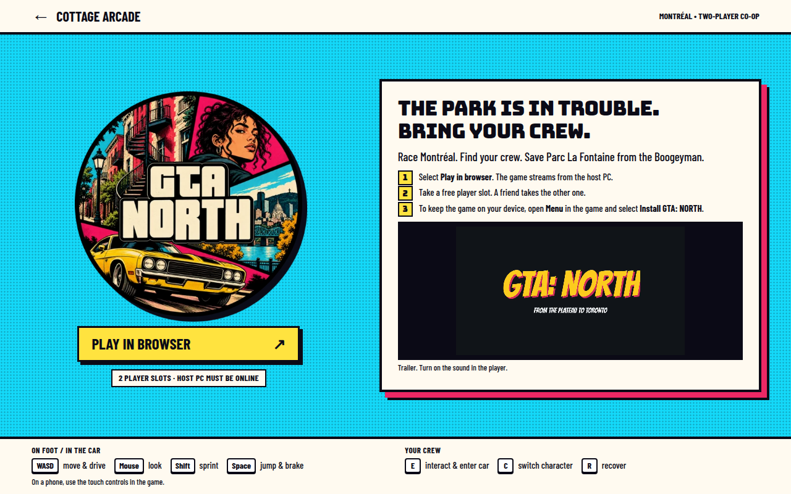
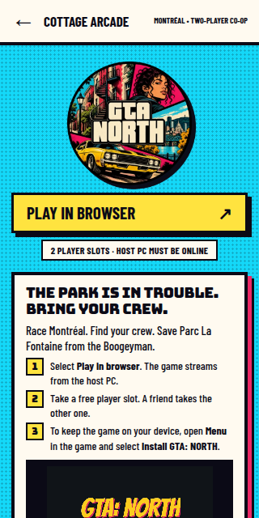
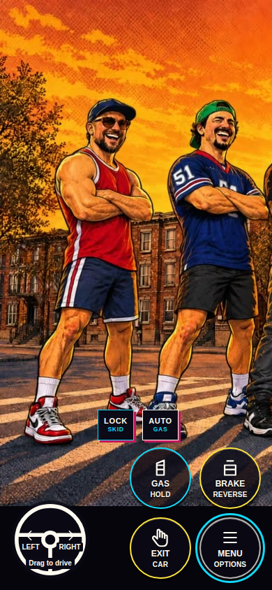
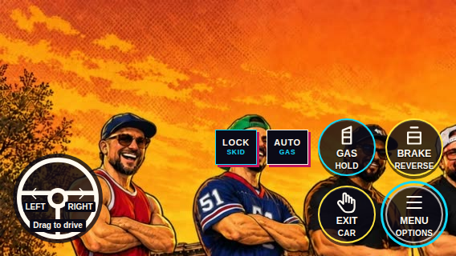
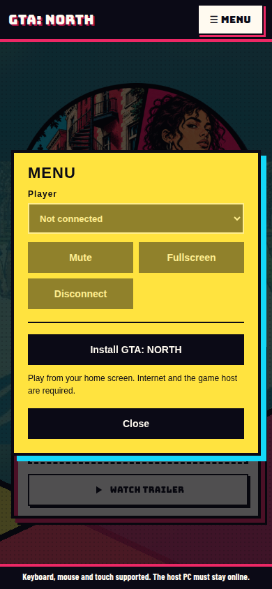
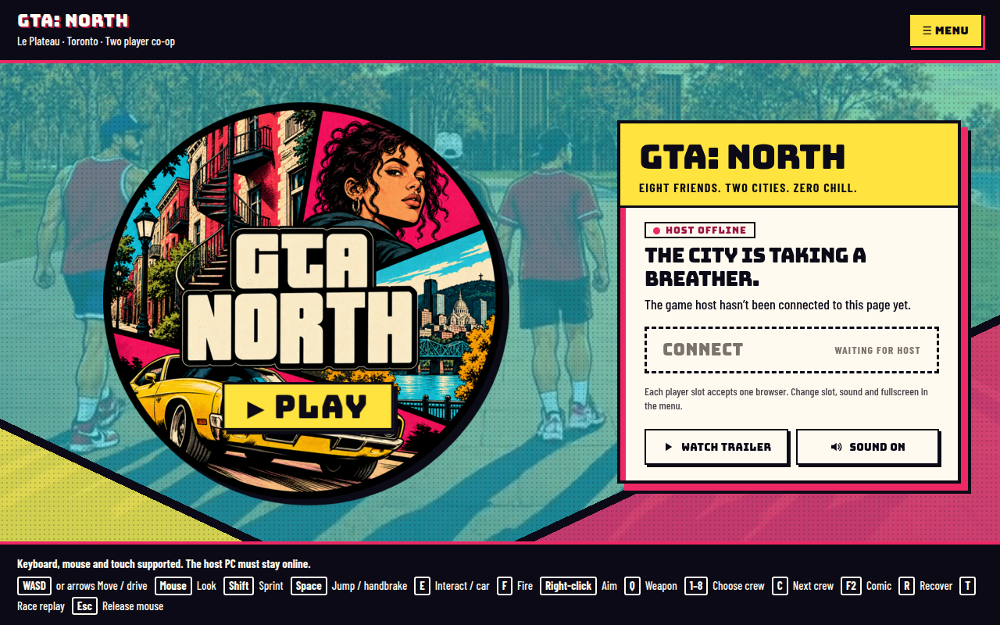
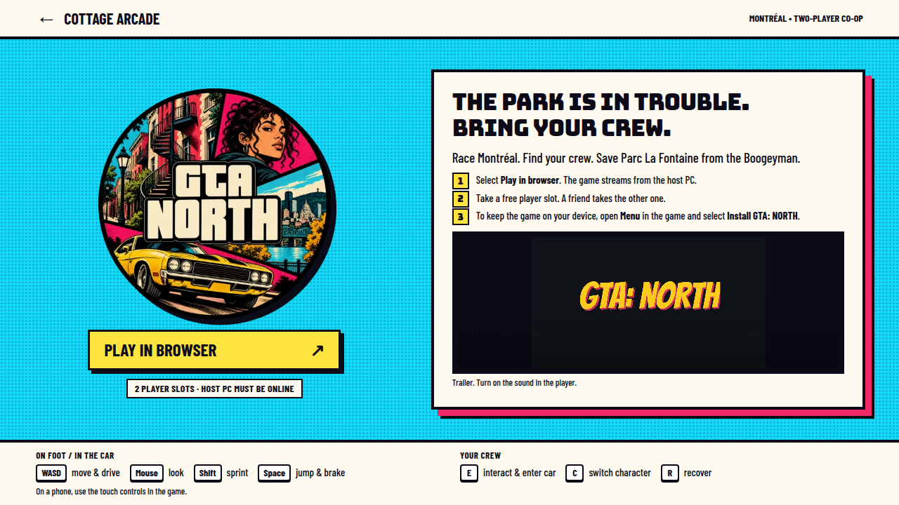
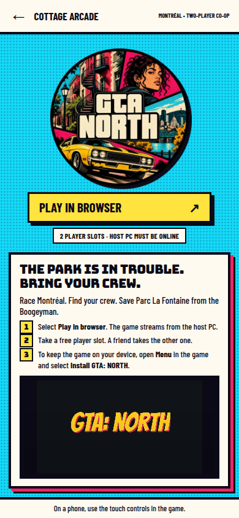
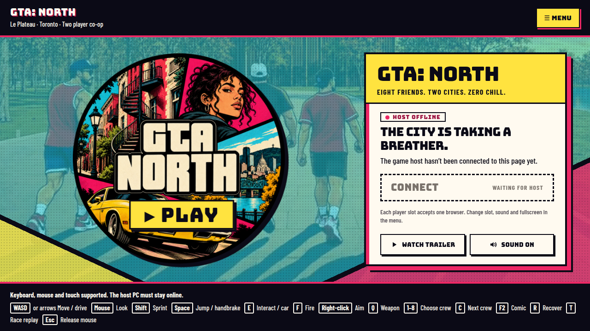
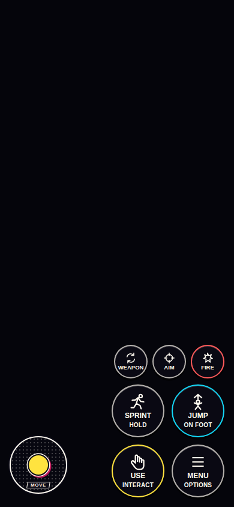

# GTA missions gauntlet

Loop: keep making NORD (the GTA row) clearer, more playable and more fun. Focus group: playability. Reference: GTA 6. Rubric: [RUBRIC.md](RUBRIC.md).

Unreal is not available here, so the native diamond was not captured. The title and the play client were loaded. Job choice is covered by `Scripts/test_job_rules.py` (126 assertions, 0 failures). A round that fails that test or the syntax check is reverted.

### Baseline — 2026-10-21 — rubric v1

- What changed: Nothing. Re-score of the build before round 1, for rubric v1.
- Why it helped: Gives round 1 a number to move.
- Screenshots: none. The round 1 shots are this same shell.
- Next target: mission clarity (2), the lowest playability score.

| Dimension | Score | Why |
| --- | ---: | --- |
| Lighting | 3 | A sky, weather clock and worklight exist; streets are not a lit city. |
| Color palette | 5 | Ink, gold and paper stay consistent from the title badge through the HUD. |
| Detail density | 3 | Park fronts carry balconies and stairs; most other blocks are still plain boxes, and one tree repeats. |
| Texture and material quality | 3 | Some greystone and slate are in the apply step; many surfaces are flat comic fills. |
| Composition and camera | 4 | The chase camera and compact radar leave the street readable; a phone still watches a streamed frame. |
| Atmosphere | 4 | The festival premise, weather and comic captions give the park a mood; the city is not alive at GTA scale. |
| Character models | 3 | Eight crew styles read as people; hands and faces are still coarse. |
| Animation smoothness | 3 | Sprint, jump and comic tumbles exist; locomotion is not a full performance set. |
| Particles and VFX | 2 | Ink, a plunger tug and a hit flash cover the action; ambient effects are almost absent. |
| UI polish | 4 | The mission card, stars and banners are readable; French and English share the screen, and touch hid the retry. |
| Responsiveness and input latency | 3 | Play is a stream; phone steering was rebuilt for late input and is still late. |
| Controls feel | 4 | Graded steering, WASD and aim assist are in; driving is still the hard part. |
| Mission clarity | 2 | The story diamond is clear; after it the card said you were done, and side jobs stayed off the radar past 100 m. |
| Pacing | 3 | Two short story beats, then free roam with nothing pointing at the next job. |
| Fun factor | 4 | The terrace rescue and the lap have a trick and a joke; the side jobs are a delivery, a ram, a fight and an escape. |
| Difficulty curve | 4 | Mission 1 teaches the plunger, then the lap and the three-star escape step up; phone delivery timing is unproven. |
| Feedback | 4 | Mission-complete banners, wanted stars, a hit flash and comic sound words mark the hits. |
| Sound design | 3 | Stingers and a music selector exist; the city is not scored and nobody is voiced. |
| Variety | 3 | Two of eight story missions, four side jobs, and fists through a shotgun. |
| Performance stability | 4 | The six static scenes meet the frame budget; driving, co-op and the stream are not proven. |

- Aesthetics raw: 34 / 10 dimensions, index 34
- Playability raw: 34 / 10 dimensions, index 34
- Total: 68 / 200
- Delta vs last round: —

### Round 1 — 2026-10-21 — rubric v1

- What changed: After both story scenes, the mission card and the existing gold diamond name the nearest unfinished side job, with distance. A running job puts its objective, timer and restart hint on that card. A finished set points at the nearest replay. During the story the campaign objective keeps the diamond. On touch, MISSION RATÉE says Menu · Recover. Keyboard still says R réessaie.
- Why it helped: From the terrace the nearest job is about 199 m away, and from the spawn about 308 m, so the old 100 m radar dots never showed a job. The card also used to say the story was over while a side job was running. A phone player who failed had no retry line, because that line only named the R key.
- Screenshots: title `docs/gauntlet/gta-missions/r1-title-1280.png`, `r1-title-390.png`, `r1-title-320.png`. Play client, host offline, `r1-play-1280.png`. Menu with Recover `r1-play-menu-390.png`. No native before/after: Unreal is not in this container.
- Next target: variety (3), tied with responsiveness, pacing and sound. Variety is the one this loop can raise: the story still stops at mission 2 of 8.

| Dimension | Score | Why |
| --- | ---: | --- |
| Lighting | 3 | Unchanged. Sky and worklight only. |
| Color palette | 5 | Unchanged. The new card uses the same gold and paper. |
| Detail density | 3 | Unchanged. |
| Texture and material quality | 3 | Unchanged. |
| Composition and camera | 4 | Unchanged. The diamond sits in the radar the story already used. |
| Atmosphere | 4 | Unchanged. |
| Character models | 3 | Unchanged. |
| Animation smoothness | 3 | Unchanged. |
| Particles and VFX | 2 | Unchanged. |
| UI polish | 4 | The card is clearer, and touch and keyboard now disagree less about retry; the mixed-language HUD remains. |
| Responsiveness and input latency | 3 | Unchanged. Still a lagged stream. |
| Controls feel | 4 | Unchanged. |
| Mission clarity | 4 | After the story the card names the next job, the diamond and the distance; touch failures name Menu · Recover. There is still no route line, and the story still stops at two missions. |
| Pacing | 3 | Finding a job is no longer a search; the session still ends the story after two beats. |
| Fun factor | 4 | Unchanged. The jobs are easier to start, not yet more fun to play. |
| Difficulty curve | 4 | Unchanged. |
| Feedback | 4 | Unchanged. The failure line is clearer; the hits feel the same. |
| Sound design | 3 | Unchanged. |
| Variety | 3 | Unchanged. Still two story missions and four side jobs. |
| Performance stability | 4 | Unchanged. |

- Aesthetics raw: 34 / 10 dimensions, index 34
- Playability raw: 36 / 10 dimensions, index 36
- Total: 70 / 200
- Delta vs last round: +2 (baseline 68). Mission clarity 2 → 4. Every other score held.

### Round 2 — 2026-10-21 — rubric v1

- What changed: After the lap is banked, the mission card and the gold diamond lead mission 3, Still Life, Moving Target, along the north shore. The player tags the beam that never blinks, moves the worklight through a near lock and a far lock, sprints the opened path, and pulls the picnic clamp. The picnic is session state: the v1 save still stores CompletedMissions 0–2, and a reloaded finish offers the pond again. While it is open, side jobs and race replay wait. R, or Menu · Recover on touch, restores the current step and does not rewind it. Once the picnic is banked, the round 1 side-job guide returns.
- Why it helped: The story stopped at mission 2 of 8, so variety and pacing both sat on "two beats, then free roam." A third beat with a watch, a wrong answer, a route change and a sprint sits between the lap and the side jobs.
- Screenshots: title `docs/gauntlet/gta-missions/r2-title-1280.png`, `r2-title-390.png`, `r2-title-320.png`. Play client, host offline, `r2-play-1280.png`. Menu with Recover `r2-play-menu-390.png`. The title loaded with no page errors. The raw play page still logs the missing `@epicgames-ps/lib-pixelstreamingfrontend-ue5.8` specifier; the shell and the Recover button still draw. No native pond capture: Unreal is not in this container. `Scripts/test_pond_rules.py` reports 373 assertions, 0 failures, on c++, g++ and clang++. `Scripts/test_job_rules.py` still reports 126 assertions, 0 failures. Syntax check `--both` passed for the campaign, the HUD, side jobs and the race-result test.
- Next target: sound design (3), tied with responsiveness. Responsiveness is the stream. This loop can put a cue on the pond beats.

| Dimension | Score | Why |
| --- | ---: | --- |
| Lighting | 3 | Unchanged. Sky and worklight only. |
| Color palette | 5 | Unchanged. The pond posts use the same ink, gold, cream, lime and berry. |
| Detail density | 3 | Unchanged. The new posts are a few comic primitives on the north shore. |
| Texture and material quality | 3 | Unchanged. |
| Composition and camera | 4 | Unchanged. The diamond is the one the story already used. |
| Atmosphere | 4 | Unchanged. The postcard copy is in the card; the shore was not played. |
| Character models | 3 | Unchanged. |
| Animation smoothness | 3 | Unchanged. |
| Particles and VFX | 2 | Unchanged. The blink is a post turning on and off. |
| UI polish | 4 | The card names mission 3, and touch says Menu · Recover. French and English still share the screen. |
| Responsiveness and input latency | 3 | Unchanged. Still a lagged stream. |
| Controls feel | 4 | Unchanged. The dash uses the existing sprint. |
| Mission clarity | 4 | The card names the current pond step and the diamond marks it. There is still no route line, and the native card was not seen. |
| Pacing | 4 | A third story beat now sits between the lap and free roam. |
| Fun factor | 4 | The peel, the wrong beam and the irritated picnic are written. They were not played, so the feel score stays. |
| Difficulty curve | 4 | Unchanged. The new step is a short puzzle in front of the same side jobs. |
| Feedback | 4 | Unchanged. The pond reuses the checkpoint and complete cues. |
| Sound design | 3 | Unchanged. Those cues are the same three one-shots. |
| Variety | 4 | Three of eight story missions are now in the build, plus the four side jobs. The pond was not played in Unreal. |
| Performance stability | 4 | Unchanged. |

- Aesthetics raw: 34 / 10 dimensions, index 34
- Playability raw: 38 / 10 dimensions, index 38
- Total: 72 / 200
- Delta vs last round: +2 (round 1 was 70). Pacing 3 → 4. Variety 3 → 4. Every other score held.

### Round 3 — 2026-10-21 — rubric v1

- What changed: During mission 3's tag step, the local player hears a short original tick whenever the decoy beams change state. Tagging a blinking beam plays the existing dialogue cue. The neighborhood and race loops are unchanged.
- Why it helped: The puzzle is "which beam never blinks," and that blink was silent. The tick gives the watch a rhythm. A miss sounds like dialogue, not like the blink.
- Screenshots: title `docs/gauntlet/gta-missions/r3-title-1280.png`, `r3-title-390.png`, `r3-title-320.png`. Play client, host offline, `r3-play-1280.png`. Menu with Recover `r3-play-menu-390.png`. The title loaded with no page errors. The raw play page still logs the missing `@epicgames-ps/lib-pixelstreamingfrontend-ue5.8` specifier; the shell and Recover still draw. The tick was not heard: Unreal is not in this container. `Scripts/test_pond_rules.py` reports 385 assertions, 0 failures, on c++, g++ and clang++. Syntax check `--both` passed for the controller, the campaign and the music tests.
- Next target: responsiveness and input latency (3), now the only playability score at 3. It is the stream. This loop should not invent a stream fix to move that number.

| Dimension | Score | Why |
| --- | ---: | --- |
| Lighting | 3 | Unchanged. Sky and worklight only. |
| Color palette | 5 | Unchanged. |
| Detail density | 3 | Unchanged. |
| Texture and material quality | 3 | Unchanged. |
| Composition and camera | 4 | Unchanged. |
| Atmosphere | 4 | Unchanged. The shore still was not played. |
| Character models | 3 | Unchanged. |
| Animation smoothness | 3 | Unchanged. |
| Particles and VFX | 2 | Unchanged. The blink is still a post turning on and off. |
| UI polish | 4 | Unchanged. |
| Responsiveness and input latency | 3 | Unchanged. Still a lagged stream. |
| Controls feel | 4 | Unchanged. |
| Mission clarity | 4 | Unchanged. The tick marks the blink; the card is still one line and was not seen in Unreal. |
| Pacing | 4 | Unchanged. |
| Fun factor | 4 | Unchanged. The tick was not heard in play. |
| Difficulty curve | 4 | Unchanged. |
| Feedback | 4 | The blink now has a tick and a wrong tag has the dialogue cue. The hits still use the same three one-shots, and none of this was heard. |
| Sound design | 4 | The tag step ticks with the decoys. The city still has two loops, and nobody is voiced. |
| Variety | 4 | Unchanged. Three of eight story missions. |
| Performance stability | 4 | Unchanged. |

- Aesthetics raw: 34 / 10 dimensions, index 34
- Playability raw: 39 / 10 dimensions, index 39
- Total: 73 / 200
- Delta vs last round: +1 (round 2 was 72). Sound design 3 → 4. Every other score held.

### Round 4 — 2026-10-21 — rubric v1

- What changed: After the picnic is banked, mission 4 Match Pointless leads on the mapped exhibition court. Score the gold panel once (it restarts the rally), bank the ball into the return gate while the ink is off the line, then pull the clamp. The court is session state. The v1 save still stores CompletedMissions 0–2. Side jobs and T wait until the clamp is banked. R restores the current rally and does not rewind it.
- Why it helped: Variety was tied at the bottom of the scores this loop can move. The story stopped at mission 3 of 8, and the picnic handed the player straight to side jobs. The gold panel teaches the loop; the bank is a timing window the ink can spoil.
- Screenshots: title `docs/gauntlet/gta-missions/r4-title-1280.png`, `r4-title-390.png`, `r4-title-320.png`. Play client, host offline, `r4-play-1280.png`. Menu with Recover `r4-play-menu-390.png`. The title loaded with no page errors. The raw play page still logs the missing `@epicgames-ps/lib-pixelstreamingfrontend-ue5.8` specifier; the shell and Recover still draw. No native court capture: Unreal is not in this container. `Scripts/test_court_rules.py` reports 133 assertions, 0 failures, on c++, g++ and clang++. `Scripts/test_pond_rules.py` still reports 385 assertions, 0 failures. `Scripts/test_job_rules.py` still reports 126 assertions, 0 failures. Syntax check `--both` passed for the campaign, the HUD, side jobs and the race-result test. OpenSpec CLI is not installed, so `openspec validate` did not run.
- Next target: fun factor (4), tied with controls, mission clarity, pacing, feedback, sound and performance. Responsiveness stays at 3 and stays out of scope. This loop should put a played payoff on the bank shot, or open mission 5, rather than touch the stream.

| Dimension | Score | Why |
| --- | ---: | --- |
| Lighting | 3 | Unchanged. Sky and worklight only. |
| Color palette | 5 | Unchanged. The court posts use the same ink, gold, cream, lime and berry. |
| Detail density | 3 | Unchanged. The new posts are a few comic primitives on one court. |
| Texture and material quality | 3 | Unchanged. |
| Composition and camera | 4 | Unchanged. The diamond is the one the story already used. |
| Atmosphere | 4 | Unchanged. The exhibition copy is in the card; the court was not played. |
| Character models | 3 | Unchanged. |
| Animation smoothness | 3 | Unchanged. The ball steps between panels. It is not a rally. |
| Particles and VFX | 2 | Unchanged. The ink is a bar turning on and off. |
| UI polish | 4 | The card names mission 4, and touch says Menu · Recover. French and English still share the screen. |
| Responsiveness and input latency | 3 | Unchanged. Still a lagged stream. Out of scope for this loop. |
| Controls feel | 4 | Unchanged. Scoring is still E at a panel. There is no racket. |
| Mission clarity | 4 | The card names the gold trap and the return gate. The native card was not seen, and there is still no route line. |
| Pacing | 4 | Unchanged. A fourth beat exists on paper between the picnic and the side jobs. Its length was not played. |
| Fun factor | 4 | The absurd bank and the penalty on the light are written. They were not played, so the feel score stays. |
| Difficulty curve | 5 | The gold panel teaches the loop. The bank then adds a window the ink can close. The rules prove both a clear window and a dangerous one. |
| Feedback | 4 | The trap panel uses the dialogue cue. The bank and the pull reuse checkpoint and complete. None of it was heard. |
| Sound design | 4 | Unchanged. The city still has two loops and the pond tick. Nobody is voiced. |
| Variety | 5 | Four of eight story missions are now in the build, plus the four side jobs. The court was not played in Unreal. |
| Performance stability | 4 | Unchanged. |

- Aesthetics raw: 34 / 10 dimensions, index 34
- Playability raw: 41 / 10 dimensions, index 41
- Total: 75 / 200
- Delta vs last round: +2 (round 3 was 73). Difficulty curve 4 → 5. Variety 4 → 5. Every other score held.

### Round 5 — 2026-10-21 — rubric v1

- What changed: After the court is banked, mission 5 Standing Ovation leads on dry ground south of the west pond. Walk to the loading edge, set the followspot and hang the backdrop in either order, then call the curtain from that edge. The curtain reveals four comic panels. A local page sound plays once on that step. The show is session state. The v1 save still stores CompletedMissions 0–2. Side jobs and T wait until the curtain. R restores the current step and does not rewind a station that is already set.
- Why it helped: Fun was the tied target, and the story still stopped before the show the rescues were building toward. The either-order stations and the page turn are that show's joke. The page sound is the first payoff that is not one of the three cooked cues.
- Screenshots: title `docs/gauntlet/gta-missions/r5-title-1280.png`, `r5-title-390.png`, `r5-title-320.png`. Play client, host offline, `r5-play-1280.png`. Menu with Recover `r5-play-menu-390.png`. The title loaded with no page errors. The raw play page still logs the missing `@epicgames-ps/lib-pixelstreamingfrontend-ue5.8` specifier; the shell and Recover still draw. No native show capture: Unreal is not in this container. `Scripts/test_show_rules.py` reports 221 assertions, 0 failures, on c++, g++ and clang++. Court, pond and job rule tests still pass. Syntax check `--both` passed for the campaign, the controller, the race-result test and the music tests. OpenSpec CLI is not installed, so `openspec validate` did not run.
- Next target: fun factor (4), still tied with controls, mission clarity, pacing, sound and performance. Responsiveness stays at 3 and stays out of scope. The page is in the build, but it was not played, so the feel score waits. The next round should keep going into mission 6 rather than touch the stream.

| Dimension | Score | Why |
| --- | ---: | --- |
| Lighting | 3 | Unchanged. Sky and worklight only. |
| Color palette | 5 | Unchanged. The show posts use the same ink, gold, cream, lime and berry. |
| Detail density | 3 | Unchanged. The new posts are a few comic primitives south of the pond. |
| Texture and material quality | 3 | Unchanged. |
| Composition and camera | 4 | Unchanged. The diamond is the one the story already used. |
| Atmosphere | 4 | Unchanged. The ovation copy is in the card; the show was not played. |
| Character models | 3 | Unchanged. |
| Animation smoothness | 3 | Unchanged. The page is posts appearing. |
| Particles and VFX | 2 | Unchanged. No new effect. The page is visibility. |
| UI polish | 4 | The card names mission 5, and touch says Menu · Recover. French and English still share the screen. |
| Responsiveness and input latency | 3 | Unchanged. Still a lagged stream. Out of scope for this loop. |
| Controls feel | 4 | Unchanged. The stations are still E. There is no followspot aim. |
| Mission clarity | 4 | The card names either station and then the loading edge. The native card was not seen, and there is still no route line. |
| Pacing | 4 | Unchanged. A fifth beat exists on paper between the court and the side jobs. Its length was not played. |
| Fun factor | 4 | The either-order rehearsal and the page turn are written. They were not played, so the feel score stays. |
| Difficulty curve | 5 | Unchanged. The new beat is a short choice in front of the same side jobs. |
| Feedback | 5 | The curtain plays a page sound that is not the pond tick and not one of the three cooked cues. It was not heard in Unreal. |
| Sound design | 4 | Unchanged. The city still has two loops. The page is one more procedural blip, and nobody is voiced. |
| Variety | 6 | Five of eight story missions are now in the build, plus the four side jobs. The show was not played in Unreal. |
| Performance stability | 4 | Unchanged. |

- Aesthetics raw: 34 / 10 dimensions, index 34
- Playability raw: 43 / 10 dimensions, index 43
- Total: 77 / 200
- Delta vs last round: +2 (round 4 was 75). Feedback 4 → 5. Variety 5 → 6. Every other score held.

### Round 6 — 2026-10-21 — rubric v1

- What changed: A clear bank on mission 4 plays a short original whistle when the step moves from the return gate to the clamp. A bank spoiled by the ink, or taken before the ball is on the middle panel, stays on that step, increments a session-only miss count, and the local player hears a rasp. The miss count is not in the v1 save. The cooked cues, the pond tick, the page, and the music loops are unchanged.
- Why it helped: The bank was the mission's joke, and it answered with the same checkpoint cue as a walk-up. The whistle marks the shot that lands. The rasp marks the one the ink takes.
- Screenshots: title `docs/gauntlet/gta-missions/r6-title-1280.png`, `r6-title-390.png`, `r6-title-320.png`. Play client, host offline, `r6-play-1280.png`. Menu with Recover `r6-play-menu-390.png`. The title loaded with no page errors. The raw play page still logs the missing `@epicgames-ps/lib-pixelstreamingfrontend-ue5.8` specifier; the shell and Recover still draw. The whistle and the rasp were not heard: Unreal is not in this container. `Scripts/test_court_rules.py` reports 144 assertions, 0 failures, on c++, g++ and clang++. Syntax check `--both` passed for the campaign, the controller, the race-result test and the music tests. OpenSpec CLI is not installed, so `openspec validate` did not run.
- Next target: fun factor (4), still tied with controls, mission clarity, pacing, sound and performance. Responsiveness stays at 3 and stays out of scope. The whistle was not played, so the feel score waits. The next round should open mission 6 rather than touch the stream.

| Dimension | Score | Why |
| --- | ---: | --- |
| Lighting | 3 | Unchanged. |
| Color palette | 5 | Unchanged. |
| Detail density | 3 | Unchanged. |
| Texture and material quality | 3 | Unchanged. |
| Composition and camera | 4 | Unchanged. |
| Atmosphere | 4 | Unchanged. The court was not played. |
| Character models | 3 | Unchanged. |
| Animation smoothness | 3 | Unchanged. |
| Particles and VFX | 2 | Unchanged. |
| UI polish | 4 | Unchanged. |
| Responsiveness and input latency | 3 | Unchanged. Still a lagged stream. Out of scope for this loop. |
| Controls feel | 4 | Unchanged. The bank is still E at the gate. |
| Mission clarity | 4 | Unchanged. The card already named the gate. The sounds were not heard in play. |
| Pacing | 4 | Unchanged. |
| Fun factor | 4 | The penalty on the light now has a whistle on paper. It was not played, so the feel score stays. |
| Difficulty curve | 5 | Unchanged. The ink window was already there. The rasp names a miss; it does not change the window. |
| Feedback | 6 | A clear bank whistles and a spoiled bank rasps. Those are not the checkpoint cue, the pond tick, or the page. They were not heard in Unreal. |
| Sound design | 4 | Unchanged. The city still has two loops. The whistle and the rasp are short blips, and nobody is voiced. |
| Variety | 6 | Unchanged. Five of eight story missions. |
| Performance stability | 4 | Unchanged. |

- Aesthetics raw: 34 / 10 dimensions, index 34
- Playability raw: 44 / 10 dimensions, index 44
- Total: 78 / 200
- Delta vs last round: +1 (round 5 was 77). Feedback 5 → 6. Every other score held.

### Round 7 — 2026-10-21 — rubric v1

- What changed: After the show is banked, mission 6 Nobody Left in the Picture leads through three short pulls, in any order, on dry ground at the terrace, the north pond and the court. Freeing one group does not clear the others. The mask is session state. The v1 save still stores CompletedMissions 0–2. Side jobs and T wait until every group is out. R restores the current group and does not clear a freed bit. The terrace recover steps east, away from the water. The pond and the court recover step south.
- Why it helped: Fun was the tied target, and the story still stopped while three groups were in the pictures. The any-order pulls are that chapter's joke without NPC escorts. The diamond names the first unfinished group, and any unfinished post still accepts E.
- Screenshots: title `docs/gauntlet/gta-missions/r7-title-1280.png`, `r7-title-390.png`, `r7-title-320.png`. Play client, host offline, `r7-play-1280.png`. Menu with Recover `r7-play-menu-390.png`. The title loaded with no page errors. The raw play page still logs the missing `@epicgames-ps/lib-pixelstreamingfrontend-ue5.8` specifier; the shell and Recover still draw. No native rescue capture: Unreal is not in this container. `Scripts/test_rescue_rules.py` reports 226 assertions, 0 failures, on c++, g++ and clang++. Show, court, pond and job rule tests still pass. Syntax check `--both` passed for the campaign, the controller and the race-result test. OpenSpec CLI is not installed, so `openspec validate` did not run.
- Next target: fun factor (4), still tied with controls, mission clarity, pacing, sound and performance. Responsiveness stays at 3 and stays out of scope. The three pulls were not played, so the feel score waits. The next round should keep going into mission 7 rather than touch the stream.

| Dimension | Score | Why |
| --- | ---: | --- |
| Lighting | 3 | Unchanged. Sky and worklight only. |
| Color palette | 5 | Unchanged. The rescue posts use the same cream, gold and lime. |
| Detail density | 3 | Unchanged. The new posts are three comic cylinders. |
| Texture and material quality | 3 | Unchanged. |
| Composition and camera | 4 | Unchanged. The diamond is the one the story already used. |
| Atmosphere | 4 | Unchanged. The group copy is in the card; the pulls were not played. |
| Character models | 3 | Unchanged. |
| Animation smoothness | 3 | Unchanged. A freed group is a bit, not a walk. |
| Particles and VFX | 2 | Unchanged. No new effect. |
| UI polish | 4 | The card names mission 6, and touch says Menu · Recover. French and English still share the screen. |
| Responsiveness and input latency | 3 | Unchanged. Still a lagged stream. Out of scope for this loop. |
| Controls feel | 4 | Unchanged. Each group is still E. There is no escort. |
| Mission clarity | 4 | The card names the open groups and any order. The native card was not seen, and there is still no route line. |
| Pacing | 4 | Unchanged. A sixth beat exists on paper between the show and the side jobs. Its length was not played. |
| Fun factor | 4 | The any-order rescues and Memphis's line are written. They were not played, so the feel score stays. |
| Difficulty curve | 5 | Unchanged. Three pulls in any order do not add a tighter window than the ink. |
| Feedback | 6 | Unchanged. A group uses the checkpoint cue and the last group uses complete. No new tone. |
| Sound design | 4 | Unchanged. The city still has two loops. Nobody is voiced. |
| Variety | 7 | Six of eight story missions are now in the build, plus the four side jobs. The rescue was not played in Unreal. |
| Performance stability | 4 | Unchanged. |

- Aesthetics raw: 34 / 10 dimensions, index 34
- Playability raw: 45 / 10 dimensions, index 45
- Total: 79 / 200
- Delta vs last round: +1 (round 6 was 78). Variety 6 → 7. Every other score held.

### Round 8 — 2026-10-21 — rubric v1

- What changed: After every group is out, mission 7 Can't Tow Tomorrow leads along the street ring. Walk to the ink feeder, pull its clamp in the beam's gap, invert the projector plate, then take the escape gate. A pull while the beam is painting stays on that step. A pull during the warning still lands. The step is session state. The v1 save still stores CompletedMissions 0–2. Side jobs and T wait until the escape. R restores the current stop and does not rewind a disruption. The recover points step off the carriageway, away from the race gates.
- Why it helped: Fun was the tied target, and the story still stopped while the border was being drawn. The gap is a second timing read after the court's ink window. The moving wagons and the drive stay out of this round.
- Screenshots: title `docs/gauntlet/gta-missions/r8-title-1280.png`, `r8-title-390.png`, `r8-title-320.png`. Play client, host offline, `r8-play-1280.png`. Menu with Recover `r8-play-menu-390.png`. The title loaded with no page errors. The raw play page still logs the missing `@epicgames-ps/lib-pixelstreamingfrontend-ue5.8` specifier; the shell and Recover still draw. No native convoy capture: Unreal is not in this container. `Scripts/test_convoy_rules.py` reports 94 assertions, 0 failures, on c++, g++ and clang++. Rescue, show, court, pond and job rule tests still pass. Syntax check `--both` passed for the campaign, the controller and the race-result test. OpenSpec CLI is not installed, so `openspec validate` did not run.
- Next target: fun factor (4), still tied with controls, mission clarity, pacing, sound and performance. Responsiveness stays at 3 and stays out of scope. The gap was not played, so the feel score waits. The next round should open mission 8 rather than touch the stream.

| Dimension | Score | Why |
| --- | ---: | --- |
| Lighting | 3 | Unchanged. Sky and worklight only. |
| Color palette | 5 | Unchanged. The convoy posts use the same berry, gold, lime and cream. |
| Detail density | 3 | Unchanged. The new posts are a feeder, a beam bar, a projector and a gate. |
| Texture and material quality | 3 | Unchanged. |
| Composition and camera | 4 | Unchanged. The diamond is the one the story already used. |
| Atmosphere | 4 | Unchanged. The border copy is in the card; the gap was not played. |
| Character models | 3 | Unchanged. |
| Animation smoothness | 3 | Unchanged. The beam is a bar appearing. |
| Particles and VFX | 2 | Unchanged. No new effect. |
| UI polish | 4 | The card names mission 7, and touch says Menu · Recover. French and English still share the screen. |
| Responsiveness and input latency | 3 | Unchanged. Still a lagged stream. Out of scope for this loop. |
| Controls feel | 4 | Unchanged. The pull is still E. There is no drive. |
| Mission clarity | 4 | The card names the gap and then the plate. The native card was not seen, and there is still no route line. |
| Pacing | 4 | Unchanged. A seventh beat exists on paper between the groups and the side jobs. Its length was not played. |
| Fun factor | 4 | The beam gap and the borrowed route line are written. They were not played, so the feel score stays. |
| Difficulty curve | 6 | The paint refuses the pull. The warning still lets it land. The rules prove both. It was not played. |
| Feedback | 6 | Unchanged. A painted pull uses the dialogue cue. The gap and the escape reuse checkpoint and complete. |
| Sound design | 4 | Unchanged. The city still has two loops. Nobody is voiced. |
| Variety | 8 | Seven of eight story missions are now in the build, plus the four side jobs. The convoy was not played in Unreal. |
| Performance stability | 4 | Unchanged. |

- Aesthetics raw: 34 / 10 dimensions, index 34
- Playability raw: 47 / 10 dimensions, index 47
- Total: 81 / 200
- Delta vs last round: +2 (round 7 was 79). Difficulty curve 5 → 6. Variety 7 → 8. Every other score held.

### Round 9 — 2026-10-21 — rubric v1

- What changed: After the convoy is banked, mission 8 Leave the Last Page Blank leads through three projection gates in order, on dry ground south of the theatre, then a pull that leaves the page blank. Crossing a gate does not skip the next one. The step is session state. The v1 save still stores CompletedMissions 0–2. Side jobs and T wait until the page is blank. R restores the current gate and does not uncross one that is already crossed.
- Why it helped: Fun was the tied target, and the story still stopped one chapter short. The three gates are the "draw him out" beat without the drive. The pull is the blank page. The page-turn attack and the two clamps stay out of this round.
- Screenshots: title `docs/gauntlet/gta-missions/r9-title-1280.png`, `r9-title-390.png`, `r9-title-320.png`. Play client, host offline, `r9-play-1280.png`. Menu with Recover `r9-play-menu-390.png`. The title loaded with no page errors. The raw play page still logs the missing `@epicgames-ps/lib-pixelstreamingfrontend-ue5.8` specifier; the shell and Recover still draw. No native page capture: Unreal is not in this container. `Scripts/test_blank_rules.py` reports 124 assertions, 0 failures, on c++, g++ and clang++. Convoy rules still pass. Syntax check `--both` passed for the campaign, the controller and the race-result test. OpenSpec CLI is not installed, so `openspec validate` did not run.
- Next target: fun factor (4), still tied with controls, mission clarity, pacing, sound and performance. Responsiveness stays at 3 and stays out of scope. All eight story missions are now in the build as session beats, and none of the new ones were played, so the feel score waits. The next round should change how a beat plays, such as a route line on the card, rather than touch the stream.

| Dimension | Score | Why |
| --- | ---: | --- |
| Lighting | 3 | Unchanged. |
| Color palette | 5 | Unchanged. The gates use the same lime, gold and cream. |
| Detail density | 3 | Unchanged. Three gates and a panel. |
| Texture and material quality | 3 | Unchanged. |
| Composition and camera | 4 | Unchanged. |
| Atmosphere | 4 | Unchanged. The blank-page line is in the card; it was not played. |
| Character models | 3 | Unchanged. |
| Animation smoothness | 3 | Unchanged. A gate is a post appearing. |
| Particles and VFX | 2 | Unchanged. |
| UI polish | 4 | The card names mission 8, and touch says Menu · Recover. French and English still share the screen. |
| Responsiveness and input latency | 3 | Unchanged. Still a lagged stream. Out of scope for this loop. |
| Controls feel | 4 | Unchanged. The gates are walk-up and the page is E. There is no drive. |
| Mission clarity | 4 | The card names the current gate, then the page. The native card was not seen, and there is still no route line. |
| Pacing | 4 | Unchanged. An eighth beat exists on paper. Its length was not played. |
| Fun factor | 4 | The blank page is written. It was not played, so the feel score stays. |
| Difficulty curve | 6 | Unchanged. The gates are in order. They do not add a tighter window than the beam. |
| Feedback | 6 | Unchanged. A gate uses the checkpoint cue and the page uses complete. |
| Sound design | 4 | Unchanged. The city still has two loops. Nobody is voiced. |
| Variety | 9 | Eight of eight story missions are now in the build, plus the four side jobs. The page was not played in Unreal. |
| Performance stability | 4 | Unchanged. |

- Aesthetics raw: 34 / 10 dimensions, index 34
- Playability raw: 48 / 10 dimensions, index 48
- Total: 82 / 200
- Delta vs last round: +1 (round 8 was 81). Variety 8 → 9. Every other score held.

### Round 10 — 2026-10-21 — rubric v1

- What changed: While a diamond is showing, the mission card names the turn (ahead, left, right, behind, or here) and draws a gold needle. The radar draws a gold stroke from the player to that diamond, inset past the arrow and short of the diamond. A linear beat also draws a fainter stroke toward the next stop. A rescue group and a side-job guide do not. When the world diamond is outside the safe view, a gold chevron sits on the inset edge and points at the stop. A stop behind the camera leaves through the bottom of the frame.
- Why it helped: Fun was the tied target. Beats played as a name, a distance, and a diamond. The needle says which way to turn. The stroke is the way to the stop. The chevron keeps that way when the diamond leaves the frame.
- Screenshots: title `docs/gauntlet/gta-missions/r10-title-1280.png`, `r10-title-390.png`, `r10-title-320.png`. Play client, host offline, `r10-play-1280.png`. Menu with Recover `r10-play-menu-390.png`. The title loaded with no page errors. The raw play page still logs the missing `@epicgames-ps/lib-pixelstreamingfrontend-ue5.8` specifier; the shell and Recover still draw. No native route line: Unreal is not in this container. `Scripts/test_route_line.py` reports 34 assertions, 0 failures, on c++, g++ and clang++. Syntax check `--both` passed for the campaign and the HUD. OpenSpec CLI is not installed, so `openspec validate` did not run.
- Next target: fun factor (4), still tied with controls, pacing, sound and performance. Responsiveness stays at 3 and stays out of scope. The card now names the turn, and the rules prove ahead, left, right, behind, here, the radar insets and the edge chevron. The native HUD was not seen, so the feel score waits. The next round should keep changing how a beat plays, not add a chapter and not touch the stream.

| Dimension | Score | Why |
| --- | ---: | --- |
| Lighting | 3 | Unchanged. |
| Color palette | 5 | Unchanged. The needle, the stroke and the chevron use the same gold. |
| Detail density | 3 | Unchanged. |
| Texture and material quality | 3 | Unchanged. |
| Composition and camera | 4 | Unchanged. The chevron sits on the existing view inset. It was not seen in the native frame. |
| Atmosphere | 4 | Unchanged. |
| Character models | 3 | Unchanged. |
| Animation smoothness | 3 | Unchanged. |
| Particles and VFX | 2 | Unchanged. |
| UI polish | 4 | The turn word is on the card. The native card was not seen, and French and English still share the screen. |
| Responsiveness and input latency | 3 | Unchanged. Still a lagged stream. Out of scope for this loop. |
| Controls feel | 4 | Unchanged. The needle follows facing. Steering is the same. |
| Mission clarity | 5 | The card names ahead, left, right, behind, or here, and the radar strokes the stop. The rules prove the needle, the insets, the next-stop stroke and the off-screen chevron. The native HUD was not seen. |
| Pacing | 4 | Unchanged. The route is marked. The length of a beat was not played. |
| Fun factor | 4 | The way to the stop is written. It was not played, so the feel score stays. |
| Difficulty curve | 6 | Unchanged. The line does not add a tighter window. |
| Feedback | 6 | Unchanged. The line is a mark, not a new hit. |
| Sound design | 4 | Unchanged. The city still has two loops. Nobody is voiced. |
| Variety | 9 | Unchanged. Eight of eight story missions, plus the four side jobs. |
| Performance stability | 4 | Unchanged. |

- Aesthetics raw: 34 / 10 dimensions, index 34
- Playability raw: 49 / 10 dimensions, index 49
- Total: 83 / 200
- Delta vs last round: +1 (round 9 was 82). Mission clarity 4 → 5. Every other score held.

### Round 11 — 2026-10-21 — rubric v1

- What changed: On foot, the turn word and the needle follow the camera yaw, flattened. Ahead means walk forward. Right means strafe right. In a car the word follows the nose, because that is the way the car drives. The world chevron still uses the full camera, including pitch.
- Why it helped: Fun was the tied target, and the route line could disagree with the walk. The body turns only after you move, while W follows the camera. A needle on the body told you to turn a character who is not the stick.
- Screenshots: title `docs/gauntlet/gta-missions/r11-title-1280.png`, `r11-title-390.png`, `r11-title-320.png`. Play client, host offline, `r11-play-1280.png`. Menu with Recover `r11-play-menu-390.png`. The title loaded with no page errors. The raw play page still logs the missing `@epicgames-ps/lib-pixelstreamingfrontend-ue5.8` specifier; the shell and Recover still draw. No native needle: Unreal is not in this container. `Scripts/test_route_line.py` reports 40 assertions, 0 failures, on c++, g++ and clang++. Syntax check `--both` passed for the HUD. OpenSpec CLI is not installed, so `openspec validate` did not run.
- Next target: fun factor (4), still tied with controls, pacing, sound and performance. Responsiveness stays at 3 and stays out of scope. The word now matches the walk key, which is clearer, and it was not played, so the feel score waits. Steering itself did not change. The next round should keep changing how a beat plays, not add a chapter and not touch the stream.

| Dimension | Score | Why |
| --- | ---: | --- |
| Lighting | 3 | Unchanged. |
| Color palette | 5 | Unchanged. |
| Detail density | 3 | Unchanged. |
| Texture and material quality | 3 | Unchanged. |
| Composition and camera | 4 | Unchanged. The shoulder camera is the graphics loop's. |
| Atmosphere | 4 | Unchanged. |
| Character models | 3 | Unchanged. |
| Animation smoothness | 3 | Unchanged. |
| Particles and VFX | 2 | Unchanged. |
| UI polish | 4 | Unchanged. The native card was not seen, and French and English still share the screen. |
| Responsiveness and input latency | 3 | Unchanged. Still a lagged stream. Out of scope for this loop. |
| Controls feel | 4 | The word matches the walk key. Graded steering is the same, and it was not driven. |
| Mission clarity | 6 | Ahead is walk forward along the camera yaw, and a car uses its nose. The rules prove both. The native HUD was not seen. |
| Pacing | 4 | Unchanged. The length of a beat was not played. |
| Fun factor | 4 | The turn now matches the stick. It was not played, so the feel score stays. |
| Difficulty curve | 6 | Unchanged. |
| Feedback | 6 | Unchanged. |
| Sound design | 4 | Unchanged. The city still has two loops. Nobody is voiced. |
| Variety | 9 | Unchanged. Eight of eight story missions, plus the four side jobs. |
| Performance stability | 4 | Unchanged. |

- Aesthetics raw: 34 / 10 dimensions, index 34
- Playability raw: 50 / 10 dimensions, index 50
- Total: 84 / 200
- Delta vs last round: +1 (round 10 was 83). Mission clarity 5 → 6. Every other score held.

### Round 12 — 2026-10-21 — rubric v1

- What changed: On the ovation, the faint route stroke no longer picks a station during the either-order choice. After the followspot, the stroke leads to the curtain, not back to the followspot. After the backdrop, it does the same. The loading edge still leads to the choice.
- Why it helped: Fun was the tied target, and the new route line lied on mission 5. Either station is legal, but the stroke pointed only at the backdrop. Once the followspot was set, the next stroke pointed back at the followspot instead of the curtain.
- Screenshots: title `docs/gauntlet/gta-missions/r12-title-1280.png`, `r12-title-390.png`, `r12-title-320.png`. Play client, host offline, `r12-play-1280.png`. Menu with Recover `r12-play-menu-390.png`. The title loaded with no page errors. The raw play page still logs the missing `@epicgames-ps/lib-pixelstreamingfrontend-ue5.8` specifier; the shell and Recover still draw. No native stroke: Unreal is not in this container. `Scripts/test_show_rules.py` reports 228 assertions, 0 failures, on c++, g++ and clang++. Syntax check `--both` passed for the campaign. OpenSpec CLI is not installed, so `openspec validate` did not run.
- Next target: fun factor (4), still tied with controls, pacing, sound and performance. Responsiveness stays at 3 and stays out of scope. The ovation stroke now matches the either-order rule, and it was not played, so the feel score waits. The next round should keep changing how a beat plays, not add a chapter and not touch the stream.

| Dimension | Score | Why |
| --- | ---: | --- |
| Lighting | 3 | Unchanged. |
| Color palette | 5 | Unchanged. |
| Detail density | 3 | Unchanged. |
| Texture and material quality | 3 | Unchanged. |
| Composition and camera | 4 | Unchanged. |
| Atmosphere | 4 | Unchanged. |
| Character models | 3 | Unchanged. |
| Animation smoothness | 3 | Unchanged. |
| Particles and VFX | 2 | Unchanged. |
| UI polish | 4 | Unchanged. The native card was not seen, and French and English still share the screen. |
| Responsiveness and input latency | 3 | Unchanged. Still a lagged stream. Out of scope for this loop. |
| Controls feel | 4 | Unchanged. Steering was not driven. |
| Mission clarity | 7 | The ovation no longer strokes a station that is already set, and the choice has no single next stop. The rules prove it. The native HUD was not seen. |
| Pacing | 4 | Unchanged. The length of a beat was not played. |
| Fun factor | 4 | The false stroke is gone. The ovation was not played, so the feel score stays. |
| Difficulty curve | 6 | Unchanged. Either order is the same rule as before. |
| Feedback | 6 | Unchanged. |
| Sound design | 4 | Unchanged. The city still has two loops. Nobody is voiced. |
| Variety | 9 | Unchanged. Eight of eight story missions, plus the four side jobs. |
| Performance stability | 4 | Unchanged. |

- Aesthetics raw: 34 / 10 dimensions, index 34
- Playability raw: 51 / 10 dimensions, index 51
- Total: 85 / 200
- Delta vs last round: +1 (round 11 was 84). Mission clarity 6 → 7. Every other score held.

### Round 13 — 2026-10-21 — rubric v1

- What changed: While a story beat or the terrace is open, the mission card says which stop this is, such as 2 of 6. When the next stop is a walk, it also says about how many seconds that leg takes at 450 cm/s, the player's walking speed. The ovation's either-order choice and a rescue group do not invent one walk. Parking the car and releasing the table are not walks. The race keeps its own clock. Sprint stays 800 cm/s, so a sprint arrives sooner than the card's walk.
- Why it helped: Pacing was a 4 the tests can prove. A beat was a sentence and a diamond. Nothing said how much of it was left, or how long the next leg was.
- Screenshots: title `docs/gauntlet/gta-missions/r13-title-1280.png`, `r13-title-390.png`, `r13-title-320.png`. Play client, host offline, `r13-play-1280.png`. Menu with Recover `r13-play-menu-390.png`. The title loaded with no page errors. The raw play page still logs the missing `@epicgames-ps/lib-pixelstreamingfrontend-ue5.8` specifier; the shell and Recover still draw. No native card: Unreal is not in this container. `Scripts/test_beat_pace.py` reports 20 assertions, 0 failures, on c++, g++ and clang++. Syntax check `--both` passed for the campaign and the HUD. OpenSpec CLI is not installed, so `openspec validate` did not run.
- Next target: fun factor (4), still tied with controls, sound and performance. Responsiveness stays at 3 and stays out of scope. The length is now a number the rules prove. It was not walked in Unreal, so the feel score waits. The next round should keep to a 4 the tests can prove, such as controls via the input mapping, and should not add a chapter or touch the stream.

| Dimension | Score | Why |
| --- | ---: | --- |
| Lighting | 3 | Unchanged. |
| Color palette | 5 | Unchanged. |
| Detail density | 3 | Unchanged. |
| Texture and material quality | 3 | Unchanged. |
| Composition and camera | 4 | Unchanged. |
| Atmosphere | 4 | Unchanged. |
| Character models | 3 | Unchanged. |
| Animation smoothness | 3 | Unchanged. |
| Particles and VFX | 2 | Unchanged. |
| UI polish | 4 | The count shares the status line, which already wraps. The native card was not seen, and French and English still share the screen. |
| Responsiveness and input latency | 3 | Unchanged. Still a lagged stream. Out of scope for this loop. |
| Controls feel | 4 | Unchanged. The walk speed on the card is the same 450 cm/s the player already uses. Steering was not driven. |
| Mission clarity | 7 | Unchanged. The turn line is the same. The new text is the length. |
| Pacing | 5 | The card says which stop this is, and about how many seconds the next walk is. The rules prove the counts and the seconds. A sprint is faster, and the walk was not timed in Unreal. |
| Fun factor | 4 | The length is written. It was not walked, so the feel score stays. |
| Difficulty curve | 6 | Unchanged. The seconds do not add a fail state. |
| Feedback | 6 | Unchanged. |
| Sound design | 4 | Unchanged. The city still has two loops. Nobody is voiced. |
| Variety | 9 | Unchanged. Eight of eight story missions, plus the four side jobs. |
| Performance stability | 4 | Unchanged. |

- Aesthetics raw: 34 / 10 dimensions, index 34
- Playability raw: 52 / 10 dimensions, index 52
- Total: 86 / 200
- Delta vs last round: +1 (round 12 was 85). Pacing 4 → 5. Every other score held.

### Round 14 — 2026-10-21 — rubric v1

- What changed: Up and Down walk and drive forward and back at the same scale as W and S. Left and Right strafe at the same scale as D and A. The arrow keys are not also actions. The phone wheel's NumPad levels stay a third and two thirds of full lock. The drive hint and the play page name the arrows.
- Why it helped: Controls feel was a 4 the input mapping can prove. Walk and drive were WASD only. The route line says left and right, and the arrow keys did nothing.
- Screenshots: title `docs/gauntlet/gta-missions/r14-title-1280.png`, `r14-title-390.png`, `r14-title-320.png`. Play client, host offline, `r14-play-1280.png`. Menu with Recover `r14-play-menu-390.png`. The title loaded with no page errors. The raw play page still logs the missing `@epicgames-ps/lib-pixelstreamingfrontend-ue5.8` specifier; the shell and Recover still draw. The arrows were not driven in Unreal. `Scripts/test_move_keys.py` read the input file: 14 axis mappings, the arrows match WASD, none are actions, and the four graded wheel keys are unchanged. Syntax check `--both` passed for the HUD hint. OpenSpec CLI is not installed, so `openspec validate` did not run.
- Next target: fun factor (4), still tied with sound and performance. Responsiveness stays at 3 and stays out of scope. The mapping is proven. Driving itself was not changed, and it was not driven, so the feel score waits. The next round should keep to a 4 the tests can prove, and should not add a chapter or touch the stream.

| Dimension | Score | Why |
| --- | ---: | --- |
| Lighting | 3 | Unchanged. |
| Color palette | 5 | Unchanged. |
| Detail density | 3 | Unchanged. |
| Texture and material quality | 3 | Unchanged. |
| Composition and camera | 4 | Unchanged. |
| Atmosphere | 4 | Unchanged. |
| Character models | 3 | Unchanged. |
| Animation smoothness | 3 | Unchanged. |
| Particles and VFX | 2 | Unchanged. |
| UI polish | 4 | The play page names the arrows. The native hint was not seen, and French and English still share the screen. |
| Responsiveness and input latency | 3 | Unchanged. Still a lagged stream. Out of scope for this loop. |
| Controls feel | 5 | Arrow keys walk and drive on the same axes as WASD. The mapping test proves the scales, and that the arrows are not also actions. Graded steering is unchanged, and it was not driven. |
| Mission clarity | 7 | Unchanged. |
| Pacing | 5 | Unchanged. The card still states the stop and the walk. |
| Fun factor | 4 | The arrows are mapped. They were not driven, so the feel score stays. |
| Difficulty curve | 6 | Unchanged. |
| Feedback | 6 | Unchanged. |
| Sound design | 4 | Unchanged. The city still has two loops. Nobody is voiced. |
| Variety | 9 | Unchanged. Eight of eight story missions, plus the four side jobs. |
| Performance stability | 4 | Unchanged. |

- Aesthetics raw: 34 / 10 dimensions, index 34
- Playability raw: 53 / 10 dimensions, index 53
- Total: 87 / 200
- Delta vs last round: +1 (round 13 was 86). Controls feel 4 → 5. Every other score held.

### Round 15 — 2026-10-21 — rubric v1

- What changed: While a story beat is open and the race is not running, a third bed plays: an original four-bar loop at 84, about 11.4 seconds, stereo, and it restarts on the downbeat. The race still uses the race loop. With no beat and no race, the neighborhood loop is unchanged. The two cooked loops and their selection log are untouched.
- Why it helped: Sound was a 4 because the city had two loops and nobody was voiced. Missions 3 through 8 were still the neighborhood bed. This is a third bed for those beats. Nobody is voiced, so the score moves one step.
- Screenshots: title `docs/gauntlet/gta-missions/r15-title-1280.png`, `r15-title-390.png`, `r15-title-320.png`. Play client, host offline, `r15-play-1280.png`. Menu with Recover `r15-play-menu-390.png`. The title loaded with no page errors. The raw play page still logs the missing `@epicgames-ps/lib-pixelstreamingfrontend-ue5.8` specifier; the shell and Recover still draw. The native bed was not heard: Unreal is not in this container. `Scripts/test_story_bed.py` reports 13 assertions, 0 failures, on c++, g++ and clang++. Syntax check `--both` passed for the playback wiring. OpenSpec CLI is not installed, so `openspec validate` did not run.
- Next target: fun factor (4), still tied with performance. Responsiveness stays at 3 and stays out of scope. The third bed is proven by the rules. It was not heard in Unreal, and nobody is voiced, so the sound score waits at 5. The next round should keep to a 4 the tests can prove, and should not add a chapter or touch the stream.

| Dimension | Score | Why |
| --- | ---: | --- |
| Lighting | 3 | Unchanged. |
| Color palette | 5 | Unchanged. |
| Detail density | 3 | Unchanged. |
| Texture and material quality | 3 | Unchanged. |
| Composition and camera | 4 | Unchanged. |
| Atmosphere | 4 | Unchanged. |
| Character models | 3 | Unchanged. |
| Animation smoothness | 3 | Unchanged. |
| Particles and VFX | 2 | Unchanged. |
| UI polish | 4 | Unchanged. The native card was not seen, and French and English still share the screen. |
| Responsiveness and input latency | 3 | Unchanged. Still a lagged stream. Out of scope for this loop. |
| Controls feel | 5 | Unchanged. Arrow keys still walk and drive on the same axes as WASD. |
| Mission clarity | 7 | Unchanged. |
| Pacing | 5 | Unchanged. The card still states the stop and the walk. |
| Fun factor | 4 | The bed is a loop the rules prove. It was not heard, so the feel score stays. |
| Difficulty curve | 6 | Unchanged. |
| Feedback | 6 | Unchanged. |
| Sound design | 5 | A story beat plays an original third bed, and the rules prove the wrap, the energy, the stereo image, and that a race still wins. The two cooked loops remain. Nobody is voiced. |
| Variety | 9 | Unchanged. Eight of eight story missions, plus the four side jobs. |
| Performance stability | 4 | Unchanged. |

- Aesthetics raw: 34 / 10 dimensions, index 34
- Playability raw: 54 / 10 dimensions, index 54
- Total: 88 / 200
- Delta vs last round: +1 (round 14 was 87). Sound design 4 → 5. Every other score held.

### Round 16 — 2026-10-21 — rubric v1

- What changed: Pressing E on a park resident plays that resident's own line, spoken. Eleven givers, eleven takes, each a different espeak-ng voice. The words are the lines already on the caption. The cooked dialogue sting still marks the other cues. The two loops and the story bed are unchanged.
- Why it helped: Sound was a 5 because a beat had a bed and nobody spoke. Talking to a giver was a caption and a sting. The reply is now that giver's voice.
- Screenshots: title `docs/gauntlet/gta-missions/r16-title-1280.png`, `r16-title-390.png`, `r16-title-320.png`. Play client, host offline, `r16-play-1280.png`. Menu with Recover `r16-play-menu-390.png`. The title loaded with no page errors. The raw play page still logs the missing `@epicgames-ps/lib-pixelstreamingfrontend-ue5.8` specifier; the shell and Recover still draw. The lines were not heard in Unreal. `Scripts/test_barks.py` reports 151 assertions, 0 failures, on c++, g++ and clang++, and the spoken words match the resident captions. Syntax check `--both` passed for the playback wiring. OpenSpec CLI is not installed, so `openspec validate` did not run.
- Next target: fun factor (4), still tied with performance. Responsiveness stays at 3 and stays out of scope. The takes are proven. They were not heard in Unreal, and they are one line each, so the sound score waits at 6. The next round should keep to a change the tests can prove, and should not add a chapter or touch the stream.

| Dimension | Score | Why |
| --- | ---: | --- |
| Lighting | 3 | Unchanged. |
| Color palette | 5 | Unchanged. |
| Detail density | 3 | Unchanged. |
| Texture and material quality | 3 | Unchanged. |
| Composition and camera | 4 | Unchanged. |
| Atmosphere | 4 | Unchanged. |
| Character models | 3 | Unchanged. |
| Animation smoothness | 3 | Unchanged. |
| Particles and VFX | 2 | Unchanged. |
| UI polish | 4 | Unchanged. The caption is the same line the voice speaks. French and English still share the screen. |
| Responsiveness and input latency | 3 | Unchanged. Still a lagged stream. Out of scope for this loop. |
| Controls feel | 5 | Unchanged. Arrow keys still walk and drive on the same axes as WASD. |
| Mission clarity | 7 | Unchanged. |
| Pacing | 5 | Unchanged. The card still states the stop and the walk. |
| Fun factor | 4 | The givers have voices. They were not heard, so the feel score stays. |
| Difficulty curve | 6 | Unchanged. |
| Feedback | 6 | Unchanged. The resident sting is now the spoken line. The other cues are the same. |
| Sound design | 6 | Pressing E on a mission giver plays that giver's original spoken line. The rules prove eleven distinct takes, the words, the energy and the quiet edges. The cooked loops remain. It was not heard in Unreal. |
| Variety | 9 | Unchanged. Eight of eight story missions, plus the four side jobs. |
| Performance stability | 4 | Unchanged. |

- Aesthetics raw: 34 / 10 dimensions, index 34
- Playability raw: 55 / 10 dimensions, index 55
- Total: 89 / 200
- Delta vs last round: +1 (round 15 was 88). Sound design 5 → 6. Every other score held.

### Round 17 — 2026-10-21 — rubric v1

- What changed: The seven story banks pay cash, and the base rises from the terrace to the last page. A clean bank pays that base times the chain already held, then the chain grows. A miss spoils the open beat: it pays the flat base, and the chain starts over. The card names the stake. The bank names the pay. The cash is shared. The chain is this session. The v1 save still stores only CompletedMissions.
- Why it helped: Fun was a 4 because a beat paid the same whether you banked it clean or missed the window. A clean run now pays more than twice a spoiled run, and the card shows the stake before you commit.
- Screenshots: title `docs/gauntlet/gta-missions/r17-title-1280.png`, `r17-title-390.png`, `r17-title-320.png`. Play client, host offline, `r17-play-1280.png`. Menu with Recover `r17-play-menu-390.png`. The title loaded with no page errors. The raw play page still logs the missing `@epicgames-ps/lib-pixelstreamingfrontend-ue5.8` specifier; the shell and Recover still draw. The chain was not played in Unreal. `Scripts/test_chain.py` reports 68 assertions, 0 failures, on c++, g++ and clang++. Syntax check `--both` passed for the campaign and the HUD. OpenSpec CLI is not installed, so `openspec validate` did not run.
- Next target: performance stability (4), the lowest playability score this loop can still see. Responsiveness stays at 3 and stays out of scope. The chain is proven by the rules. It was not played, so the fun score waits at 5. The next round should keep to a change the tests can prove, and should not add a chapter or touch the stream.

| Dimension | Score | Why |
| --- | ---: | --- |
| Lighting | 3 | Unchanged. |
| Color palette | 5 | Unchanged. |
| Detail density | 3 | Unchanged. |
| Texture and material quality | 3 | Unchanged. |
| Composition and camera | 4 | Unchanged. |
| Atmosphere | 4 | Unchanged. |
| Character models | 3 | Unchanged. |
| Animation smoothness | 3 | Unchanged. |
| Particles and VFX | 2 | Unchanged. |
| UI polish | 4 | The stake shares the status line. The native card was not seen, and French and English still share the screen. |
| Responsiveness and input latency | 3 | Unchanged. Still a lagged stream. Out of scope for this loop. |
| Controls feel | 5 | Unchanged. Arrow keys still walk and drive on the same axes as WASD. |
| Mission clarity | 7 | Unchanged. The turn line is the same. The new text is the stake. |
| Pacing | 5 | Unchanged. The card still states the stop and the walk. |
| Fun factor | 5 | A clean chain pays more than twice a spoiled run, later beats are worth more, and a miss drops the stake to the flat base. The rules prove the pays. It was not played in Unreal. |
| Difficulty curve | 6 | Unchanged. The windows are the ones the beats already had. A miss costs the chain. It does not add a new fail. |
| Feedback | 6 | The card names the stake and a bank names the pay. The hit is still the sting until it is heard. |
| Sound design | 6 | Unchanged. The givers still speak their own lines. The chain does not add a cue. |
| Variety | 9 | Unchanged. Eight of eight story missions, plus the four side jobs. |
| Performance stability | 4 | Unchanged. |

- Aesthetics raw: 34 / 10 dimensions, index 34
- Playability raw: 56 / 10 dimensions, index 56
- Total: 90 / 200
- Delta vs last round: +1 (round 16 was 89). Fun factor 4 → 5. Every other score held.

### Round 18 — 2026-10-21 — rubric v1

- What changed: A side job pays on the same chain as the story. A clean job pays its reward times the chain already held, then the chain grows, and the multiple stops at seven. A spoiled chain pays the flat reward and starts over. A failed job breaks the chain. The card names that stake while a side job is the next thing to do. With the chain at zero, the pay is the reward the job already had. The story marks stay, and the v1 save still stores only CompletedMissions.
- Why it helped: Fun was a 5 because the chain stopped when the last page banked. The four side jobs were still a flat payout, and failing one did not put the next attempt at risk.
- Screenshots: title `docs/gauntlet/gta-missions/r18-title-1280.png`, `r18-title-390.png`, `r18-title-320.png`. Play client, host offline, `r18-play-1280.png`. Menu with Recover `r18-play-menu-390.png`. The title loaded with no page errors. The raw play page still logs the missing `@epicgames-ps/lib-pixelstreamingfrontend-ue5.8` specifier; the shell and Recover still draw. The chain was not played in Unreal. `Scripts/test_chain.py` reports 73 assertions, 0 failures, on c++, g++ and clang++. Syntax check `--both` passed for the campaign, the side jobs and the HUD. OpenSpec CLI is not installed, so `openspec validate` did not run.
- Next target: performance stability (4), the lowest playability score this loop can still see. Responsiveness stays at 3 and stays out of scope. The job multiple is proven by the rules. It was not played, so the fun score waits at 6. The next round should keep to a change the tests can prove, and should not add a chapter or touch the stream.

| Dimension | Score | Why |
| --- | ---: | --- |
| Lighting | 3 | Unchanged. |
| Color palette | 5 | Unchanged. |
| Detail density | 3 | Unchanged. |
| Texture and material quality | 3 | Unchanged. |
| Composition and camera | 4 | Unchanged. |
| Atmosphere | 4 | Unchanged. |
| Character models | 3 | Unchanged. |
| Animation smoothness | 3 | Unchanged. |
| Particles and VFX | 2 | Unchanged. |
| UI polish | 4 | The stake shares the status line. The native card was not seen, and French and English still share the screen. |
| Responsiveness and input latency | 3 | Unchanged. Still a lagged stream. Out of scope for this loop. |
| Controls feel | 5 | Unchanged. Arrow keys still walk and drive on the same axes as WASD. |
| Mission clarity | 7 | Unchanged. |
| Pacing | 5 | Unchanged. The card still states the stop and the walk. |
| Fun factor | 6 | A side job pays on the story chain. A clean job multiplies, a failure breaks it, and the multiple stops at seven. The rules prove the pays. With the chain at zero the reward is the one the job already had. It was not played in Unreal. |
| Difficulty curve | 6 | Unchanged. A failed job breaks the chain. It does not add a new fail window. |
| Feedback | 6 | The card names the job's stake. The hit is still the sting until it is heard. |
| Sound design | 6 | Unchanged. |
| Variety | 9 | Unchanged. Eight of eight story missions, plus the four side jobs. |
| Performance stability | 4 | Unchanged. |

- Aesthetics raw: 34 / 10 dimensions, index 34
- Playability raw: 57 / 10 dimensions, index 57
- Total: 91 / 200
- Delta vs last round: +1 (round 17 was 90). Fun factor 5 → 6. Every other score held.

### Round 19 — 2026-10-21 — rubric v1

- What changed: A held chain lengthens the court ink and the convoy beam. Chain 0 keeps the taught windows. The clear gap shrinks but does not disappear, and it does not cover the warning. The card says how many seconds are clear on the return and on the gap. The ink and the beam marks use that longer window.
- Why it helped: Difficulty was a 6 because a miss cost the chain but the windows stayed the ones the first visit taught. Later, on a chain, the same sample is a miss.
- Screenshots: title `docs/gauntlet/gta-missions/r19-title-1280.png`, `r19-title-390.png`, `r19-title-320.png`. Play client, host offline, `r19-play-1280.png`. Menu with Recover `r19-play-menu-390.png`. The title loaded with no page errors. The raw play page still logs the missing `@epicgames-ps/lib-pixelstreamingfrontend-ue5.8` specifier; the shell and Recover still draw. The windows were not played in Unreal. `Scripts/test_court_rules.py` reports 153 assertions, 0 failures, and `Scripts/test_convoy_rules.py` reports 98 assertions, 0 failures, on c++, g++ and clang++. `Scripts/test_chain.py` still reports 73 assertions, 0 failures. Syntax check `--both` passed for the campaign and the HUD. OpenSpec CLI is not installed, so `openspec validate` did not run.
- Next target: feedback (6), tied with fun. Performance stays at 4 and is not measurable here. Responsiveness stays at 3 and stays out of scope. The longer windows are proven by the rules. They were not played, so the difficulty score waits at 7. The next round should keep to a change the tests can prove, and should not add a chapter or touch the stream.

| Dimension | Score | Why |
| --- | ---: | --- |
| Lighting | 3 | Unchanged. |
| Color palette | 5 | Unchanged. |
| Detail density | 3 | Unchanged. |
| Texture and material quality | 3 | Unchanged. |
| Composition and camera | 4 | Unchanged. |
| Atmosphere | 4 | Unchanged. |
| Character models | 3 | Unchanged. |
| Animation smoothness | 3 | Unchanged. |
| Particles and VFX | 2 | Unchanged. |
| UI polish | 4 | The clear seconds share the status line. The native card was not seen, and French and English still share the screen. |
| Responsiveness and input latency | 3 | Unchanged. Still a lagged stream. Out of scope for this loop. |
| Controls feel | 5 | Unchanged. Arrow keys still walk and drive on the same axes as WASD. |
| Mission clarity | 7 | Unchanged. |
| Pacing | 5 | Unchanged. The card still states the stop and the walk. |
| Fun factor | 6 | Unchanged. A side job still pays on the story chain. The longer windows do not change the pay. |
| Difficulty curve | 7 | The court ink and the convoy beam grow with the chain. The rules prove a taught sample that banks at chain 0 misses at a full chain, and that a clear gap remains. It was not played. |
| Feedback | 6 | The card names the clear seconds. The hit is still the sting until it is heard. |
| Sound design | 6 | Unchanged. |
| Variety | 9 | Unchanged. Eight of eight story missions, plus the four side jobs. |
| Performance stability | 4 | Unchanged. Not measurable in this container. |

- Aesthetics raw: 34 / 10 dimensions, index 34
- Playability raw: 58 / 10 dimensions, index 58
- Total: 92 / 200
- Delta vs last round: +1 (round 18 was 91). Difficulty curve 6 → 7. Every other score held.

### Round 20 — 2026-10-21 — rubric v1

- What changed: A bank names its rank. A spoiled bank reads SCRAPE. A clean bank reads CLEAN at chain 1, CHAIN at 2 or 3, HEAT at 4, 5, or 6, and MAX at 7. The lap line and the story line show that word with the pay. The pay itself does not change.
- Why it helped: Feedback was a 6 because a clean bank and a spoiled bank both ended on the amount and the chain count. They did not say how hard the hit was.
- Screenshots: title `docs/gauntlet/gta-missions/r20-title-1280.png`, `r20-title-390.png`, `r20-title-320.png`. Play client, host offline, `r20-play-1280.png`. Menu with Recover `r20-play-menu-390.png`. The title loaded with no page errors. The raw play page still logs the missing `@epicgames-ps/lib-pixelstreamingfrontend-ue5.8` specifier; the shell and Recover still draw. The rank was not played in Unreal. `Scripts/test_chain.py` reports 85 assertions, 0 failures, on c++, g++ and clang++. Syntax check `--both` passed for the campaign. OpenSpec CLI is not installed, so `openspec validate` did not run.
- Next target: fun factor (6), the lowest of the verifiable set this loop is lifting. Difficulty and feedback are now 7. Variety stays at 9. Performance stays at 4 and is not measurable here. Responsiveness stays at 3 and stays out of scope. The rank is proven by the rules. It was not played, so the feedback score waits at 7. The next round should add a mechanic the tests can prove, and should not add a chapter or touch the stream.

| Dimension | Score | Why |
| --- | ---: | --- |
| Lighting | 3 | Unchanged. |
| Color palette | 5 | Unchanged. |
| Detail density | 3 | Unchanged. |
| Texture and material quality | 3 | Unchanged. |
| Composition and camera | 4 | Unchanged. |
| Atmosphere | 4 | Unchanged. |
| Character models | 3 | Unchanged. |
| Animation smoothness | 3 | Unchanged. |
| Particles and VFX | 2 | Unchanged. |
| UI polish | 4 | The rank shares the bank line. The native line was not seen, and French and English still share the screen. |
| Responsiveness and input latency | 3 | Unchanged. Still a lagged stream. Out of scope for this loop. |
| Controls feel | 5 | Unchanged. Arrow keys still walk and drive on the same axes as WASD. |
| Mission clarity | 7 | Unchanged. |
| Pacing | 5 | Unchanged. The card still states the stop and the walk. |
| Fun factor | 6 | Unchanged. The rank names the hit. It does not change the pay. |
| Difficulty curve | 7 | Unchanged. The court ink and the convoy beam still grow with the chain. |
| Feedback | 7 | A bank names SCRAPE, CLEAN, CHAIN, HEAT, or MAX. The rules pick the word from the chain after the bank, and a spoil outranks that chain. The pay stays put. It was not played. |
| Sound design | 6 | Unchanged. |
| Variety | 9 | Unchanged. Eight of eight story missions, plus the four side jobs. |
| Performance stability | 4 | Unchanged. Not measurable in this container. |

- Aesthetics raw: 34 / 10 dimensions, index 34
- Playability raw: 59 / 10 dimensions, index 59
- Total: 93 / 200
- Delta vs last round: +1 (round 19 was 92). Feedback 6 → 7. Every other score held.

### Round 21 — 2026-10-21 — rubric v1

- What changed: A close call pays on top of the chain. On the court it is the first quarter-second the ball spends on the middle panel, once the ink is clear. On the convoy it is the first quarter-second after the beam. The bonus is 50 times one more than the chain held, and it stops at a chain of six. A spoil pays nothing. A long chain pushes the ink over the taught court sample, so that sample stops being a close call, and a later clear bank still lands. The 1.5 second convoy pull still banks and is not a close call. The card names the bonus on the return and on the gap. The story bank's own pay does not change.
- Why it helped: Fun was a 6 because the chain paid the same amount whether the bank was early or late in the clear window.
- Screenshots: title `docs/gauntlet/gta-missions/r21-title-1280.png`, `r21-title-390.png`, `r21-title-320.png`. Play client, host offline, `r21-play-1280.png`. Menu with Recover `r21-play-menu-390.png`. The title loaded with no page errors. The raw play page still logs the missing `@epicgames-ps/lib-pixelstreamingfrontend-ue5.8` specifier; the shell and Recover still draw. The close call was not played in Unreal. `Scripts/test_court_rules.py` reports 158 assertions, `Scripts/test_convoy_rules.py` reports 102 assertions, and `Scripts/test_chain.py` reports 92 assertions, 0 failures, on c++, g++ and clang++. Syntax check `--both` passed for the campaign and the HUD. OpenSpec CLI is not installed, so `openspec validate` did not run.
- Next target: pacing (5), tied with controls feel. Fun, difficulty, and feedback are now 7. Variety stays at 9. Performance stays at 4 and is not measurable here. Responsiveness stays at 3 and stays out of scope. The close bonus is proven by the rules. It was not played, so the fun score waits at 7. The next round should keep to a change the tests can prove, and should not add a chapter or touch the stream.

| Dimension | Score | Why |
| --- | ---: | --- |
| Lighting | 3 | Unchanged. |
| Color palette | 5 | Unchanged. |
| Detail density | 3 | Unchanged. |
| Texture and material quality | 3 | Unchanged. |
| Composition and camera | 4 | Unchanged. |
| Atmosphere | 4 | Unchanged. |
| Character models | 3 | Unchanged. |
| Animation smoothness | 3 | Unchanged. |
| Particles and VFX | 2 | Unchanged. |
| UI polish | 4 | The close offer shares the status line. The native card was not seen, and French and English still share the screen. |
| Responsiveness and input latency | 3 | Unchanged. Still a lagged stream. Out of scope for this loop. |
| Controls feel | 5 | Unchanged. Arrow keys still walk and drive on the same axes as WASD. |
| Mission clarity | 7 | Unchanged. |
| Pacing | 5 | Unchanged. The card still states the stop and the walk. |
| Fun factor | 7 | A close call pays 50 times one more than the chain, and a spoil pays nothing. The taught court sample is that call at chain 0 and ink at chain 6. A later clear bank still lands. The 1.5 second convoy pull banks and is not a close call. It was not played. |
| Difficulty curve | 7 | Unchanged. The court ink and the convoy beam still grow with the chain. The close slice sits inside the window that was already there. |
| Feedback | 7 | Unchanged. A bank still names its rank. The close line is the bonus, not a new rank. |
| Sound design | 6 | Unchanged. |
| Variety | 9 | Unchanged. Eight of eight story missions, plus the four side jobs. |
| Performance stability | 4 | Unchanged. Not measurable in this container. |

- Aesthetics raw: 34 / 10 dimensions, index 34
- Playability raw: 60 / 10 dimensions, index 60
- Total: 94 / 200
- Delta vs last round: +1 (round 20 was 93). Fun factor 6 → 7. Every other score held.

### Round 22 — 2026-10-21 — rubric v1

- What changed: The card names a sprint when it is shorter than the walk. Walk stays 450 centimetres a second and sprint stays 800. Both round to the nearest second. A leg of 1800 centimetres is four seconds of walking and two seconds of sprinting. A one-second walk stays one second at a sprint, and the card does not repeat it. The pond's opening leg names a shorter sprint. The walk time itself does not change.
- Why it helped: Pacing was a 5 because the card said how long the next leg was at a walk, and a sprint was already faster.
- Screenshots: title `docs/gauntlet/gta-missions/r22-title-1280.png`, `r22-title-390.png`, `r22-title-320.png`. Play client, host offline, `r22-play-1280.png`. Menu with Recover `r22-play-menu-390.png`. The title loaded with no page errors. The raw play page still logs the missing `@epicgames-ps/lib-pixelstreamingfrontend-ue5.8` specifier; the shell and Recover still draw. The sprint line was not played in Unreal. `Scripts/test_beat_pace.py` reports 26 assertions, 0 failures, on c++, g++ and clang++. Syntax check `--both` passed for the campaign and the HUD. OpenSpec CLI is not installed, so `openspec validate` did not run.
- Next target: controls feel (5), the lowest playability score this loop can still change. Pacing is now 6. Performance stays at 4 and is not measurable here. Responsiveness stays at 3 and stays out of scope. The sprint time is proven by the rules. It was not played, so the pacing score waits at 6. The next round should keep to a change the tests can prove, and should not add a chapter or touch the stream.

| Dimension | Score | Why |
| --- | ---: | --- |
| Lighting | 3 | Unchanged. |
| Color palette | 5 | Unchanged. |
| Detail density | 3 | Unchanged. |
| Texture and material quality | 3 | Unchanged. |
| Composition and camera | 4 | Unchanged. |
| Atmosphere | 4 | Unchanged. |
| Character models | 3 | Unchanged. |
| Animation smoothness | 3 | Unchanged. |
| Particles and VFX | 2 | Unchanged. |
| UI polish | 4 | The sprint shares the status line when it is shorter. The native card was not seen, and French and English still share the screen. |
| Responsiveness and input latency | 3 | Unchanged. Still a lagged stream. Out of scope for this loop. |
| Controls feel | 5 | Unchanged. Arrow keys still walk and drive on the same axes as WASD. |
| Mission clarity | 7 | Unchanged. |
| Pacing | 6 | A long leg names a sprint shorter than its walk. Four seconds of walking is two seconds of sprinting. A one-second walk does not grow a matching sprint line. The pond opening is shorter at a sprint. It was not played. |
| Fun factor | 7 | Unchanged. A close call still pays on the front of a clear window. |
| Difficulty curve | 7 | Unchanged. The court ink and the convoy beam still grow with the chain. |
| Feedback | 7 | Unchanged. A bank still names its rank. |
| Sound design | 6 | Unchanged. |
| Variety | 9 | Unchanged. Eight of eight story missions, plus the four side jobs. |
| Performance stability | 4 | Unchanged. Not measurable in this container. |

- Aesthetics raw: 34 / 10 dimensions, index 34
- Playability raw: 61 / 10 dimensions, index 61
- Total: 95 / 200
- Delta vs last round: +1 (round 21 was 94). Pacing 5 → 6. Every other score held.

### Round 23 — 2026-10-21 — rubric v1

- What changed: The on-foot stick walks in three steps, on the same edges as the wheel. A short push is a third of full speed. A longer push is two thirds. The edge stays full speed, on W, A, S and D. WASD and the arrow keys stay full lock. A latched sprint waits for that full step.
- Why it helped: Controls feel was a 5 because the arrows already matched WASD, and the on-foot stick was still full speed once the thumb left a dead zone.
- Screenshots: title `docs/gauntlet/gta-missions/r23-title-1280.png`, `r23-title-390.png`, `r23-title-320.png`. Play client, host offline, `r23-play-1280.png`. Menu with Recover `r23-play-menu-390.png`. The title loaded with no page errors. The raw play page still logs the missing `@epicgames-ps/lib-pixelstreamingfrontend-ue5.8` specifier; the shell and Recover still draw. The steps were not played in Unreal. `node --test touch-controls.test.mjs` reports 39 tests, 0 failures. `Scripts/test_move_keys.py` reports 22 axis mappings and that the arrows still match WASD. OpenSpec CLI is not installed, so `openspec validate` did not run.
- Next target: sound design (6), tied with pacing. Controls feel is now 6. Performance stays at 4 and is not measurable here. Responsiveness stays at 3 and stays out of scope. The steps are proven by the stick and the input map. They were not played, so the controls score waits at 6. The next round should keep to a change the tests can prove, and should not add a chapter or touch the stream.

| Dimension | Score | Why |
| --- | ---: | --- |
| Lighting | 3 | Unchanged. |
| Color palette | 5 | Unchanged. |
| Detail density | 3 | Unchanged. |
| Texture and material quality | 3 | Unchanged. |
| Composition and camera | 4 | Unchanged. |
| Atmosphere | 4 | Unchanged. |
| Character models | 3 | Unchanged. |
| Animation smoothness | 3 | Unchanged. |
| Particles and VFX | 2 | Unchanged. |
| UI polish | 4 | Unchanged. The native card was not seen, and French and English still share the screen. |
| Responsiveness and input latency | 3 | Unchanged. Still a lagged stream. Out of scope for this loop. |
| Controls feel | 6 | The on-foot stick walks in three steps, on the same edges as the wheel. A short push is a third, a longer push is two thirds, and the edge stays WASD. Arrows stay full lock. A latched sprint waits for the full step. It was not played. |
| Mission clarity | 7 | Unchanged. |
| Pacing | 6 | Unchanged. A long leg still names a sprint shorter than its walk. |
| Fun factor | 7 | Unchanged. A close call still pays on the front of a clear window. |
| Difficulty curve | 7 | Unchanged. The court ink and the convoy beam still grow with the chain. |
| Feedback | 7 | Unchanged. A bank still names its rank. |
| Sound design | 6 | Unchanged. |
| Variety | 9 | Unchanged. Eight of eight story missions, plus the four side jobs. |
| Performance stability | 4 | Unchanged. Not measurable in this container. |

- Aesthetics raw: 34 / 10 dimensions, index 34
- Playability raw: 62 / 10 dimensions, index 62
- Total: 96 / 200
- Delta vs last round: +1 (round 22 was 95). Controls feel 5 → 6. Every other score held.

### Round 24 — 2026-10-21 — rubric v1

- What changed: A bank that pays plays a short pitch for the rank it names. Scrape, clean, chain, heat, and max are five different pitches. A spoil is the scrape pitch even when the chain it leaves is higher. The pitches sit off the pond tick, the court whistle, the court rasp, and the theatre page. The cooked stings and the music log stay as they were.
- Why it helped: Sound design was a 6 because a bank already named its rank, and the three cooked stings did not change pitch with that word.
- Screenshots: title `docs/gauntlet/gta-missions/r24-title-1280.png`, `r24-title-390.png`, `r24-title-320.png`. Play client, host offline, `r24-play-1280.png`. Menu with Recover `r24-play-menu-390.png`. The title loaded with no page errors. The raw play page still logs the missing `@epicgames-ps/lib-pixelstreamingfrontend-ue5.8` specifier; the shell and Recover still draw. The pitch was not heard. `Scripts/test_rank_tone.py` reports 86 assertions, 0 failures, on c++, g++, and clang++. Syntax check `--both` passed for `QuebecGameplay.cpp` and `QuebecCampaign.cpp`. OpenSpec CLI is not installed, so `openspec validate` did not run.
- Next target: pacing (6), tied with controls feel. Sound design is now 7. Performance stays at 4 and is not measurable here. Responsiveness stays at 3 and stays out of scope. The pitches are proven by the rules. They were not heard, so the sound score waits at 7. The next round should keep to a change the tests can prove, and should not add a chapter or touch the stream.

| Dimension | Score | Why |
| --- | ---: | --- |
| Lighting | 3 | Unchanged. |
| Color palette | 5 | Unchanged. |
| Detail density | 3 | Unchanged. |
| Texture and material quality | 3 | Unchanged. |
| Composition and camera | 4 | Unchanged. |
| Atmosphere | 4 | Unchanged. |
| Character models | 3 | Unchanged. |
| Animation smoothness | 3 | Unchanged. |
| Particles and VFX | 2 | Unchanged. |
| UI polish | 4 | Unchanged. The native card was not seen, and French and English still share the screen. |
| Responsiveness and input latency | 3 | Unchanged. Still a lagged stream. Out of scope for this loop. |
| Controls feel | 6 | Unchanged. The on-foot stick still walks in three steps, and WASD stays full lock. |
| Mission clarity | 7 | Unchanged. |
| Pacing | 6 | Unchanged. A long leg still names a sprint shorter than its walk. |
| Fun factor | 7 | Unchanged. A close call still pays on the front of a clear window. |
| Difficulty curve | 7 | Unchanged. The court ink and the convoy beam still grow with the chain. |
| Feedback | 7 | Unchanged. A bank still names its rank. The pitch is the sound of that word, not a new word. |
| Sound design | 7 | A bank plays a pitch for its rank: scrape, clean, chain, heat, or max. The rules prove the five pitches differ and sit off the pond tick, the court whistle, the rasp, and the theatre page. It was not heard. |
| Variety | 9 | Unchanged. Eight of eight story missions, plus the four side jobs. |
| Performance stability | 4 | Unchanged. Not measurable in this container. |

- Aesthetics raw: 34 / 10 dimensions, index 34
- Playability raw: 63 / 10 dimensions, index 63
- Total: 97 / 200
- Delta vs last round: +1 (round 23 was 96). Sound design 6 → 7. Every other score held.

### Round 25 — 2026-10-21 — rubric v1

- What changed: On foot, the card names the walk and the sprint left to the diamond you are following. Inside the widest step reach the clock drops. The last approach and a rescue group, which used to stay silent, get that clock. In a car the card keeps the stored leg, which is already zero on the drive.
- Why it helped: Pacing was a 6 because the card quoted the next leg between posts and left that number in place. The last approach, and every rescue group, named no time at all.
- Screenshots: title `docs/gauntlet/gta-missions/r25-title-1280.png`, `r25-title-390.png`, `r25-title-320.png`. Play client, host offline, `r25-play-1280.png`. Menu with Recover `r25-play-menu-390.png`. The title loaded with no page errors. The raw play page still logs the missing `@epicgames-ps/lib-pixelstreamingfrontend-ue5.8` specifier; the shell and Recover still draw. The native card was not seen. `Scripts/test_beat_pace.py` reports 32 assertions, 0 failures, on c++, g++, and clang++. Syntax check `--both` passed for `QuebecGameplay.cpp`. OpenSpec CLI is not installed, so `openspec validate` did not run.
- Next target: controls feel (6). Pacing is now 7. Performance stays at 4 and is not measurable here. Responsiveness stays at 3 and stays out of scope. The clock is proven by the rules. It was not seen on the native card, so the pacing score waits at 7. The next round should keep to a change the tests can prove, and should not add a chapter or touch the stream.

| Dimension | Score | Why |
| --- | ---: | --- |
| Lighting | 3 | Unchanged. |
| Color palette | 5 | Unchanged. |
| Detail density | 3 | Unchanged. |
| Texture and material quality | 3 | Unchanged. |
| Composition and camera | 4 | Unchanged. |
| Atmosphere | 4 | Unchanged. |
| Character models | 3 | Unchanged. |
| Animation smoothness | 3 | Unchanged. |
| Particles and VFX | 2 | Unchanged. |
| UI polish | 4 | Unchanged. The native card was not seen, and French and English still share the screen. |
| Responsiveness and input latency | 3 | Unchanged. Still a lagged stream. Out of scope for this loop. |
| Controls feel | 6 | Unchanged. The on-foot stick still walks in three steps, and WASD stays full lock. |
| Mission clarity | 7 | Unchanged. |
| Pacing | 7 | On foot the card names the time left to the diamond. Inside the step reach the clock drops. The last approach and a rescue group now have a walk and a shorter sprint. A car keeps the stored leg. It was not seen. |
| Fun factor | 7 | Unchanged. A close call still pays on the front of a clear window. |
| Difficulty curve | 7 | Unchanged. The court ink and the convoy beam still grow with the chain. |
| Feedback | 7 | Unchanged. A bank still names its rank. |
| Sound design | 7 | Unchanged. A bank still plays a pitch for its rank. |
| Variety | 9 | Unchanged. Eight of eight story missions, plus the four side jobs. |
| Performance stability | 4 | Unchanged. Not measurable in this container. |

- Aesthetics raw: 34 / 10 dimensions, index 34
- Playability raw: 64 / 10 dimensions, index 64
- Total: 98 / 200
- Delta vs last round: +1 (round 24 was 97). Pacing 6 → 7. Every other score held.

### Round 26 — 2026-10-21 — rubric v1

- What changed: The driving wheel's pedal uses the same three steps as the on-foot stick. A short push is a third of gas. A longer push is two thirds. The edge stays full gas, on W, and full brake, on S. A short brake drops auto gas. Full gas from the button or from Auto wins over a lighter wheel step, so the two do not add. WASD and the arrows stay full lock.
- Why it helped: Controls feel was a 6 because the on-foot stick already had three steps, and the wheel still sent full gas or full brake as soon as the thumb left one edge.
- Screenshots: title `docs/gauntlet/gta-missions/r26-title-1280.png`, `r26-title-390.png`, `r26-title-320.png`. Play client, host offline, `r26-play-1280.png`. Menu with Recover `r26-play-menu-390.png`. The title loaded with no page errors. The raw play page still logs the missing `@epicgames-ps/lib-pixelstreamingfrontend-ue5.8` specifier; the shell and Recover still draw. The pedal was not driven in Unreal. `node --test touch-controls.test.mjs` reports 40 tests, 0 failures. `Scripts/test_move_keys.py` reports 22 axis mappings and that the arrows still match WASD. OpenSpec CLI is not installed, so `openspec validate` did not run.
- Next target: fun factor (7), tied with the other playability scores this loop can still change. Controls feel is now 7. Performance stays at 4 and is not measurable here. Responsiveness stays at 3 and stays out of scope. The steps are proven by the wheel and the input map. They were not driven, so the controls score waits at 7. The next round should keep to a change the tests can prove, and should not add a chapter or touch the stream.

| Dimension | Score | Why |
| --- | ---: | --- |
| Lighting | 3 | Unchanged. |
| Color palette | 5 | Unchanged. |
| Detail density | 3 | Unchanged. |
| Texture and material quality | 3 | Unchanged. |
| Composition and camera | 4 | Unchanged. |
| Atmosphere | 4 | Unchanged. |
| Character models | 3 | Unchanged. |
| Animation smoothness | 3 | Unchanged. |
| Particles and VFX | 2 | Unchanged. |
| UI polish | 4 | Unchanged. The native card was not seen, and French and English still share the screen. |
| Responsiveness and input latency | 3 | Unchanged. Still a lagged stream. Out of scope for this loop. |
| Controls feel | 7 | The driving pedal has three steps, on the same edges as the wheel. A short push is a third of gas, a longer push is two thirds, and the edge stays W. A short brake drops auto gas. Full gas does not add to a lighter step. It was not driven. |
| Mission clarity | 7 | Unchanged. |
| Pacing | 7 | Unchanged. On foot the card still names the time left to the diamond. |
| Fun factor | 7 | Unchanged. A close call still pays on the front of a clear window. |
| Difficulty curve | 7 | Unchanged. The court ink and the convoy beam still grow with the chain. |
| Feedback | 7 | Unchanged. A bank still names its rank. |
| Sound design | 7 | Unchanged. A bank still plays a pitch for its rank. |
| Variety | 9 | Unchanged. Eight of eight story missions, plus the four side jobs. |
| Performance stability | 4 | Unchanged. Not measurable in this container. |

- Aesthetics raw: 34 / 10 dimensions, index 34
- Playability raw: 65 / 10 dimensions, index 65
- Total: 99 / 200
- Delta vs last round: +1 (round 25 was 98). Controls feel 6 → 7. Every other score held.

### Round 27 — 2026-10-21 — rubric v1

- What changed: A fifth side job, Trois affiches. The marker sits on rue Gauthier, short of Avenue Papineau. Three corners — Papineau, Cartier, Dorion — take a poster in any order. Pasting the same corner twice does not count twice. The clock is two minutes and does not grow. Pay is 350. The other four pays stay put, and the goon pay stays 300.
- Why it helped: Fun was a 7 because the four jobs were a delivery, a chase, a fight, and an escape. None of them was a short tour you could finish in any order.
- Screenshots: title `docs/gauntlet/gta-missions/r27-title-1280.png`, `r27-title-390.png`, `r27-title-320.png`. Play client, host offline, `r27-play-1280.png`. Menu with Recover `r27-play-menu-390.png`. The title loaded with no page errors. The raw play page still logs the missing `@epicgames-ps/lib-pixelstreamingfrontend-ue5.8` specifier; the shell and Recover still draw. The tour was not walked in Unreal. `Scripts/test_job_rules.py` reports 159 assertions, 0 failures, on c++, g++, and clang++. Syntax check `--both` passed for `QuebecSideJobs.cpp` and `QuebecGameplay.cpp`. OpenSpec CLI is not installed, so `openspec validate` did not run.
- Next target: a place to spend the cash the jobs already pay. Fun is now 8. The other playability scores this loop can still change stay at 7, and the next round favors a cash sink over another small tune. Performance stays at 4 and is not measurable here. Responsiveness stays at 3 and stays out of scope. The tour is proven by the rules. It was not walked, so the fun score waits at 8. Variety stays at 9: five side jobs still sit in one district.

| Dimension | Score | Why |
| --- | ---: | --- |
| Lighting | 3 | Unchanged. |
| Color palette | 5 | Unchanged. |
| Detail density | 3 | Unchanged. |
| Texture and material quality | 3 | Unchanged. |
| Composition and camera | 4 | Unchanged. |
| Atmosphere | 4 | Unchanged. |
| Character models | 3 | Unchanged. |
| Animation smoothness | 3 | Unchanged. |
| Particles and VFX | 2 | Unchanged. |
| UI polish | 4 | Unchanged. The native card was not seen, and French and English still share the screen. |
| Responsiveness and input latency | 3 | Unchanged. Still a lagged stream. Out of scope for this loop. |
| Controls feel | 7 | Unchanged. The driving pedal still has three steps. |
| Mission clarity | 7 | Unchanged. |
| Pacing | 7 | Unchanged. On foot the card still names the time left to the diamond. |
| Fun factor | 8 | A fifth side job pastes three posters on rue Gauthier in any order. The clock does not grow. The rules prove the walk fits two minutes, the corners stay apart, and the order does not matter. It was not walked. |
| Difficulty curve | 7 | Unchanged. The court ink and the convoy beam still grow with the chain. |
| Feedback | 7 | Unchanged. A bank still names its rank. |
| Sound design | 7 | Unchanged. A bank still plays a pitch for its rank. |
| Variety | 9 | Five side jobs now, including the poster tour. Still one district, so this is not the reference's spread. |
| Performance stability | 4 | Unchanged. Not measurable in this container. |

- Aesthetics raw: 34 / 10 dimensions, index 34
- Playability raw: 66 / 10 dimensions, index 66
- Total: 100 / 200
- Delta vs last round: +1 (round 26 was 99). Fun factor 7 → 8. Every other score held.

### Round 28 — 2026-10-21 — rubric v1

- What changed: Chez Lise, a casse-croûte on the Rue Sherbrooke Est sidewalk, 40 m south of the spawn. On foot, E buys one thing. A kit is 80 when you are hurt. A vest is 120 when you are healthy and the vest is not full. One wanted star is 200 when both bars are full. A short purse buys nothing. A driver and a downed player buy nothing. Cinq étoiles will not sell its stars, and a kit still sells during that job. The other pays stay put. The goon pay stays 300.
- Why it helped: Fun was an 8 because the jobs and the story banks pay session cash, and the district had nothing that would take it.
- Screenshots: title `docs/gauntlet/gta-missions/r28-title-1280.png`, `r28-title-390.png`, `r28-title-320.png`. Play client, host offline, `r28-play-1280.png`. Menu with Recover `r28-play-menu-390.png`. The title loaded with no page errors. The raw play page still logs the missing `@epicgames-ps/lib-pixelstreamingfrontend-ue5.8` specifier; the shell and Recover still draw. The stall was not bought in Unreal. `Scripts/test_stand_rules.py` reports 114 assertions, 0 failures, on c++, g++, and clang++. Syntax check `--both` passed for `QuebecCart.cpp`, `QuebecGameplay.cpp`, and `QuebecGameHUD.cpp`. OpenSpec CLI is not installed, so `openspec validate` did not run.
- Next target: a set-piece moment. Fun is now 9. The other playability scores this loop can still change stay at 7, and the next round favors a set piece over another small tune. Performance stays at 4 and is not measurable here. Responsiveness stays at 3 and stays out of scope. The sale is proven by the rules. It was not bought, so the fun score waits at 9. Variety stays at 9: the stall is still in the one district.

| Dimension | Score | Why |
| --- | ---: | --- |
| Lighting | 3 | Unchanged. |
| Color palette | 5 | Unchanged. |
| Detail density | 3 | Unchanged. |
| Texture and material quality | 3 | Unchanged. |
| Composition and camera | 4 | Unchanged. |
| Atmosphere | 4 | Unchanged. |
| Character models | 3 | Unchanged. |
| Animation smoothness | 3 | Unchanged. |
| Particles and VFX | 2 | Unchanged. |
| UI polish | 4 | Unchanged. The native card was not seen, and French and English still share the screen. |
| Responsiveness and input latency | 3 | Unchanged. Still a lagged stream. Out of scope for this loop. |
| Controls feel | 7 | Unchanged. The driving pedal still has three steps. |
| Mission clarity | 7 | Unchanged. |
| Pacing | 7 | Unchanged. On foot the card still names the time left to the diamond. |
| Fun factor | 9 | Chez Lise sells a kit, a vest, or one star for the cash the jobs pay. A short purse buys nothing. Cinq étoiles keeps its stars. The rules prove the order, the prices, and that the stall stays off the job points. It was not bought. |
| Difficulty curve | 7 | Unchanged. The court ink and the convoy beam still grow with the chain. |
| Feedback | 7 | Unchanged. A bank still names its rank. |
| Sound design | 7 | Unchanged. A bank still plays a pitch for its rank. |
| Variety | 9 | Five side jobs, and now a stall that spends the cash. Still one district, so this is not the reference's spread. |
| Performance stability | 4 | Unchanged. Not measurable in this container. |

- Aesthetics raw: 34 / 10 dimensions, index 34
- Playability raw: 67 / 10 dimensions, index 67
- Total: 101 / 200
- Delta vs last round: +1 (round 27 was 100). Fun factor 8 → 9. Every other score held.

### Round 29 — 2026-10-21 — rubric v1

- What changed: After L'encre déborde is won, a light stands on the Théâtre de Verdure stage, 18 m from the job marker. E starts a twelve-second bow. The clock runs only in the light. One second outside pauses it. More than two seconds outside drops it, and it can be tried again. Holding it pays 150 to everyone in the session, once. The prompt names the seconds left. The goon pay stays 300. The chain is not touched. A story beat, a running job, a driver, and a downed player do not start it.
- Why it helped: The theatre fight ended and the lawn went quiet. Nothing asked the player to stay.
- Screenshots: title `docs/gauntlet/gta-missions/r29-title-1280.png`, `r29-title-390.png`, `r29-title-320.png`. Play client, host offline, `r29-play-1280.png`. Menu with Recover `r29-play-menu-390.png`. The title loaded with no page errors. The raw play page still logs the missing `@epicgames-ps/lib-pixelstreamingfrontend-ue5.8` specifier; the shell and Recover still draw. The bow was not stood in Unreal. `Scripts/test_bow_rules.py` reports 31 assertions, 0 failures, on c++, g++, and clang++. Syntax check `--both` passed for `QuebecBow.cpp`, `QuebecGameplay.cpp`, and `QuebecGameHUD.cpp`. OpenSpec CLI is not installed, so `openspec validate` did not run.
- Next target: a set piece on a story beat, the pond beam or the convoy's last wagon. Feedback is now 8. Fun stays at 9. The other playability scores this loop can still change stay at 7, and the next round favors a story set piece over a small tune. Performance stays at 4 and is not measurable here. Responsiveness stays at 3 and stays out of scope. The hold is proven by the rules. It was not stood, so the feedback score waits at 8.

| Dimension | Score | Why |
| --- | ---: | --- |
| Lighting | 3 | Unchanged. |
| Color palette | 5 | Unchanged. |
| Detail density | 3 | Unchanged. |
| Texture and material quality | 3 | Unchanged. |
| Composition and camera | 4 | Unchanged. |
| Atmosphere | 4 | Unchanged. |
| Character models | 3 | Unchanged. |
| Animation smoothness | 3 | Unchanged. |
| Particles and VFX | 2 | Unchanged. |
| UI polish | 4 | Unchanged. The native card was not seen, and French and English still share the screen. |
| Responsiveness and input latency | 3 | Unchanged. Still a lagged stream. Out of scope for this loop. |
| Controls feel | 7 | Unchanged. The driving pedal still has three steps. |
| Mission clarity | 7 | Unchanged. |
| Pacing | 7 | Unchanged. On foot the card still names the time left to the diamond. |
| Fun factor | 9 | Unchanged. Chez Lise still sells a kit, a vest, or one star. |
| Difficulty curve | 7 | Unchanged. The court ink and the convoy beam still grow with the chain. |
| Feedback | 8 | After the theatre fight, the stage holds you in a light for twelve seconds, names the seconds left, and pays when you stay. One second outside pauses it. More than two seconds drops it. It was not stood. |
| Sound design | 7 | Unchanged. A bank still plays a pitch for its rank. The bow uses the cues that already exist. |
| Variety | 9 | The stage bow is one moment on the lawn the fight already uses. Still one district, so this is not the reference's spread. |
| Performance stability | 4 | Unchanged. Not measurable in this container. |

- Aesthetics raw: 34 / 10 dimensions, index 34
- Playability raw: 68 / 10 dimensions, index 68
- Total: 102 / 200
- Delta vs last round: +1 (round 28 was 101). Feedback 7 → 8. Every other score held.

### Round 30 — 2026-10-21 — rubric v1

- What changed: On the escape step of Can't Tow Tomorrow, a second wagon stands 14 m north of the clear gate. E on the clear gate banks the convoy. E on the wagon Green Cap called does not advance the step, and the chain breaks. A held chain does not let that wagon bank. The card marks the clear gate. The prompt names which wagon you are standing at. The beam timing is unchanged. The save still stores only Version and CompletedMissions.
- Why it helped: The lines already argued about two wagons, and only one of them existed. Taking the one he called was the same as taking the clear gate.
- Screenshots: title `docs/gauntlet/gta-missions/r30-title-1280.png`, `r30-title-390.png`, `r30-title-320.png`. Play client, host offline, `r30-play-1280.png`. Menu with Recover `r30-play-menu-390.png`. The title loaded with no page errors. The raw play page still logs the missing `@epicgames-ps/lib-pixelstreamingfrontend-ue5.8` specifier; the shell and Recover still draw. The wagons were not stood in Unreal. `Scripts/test_convoy_rules.py` reports 123 assertions, 0 failures, on c++, g++, and clang++. Syntax check `--both` passed for `QuebecCampaign.cpp`. OpenSpec CLI is not installed, so `openspec validate` did not run.
- Next target: a set piece on the pond beam, the steady one that stays lit. Difficulty is now 8. Fun stays at 9. The other playability scores this loop can still change stay at 7, and the next round favors the pond set piece over a small tune. Performance stays at 4 and is not measurable here. Responsiveness stays at 3 and stays out of scope. The choice is proven by the rules. It was not played, so the difficulty score waits at 8.

| Dimension | Score | Why |
| --- | ---: | --- |
| Lighting | 3 | Unchanged. |
| Color palette | 5 | Unchanged. |
| Detail density | 3 | Unchanged. |
| Texture and material quality | 3 | Unchanged. |
| Composition and camera | 4 | Unchanged. |
| Atmosphere | 4 | Unchanged. |
| Character models | 3 | Unchanged. |
| Animation smoothness | 3 | Unchanged. |
| Particles and VFX | 2 | Unchanged. |
| UI polish | 4 | Unchanged. The native card was not seen, and French and English still share the screen. |
| Responsiveness and input latency | 3 | Unchanged. Still a lagged stream. Out of scope for this loop. |
| Controls feel | 7 | Unchanged. The driving pedal still has three steps. |
| Mission clarity | 7 | Unchanged. The escape step names both wagons. The native card was not seen. |
| Pacing | 7 | Unchanged. On foot the card still names the time left to the diamond. |
| Fun factor | 9 | Unchanged. Chez Lise still sells a kit, a vest, or one star. |
| Difficulty curve | 8 | The last wagon is a miss. The clear gate banks. The wagon he called does not, and the chain breaks. A held chain does not let that wagon bank. It was not played. |
| Feedback | 8 | Unchanged. A bank still names its rank. The called wagon uses the dialogue cue that already exists. |
| Sound design | 7 | Unchanged. A bank still plays a pitch for its rank. |
| Variety | 9 | The called wagon is a second post on the convoy the park already has. Still one district, so this is not the reference's spread. |
| Performance stability | 4 | Unchanged. Not measurable in this container. |

- Aesthetics raw: 34 / 10 dimensions, index 34
- Playability raw: 69 / 10 dimensions, index 69
- Total: 103 / 200
- Delta vs last round: +1 (round 29 was 102). Difficulty curve 7 → 8. Every other score held.

### Round 31 — 2026-10-21 — rubric v1

- What changed: On the north shore, E on the beam that never blinks starts a four-second hold. The clock runs only while you stand in it, and the prompt names the seconds left. One second outside pauses it. More than one second outside drops it, and it can be tried again. E on a blinking beam still breaks the chain and does not finish the hold. The blink period stays 2.4 seconds. The banked step stays 6. The save still stores only Version and CompletedMissions.
- Why it helped: The steady beam was a tap. The other two blink, and nothing asked you to stay and watch them.
- Screenshots: title `docs/gauntlet/gta-missions/r31-title-1280.png`, `r31-title-390.png`, `r31-title-320.png`. Play client, host offline, `r31-play-1280.png`. Menu with Recover `r31-play-menu-390.png`. The title loaded with no page errors. The raw play page still logs the missing `@epicgames-ps/lib-pixelstreamingfrontend-ue5.8` specifier; the shell and Recover still draw. The hold was not stood in Unreal. `Scripts/test_pond_rules.py` reports 413 assertions, 0 failures, on c++, g++, and clang++. Syntax check `--both` passed for `QuebecCampaign.cpp`. OpenSpec CLI is not installed, so `openspec validate` did not run.
- Next target: a set piece on the blank page, if that last cue is still a single walk-up. Pacing is now 8. Fun stays at 9. Difficulty stays at 8. The other playability scores this loop can still change stay at 7, and the next round favors another story set piece over a small tune. Performance stays at 4 and is not measurable here. Responsiveness stays at 3 and stays out of scope. The hold is proven by the rules. It was not stood, so the pacing score waits at 8.

| Dimension | Score | Why |
| --- | ---: | --- |
| Lighting | 3 | Unchanged. |
| Color palette | 5 | Unchanged. |
| Detail density | 3 | Unchanged. |
| Texture and material quality | 3 | Unchanged. |
| Composition and camera | 4 | Unchanged. |
| Atmosphere | 4 | Unchanged. |
| Character models | 3 | Unchanged. |
| Animation smoothness | 3 | Unchanged. |
| Particles and VFX | 2 | Unchanged. |
| UI polish | 4 | Unchanged. The native card was not seen, and French and English still share the screen. |
| Responsiveness and input latency | 3 | Unchanged. Still a lagged stream. Out of scope for this loop. |
| Controls feel | 7 | Unchanged. The driving pedal still has three steps. |
| Mission clarity | 7 | Unchanged. The tag step says to stay. The native card was not seen. |
| Pacing | 8 | The postcard is no longer a tap. You stay four seconds while the other two blink. One second outside pauses it. More than one second drops it. It was not stood. |
| Fun factor | 9 | Unchanged. Chez Lise still sells a kit, a vest, or one star. |
| Difficulty curve | 8 | Unchanged. The clear wagon still banks and the called wagon still breaks the chain. A blinking beam still breaks it too. |
| Feedback | 8 | Unchanged. A bank still names its rank. The hold names the seconds left with the prompt the stage bow already uses. |
| Sound design | 7 | Unchanged. A bank still plays a pitch for its rank. The hold uses the dialogue cue that already exists. The blink tick is the one the shore already plays. |
| Variety | 9 | The hold is a clock on the beam the shore already has. Still one district, so this is not the reference's spread. |
| Performance stability | 4 | Unchanged. Not measurable in this container. |

- Aesthetics raw: 34 / 10 dimensions, index 34
- Playability raw: 70 / 10 dimensions, index 70
- Total: 104 / 200
- Delta vs last round: +1 (round 30 was 103). Pacing 7 → 8. Every other score held.

### Round 32 — 2026-10-21 — rubric v1

- What changed: On the last page, a second post stands southeast of the blank page. E there sells the page for 200, ends the beat, and does not bank the chain. E on the blank page still banks the chain. 200 is less than the page's base of 780, so a chain at zero still pays more for leaving it blank. A sale on a gate does not end the page. A second sale pays nothing. The card still marks the blank page. The save still stores only Version and CompletedMissions.
- Why it helped: The curator already wanted the moment kept, and the only ending was the pull Memphis asked for.
- Screenshots: title `docs/gauntlet/gta-missions/r32-title-1280.png`, `r32-title-390.png`, `r32-title-320.png`. Play client, host offline, `r32-play-1280.png`. Menu with Recover `r32-play-menu-390.png`. The title loaded with no page errors. The raw play page still logs the missing `@epicgames-ps/lib-pixelstreamingfrontend-ue5.8` specifier; the shell and Recover still draw. The sale was not taken in Unreal. `Scripts/test_blank_rules.py` reports 152 assertions, 0 failures, on c++, g++, and clang++. Syntax check `--both` passed for `QuebecCampaign.cpp`. OpenSpec CLI is not installed, so `openspec validate` did not run.
- Next target: controls feel, tied at 7 with mission clarity and sound. Clarity waits on the native card. The story beats now have a hold, a wrong wagon, and a sale, so the next round should be a control or a sound the tests can prove, not another fork on a page. Performance stays at 4 and is not measurable here. Responsiveness stays at 3 and stays out of scope. The sale is proven by the rules. It was not taken, so the difficulty score waits at 9.

| Dimension | Score | Why |
| --- | ---: | --- |
| Lighting | 3 | Unchanged. |
| Color palette | 5 | Unchanged. |
| Detail density | 3 | Unchanged. |
| Texture and material quality | 3 | Unchanged. |
| Composition and camera | 4 | Unchanged. |
| Atmosphere | 4 | Unchanged. |
| Character models | 3 | Unchanged. |
| Animation smoothness | 3 | Unchanged. |
| Particles and VFX | 2 | Unchanged. |
| UI polish | 4 | Unchanged. The native card was not seen, and French and English still share the screen. |
| Responsiveness and input latency | 3 | Unchanged. Still a lagged stream. Out of scope for this loop. |
| Controls feel | 7 | Unchanged. The driving pedal still has three steps. |
| Mission clarity | 7 | Unchanged. The last page names the sale and the blank ending. The native card was not seen. |
| Pacing | 8 | Unchanged. The postcard is still a four-second hold. |
| Fun factor | 9 | Unchanged. Chez Lise still sells a kit, a vest, or one star. |
| Difficulty curve | 9 | Selling the last page ends it for 200 and does not bank the chain. Leaving it blank still banks. 200 is less than the page's base of 780. It was not taken. |
| Feedback | 8 | Unchanged. A blank page still names its rank. The sale does not play that sting. |
| Sound design | 7 | Unchanged. A bank still plays a pitch for its rank. The sale uses no new cue. |
| Variety | 9 | The sale is a second post on the last page the park already has. Still one district, so this is not the reference's spread. |
| Performance stability | 4 | Unchanged. Not measurable in this container. |

- Aesthetics raw: 34 / 10 dimensions, index 34
- Playability raw: 71 / 10 dimensions, index 71
- Total: 105 / 200
- Delta vs last round: +1 (round 31 was 104). Difficulty curve 8 → 9. Every other score held.

### Round 33 — 2026-10-21 — rubric v1

- What changed: While driving, Lock holds Space, the handbrake, and lets go when the thumb lifts. Auto gas stays down during that hold. Brake still sends S and still drops auto gas. On foot, Lock hides and Jump still sends Space. Leaving the car lifts Space. The steering steps and the pedal steps are the same.
- Why it helped: The wheels already lock on Space, and the phone's brake button is reverse, which the wheel already does in three steps. A thumb had no way to hold the lock.
- Screenshots: title `docs/gauntlet/gta-missions/r33-title-1280.png`, `r33-title-390.png`, `r33-title-320.png`. Play client, host offline, `r33-play-1280.png`. Menu with Recover `r33-play-menu-390.png`. Lock beside the wheel, `r33-lock-390.png` and `r33-lock-568.png`. The title loaded with no page errors. The raw play page still logs the missing `@epicgames-ps/lib-pixelstreamingfrontend-ue5.8` specifier; the shell and Recover still draw. The lock was not held in a car. `node --test touch-controls.test.mjs` passed, including the hold, the release, and the brake key. `node steering-layout.test.mjs` passed from 320 to 1280, portrait and landscape. OpenSpec CLI is not installed, so `openspec validate` did not run.
- Next target: sound design, tied at 7 with mission clarity. Clarity waits on the native card. The phone can hold the lock, so the next round should be a skid cue the tests can prove, off the music path and off the three feedback sounds. Performance stays at 4 and is not measurable here. Responsiveness stays at 3 and stays out of scope. The hold is proven by the phone tests. It was not felt, so the controls score waits at 8.

| Dimension | Score | Why |
| --- | ---: | --- |
| Lighting | 3 | Unchanged. |
| Color palette | 5 | Unchanged. |
| Detail density | 3 | Unchanged. |
| Texture and material quality | 3 | Unchanged. |
| Composition and camera | 4 | Unchanged. |
| Atmosphere | 4 | Unchanged. |
| Character models | 3 | Unchanged. |
| Animation smoothness | 3 | Unchanged. |
| Particles and VFX | 2 | Unchanged. |
| UI polish | 4 | Unchanged. The native card was not seen, and French and English still share the screen. |
| Responsiveness and input latency | 3 | Unchanged. Still a lagged stream. Out of scope for this loop. |
| Controls feel | 8 | Lock holds Space while driving and lifts it on release or when you leave the car. Auto gas stays. Brake still sends S. It was not felt in a car. |
| Mission clarity | 7 | Unchanged. The last page names the sale and the blank ending. The native card was not seen. |
| Pacing | 8 | Unchanged. The postcard is still a four-second hold. |
| Fun factor | 9 | Unchanged. Chez Lise still sells a kit, a vest, or one star. |
| Difficulty curve | 9 | Unchanged. Selling the last page ends it for 200 and does not bank the chain. |
| Feedback | 8 | Unchanged. A blank page still names its rank. The lock uses the handbrake the car already has. |
| Sound design | 7 | Unchanged. A bank still plays a pitch for its rank. The lock adds no new cue. |
| Variety | 9 | Lock is a second driving button. Still one district, so this is not the reference's spread. |
| Performance stability | 4 | Unchanged. Not measurable in this container. |

- Aesthetics raw: 34 / 10 dimensions, index 34
- Playability raw: 72 / 10 dimensions, index 72
- Total: 106 / 200
- Delta vs last round: +1 (round 32 was 105). Controls feel 7 → 8. Every other score held.

### Round 34 — 2026-10-21 — rubric v1

- What changed: When the handbrake catches above 300 cm/s, a short chirp plays. The sweep runs from 1860 Hz down to 420 Hz under a little noise. A lock at 300 cm/s or slower stays quiet. A lock that is already held stays quiet. Letting go stays quiet. The comic word SKRRT still uses that same catch. The music path and the three feedback sounds are unchanged.
- Why it helped: The phone can hold the lock, and the catch only painted a word. The engine hum does not mark the moment the wheels lock.
- Screenshots: title `docs/gauntlet/gta-missions/r34-title-1280.png`, `r34-title-390.png`, `r34-title-320.png`. Play client, host offline, `r34-play-1280.png`. Menu with Recover `r34-play-menu-390.png`. The title loaded with no page errors. The raw play page still logs the missing `@epicgames-ps/lib-pixelstreamingfrontend-ue5.8` specifier; the shell and Recover still draw. The chirp was not heard in a car. `Scripts/test_skid_tone.py` reports 22 assertions, 0 failures, on c++, g++, and clang++. Syntax check `--both` passed for `QuebecGameplay.cpp`. OpenSpec CLI is not installed, so `openspec validate` did not run.
- Next target: mission clarity, the remaining 7. The native card was not seen, so the score waits. Responsiveness stays at 3 and stays out of scope. Performance stays at 4 and is not measurable here. The chirp is proven by the wave. It was not heard, so the sound score waits at 8.

| Dimension | Score | Why |
| --- | ---: | --- |
| Lighting | 3 | Unchanged. |
| Color palette | 5 | Unchanged. |
| Detail density | 3 | Unchanged. |
| Texture and material quality | 3 | Unchanged. |
| Composition and camera | 4 | Unchanged. |
| Atmosphere | 4 | Unchanged. |
| Character models | 3 | Unchanged. |
| Animation smoothness | 3 | Unchanged. |
| Particles and VFX | 2 | Unchanged. |
| UI polish | 4 | Unchanged. The native card was not seen, and French and English still share the screen. |
| Responsiveness and input latency | 3 | Unchanged. Still a lagged stream. Out of scope for this loop. |
| Controls feel | 8 | Unchanged. Lock still holds Space while driving. |
| Mission clarity | 7 | Unchanged. The last page names the sale and the blank ending. The native card was not seen. |
| Pacing | 8 | Unchanged. The postcard is still a four-second hold. |
| Fun factor | 9 | Unchanged. Chez Lise still sells a kit, a vest, or one star. |
| Difficulty curve | 9 | Unchanged. Selling the last page ends it for 200 and does not bank the chain. |
| Feedback | 8 | Unchanged. A bank still names its rank. The chirp is the sound of the catch, and the word SKRRT was already there. |
| Sound design | 8 | The lock plays a sweep from 1860 Hz down to 420 Hz. It stays off the rank pitches and off the pond, court, and theatre tones. A lock at a walk stays quiet. It was not heard. |
| Variety | 9 | The chirp is a cue on the lock the car already has. Still one district, so this is not the reference's spread. |
| Performance stability | 4 | Unchanged. Not measurable in this container. |

- Aesthetics raw: 34 / 10 dimensions, index 34
- Playability raw: 73 / 10 dimensions, index 73
- Total: 107 / 200
- Delta vs last round: +1 (round 33 was 106). Sound design 7 → 8. Every other score held.

### Round 35 — 2026-10-21 — rubric v1

- What changed: La course is a sixth side job. The passenger boards at a south road. The drop is a quay west of the terrace, and it counts only from a car at the arrival speed. After boarding, four seconds on foot loses them. Getting back in the car clears that clock. The job clock is 100 seconds and does not grow. The pay is 450. The goon pay stays 300. From the spawn the nearest open job is still the escape, and from the terrace it is still the goons.
- Why it helped: The other jobs are a delivery, a chase, a fight, an escape, and a poster tour. None of them fails because you stepped out of the car. The four seconds is a drive you can lose by walking, which is a different clock from the pond's beam hold.
- Screenshots: title `docs/gauntlet/gta-missions/r35-title-1280.png`, `r35-title-390.png`, `r35-title-320.png`. Play client, host offline, `r35-play-1280.png`. Menu with Recover `r35-play-menu-390.png`. The title loaded with no page errors. The raw play page still logs the missing `@epicgames-ps/lib-pixelstreamingfrontend-ue5.8` specifier; the shell and Recover still draw. The fare was not driven in a car. `Scripts/test_job_rules.py` reports 190 assertions, 0 failures, on c++, g++, and clang++. Syntax check `--both` passed for `QuebecSideJobs.cpp`. OpenSpec CLI is not installed, so `openspec validate` did not run.
- Next target: mission clarity, still the remaining 7. The native card was not seen, so the score waits. The next round spends cash on a wrecked car instead of rewriting a card this container cannot show. Responsiveness stays at 3 and stays out of scope. Performance stays at 4 and is not measurable here. Fun, difficulty, and variety stay at 9. The grace is proven by the rules. It was not felt, so the pacing score waits at 9.

| Dimension | Score | Why |
| --- | ---: | --- |
| Lighting | 3 | Unchanged. |
| Color palette | 5 | Unchanged. |
| Detail density | 3 | Unchanged. |
| Texture and material quality | 3 | Unchanged. |
| Composition and camera | 4 | Unchanged. |
| Atmosphere | 4 | Unchanged. |
| Character models | 3 | Unchanged. |
| Animation smoothness | 3 | Unchanged. |
| Particles and VFX | 2 | Unchanged. |
| UI polish | 4 | Unchanged. The native card was not seen, and French and English still share the screen. |
| Responsiveness and input latency | 3 | Unchanged. Still a lagged stream. Out of scope for this loop. |
| Controls feel | 8 | Unchanged. Lock still holds Space while driving. |
| Mission clarity | 7 | Unchanged. The fare names the passenger and the quay. The native card was not seen. |
| Pacing | 9 | Four seconds on foot after boarding loses the passenger. A slow car at the quay finishes the fare. A fast car does not. The clock does not grow. |
| Fun factor | 9 | Unchanged. Chez Lise still sells a kit, a vest, or one star. A sixth job is not the reference's spread of things to do. |
| Difficulty curve | 9 | Unchanged. Selling the last page ends it for 200 and does not bank the chain. |
| Feedback | 8 | Unchanged. Boarding uses the checkpoint cue the jobs already play. The rank sting is unchanged. |
| Sound design | 8 | Unchanged. The lock still chirps. The fare adds no new tone. |
| Variety | 9 | La course is a sixth job in the same district. Still one neighbourhood, so this is not the reference's spread. |
| Performance stability | 4 | Unchanged. Not measurable in this container. |

- Aesthetics raw: 34 / 10 dimensions, index 34
- Playability raw: 74 / 10 dimensions, index 74
- Total: 108 / 200
- Delta vs last round: +1 (round 34 was 107). Pacing 8 → 9. Every other score held.

### Round 36 — 2026-10-21 — rubric v1

- What changed: The atelier stands on a sidewalk east of the spawn, eight metres off a mapped road. E on foot clears the body damage on the nearest hurt car. A wreck costs 400. Half the body costs 220. A scratch costs more than the empty-car intercept and less than a quarter of the body. A short purse leaves the cash and the dent. A police car, a driver, and a downed player are refused. Wanted stars are not an input. While the thief job is running, that job's car is skipped. The goon pay stays 300, which does not cover a wreck. An escape still does.
- Why it helped: Chez Lise sells a kit, a vest, or one star. A dented car had nowhere to put the cash. The bill grows with the damage, so a wreck is a reason to have done a bigger job.
- Screenshots: title `docs/gauntlet/gta-missions/r36-title-1280.png`, `r36-title-390.png`, `r36-title-320.png`. Play client, host offline, `r36-play-1280.png`. Menu with Recover `r36-play-menu-390.png`. The title loaded with no page errors. The raw play page still logs the missing `@epicgames-ps/lib-pixelstreamingfrontend-ue5.8` specifier; the shell and Recover still draw. The bill was not paid in a car. `Scripts/test_bay_rules.py` reports 58 assertions, 0 failures, on c++, g++, and clang++. Syntax check `--both` passed for `QuebecBay.cpp`, `QuebecGameplay.cpp`, and `QuebecGameHUD.cpp`. OpenSpec CLI is not installed, so `openspec validate` did not run.
- Next target: mission clarity, still the remaining 7. The native card was not seen, so the score waits. Responsiveness stays at 3 and stays out of scope. Performance stays at 4 and is not measurable here. Fun, difficulty, variety, and pacing stay at 9. The bill is a second way to spend cash, and Chez Lise already made that spend, so fun does not move.

| Dimension | Score | Why |
| --- | ---: | --- |
| Lighting | 3 | Unchanged. |
| Color palette | 5 | Unchanged. |
| Detail density | 3 | Unchanged. |
| Texture and material quality | 3 | Unchanged. |
| Composition and camera | 4 | Unchanged. |
| Atmosphere | 4 | Unchanged. |
| Character models | 3 | Unchanged. |
| Animation smoothness | 3 | Unchanged. |
| Particles and VFX | 2 | Unchanged. |
| UI polish | 4 | Unchanged. The native card was not seen, and French and English still share the screen. |
| Responsiveness and input latency | 3 | Unchanged. Still a lagged stream. Out of scope for this loop. |
| Controls feel | 8 | Unchanged. Lock still holds Space while driving. |
| Mission clarity | 7 | Unchanged. The fare names the passenger and the quay. The native card was not seen. |
| Pacing | 9 | Unchanged. Four seconds on foot after boarding still loses the passenger. |
| Fun factor | 9 | The atelier bills a dent. Chez Lise already sold a kit, a vest, or one star, and this is not the reference's spread of things to spend on. |
| Difficulty curve | 9 | Unchanged. Selling the last page ends it for 200 and does not bank the chain. A wreck costs more than the goon pay, and that pay stayed 300. |
| Feedback | 8 | Unchanged. Paying plays the checkpoint cue the stall already uses. |
| Sound design | 8 | Unchanged. The lock still chirps. The atelier adds no new tone. |
| Variety | 9 | The atelier is another counter in the same district. Still one neighbourhood, so this is not the reference's spread. |
| Performance stability | 4 | Unchanged. Not measurable in this container. |

- Aesthetics raw: 34 / 10 dimensions, index 34
- Playability raw: 74 / 10 dimensions, index 74
- Total: 108 / 200
- Delta vs last round: 0 (round 35 was 108). The bill is new, and no playability score had room to move by one honest step.

### Round 37 — 2026-10-21 — rubric v1

- What changed: La course leaves a loaner at the curb when the starter is on foot and no free car is within 30 metres. The first spawn tries seven metres along the lane, then the other side, then farther, then the road point, so the car is not sitting on the marker. Paint is the second style and the tag is the existing loan tag. A driver does not get a second car. A free car already nearby is not joined by a loaner. Moving traffic does not count as that free car, because the door only offers traffic at or under 120 cm/s. Stopped traffic does. Boarding on foot is unchanged: the four-second grace still starts on the next tick. An empty loaner is retired the same way the thief's loaner is. A player who is driving it keeps it.
- Why it helped: The passenger boards a walker at the pickup, then gives four seconds on foot. Without a car at the curb that clock expired while they hunted. The loaner makes the existing clock a choice.
- Screenshots: title `docs/gauntlet/gta-missions/r37-title-1280.png`, `r37-title-390.png`, `r37-title-320.png`. Play client, host offline, `r37-play-1280.png`. Menu with Recover `r37-play-menu-390.png`. The title loaded with no page errors. The raw play page still logs the missing `@epicgames-ps/lib-pixelstreamingfrontend-ue5.8` specifier; the shell and Recover still draw. The loaner was not entered in a car. `Scripts/test_job_rules.py` reports 203 assertions, 0 failures, on c++, g++, and clang++. Syntax check `--both` passed for `QuebecSideJobs.cpp` and `QuebecGameplay.cpp`. OpenSpec CLI is not installed, so `openspec validate` did not run. Already-merged GTA pull requests from this loop had no posted Vercel review comments to address. Four older reviews were closed after counting suggestions and before publishing the text, so there was nothing to apply. The fare pull request's Vercel review asked to ignore moving traffic, and that is the rule above.
- Next target: mission clarity, still the remaining 7. The native card was not seen, so the score waits. Responsiveness stays at 3 and stays out of scope. Performance stays at 4 and is not measurable here. Fun, difficulty, variety, and pacing stay at 9. The four-second clock already moved pacing. A curb car makes that clock playable and does not add a new scored step.

| Dimension | Score | Why |
| --- | ---: | --- |
| Lighting | 3 | Unchanged. |
| Color palette | 5 | Unchanged. |
| Detail density | 3 | Unchanged. |
| Texture and material quality | 3 | Unchanged. |
| Composition and camera | 4 | Unchanged. |
| Atmosphere | 4 | Unchanged. |
| Character models | 3 | Unchanged. |
| Animation smoothness | 3 | Unchanged. |
| Particles and VFX | 2 | Unchanged. |
| UI polish | 4 | Unchanged. The native card was not seen, and French and English still share the screen. |
| Responsiveness and input latency | 3 | Unchanged. Still a lagged stream. Out of scope for this loop. |
| Controls feel | 8 | Unchanged. Lock still holds Space while driving. |
| Mission clarity | 7 | Unchanged. The fare names the passenger and the quay. The native card was not seen. |
| Pacing | 9 | Unchanged. Four seconds on foot after boarding still loses the passenger. The loaner makes that clock a choice, and the clock already scored this. |
| Fun factor | 9 | Unchanged. Chez Lise still sells a kit, a vest, or one star. A curb car is not the reference's spread of things to do. |
| Difficulty curve | 9 | Unchanged. Selling the last page ends it for 200 and does not bank the chain. A wreck still costs more than the goon pay. |
| Feedback | 8 | Unchanged. Boarding still uses the checkpoint cue the jobs already play. |
| Sound design | 8 | Unchanged. The lock still chirps. The loaner adds no new tone. |
| Variety | 9 | Unchanged. La course is still a sixth job in the same district. |
| Performance stability | 4 | Unchanged. Not measurable in this container. |

- Aesthetics raw: 34 / 10 dimensions, index 34
- Playability raw: 74 / 10 dimensions, index 74
- Total: 108 / 200
- Delta vs last round: 0 (round 36 was 108). The curb car is new, and no playability score had room to move by one honest step.

### Round 38 — 2026-10-21 — rubric v1

- What changed: After the passenger boards, the world post stands on the waiting loaner and reads CHAR while the starter is on foot. The line says to get back in the car, with the seconds left. Once someone is driving, the post moves to the quay and reads QUAI. Before boarding, the post stays on the pickup and reads PASSAGER. On foot with no loaner waiting, the post stays on the quay. A post within 80 cm of the pickup or the quay uses that place's word. The loaner still spawns farther along the lane.
- Why it helped: The four seconds were pointing at the quay while the car sat at the curb. The post now marks the car those seconds are for, then marks the quay once someone is in a car.
- Screenshots: title `docs/gauntlet/gta-missions/r38-title-1280.png`, `r38-title-390.png`, `r38-title-320.png`. Play client, host offline, `r38-play-1280.png`. Menu with Recover `r38-play-menu-390.png`. The title loaded with no page errors. The raw play page still logs the missing `@epicgames-ps/lib-pixelstreamingfrontend-ue5.8` specifier; the shell and Recover still draw. The post was not seen in the native view. `Scripts/test_job_rules.py` reports 213 assertions, 0 failures, on c++, g++, and clang++. Syntax check `--both` passed for `QuebecSideJobs.cpp`. OpenSpec CLI is not installed, so `openspec validate` did not run.
- Next target: mission clarity, still the remaining 7. The post move was not seen on the native card, so the score waits. Responsiveness stays at 3 and stays out of scope. Performance stays at 4 and is not measurable here. Fun, difficulty, variety, and pacing stay at 9.

| Dimension | Score | Why |
| --- | ---: | --- |
| Lighting | 3 | Unchanged. |
| Color palette | 5 | Unchanged. |
| Detail density | 3 | Unchanged. |
| Texture and material quality | 3 | Unchanged. |
| Composition and camera | 4 | Unchanged. |
| Atmosphere | 4 | Unchanged. |
| Character models | 3 | Unchanged. |
| Animation smoothness | 3 | Unchanged. |
| Particles and VFX | 2 | Unchanged. |
| UI polish | 4 | Unchanged. The native card was not seen, and French and English still share the screen. |
| Responsiveness and input latency | 3 | Unchanged. Still a lagged stream. Out of scope for this loop. |
| Controls feel | 8 | Unchanged. Lock still holds Space while driving. |
| Mission clarity | 7 | The post stands on the loaner while the starter is on foot, then on the quay once someone drives. The native card and that post were not seen, so the score waits. |
| Pacing | 9 | Unchanged. Four seconds on foot after boarding still loses the passenger. |
| Fun factor | 9 | Unchanged. Chez Lise still sells a kit, a vest, or one star. A post that moves is not the reference's spread of things to do. |
| Difficulty curve | 9 | Unchanged. Selling the last page ends it for 200 and does not bank the chain. A wreck still costs more than the goon pay. |
| Feedback | 8 | Unchanged. Boarding still uses the checkpoint cue the jobs already play. |
| Sound design | 8 | Unchanged. The lock still chirps. The post adds no new tone. |
| Variety | 9 | Unchanged. La course is still a sixth job in the same district. |
| Performance stability | 4 | Unchanged. Not measurable in this container. |

- Aesthetics raw: 34 / 10 dimensions, index 34
- Playability raw: 74 / 10 dimensions, index 74
- Total: 108 / 200
- Delta vs last round: 0 (round 37 was 108). The post now marks the car, and the native view was not seen, so no score moved.

### Round 39 — 2026-10-21 — rubric v1

- What changed: A hit that dents the body plays a short thud for that car's driver. A wall faster than 600 cm/s dents, and so does another car faster than 500 cm/s. A scrape under that stays quiet. The same car waits 0.35 seconds before the next thud, so a grind does not machine-gun. The other driver hears it when someone is at that wheel. The wave is a 48 Hz body under a short noise crack. It stays off the rank pitches, the lock chirp, the pond tick, the court whistle, the court rasp and the theatre page. The music path and the three feedback sounds are unchanged.
- Why it helped: The body already kept the dent, and the engine hum kept going. Nothing marked the hit. The thud is the sound of that dent.
- Screenshots: title `docs/gauntlet/gta-missions/r39-title-1280.png`, `r39-title-390.png`, `r39-title-320.png`. Play client, host offline, `r39-play-1280.png`. Menu with Recover `r39-play-menu-390.png`. The title loaded with no page errors. The raw play page still logs the missing `@epicgames-ps/lib-pixelstreamingfrontend-ue5.8` specifier; the shell and Recover still draw. The thud was not heard in a car. `Scripts/test_impact_tone.py` reports 35 assertions, 0 failures, on c++, g++, and clang++. Syntax check `--both` passed for `QuebecGameplay.cpp` and `QuebecDrive.cpp`. OpenSpec CLI is not installed, so `openspec validate` did not run.
- Next target: controls feel, still 8, tied with feedback. Mission clarity stays at 7 and stays out of reach offline. Responsiveness stays at 3 and stays out of scope. Performance stays at 4 and is not measurable here. Fun, difficulty, variety, and pacing stay at 9.

| Dimension | Score | Why |
| --- | ---: | --- |
| Lighting | 3 | Unchanged. |
| Color palette | 5 | Unchanged. |
| Detail density | 3 | Unchanged. |
| Texture and material quality | 3 | Unchanged. |
| Composition and camera | 4 | Unchanged. |
| Atmosphere | 4 | Unchanged. |
| Character models | 3 | Unchanged. |
| Animation smoothness | 3 | Unchanged. |
| Particles and VFX | 2 | Unchanged. |
| UI polish | 4 | Unchanged. The native card was not seen, and French and English still share the screen. |
| Responsiveness and input latency | 3 | Unchanged. Still a lagged stream. Out of scope for this loop. |
| Controls feel | 8 | Unchanged. Lock still holds Space while driving. |
| Mission clarity | 7 | Unchanged. The fare post still moves from the loaner to the quay. The native card was not seen, and this score stays out of reach offline. |
| Pacing | 9 | Unchanged. Four seconds on foot after boarding still loses the passenger. |
| Fun factor | 9 | Unchanged. Chez Lise still sells a kit, a vest, or one star. A thud is not the reference's spread of things to do. |
| Difficulty curve | 9 | Unchanged. Selling the last page ends it for 200 and does not bank the chain. A wreck still costs more than the goon pay. |
| Feedback | 8 | Unchanged. The dent was already on the body. The thud is the sound of that dent, and it was not heard. |
| Sound design | 9 | A dent plays a low crack. A scrape stays quiet, and the same car waits 0.35 seconds. The wave stays off the chirp and the other stings. It was not heard. Nobody is voiced, so this is not the reference's city. |
| Variety | 9 | Unchanged. La course is still a sixth job in the same district. |
| Performance stability | 4 | Unchanged. Not measurable in this container. |

- Aesthetics raw: 34 / 10 dimensions, index 34
- Playability raw: 75 / 10 dimensions, index 75
- Total: 109 / 200
- Delta vs last round: +1 (round 38 was 108). Sound design 8 → 9. Every other score held.

### Round 40 — 2026-10-21 — rubric v1

- What changed: A failed side job plays one falling sting for every player in the session. A success still plays the complete cue and does not play the sting. The same branch covers an abandoned job, an arrest, a knockout, the clock, a crushed delivery, a lost thief, goons that never came, leaving the theatre, and a passenger who got out. The wave falls from 310 Hz to 118 Hz over a fifth of a second. It stays off the rank pitches, the lock chirp, the pond tick, the court whistle, the court rasp, the theatre page, and the dent thud. The music path and the three feedback sounds are unchanged.
- Why it helped: A paid job already marked the finish. A miss set the banner and the retry window and stayed silent. The sting is the sound of that miss.
- Screenshots: title `docs/gauntlet/gta-missions/r40-title-1280.png`, `r40-title-390.png`, `r40-title-320.png`. Play client, host offline, `r40-play-1280.png`. Menu with Recover `r40-play-menu-390.png`. The title loaded with no page errors. The raw play page still logs the missing `@epicgames-ps/lib-pixelstreamingfrontend-ue5.8` specifier; the shell and Recover still draw. The sting was not heard. `Scripts/test_loss_tone.py` reports 26 assertions, 0 failures, on c++, g++, and clang++. Syntax check `--both` passed for `QuebecGameplay.cpp` and `QuebecSideJobs.cpp`. OpenSpec CLI is not installed, so `openspec validate` did not run.
- Next target: controls feel, still 8. Mission clarity stays at 7 and stays out of reach offline. Responsiveness stays at 3 and stays out of scope. Performance stays at 4 and is not measurable here. Fun, difficulty, variety, pacing, and sound stay at 9.

| Dimension | Score | Why |
| --- | ---: | --- |
| Lighting | 3 | Unchanged. |
| Color palette | 5 | Unchanged. |
| Detail density | 3 | Unchanged. |
| Texture and material quality | 3 | Unchanged. |
| Composition and camera | 4 | Unchanged. |
| Atmosphere | 4 | Unchanged. |
| Character models | 3 | Unchanged. |
| Animation smoothness | 3 | Unchanged. |
| Particles and VFX | 2 | Unchanged. |
| UI polish | 4 | Unchanged. The native card was not seen, and French and English still share the screen. |
| Responsiveness and input latency | 3 | Unchanged. Still a lagged stream. Out of scope for this loop. |
| Controls feel | 8 | Unchanged. Lock still holds Space while driving. |
| Mission clarity | 7 | Unchanged. The fare post still moves from the loaner to the quay. The native card was not seen, and this score stays out of reach offline. |
| Pacing | 9 | Unchanged. Four seconds on foot after boarding still loses the passenger. |
| Fun factor | 9 | Unchanged. Chez Lise still sells a kit, a vest, or one star. A miss sting is not the reference's spread of things to do. |
| Difficulty curve | 9 | Unchanged. Selling the last page ends it for 200 and does not bank the chain. A wreck still costs more than the goon pay. |
| Feedback | 9 | A failed side job plays a falling sting. A success stays on the complete cue. The sting was not heard. |
| Sound design | 9 | Unchanged. The dent thud still marks a scrape as quiet. Another sting was not heard, and nobody is voiced, so this is not the reference's city. |
| Variety | 9 | Unchanged. La course is still a sixth job in the same district. |
| Performance stability | 4 | Unchanged. Not measurable in this container. |

- Aesthetics raw: 34 / 10 dimensions, index 34
- Playability raw: 76 / 10 dimensions, index 76
- Total: 110 / 200
- Delta vs last round: +1 (round 39 was 109). Feedback 8 → 9. Every other score held.

### Round 41 — 2026-10-21 — rubric v1

- What changed: Getting out of a car that is moving faster than a walk keeps that pace for a short run-out. Forward speed and sideways slip both count. The pace is capped at 900 cm/s and eases off at 1400 cm/s each second. A car at a walk or slower still plants the player. Walking, jumping, or swimming cancels the run-out, and a held sprint key keeps the sprint. A blocked door still says the doors are blocked. A knockdown that pulls someone out of a car does not use this path.
- Why it helped: The car kept going and the player stopped dead. Stepping out of a moving car now carries that pace for a moment.
- Screenshots: title `docs/gauntlet/gta-missions/r41-title-1280.png`, `r41-title-390.png`, `r41-title-320.png`. Play client, host offline, `r41-play-1280.png`. Menu with Recover `r41-play-menu-390.png`. The title loaded with no page errors. The raw play page still logs the missing `@epicgames-ps/lib-pixelstreamingfrontend-ue5.8` specifier; the shell and Recover still draw. The run-out was not felt. `Scripts/test_bail_pace.py` reports 20 assertions, 0 failures, on c++, g++, and clang++. Syntax check `--both` passed for `QuebecGameplay.cpp`. OpenSpec CLI is not installed, so `openspec validate` did not run.
- Next target: feedback, still 9, tied with controls, fun, difficulty, pacing, sound, and variety. None of those should go to 10 from a change that was not played or heard. Mission clarity stays at 7 and stays out of reach offline. Responsiveness stays at 3 and stays out of scope. Performance stays at 4 and is not measurable here.

| Dimension | Score | Why |
| --- | ---: | --- |
| Lighting | 3 | Unchanged. |
| Color palette | 5 | Unchanged. |
| Detail density | 3 | Unchanged. |
| Texture and material quality | 3 | Unchanged. |
| Composition and camera | 4 | Unchanged. |
| Atmosphere | 4 | Unchanged. |
| Character models | 3 | Unchanged. |
| Animation smoothness | 3 | Unchanged. |
| Particles and VFX | 2 | Unchanged. |
| UI polish | 4 | Unchanged. The native card was not seen, and French and English still share the screen. |
| Responsiveness and input latency | 3 | Unchanged. Still a lagged stream. Out of scope for this loop. |
| Controls feel | 9 | Getting out faster than a walk keeps that pace, capped at a run, and it eases off. A slow car still plants you. It was not felt. This is not the reference's driving. |
| Mission clarity | 7 | Unchanged. The fare post still moves from the loaner to the quay. The native card was not seen, and this score stays out of reach offline. |
| Pacing | 9 | Unchanged. Four seconds on foot after boarding still loses the passenger. |
| Fun factor | 9 | Unchanged. Chez Lise still sells a kit, a vest, or one star. A run-out is not the reference's spread of things to do. |
| Difficulty curve | 9 | Unchanged. Selling the last page ends it for 200 and does not bank the chain. A wreck still costs more than the goon pay. |
| Feedback | 9 | Unchanged. A failed side job still plays the falling sting. The sting was not heard. |
| Sound design | 9 | Unchanged. The dent thud still marks a scrape as quiet. Nobody is voiced, so this is not the reference's city. |
| Variety | 9 | Unchanged. La course is still a sixth job in the same district. |
| Performance stability | 4 | Unchanged. Not measurable in this container. |

- Aesthetics raw: 34 / 10 dimensions, index 34
- Playability raw: 77 / 10 dimensions, index 77
- Total: 111 / 200
- Delta vs last round: +1 (round 40 was 110). Controls feel 8 → 9. Every other score held.

### Round 42 — 2026-10-21 — rubric v1

- What changed: One pedalo waits in the channel beside the north-pond footbridge, 280 cm off the deck and inside the door reach. On the water it tops out at 650 cm/s and reverses at 220 cm/s. Off the water it only creeps at 140 cm/s, so it can leave the berth and cannot tour the streets. Letting go coasts to a stop. It does not handbrake-slide, and a bump does not dent it. E on the deck boards it. E aboard steps ashore. Cars keep the driving model they already have. The body is still the car mesh. The v1 save is untouched.
- Why it helped: The pond was only for swimming, and every vehicle was a car. The bridge now has a boat in the channel.
- Screenshots: title `docs/gauntlet/gta-missions/r42-title-1280.png`, `r42-title-390.png`, `r42-title-320.png`. Play client, host offline, `r42-play-1280.png`. Menu with Recover `r42-play-menu-390.png`. The title loaded with no page errors. The raw play page still logs the missing `@epicgames-ps/lib-pixelstreamingfrontend-ue5.8` specifier; the shell and Recover still draw. The boat was not paddled. `Scripts/test_ride.py` reports 20 assertions, 0 failures, on c++, g++, and clang++. Syntax check `--both` passed for `QuebecGameplay.cpp`, `QuebecSwimming.cpp`, and `QuebecDrive.cpp`. OpenSpec CLI is not installed, so `openspec validate` did not run.
- Next target: more district content. The playable scores that can still move are capped offline, so the score stays. Mission clarity stays at 7 and stays out of reach offline. Responsiveness stays at 3 and stays out of scope. Performance stays at 4 and is not measurable here.

| Dimension | Score | Why |
| --- | ---: | --- |
| Lighting | 3 | Unchanged. |
| Color palette | 5 | Unchanged. |
| Detail density | 3 | Unchanged. |
| Texture and material quality | 3 | Unchanged. |
| Composition and camera | 4 | Unchanged. |
| Atmosphere | 4 | Unchanged. |
| Character models | 3 | Unchanged. |
| Animation smoothness | 3 | Unchanged. |
| Particles and VFX | 2 | Unchanged. |
| UI polish | 4 | Unchanged. The native card was not seen, and French and English still share the screen. |
| Responsiveness and input latency | 3 | Unchanged. Still a lagged stream. Out of scope for this loop. |
| Controls feel | 9 | Unchanged. Getting out faster than a walk still keeps that pace. The paddle rules were not felt. |
| Mission clarity | 7 | Unchanged. The fare post still moves from the loaner to the quay. The native card was not seen, and this score stays out of reach offline. |
| Pacing | 9 | Unchanged. Four seconds on foot after boarding still loses the passenger. |
| Fun factor | 9 | Unchanged. Chez Lise still sells a kit, a vest, or one star. A boat that was not paddled is not the reference's spread of things to do. |
| Difficulty curve | 9 | Unchanged. Selling the last page ends it for 200 and does not bank the chain. A wreck still costs more than the goon pay. |
| Feedback | 9 | Unchanged. A failed side job still plays the falling sting. The sting was not heard. |
| Sound design | 9 | Unchanged. The dent thud still marks a scrape as quiet. Nobody is voiced, so this is not the reference's city. |
| Variety | 9 | A pedalo waits beside the bridge. It was not paddled, and the body is still a car mesh, so this is not a garage of vehicles. |
| Performance stability | 4 | Unchanged. Not measurable in this container. |

- Aesthetics raw: 34 / 10 dimensions, index 34
- Playability raw: 77 / 10 dimensions, index 77
- Total: 111 / 200
- Delta vs last round: 0 (round 41 was 111). The pedalo was not paddled, so every score held.

### Round 43 — 2026-10-21 — rubric v1

- What changed: A buoy stands at the north-pond swim point, across the island from the pedalo berth, more than 50 m away. Paddle the pedalo out to it and back to the bridge. The driver is paid 120 session cash once. A car does not count, and touching the berth before the buoy does not finish the lap. A second pass does not pay. The drive line names the buoy, then the bridge, then the paddle again. The paddle speeds, car handling, and the v1 save are unchanged. The buoy is an engine cylinder in the comic lime and cream.
- Why it helped: The pedalo had a berth and nowhere to go. The north pond now has a circuit.
- Screenshots: title `docs/gauntlet/gta-missions/r43-title-1280.png`, `r43-title-390.png`, `r43-title-320.png`. Play client, host offline, `r43-play-1280.png`. Menu with Recover `r43-play-menu-390.png`. The title loaded with no page errors. The raw play page still logs the missing `@epicgames-ps/lib-pixelstreamingfrontend-ue5.8` specifier; the shell and Recover still draw. The lap was not paddled. `Scripts/test_lap.py` reports 26 assertions, 0 failures, on c++, g++, and clang++. Syntax check `--both` passed for `QuebecBuoy.cpp` and `QuebecGameplay.cpp`. OpenSpec CLI is not installed, so `openspec validate` did not run.
- Next target: more district content. The playable scores that can still move are capped offline, so the score stays. Mission clarity stays at 7 and stays out of reach offline. Responsiveness stays at 3 and stays out of scope. Performance stays at 4 and is not measurable here.

| Dimension | Score | Why |
| --- | ---: | --- |
| Lighting | 3 | Unchanged. |
| Color palette | 5 | Unchanged. |
| Detail density | 3 | Unchanged. |
| Texture and material quality | 3 | Unchanged. |
| Composition and camera | 4 | Unchanged. |
| Atmosphere | 4 | Unchanged. |
| Character models | 3 | Unchanged. |
| Animation smoothness | 3 | Unchanged. |
| Particles and VFX | 2 | Unchanged. |
| UI polish | 4 | Unchanged. The native card was not seen, and French and English still share the screen. |
| Responsiveness and input latency | 3 | Unchanged. Still a lagged stream. Out of scope for this loop. |
| Controls feel | 9 | Unchanged. Getting out faster than a walk still keeps that pace. The paddle rules were not felt. |
| Mission clarity | 7 | Unchanged. The fare post still moves from the loaner to the quay. The native card was not seen, and this score stays out of reach offline. |
| Pacing | 9 | Unchanged. Four seconds on foot after boarding still loses the passenger. |
| Fun factor | 9 | Unchanged. Chez Lise still sells a kit, a vest, or one star. A lap that was not paddled is not the reference's spread of things to do. |
| Difficulty curve | 9 | Unchanged. Selling the last page ends it for 200 and does not bank the chain. A wreck still costs more than the goon pay. |
| Feedback | 9 | Unchanged. A failed side job still plays the falling sting. The sting was not heard. |
| Sound design | 9 | Unchanged. The dent thud still marks a scrape as quiet. Nobody is voiced, so this is not the reference's city. |
| Variety | 9 | A buoy waits across the north pond. The lap was not paddled, and the body is still a car mesh, so this is not a garage of vehicles. |
| Performance stability | 4 | Unchanged. Not measurable in this container. |

- Aesthetics raw: 34 / 10 dimensions, index 34
- Playability raw: 77 / 10 dimensions, index 77
- Total: 111 / 200
- Delta vs last round: 0 (round 42 was 111). The lap was not paddled, so every score held.

### Round 44 — 2026-10-21 — rubric v1

- What changed: A float stands at the south-pond swim point, and a post stands on the dry bank 21 m away. Swim out to the float and walk back to the bank. The swimmer who tagged the float is paid 80 session cash once. A driver does not count. Standing on the bank before the float does not finish the wade. A friend waiting on the bank does not collect the purse or end it. A second pass does not pay. Someone waiting on the bank does not block the person at the float. The north-pond pedalo lap, the paddle speeds, car handling, and the v1 save are unchanged. The marks are engine cylinders in the comic ink, cream, and lime.
- Why it helped: The south pond was only for swimming, and the pedalo circuit is on the other pond. A walker now has a lap in this water.
- Screenshots: title `docs/gauntlet/gta-missions/r44-title-1280.png`, `r44-title-390.png`, `r44-title-320.png`. Play client, host offline, `r44-play-1280.png`. Menu with Recover `r44-play-menu-390.png`. The title loaded with no page errors. The raw play page still logs the missing `@epicgames-ps/lib-pixelstreamingfrontend-ue5.8` specifier; the shell and Recover still draw. The wade was not swum. `Scripts/test_wade.py` reports 29 assertions, 0 failures, on c++, g++, and clang++. The pedalo lap test still reports 26 assertions, 0 failures. Syntax check `--both` passed for `QuebecWadeMark.cpp` and `QuebecGameplay.cpp`. OpenSpec CLI is not installed, so `openspec validate` did not run.
- Next target: more district content. The playable scores that can still move are capped offline, so the score stays. Mission clarity stays at 7 and stays out of reach offline. Responsiveness stays at 3 and stays out of scope. Performance stays at 4 and is not measurable here.

| Dimension | Score | Why |
| --- | ---: | --- |
| Lighting | 3 | Unchanged. |
| Color palette | 5 | Unchanged. |
| Detail density | 3 | Unchanged. |
| Texture and material quality | 3 | Unchanged. |
| Composition and camera | 4 | Unchanged. |
| Atmosphere | 4 | Unchanged. |
| Character models | 3 | Unchanged. |
| Animation smoothness | 3 | Unchanged. |
| Particles and VFX | 2 | Unchanged. |
| UI polish | 4 | Unchanged. The native card was not seen, and French and English still share the screen. |
| Responsiveness and input latency | 3 | Unchanged. Still a lagged stream. Out of scope for this loop. |
| Controls feel | 9 | Unchanged. Getting out faster than a walk still keeps that pace. The wade was not swum. |
| Mission clarity | 7 | Unchanged. The fare post still moves from the loaner to the quay. The native card was not seen, and this score stays out of reach offline. |
| Pacing | 9 | Unchanged. Four seconds on foot after boarding still loses the passenger. |
| Fun factor | 9 | Unchanged. Chez Lise still sells a kit, a vest, or one star. A wade that was not swum is not the reference's spread of things to do. |
| Difficulty curve | 9 | Unchanged. Selling the last page ends it for 200 and does not bank the chain. A wreck still costs more than the goon pay. |
| Feedback | 9 | Unchanged. A failed side job still plays the falling sting. The sting was not heard. |
| Sound design | 9 | Unchanged. The dent thud still marks a scrape as quiet. Nobody is voiced, so this is not the reference's city. |
| Variety | 9 | A float waits in the south pond. The wade was not swum, and the marks are still engine cylinders, so this is not a new district to tour. |
| Performance stability | 4 | Unchanged. Not measurable in this container. |

- Aesthetics raw: 34 / 10 dimensions, index 34
- Playability raw: 77 / 10 dimensions, index 77
- Total: 111 / 200
- Delta vs last round: 0 (round 43 was 111). The wade was not swum, so every score held.

### Round 45 — 2026-10-21 — rubric v1

- What changed: Three posts stand on sidewalks east of the park, each leg longer than 100 m. Walk them in order. Porte 1 remembers who tagged it. That person has to reach porte 2, then porte 3. They are paid 240 session cash once, at the last post. A driver does not count. A later post does not skip the one before it. A friend at a later post does not take the purse or end it. A second pass does not pay. On foot, in a wide landscape window, the card names the next porte. The v1 save is untouched, and this is not a story mission. The posts are engine cylinders in the comic lime, cream, and ink.
- Why it helped: The pond laps are one out-and-back each. A walker now has an errand with a second stop and a third.
- Screenshots: title `docs/gauntlet/gta-missions/r45-title-1280.png`, `r45-title-390.png`, `r45-title-320.png`. Play client, host offline, `r45-play-1280.png`. Menu with Recover `r45-play-menu-390.png`. The title loaded with no page errors. The raw play page still logs the missing `@epicgames-ps/lib-pixelstreamingfrontend-ue5.8` specifier; the shell and Recover still draw. The walk was not walked. `Scripts/test_trio.py` reports 30 assertions, 0 failures, on c++, g++, and clang++. The wade test still reports 29, and the pedalo lap test still reports 26. Syntax check `--both` passed for `QuebecTrioMark.cpp` and `QuebecGameplay.cpp`. OpenSpec CLI is not installed, so `openspec validate` did not run.
- Next target: a new vehicle type. The playable scores that can still move are capped offline, so the score stays. Mission clarity stays at 7 and stays out of reach offline. Responsiveness stays at 3 and stays out of scope. Performance stays at 4 and is not measurable here.

| Dimension | Score | Why |
| --- | ---: | --- |
| Lighting | 3 | Unchanged. |
| Color palette | 5 | Unchanged. |
| Detail density | 3 | Unchanged. |
| Texture and material quality | 3 | Unchanged. |
| Composition and camera | 4 | Unchanged. |
| Atmosphere | 4 | Unchanged. |
| Character models | 3 | Unchanged. |
| Animation smoothness | 3 | Unchanged. |
| Particles and VFX | 2 | Unchanged. |
| UI polish | 4 | Unchanged. The native card was not seen, and French and English still share the screen. |
| Responsiveness and input latency | 3 | Unchanged. Still a lagged stream. Out of scope for this loop. |
| Controls feel | 9 | Unchanged. Getting out faster than a walk still keeps that pace. The three posts were not walked. |
| Mission clarity | 7 | Unchanged. The fare post still moves from the loaner to the quay. The native card was not seen, and this score stays out of reach offline. |
| Pacing | 9 | Unchanged. Four seconds on foot after boarding still loses the passenger. |
| Fun factor | 9 | Unchanged. Chez Lise still sells a kit, a vest, or one star. A walk that was not walked is not the reference's spread of things to do. |
| Difficulty curve | 9 | Unchanged. Selling the last page ends it for 200 and does not bank the chain. A wreck still costs more than the goon pay. |
| Feedback | 9 | Unchanged. A failed side job still plays the falling sting. The sting was not heard. |
| Sound design | 9 | Unchanged. The dent thud still marks a scrape as quiet. Nobody is voiced, so this is not the reference's city. |
| Variety | 9 | Three sidewalk posts wait east of the park. The walk was not walked, so this is not a city of errands. |
| Performance stability | 4 | Unchanged. Not measurable in this container. |

- Aesthetics raw: 34 / 10 dimensions, index 34
- Playability raw: 77 / 10 dimensions, index 77
- Total: 111 / 200
- Delta vs last round: 0 (round 44 was 111). The walk was not walked, so every score held.

### Round 46 — 2026-10-21 — rubric v1

- What changed: A bike waits in the dry park east of the spawn. On land it tops out at 900 cm/s, faster than a walk, and reverses at 200 cm/s. In the water the same hold only creeps at 90 cm/s. Letting go coasts to a stop. It does not handbrake-slide, and a bump does not dent it. A car that hits it still dents. E boards it, and E steps off. Cars and the pedalo keep their own models. The body is still the car mesh. The v1 save is untouched, and this is not a story mission.
- Why it helped: Every ride was a car or the pond pedalo. The dry park now has something to pedal.
- Screenshots: title `docs/gauntlet/gta-missions/r46-title-1280.png`, `r46-title-390.png`, `r46-title-320.png`. Play client, host offline, `r46-play-1280.png`. Menu with Recover `r46-play-menu-390.png`. The title loaded with no page errors. The raw play page still logs the missing `@epicgames-ps/lib-pixelstreamingfrontend-ue5.8` specifier; the shell and Recover still draw. The bike was not ridden. `Scripts/test_cycle.py` reports 19 assertions, 0 failures, on c++, g++, and clang++. The pedalo lap test still reports 26, the wade test 29, the three-post test 30, and the pedalo test 20. Syntax check `--both` passed for `QuebecGameplay.cpp` and `QuebecDrive.cpp`. OpenSpec CLI is not installed, so `openspec validate` did not run.
- Next target: another district errand. The playable scores that can still move are capped offline, so the score stays. Mission clarity stays at 7 and stays out of reach offline. Responsiveness stays at 3 and stays out of scope. Performance stays at 4 and is not measurable here.

| Dimension | Score | Why |
| --- | ---: | --- |
| Lighting | 3 | Unchanged. |
| Color palette | 5 | Unchanged. |
| Detail density | 3 | Unchanged. |
| Texture and material quality | 3 | Unchanged. |
| Composition and camera | 4 | Unchanged. |
| Atmosphere | 4 | Unchanged. |
| Character models | 3 | Unchanged. |
| Animation smoothness | 3 | Unchanged. |
| Particles and VFX | 2 | Unchanged. |
| UI polish | 4 | Unchanged. The native card was not seen, and French and English still share the screen. |
| Responsiveness and input latency | 3 | Unchanged. Still a lagged stream. Out of scope for this loop. |
| Controls feel | 9 | Unchanged. Getting out faster than a walk still keeps that pace. The bike was not ridden. |
| Mission clarity | 7 | Unchanged. The fare post still moves from the loaner to the quay. The native card was not seen, and this score stays out of reach offline. |
| Pacing | 9 | Unchanged. Four seconds on foot after boarding still loses the passenger. |
| Fun factor | 9 | Unchanged. Chez Lise still sells a kit, a vest, or one star. A bike that was not ridden is not the reference's spread of things to do. |
| Difficulty curve | 9 | Unchanged. Selling the last page ends it for 200 and does not bank the chain. A wreck still costs more than the goon pay. |
| Feedback | 9 | Unchanged. A failed side job still plays the falling sting. The sting was not heard. |
| Sound design | 9 | Unchanged. The dent thud still marks a scrape as quiet. Nobody is voiced, so this is not the reference's city. |
| Variety | 9 | A bike waits in the dry park. It was not ridden, and the body is still a car mesh, so this is not a new way to cross the park. |
| Performance stability | 4 | Unchanged. Not measurable in this container. |

- Aesthetics raw: 34 / 10 dimensions, index 34
- Playability raw: 77 / 10 dimensions, index 77
- Total: 111 / 200
- Delta vs last round: 0 (round 45 was 111). The bike was not ridden, so every score held.

### Round 47 — 2026-10-21 — rubric v1

- What changed: The park bike has a loop. A post stands on the lawn 200 m north of the stand, another on the allée 200 m west, and a ring marks the stand. Pedal the lawn, then the allée, then back. The rider who tagged the lawn is the only one who can finish, and they are paid 180 session cash once. A car does not count. A later mark does not skip the one before it. A friend on the bike does not take the purse. A second pass does not pay. While the loop is open, the bike's card names the next mark. The marks are engine cylinders. The v1 save is untouched, and this is not a story mission.
- Why it helped: The bike pedaled, and then the ride was over. The dry park now has a circuit with a second mark and a return.
- Screenshots: title `docs/gauntlet/gta-missions/r47-title-1280.png`, `r47-title-390.png`, `r47-title-320.png`. Play client, host offline, `r47-play-1280.png`. Menu with Recover `r47-play-menu-390.png`. The title loaded with no page errors. The raw play page still logs the missing `@epicgames-ps/lib-pixelstreamingfrontend-ue5.8` specifier; the shell and Recover still draw. The loop was not ridden. `Scripts/test_ring.py` reports 26 assertions, 0 failures, on c++, g++, and clang++. The bike test still reports 19, the pedalo lap 26, the wade 29, and the three-post walk 30. Syntax check `--both` passed for `QuebecRingMark.cpp` and `QuebecGameplay.cpp`. OpenSpec CLI is not installed, so `openspec validate` did not run.
- Next target: another district errand. The playable scores that can still move are capped offline, so the score stays. Mission clarity stays at 7 and stays out of reach offline. Responsiveness stays at 3 and stays out of scope. Performance stays at 4 and is not measurable here.

| Dimension | Score | Why |
| --- | ---: | --- |
| Lighting | 3 | Unchanged. |
| Color palette | 5 | Unchanged. |
| Detail density | 3 | Unchanged. |
| Texture and material quality | 3 | Unchanged. |
| Composition and camera | 4 | Unchanged. |
| Atmosphere | 4 | Unchanged. |
| Character models | 3 | Unchanged. |
| Animation smoothness | 3 | Unchanged. |
| Particles and VFX | 2 | Unchanged. |
| UI polish | 4 | Unchanged. The native card was not seen, and French and English still share the screen. |
| Responsiveness and input latency | 3 | Unchanged. Still a lagged stream. Out of scope for this loop. |
| Controls feel | 9 | Unchanged. Getting out faster than a walk still keeps that pace. The bike loop was not ridden. |
| Mission clarity | 7 | Unchanged. The fare post still moves from the loaner to the quay. The native card was not seen, and this score stays out of reach offline. |
| Pacing | 9 | Unchanged. Four seconds on foot after boarding still loses the passenger. |
| Fun factor | 9 | Unchanged. Chez Lise still sells a kit, a vest, or one star. A loop that was not ridden is not the reference's spread of things to do. |
| Difficulty curve | 9 | Unchanged. Selling the last page ends it for 200 and does not bank the chain. A wreck still costs more than the goon pay. |
| Feedback | 9 | Unchanged. A failed side job still plays the falling sting. The sting was not heard. |
| Sound design | 9 | Unchanged. The dent thud still marks a scrape as quiet. Nobody is voiced, so this is not the reference's city. |
| Variety | 9 | Two marks wait for the park bike. The loop was not ridden, so this is not a tour of the park. |
| Performance stability | 4 | Unchanged. Not measurable in this container. |

- Aesthetics raw: 34 / 10 dimensions, index 34
- Playability raw: 77 / 10 dimensions, index 77
- Total: 111 / 200
- Delta vs last round: 0 (round 46 was 111). The loop was not ridden, so every score held.

### Round 48 — 2026-10-21 — rubric v1

- What changed: Mission 9 opens after the blank page. Ride the park bike to a dry mark east of the stand, paddle the pedalo to the north buoy, then swim to the south-pond float. The purse is 360 session cash, paid once. A later place does not skip the one before it. The wrong vehicle does not advance the step. The seven story banks stay seven. The v1 save still stores completed missions 0–2. A race replay does not rewind the tour. Recover puts the player back on the current leg.
- Why it helped: The bike, the pedalo, and the swim each had their own errand. After the blank page, one story now asks for all three in order.
- Screenshots: title `docs/gauntlet/gta-missions/r48-title-1280.png`, `r48-title-390.png`, `r48-title-320.png`. Play client, host offline, `r48-play-1280.png`. Menu with Recover `r48-play-menu-390.png`. The title loaded with no page errors. The raw play page still logs the missing `@epicgames-ps/lib-pixelstreamingfrontend-ue5.8` specifier; the shell and Recover still draw. The tour was not ridden, paddled, or swum. `Scripts/test_tour.py` reports 35 assertions, 0 failures, on c++, g++, and clang++. The bike test still reports 19, the loop 26, the pedalo lap 26, the wade 29, and the three-post walk 30. Syntax check `--both` passed for `QuebecCampaign.cpp`, `QuebecGameplay.cpp`, and `QuebecFeedbackTests.cpp`. OpenSpec CLI is not installed, so `openspec validate` did not run.
- Next target: another district errand. The playable scores that can still move are capped offline, so the score stays. Mission clarity stays at 7 and stays out of reach offline. Responsiveness stays at 3 and stays out of scope. Performance stays at 4 and is not measurable here.

| Dimension | Score | Why |
| --- | ---: | --- |
| Lighting | 3 | Unchanged. |
| Color palette | 5 | Unchanged. |
| Detail density | 3 | Unchanged. |
| Texture and material quality | 3 | Unchanged. |
| Composition and camera | 4 | Unchanged. |
| Atmosphere | 4 | Unchanged. |
| Character models | 3 | Unchanged. |
| Animation smoothness | 3 | Unchanged. |
| Particles and VFX | 2 | Unchanged. |
| UI polish | 4 | Unchanged. The native card was not seen, and French and English still share the screen. |
| Responsiveness and input latency | 3 | Unchanged. Still a lagged stream. Out of scope for this loop. |
| Controls feel | 9 | Unchanged. Getting out faster than a walk still keeps that pace. The tour was not ridden. |
| Mission clarity | 7 | Unchanged. The fare post still moves from the loaner to the quay. The native card was not seen, and this score stays out of reach offline. |
| Pacing | 9 | Unchanged. Four seconds on foot after boarding still loses the passenger. |
| Fun factor | 9 | Unchanged. Chez Lise still sells a kit, a vest, or one star. A tour that was not played is not the reference's spread of things to do. |
| Difficulty curve | 9 | Unchanged. Selling the last page ends it for 200 and does not bank the chain. A wreck still costs more than the goon pay. |
| Feedback | 9 | Unchanged. A failed side job still plays the falling sting. The sting was not heard. |
| Sound design | 9 | Unchanged. The dent thud still marks a scrape as quiet. Nobody is voiced, so this is not the reference's city. |
| Variety | 9 | Mission 9 asks for the bike, the pedalo, and a swim. It was not played, so this is not a new way across the park. |
| Performance stability | 4 | Unchanged. Not measurable in this container. |

- Aesthetics raw: 34 / 10 dimensions, index 34
- Playability raw: 77 / 10 dimensions, index 77
- Total: 111 / 200
- Delta vs last round: 0 (round 47 was 111). The tour was not played, so every score held.

### Round 49 — 2026-10-21 — rubric v1

- What changed: A caisse sits on the Sherbrooke sidewalk, eight metres south of Chez Lise. Walk up and take it. Pedal it on the park bike to a post in Parc Persillier-Lachapelle. The purse is 260 session cash, paid once to the person who took it. A driver does not take it. A walker does not drop it. A later place does not skip. A second pass does not pay. While the bike loop is still open, the bike card keeps naming that loop. After the loop is done, the card names Persillier while the parcel is still aboard. The posts are engine cylinders. The v1 save is untouched, and this is not a story mission.
- Why it helped: The bike looped the lawn, and mission 9 crossed the pond. A walker can now pick something up and pedal it out of the neighbourhood.
- Screenshots: title `docs/gauntlet/gta-missions/r49-title-1280.png`, `r49-title-390.png`, `r49-title-320.png`. Play client, host offline, `r49-play-1280.png`. Menu with Recover `r49-play-menu-390.png`. The title loaded with no page errors. The raw play page still logs the missing `@epicgames-ps/lib-pixelstreamingfrontend-ue5.8` specifier; the shell and Recover still draw. The parcel was not carried. `Scripts/test_crate.py` reports 105 assertions, 0 failures, on c++, g++, and clang++. The bike loop still reports 26, the tour 35, and the three-post walk 30. Syntax check `--both` passed for `QuebecCrateMark.cpp`, `QuebecRingMark.cpp`, and `QuebecGameplay.cpp`. OpenSpec CLI is not installed, so `openspec validate` did not run.
- Next target: another district errand. The playable scores that can still move are capped offline, so the score stays. Mission clarity stays at 7 and stays out of reach offline. Responsiveness stays at 3 and stays out of scope. Performance stays at 4 and is not measurable here.

| Dimension | Score | Why |
| --- | ---: | --- |
| Lighting | 3 | Unchanged. |
| Color palette | 5 | Unchanged. |
| Detail density | 3 | Unchanged. |
| Texture and material quality | 3 | Unchanged. |
| Composition and camera | 4 | Unchanged. |
| Atmosphere | 4 | Unchanged. |
| Character models | 3 | Unchanged. |
| Animation smoothness | 3 | Unchanged. |
| Particles and VFX | 2 | Unchanged. |
| UI polish | 4 | Unchanged. The native card was not seen, and French and English still share the screen. |
| Responsiveness and input latency | 3 | Unchanged. Still a lagged stream. Out of scope for this loop. |
| Controls feel | 9 | Unchanged. Getting out faster than a walk still keeps that pace. The parcel was not carried. |
| Mission clarity | 7 | Unchanged. The fare post still moves from the loaner to the quay. The native card was not seen, and this score stays out of reach offline. |
| Pacing | 9 | Unchanged. Four seconds on foot after boarding still loses the passenger. |
| Fun factor | 9 | Unchanged. Chez Lise still sells a kit, a vest, or one star. A parcel that was not carried is not the reference's spread of things to do. |
| Difficulty curve | 9 | Unchanged. Selling the last page ends it for 200 and does not bank the chain. A wreck still costs more than the goon pay. |
| Feedback | 9 | Unchanged. A failed side job still plays the falling sting. The sting was not heard. |
| Sound design | 9 | Unchanged. The dent thud still marks a scrape as quiet. Nobody is voiced, so this is not the reference's city. |
| Variety | 9 | A caisse waits on Sherbrooke. It was not carried, so this is not a delivery across the east side. |
| Performance stability | 4 | Unchanged. Not measurable in this container. |

- Aesthetics raw: 34 / 10 dimensions, index 34
- Playability raw: 77 / 10 dimensions, index 77
- Total: 111 / 200
- Delta vs last round: 0 (round 48 was 111). The parcel was not carried, so every score held.

### Round 50 — 2026-10-21 — rubric v1

- What changed: Mission 10 opens after the tour. Ride the park bike back to the stand, paddle the pedalo back to the berth, then walk onto the south bank. The purse is 420 session cash, paid once. A later place does not skip the one before it. The wrong way of moving does not advance the step. The seven story banks stay seven. The v1 save still stores completed missions 0–2. A race replay does not rewind the beat. Recover puts the player outside the current door.
- Why it helped: Mission 9 sent the bike east, the pedalo to the buoy, and a swimmer to the float. The day now asks for those three to be put back.
- Screenshots: title `docs/gauntlet/gta-missions/r50-title-1280.png`, `r50-title-390.png`, `r50-title-320.png`. Play client, host offline, `r50-play-1280.png`. Menu with Recover `r50-play-menu-390.png`. The title loaded with no page errors. The raw play page still logs the missing `@epicgames-ps/lib-pixelstreamingfrontend-ue5.8` specifier; the shell and Recover still draw. The beat was not ridden, paddled, or walked. `Scripts/test_home.py` reports 121 assertions, 0 failures, on c++, g++, and clang++. The tour still reports 35 and the caisse 105. Syntax check `--both` passed for `QuebecCampaign.cpp`, `QuebecGameplay.cpp`, and `QuebecFeedbackTests.cpp`. OpenSpec CLI is not installed, so `openspec validate` did not run.
- Next target: a new vehicle. The playable scores that can still move are capped offline, so the score stays. Mission clarity stays at 7 and stays out of reach offline. Responsiveness stays at 3 and stays out of scope. Performance stays at 4 and is not measurable here.

| Dimension | Score | Why |
| --- | ---: | --- |
| Lighting | 3 | Unchanged. |
| Color palette | 5 | Unchanged. |
| Detail density | 3 | Unchanged. |
| Texture and material quality | 3 | Unchanged. |
| Composition and camera | 4 | Unchanged. |
| Atmosphere | 4 | Unchanged. |
| Character models | 3 | Unchanged. |
| Animation smoothness | 3 | Unchanged. |
| Particles and VFX | 2 | Unchanged. |
| UI polish | 4 | Unchanged. The native card was not seen, and French and English still share the screen. |
| Responsiveness and input latency | 3 | Unchanged. Still a lagged stream. Out of scope for this loop. |
| Controls feel | 9 | Unchanged. Getting out faster than a walk still keeps that pace. The beat was not ridden. |
| Mission clarity | 7 | Unchanged. The fare post still moves from the loaner to the quay. The native card was not seen, and this score stays out of reach offline. |
| Pacing | 9 | Unchanged. Four seconds on foot after boarding still loses the passenger. |
| Fun factor | 9 | Unchanged. Chez Lise still sells a kit, a vest, or one star. A beat that was not played is not the reference's spread of things to do. |
| Difficulty curve | 9 | Unchanged. Selling the last page ends it for 200 and does not bank the chain. A wreck still costs more than the goon pay. |
| Feedback | 9 | Unchanged. A failed side job still plays the falling sting. The sting was not heard. |
| Sound design | 9 | Unchanged. The dent thud still marks a scrape as quiet. Nobody is voiced, so this is not the reference's city. |
| Variety | 9 | Mission 10 asks the bike, the pedalo, and a walker to go home. It was not played, so this is not a new way to close the day. |
| Performance stability | 4 | Unchanged. Not measurable in this container. |

- Aesthetics raw: 34 / 10 dimensions, index 34
- Playability raw: 77 / 10 dimensions, index 77
- Total: 111 / 200
- Delta vs last round: 0 (round 49 was 111). The beat was not played, so every score held.

### Round 51 — 2026-10-21 — rubric v1

- What changed: A kick scooter waits on the dry lawn east of the ponds. It tops out at 620 cm/s, faster than a walk and slower than the park bike. In the water it only creeps, at 60 cm/s. It does not take body damage, and it does not count as the bike for the loop, the caisse, or missions 9 and 10. The tailpipe stays on cars. The body is still a car mesh. The v1 save is untouched, and this is not a story mission.
- Why it helped: The park had a pedalo and a bike. A walker who wants something quicker than a walk, and slower than the bike, can now kick.
- Screenshots: title `docs/gauntlet/gta-missions/r51-title-1280.png`, `r51-title-390.png`, `r51-title-320.png`. Play client, host offline, `r51-play-1280.png`. Menu with Recover `r51-play-menu-390.png`. The title loaded with no page errors. The raw play page still logs the missing `@epicgames-ps/lib-pixelstreamingfrontend-ue5.8` specifier; the shell and Recover still draw. The scooter was not kicked. `Scripts/test_scoot.py` reports 22 assertions, 0 failures, on c++, g++, and clang++, and the stand is more than 14 m from a mapped road centre. The bike test still reports 19. The exhaust test still passes. Syntax check `--both` passed for `QuebecGameplay.cpp` and `QuebecDrive.cpp`. OpenSpec CLI is not installed, so `openspec validate` did not run.
- Next target: another district errand. The playable scores that can still move are capped offline, so the score stays. Mission clarity stays at 7 and stays out of reach offline. Responsiveness stays at 3 and stays out of scope. Performance stays at 4 and is not measurable here.

| Dimension | Score | Why |
| --- | ---: | --- |
| Lighting | 3 | Unchanged. |
| Color palette | 5 | Unchanged. |
| Detail density | 3 | Unchanged. |
| Texture and material quality | 3 | Unchanged. |
| Composition and camera | 4 | Unchanged. |
| Atmosphere | 4 | Unchanged. |
| Character models | 3 | Unchanged. |
| Animation smoothness | 3 | Unchanged. |
| Particles and VFX | 2 | Unchanged. |
| UI polish | 4 | Unchanged. The native card was not seen, and French and English still share the screen. |
| Responsiveness and input latency | 3 | Unchanged. Still a lagged stream. Out of scope for this loop. |
| Controls feel | 9 | Unchanged. Getting out faster than a walk still keeps that pace. The scooter was not kicked. |
| Mission clarity | 7 | Unchanged. The fare post still moves from the loaner to the quay. The native card was not seen, and this score stays out of reach offline. |
| Pacing | 9 | Unchanged. Four seconds on foot after boarding still loses the passenger. |
| Fun factor | 9 | Unchanged. Chez Lise still sells a kit, a vest, or one star. A scooter that was not kicked is not the reference's spread of things to do. |
| Difficulty curve | 9 | Unchanged. Selling the last page ends it for 200 and does not bank the chain. A wreck still costs more than the goon pay. |
| Feedback | 9 | Unchanged. A failed side job still plays the falling sting. The sting was not heard. |
| Sound design | 9 | Unchanged. The dent thud still marks a scrape as quiet. Nobody is voiced, so this is not the reference's city. |
| Variety | 9 | A scooter waits on the east lawn. It was not kicked, and the body is still a car mesh, so this is not a new way to cross the park. |
| Performance stability | 4 | Unchanged. Not measurable in this container. |

- Aesthetics raw: 34 / 10 dimensions, index 34
- Playability raw: 77 / 10 dimensions, index 77
- Total: 111 / 200
- Delta vs last round: 0 (round 50 was 111). The scooter was not kicked, so every score held.

### Round 52 — 2026-10-21 — rubric v1

- What changed: Leaving and coming back keeps the picnic, the court, the show, the groups, the convoy, the blank page, the tour, and putting the day away. The slot still loads an old race save, and that save starts the pond again. New writes keep completed missions at 0–2 and add those eight steps. The planted unreadable fixture stays unreadable and is not overwritten. The combo, the hold clocks, the misses, the cash, and the side errands stay in the session. A race replay does not clear the steps.
- Why it helped: A finished beat used to vanish when the session ended, so the day after the race always opened on the pond.
- Screenshots: title `docs/gauntlet/gta-missions/r52-title-1280.png`, `r52-title-390.png`, `r52-title-320.png`. Play client, host offline, `r52-play-1280.png`. Menu with Recover `r52-play-menu-390.png`. The title loaded with no page errors. The raw play page still logs the missing `@epicgames-ps/lib-pixelstreamingfrontend-ue5.8` specifier; the shell and Recover still draw. The slot was not loaded in Unreal. `Scripts/test_story_save.py` reports 62 assertions, 0 failures, on c++, g++, and clang++. Syntax check `--both` passed for `QuebecCampaign.cpp` and `QuebecCampaignSaveTests.cpp`. OpenSpec CLI is not installed, so `openspec validate` did not run.
- Next target: an escort, someone who follows and stops when left behind. That is a new way to play, not another circuit of the bike, the pedalo, and the bank. The playable scores that can still move are capped offline, so the score stays. Mission clarity stays at 7 and stays out of reach offline. Responsiveness stays at 3 and stays out of scope. Performance stays at 4 and is not measurable here.

| Dimension | Score | Why |
| --- | ---: | --- |
| Lighting | 3 | Unchanged. |
| Color palette | 5 | Unchanged. |
| Detail density | 3 | Unchanged. |
| Texture and material quality | 3 | Unchanged. |
| Composition and camera | 4 | Unchanged. |
| Atmosphere | 4 | Unchanged. |
| Character models | 3 | Unchanged. |
| Animation smoothness | 3 | Unchanged. |
| Particles and VFX | 2 | Unchanged. |
| UI polish | 4 | Unchanged. The native card was not seen, and French and English still share the screen. |
| Responsiveness and input latency | 3 | Unchanged. Still a lagged stream. Out of scope for this loop. |
| Controls feel | 9 | Unchanged. Getting out faster than a walk still keeps that pace. |
| Mission clarity | 7 | Unchanged. The fare post still moves from the loaner to the quay. The native card was not seen, and this score stays out of reach offline. |
| Pacing | 9 | Unchanged. Four seconds on foot after boarding still loses the passenger. |
| Fun factor | 9 | Unchanged. Chez Lise still sells a kit, a vest, or one star. A save that was not loaded is not a new thing to do. |
| Difficulty curve | 9 | Unchanged. Selling the last page ends it for 200 and does not bank the chain. A wreck still costs more than the goon pay. |
| Feedback | 9 | Unchanged. A failed side job still plays the falling sting. The sting was not heard. |
| Sound design | 9 | Unchanged. The dent thud still marks a scrape as quiet. Nobody is voiced, so this is not the reference's city. |
| Variety | 9 | Unchanged. Remembering the day does not add a new way to cross the park. The slot was not loaded. |
| Performance stability | 4 | Unchanged. Not measurable in this container. |

- Aesthetics raw: 34 / 10 dimensions, index 34
- Playability raw: 77 / 10 dimensions, index 77
- Total: 111 / 200
- Delta vs last round: 0 (round 51 was 111). The slot was not loaded in Unreal, so every score held.

### Round 53 — 2026-10-21 — rubric v1

- What changed: After the day is put away, Grey Coat waits on the east lawn. Walk up to them and they follow. Ride, swim, or get too far and they stop until you come back on foot. Both of you at the east door pay 480 once. The seven banks stay seven. The slot is now version 4. Version 3 still loads and starts this walk at the meet. Version 1 still loads and starts the pond over. Version 2 stays unread and is not overwritten. Grey Coat's place on the lawn stays in the session.
- Why it helped: The tour and putting the day away both send you through the bike, the pedalo, and a walk. Nothing in the park was following you, and nothing stopped when you rode off.
- Screenshots: title `docs/gauntlet/gta-missions/r53-title-1280.png`, `r53-title-390.png`, `r53-title-320.png`. Play client, host offline, `r53-play-1280.png`. Menu with Recover `r53-play-menu-390.png`. The title loaded with no page errors. The raw play page still logs the missing `@epicgames-ps/lib-pixelstreamingfrontend-ue5.8` specifier; the shell and Recover still draw. The walk was not played in Unreal. `Scripts/test_escort.py` reports 98 assertions, 0 failures, on c++, g++, and clang++. `Scripts/test_story_save.py` reports 71 assertions, 0 failures, on the same three. Syntax check `--both` passed for `QuebecCampaign.cpp`, `QuebecCampaignSaveTests.cpp`, `QuebecGameplay.cpp`, and `QuebecFeedbackTests.cpp`. OpenSpec CLI is not installed, so `openspec validate` did not run.
- Next target: a timed heist or a way to stay unseen. That is a new way to play, not another circuit and not another person who follows. The playable scores that can still move are capped offline, so the score stays. Mission clarity stays at 7 and stays out of reach offline. Responsiveness stays at 3 and stays out of scope. Performance stays at 4 and is not measurable here.

| Dimension | Score | Why |
| --- | ---: | --- |
| Lighting | 3 | Unchanged. |
| Color palette | 5 | Unchanged. |
| Detail density | 3 | Unchanged. |
| Texture and material quality | 3 | Unchanged. |
| Composition and camera | 4 | Unchanged. |
| Atmosphere | 4 | Unchanged. |
| Character models | 3 | Unchanged. |
| Animation smoothness | 3 | Unchanged. |
| Particles and VFX | 2 | Unchanged. |
| UI polish | 4 | Unchanged. The native card was not seen, and French and English still share the screen. |
| Responsiveness and input latency | 3 | Unchanged. Still a lagged stream. Out of scope for this loop. |
| Controls feel | 9 | Unchanged. Getting out faster than a walk still keeps that pace. |
| Mission clarity | 7 | Unchanged. The fare post still moves from the loaner to the quay. The native card was not seen, and this score stays out of reach offline. |
| Pacing | 9 | Unchanged. Four seconds on foot after boarding still loses the passenger. |
| Fun factor | 9 | Unchanged. Chez Lise still sells a kit, a vest, or one star. A walk that was not played is not a new thing to do. |
| Difficulty curve | 9 | Unchanged. Selling the last page ends it for 200 and does not bank the chain. A wreck still costs more than the goon pay. |
| Feedback | 9 | Unchanged. A failed side job still plays the falling sting. The sting was not heard. |
| Sound design | 9 | Unchanged. The dent thud still marks a scrape as quiet. Nobody is voiced, so this is not the reference's city. |
| Variety | 9 | Unchanged. A follower who was not walked is not a new way across the park that was seen. |
| Performance stability | 4 | Unchanged. Not measurable in this container. |

- Aesthetics raw: 34 / 10 dimensions, index 34
- Playability raw: 77 / 10 dimensions, index 77
- Total: 111 / 200
- Delta vs last round: 0 (round 52 was 111). The walk was not played in Unreal, so every score held.

### Round 54 — 2026-10-21 — rubric v1

- What changed: After Grey Coat is home, two lamps watch the east lawn. Step into the north dark and the crossing starts. The straight line between the pockets is lit, so a lamp burns the attempt until you go back to the pocket. The west side stays dark. The south pocket pays 520 once. The seven banks stay seven. The slot is now version 5. Version 4 still loads and starts this crossing over. Version 1 still loads and starts the pond over. Version 2 stays unread and is not overwritten. The burn stays in the session.
- Why it helped: The walk with Grey Coat is someone who follows. Nothing in the park was watching a path and failing you for being seen.
- Screenshots: title `docs/gauntlet/gta-missions/r54-title-1280.png`, `r54-title-390.png`, `r54-title-320.png`. Play client, host offline, `r54-play-1280.png`. Menu with Recover `r54-play-menu-390.png`. The title loaded with no page errors. The raw play page still logs the missing `@epicgames-ps/lib-pixelstreamingfrontend-ue5.8` specifier; the shell and Recover still draw. The crossing was not walked in Unreal. `Scripts/test_shade.py` reports 182 assertions, 0 failures, on c++, g++, and clang++. `Scripts/test_story_save.py` reports 77 assertions, 0 failures, on the same three. Syntax check `--both` passed for `QuebecCampaign.cpp`, `QuebecCampaignSaveTests.cpp`, `QuebecGameplay.cpp`, and `QuebecFeedbackTests.cpp`. OpenSpec CLI is not installed, so `openspec validate` did not run.
- Next target: a timed grab that fails when the clock runs out, not another follower, not another lit path, and not a second copy of the lap. The lap already has a rival on the route. The playable scores that can still move are capped offline, so the score stays. Mission clarity stays at 7 and stays out of reach offline. Responsiveness stays at 3 and stays out of scope. Performance stays at 4 and is not measurable here.

| Dimension | Score | Why |
| --- | ---: | --- |
| Lighting | 3 | Unchanged. |
| Color palette | 5 | Unchanged. |
| Detail density | 3 | Unchanged. |
| Texture and material quality | 3 | Unchanged. |
| Composition and camera | 4 | Unchanged. |
| Atmosphere | 4 | Unchanged. |
| Character models | 3 | Unchanged. |
| Animation smoothness | 3 | Unchanged. |
| Particles and VFX | 2 | Unchanged. |
| UI polish | 4 | Unchanged. The native card was not seen, and French and English still share the screen. |
| Responsiveness and input latency | 3 | Unchanged. Still a lagged stream. Out of scope for this loop. |
| Controls feel | 9 | Unchanged. Getting out faster than a walk still keeps that pace. |
| Mission clarity | 7 | Unchanged. The fare post still moves from the loaner to the quay. The native card was not seen, and this score stays out of reach offline. |
| Pacing | 9 | Unchanged. Four seconds on foot after boarding still loses the passenger. |
| Fun factor | 9 | Unchanged. Chez Lise still sells a kit, a vest, or one star. A crossing that was not walked is not a new thing to do. |
| Difficulty curve | 9 | Unchanged. Selling the last page ends it for 200 and does not bank the chain. A wreck still costs more than the goon pay. |
| Feedback | 9 | Unchanged. A failed side job still plays the falling sting. The sting was not heard. |
| Sound design | 9 | Unchanged. The dent thud still marks a scrape as quiet. Nobody is voiced, so this is not the reference's city. |
| Variety | 9 | Unchanged. Lamps that were not walked are not a new way across the park that was seen. |
| Performance stability | 4 | Unchanged. Not measurable in this container. |

- Aesthetics raw: 34 / 10 dimensions, index 34
- Playability raw: 77 / 10 dimensions, index 77
- Total: 111 / 200
- Delta vs last round: 0 (round 53 was 111). The crossing was not walked in Unreal, so every score held.

### Round 55 — 2026-10-21 — rubric v1

- What changed: After the crossing is dark, a case sits on the east lawn. Take it on foot and the drop is seventy metres south. Twelve seconds. A sprint makes it. A walk does not. A rider cannot take it or drop it, and the clock still runs. If the window shuts, the case goes back and nothing is paid. The drop pays 560 once. The seven banks stay seven. The slot is now version 6. Version 5 still loads and starts this grab over. Version 1 still loads and starts the pond over. Version 2 stays unread and is not overwritten. The clock stays in the session, so a reload during the run gives the full twelve seconds back and keeps the step.
- Why it helped: The lamps fail you for being seen. Nothing in the park was a clock that shut and put the case back.
- Screenshots: title `docs/gauntlet/gta-missions/r55-title-1280.png`, `r55-title-390.png`, `r55-title-320.png`. Play client, host offline, `r55-play-1280.png`. Menu with Recover `r55-play-menu-390.png`. The title loaded with no page errors. The raw play page still logs the missing `@epicgames-ps/lib-pixelstreamingfrontend-ue5.8` specifier; the shell and Recover still draw. The window was not run in Unreal. `Scripts/test_grab.py` reports 152 assertions, 0 failures, on c++, g++, and clang++. `Scripts/test_story_save.py` reports 89 assertions, 0 failures, on the same three. Syntax check `--both` passed for `QuebecCampaign.cpp`, `QuebecCampaignSaveTests.cpp`, `QuebecGameplay.cpp`, and `QuebecFeedbackTests.cpp`. OpenSpec CLI is not installed, so `openspec validate` did not run.
- Next target: a rival race that is a different contest from the lap. The lap already rides a ghost along the race route. This is not another follower, not another lit path, and not another go-to-A-then-B circuit. The playable scores that can still move are capped offline, so the score stays. Mission clarity stays at 7 and stays out of reach offline. Responsiveness stays at 3 and stays out of scope. Performance stays at 4 and is not measurable here.

| Dimension | Score | Why |
| --- | ---: | --- |
| Lighting | 3 | Unchanged. |
| Color palette | 5 | Unchanged. |
| Detail density | 3 | Unchanged. |
| Texture and material quality | 3 | Unchanged. |
| Composition and camera | 4 | Unchanged. |
| Atmosphere | 4 | Unchanged. |
| Character models | 3 | Unchanged. |
| Animation smoothness | 3 | Unchanged. |
| Particles and VFX | 2 | Unchanged. |
| UI polish | 4 | Unchanged. The native card was not seen, and French and English still share the screen. |
| Responsiveness and input latency | 3 | Unchanged. Still a lagged stream. Out of scope for this loop. |
| Controls feel | 9 | Unchanged. Getting out faster than a walk still keeps that pace. |
| Mission clarity | 7 | Unchanged. The fare post still moves from the loaner to the quay. The native card was not seen, and this score stays out of reach offline. |
| Pacing | 9 | Unchanged. Four seconds on foot after boarding still loses the passenger. |
| Fun factor | 9 | Unchanged. Chez Lise still sells a kit, a vest, or one star. A window that was not run is not a new thing to do. |
| Difficulty curve | 9 | Unchanged. Selling the last page ends it for 200 and does not bank the chain. A wreck still costs more than the goon pay. |
| Feedback | 9 | Unchanged. A failed side job still plays the falling sting. The sting was not heard. |
| Sound design | 9 | Unchanged. The dent thud still marks a scrape as quiet. Nobody is voiced, so this is not the reference's city. |
| Variety | 9 | Unchanged. A clock that was not run is not a new way across the park that was seen. |
| Performance stability | 4 | Unchanged. Not measurable in this container. |

- Aesthetics raw: 34 / 10 dimensions, index 34
- Playability raw: 77 / 10 dimensions, index 77
- Total: 111 / 200
- Delta vs last round: 0 (round 54 was 111). The window was not run in Unreal, so every score held.

### Round 56 — 2026-10-21 — rubric v1

- What changed: After the case is in, a faster runner waits on a line north of the lawn. Step on it and they take the long road. The grass to the finish is shorter. A sprint on the grass beats them. A walk does not. A sprint on their road does not, because they are faster than a sprint and the road is longer. A rider cannot start it or take the finish. If they arrive first, the line is back and nothing is paid. The finish pays 600 once. The seven banks stay seven. The lap ghost stays on the race route. The slot is now version 7. Version 6 still loads and starts this race over. Version 1 still loads and starts the pond over. Version 2 stays unread and is not overwritten. Their clock stays in the session, so a reload during the race puts them back on the line and keeps the step.
- Why it helped: The window is a clock on one line. The lap already rides a ghost that does not care which way you go. Nothing in the park was a person you had to beat by taking the shorter grass.
- Screenshots: title `docs/gauntlet/gta-missions/r56-title-1280.png`, `r56-title-390.png`, `r56-title-320.png`. Play client, host offline, `r56-play-1280.png`. Menu with Recover `r56-play-menu-390.png`. The title loaded with no page errors. The raw play page still logs the missing `@epicgames-ps/lib-pixelstreamingfrontend-ue5.8` specifier; the shell and Recover still draw. The race was not run in Unreal. `Scripts/test_cut.py` reports 206 assertions, 0 failures, on c++, g++, and clang++. `Scripts/test_story_save.py` reports 98 assertions, 0 failures, on the same three. Syntax check `--both` passed for `QuebecCampaign.cpp`, `QuebecCampaignSaveTests.cpp`, `QuebecGameplay.cpp`, and `QuebecFeedbackTests.cpp`. OpenSpec CLI is not installed, so `openspec validate` did not run.
- Next target: keep adding a way to play that is not a follower, not a lit path, not a single clock, and not a second copy of this race or the lap. The playable scores that can still move are capped offline, so the score stays. Mission clarity stays at 7 and stays out of reach offline. Responsiveness stays at 3 and stays out of scope. Performance stays at 4 and is not measurable here.

| Dimension | Score | Why |
| --- | ---: | --- |
| Lighting | 3 | Unchanged. |
| Color palette | 5 | Unchanged. |
| Detail density | 3 | Unchanged. |
| Texture and material quality | 3 | Unchanged. |
| Composition and camera | 4 | Unchanged. |
| Atmosphere | 4 | Unchanged. |
| Character models | 3 | Unchanged. |
| Animation smoothness | 3 | Unchanged. |
| Particles and VFX | 2 | Unchanged. |
| UI polish | 4 | Unchanged. The native card was not seen, and French and English still share the screen. |
| Responsiveness and input latency | 3 | Unchanged. Still a lagged stream. Out of scope for this loop. |
| Controls feel | 9 | Unchanged. Getting out faster than a walk still keeps that pace. |
| Mission clarity | 7 | Unchanged. The fare post still moves from the loaner to the quay. The native card was not seen, and this score stays out of reach offline. |
| Pacing | 9 | Unchanged. Four seconds on foot after boarding still loses the passenger. |
| Fun factor | 9 | Unchanged. Chez Lise still sells a kit, a vest, or one star. A race that was not run is not a new thing to do. |
| Difficulty curve | 9 | Unchanged. Selling the last page ends it for 200 and does not bank the chain. A wreck still costs more than the goon pay. |
| Feedback | 9 | Unchanged. A failed side job still plays the falling sting. The sting was not heard. |
| Sound design | 9 | Unchanged. The dent thud still marks a scrape as quiet. Nobody is voiced, so this is not the reference's city. |
| Variety | 9 | Unchanged. A runner who was not raced is not a new way across the park that was seen. |
| Performance stability | 4 | Unchanged. Not measurable in this container. |

- Aesthetics raw: 34 / 10 dimensions, index 34
- Playability raw: 77 / 10 dimensions, index 77
- Total: 111 / 200
- Delta vs last round: 0 (round 55 was 111). The race was not run in Unreal, so every score held.

### Round 57 — 2026-10-21 — rubric v1

- What changed: After the short way is banked, a real car on the east road starts a tail. Get in on the seat and they follow you to the hide. A drive down that road pulls away and pays 640 once. A crawl is caught. A stop is caught. Getting out does not stop them. A walker, a bike, a pedalo, or a scooter cannot take the seat or the hide. If they catch you, including a tie on the hide, the seat is back and nothing is paid. The seven banks stay seven. The lap ghost stays on the race route. The police chase stays on wanted cars. No extra car is spawned. The slot is now version 8. Version 7 still loads and starts this chase over. Version 1 still loads and starts the pond over. Version 2 stays unread and is not overwritten. The tail's place on the road stays in the session, so a reload during the chase puts them back behind the seat and keeps the step.
- Why it helped: The short way is a clock on a fixed road. The lap ghost does not follow. Nothing else in the day was a car you had to outrun.
- Screenshots: title `docs/gauntlet/gta-missions/r57-title-1280.png`, `r57-title-390.png`, `r57-title-320.png`. Play client, host offline, `r57-play-1280.png`. Menu with Recover `r57-play-menu-390.png`. The title loaded with no page errors. The raw play page still logs the missing `@epicgames-ps/lib-pixelstreamingfrontend-ue5.8` specifier; the shell and Recover still draw. The chase was not driven in Unreal. `Scripts/test_chase.py` reports 223 assertions, 0 failures, on c++, g++, and clang++. `Scripts/test_story_save.py` reports 107 assertions, 0 failures, on the same three. Syntax check `--both` passed for `QuebecCampaign.cpp`, `QuebecCampaignSaveTests.cpp`, `QuebecGameplay.cpp`, and `QuebecFeedbackTests.cpp`. OpenSpec CLI is not installed, so `openspec validate` did not run.
- Next target: one finale that ties the walk, the dark, the window, the short way, and this tail into a shorter run in a new place, with one purse at the end. The playable scores that can still move are capped offline, so the score stays. Mission clarity stays at 7 and stays out of reach offline. Responsiveness stays at 3 and stays out of scope. Performance stays at 4 and is not measurable here.

| Dimension | Score | Why |
| --- | ---: | --- |
| Lighting | 3 | Unchanged. |
| Color palette | 5 | Unchanged. |
| Detail density | 3 | Unchanged. |
| Texture and material quality | 3 | Unchanged. |
| Composition and camera | 4 | Unchanged. |
| Atmosphere | 4 | Unchanged. |
| Character models | 3 | Unchanged. |
| Animation smoothness | 3 | Unchanged. |
| Particles and VFX | 2 | Unchanged. |
| UI polish | 4 | Unchanged. The native card was not seen, and French and English still share the screen. |
| Responsiveness and input latency | 3 | Unchanged. Still a lagged stream. Out of scope for this loop. |
| Controls feel | 9 | Unchanged. Getting out faster than a walk still keeps that pace. |
| Mission clarity | 7 | Unchanged. The fare post still moves from the loaner to the quay. The native card was not seen, and this score stays out of reach offline. |
| Pacing | 9 | Unchanged. Four seconds on foot after boarding still loses the passenger. |
| Fun factor | 9 | Unchanged. Chez Lise still sells a kit, a vest, or one star. A chase that was not driven is not a new thing to do. |
| Difficulty curve | 9 | Unchanged. Selling the last page ends it for 200 and does not bank the chain. A wreck still costs more than the goon pay. |
| Feedback | 9 | Unchanged. A failed side job still plays the falling sting. The sting was not heard. |
| Sound design | 9 | Unchanged. The dent thud still marks a scrape as quiet. Nobody is voiced, so this is not the reference's city. |
| Variety | 9 | Unchanged. A tail that was not driven is not a new way across the park that was seen. |
| Performance stability | 4 | Unchanged. Not measurable in this container. |

- Aesthetics raw: 34 / 10 dimensions, index 34
- Playability raw: 77 / 10 dimensions, index 77
- Total: 111 / 200
- Delta vs last round: 0 (round 56 was 111). The chase was not driven in Unreal, so every score held.

### Round 58 — 2026-10-21 — rubric v1

- What changed: After the tail is banked, one shorter day in a new place runs the walk, the dark, the page, the grass, and a short drive. Walk up to them. Cross to the south dark and stay out of the lamps. A lamp sends you back to the pocket, not to the meet. Take the page and drop it south within five seconds, on foot. A walk from the south edge of the case or the line still loses. A sprint from the north edge still makes it. Step on the line and sprint the grass before they arrive on the longer road. A walk loses. A sprint on their road loses. Get in a car on the seat and drive to the hide before they catch you. A crawl is caught. A stop is caught. Getting out does not stop them. A walker, a bike, a pedalo, or a scooter cannot take the seat or the hide. A fail returns that stage, not the whole day. The day pays 800 once, at the hide. The seven banks stay seven. The walk, the dark, the window, the short way, and the tail are not retuned. The lap ghost stays on the race route. The police chase stays on wanted cars. No extra car is spawned. The slot is now version 9. Version 8 still loads and starts this day over. Version 1 still loads and starts the pond over. Version 2 stays unread and is not overwritten. The burn, the page clock, the grass clock, and the tail's place stay in the session, so a reload during a stage puts that stage back at its start and keeps the step.
- Why it helped: The walk, the dark, the window, the short way, and the tail were five separate beats. Nothing in the day asked you to run a shorter version of all five, in a new place, for one purse.
- Screenshots: title `docs/gauntlet/gta-missions/r58-title-1280.png`, `r58-title-390.png`, `r58-title-320.png`. Play client, host offline, `r58-play-1280.png`. Menu with Recover `r58-play-menu-390.png`. The title loaded with no page errors. The raw play page still logs the missing `@epicgames-ps/lib-pixelstreamingfrontend-ue5.8` specifier; the shell and Recover still draw. The day was not played in Unreal. `Scripts/test_finale.py` reports 1094 assertions, 0 failures, on c++, g++, and clang++. `Scripts/test_story_save.py` reports 118 assertions, 0 failures, on the same three. Syntax check `--both` passed for `QuebecCampaign.cpp`, `QuebecCampaignSaveTests.cpp`, `QuebecGameplay.cpp`, and `QuebecFeedbackTests.cpp`. OpenSpec CLI is not installed, so `openspec validate` did not run.
- Next target: the playable scores that can still move are capped offline, so the score stays. Do not add a second copy of this day, the tail, or the short way. Mission clarity stays at 7 and stays out of reach offline. Responsiveness stays at 3 and stays out of scope. Performance stays at 4 and is not measurable here.

| Dimension | Score | Why |
| --- | ---: | --- |
| Lighting | 3 | Unchanged. |
| Color palette | 5 | Unchanged. |
| Detail density | 3 | Unchanged. |
| Texture and material quality | 3 | Unchanged. |
| Composition and camera | 4 | Unchanged. |
| Atmosphere | 4 | Unchanged. |
| Character models | 3 | Unchanged. |
| Animation smoothness | 3 | Unchanged. |
| Particles and VFX | 2 | Unchanged. |
| UI polish | 4 | Unchanged. The native card was not seen, and French and English still share the screen. |
| Responsiveness and input latency | 3 | Unchanged. Still a lagged stream. Out of scope for this loop. |
| Controls feel | 9 | Unchanged. Getting out faster than a walk still keeps that pace. |
| Mission clarity | 7 | Unchanged. The fare post still moves from the loaner to the quay. The native card was not seen, and this score stays out of reach offline. |
| Pacing | 9 | Unchanged. Four seconds on foot after boarding still loses the passenger. |
| Fun factor | 9 | Unchanged. Chez Lise still sells a kit, a vest, or one star. A day that was not played is not a new thing to do. |
| Difficulty curve | 9 | Unchanged. Selling the last page ends it for 200 and does not bank the chain. A wreck still costs more than the goon pay. |
| Feedback | 9 | Unchanged. A failed side job still plays the falling sting. The sting was not heard. |
| Sound design | 9 | Unchanged. The dent thud still marks a scrape as quiet. Nobody is voiced, so this is not the reference's city. |
| Variety | 9 | Unchanged. A day that was not played is not a new way across the park that was seen. |
| Performance stability | 4 | Unchanged. Not measurable in this container. |

- Aesthetics raw: 34 / 10 dimensions, index 34
- Playability raw: 77 / 10 dimensions, index 77
- Total: 111 / 200
- Delta vs last round: 0 (round 57 was 111). The day was not played in Unreal, so every score held.

### Round 59 — 2026-10-27 — rubric v1

- What changed: After the day is banked, one person walks their own line south across the north lawn at a walk. Stand behind them. A matched walk keeps the gap and pays 400 once at the stop. A sprint crowds them. A stop loses them. A car does not count. A partner inside the close radius crowds them even when the watched player is in the band. A fail sends them back to the corner and stays on this beat. The seven banks stay seven. The escort, the chase, the finale, the lap ghost, and the police chase are not retuned. No extra car is spawned. The slot is now version 10. Version 9 still loads and starts this beat over. Version 1 still loads and starts the pond over. Version 2 stays unread and is not overwritten. How far they have walked stays in the session, so a reload during the walk puts them back at the corner and keeps the step.
- Why it helped: The escort follows you, and the tail chases you. Nothing asked you to hold a gap while someone else walked a line of their own.
- Screenshots: title `docs/gauntlet/gta-missions/r59-title-1280.png`, `r59-title-390.png`, `r59-title-320.png`. Play client, host offline, `r59-play-1280.png`. Menu with Recover `r59-play-menu-390.png`. The title loaded with no page errors. The raw play page still logs the missing `@epicgames-ps/lib-pixelstreamingfrontend-ue5.8` specifier; the shell and Recover still draw. The gap was not walked in Unreal. `Scripts/test_follow.py` reports 97 assertions, 0 failures, on c++, g++, and clang++. `Scripts/test_story_save.py` reports 128 assertions, 0 failures, on the same three. Syntax check `--both` passed for `QuebecCampaign.cpp`, `QuebecCampaignSaveTests.cpp`, `QuebecGameplay.cpp`, and `QuebecFeedbackTests.cpp`. OpenSpec CLI is not installed, so `openspec validate` did not run.
- Next target: the playable scores that can still move are capped offline, so the score stays. Do not add a second copy of this gap, the day, the tail, or the short way. Mission clarity stays at 7 and stays out of reach offline. Responsiveness stays at 3 and stays out of scope. Performance stays at 4 and is not measurable here.

| Dimension | Score | Why |
| --- | ---: | --- |
| Lighting | 3 | Unchanged. |
| Color palette | 5 | Unchanged. |
| Detail density | 3 | Unchanged. |
| Texture and material quality | 3 | Unchanged. |
| Composition and camera | 4 | Unchanged. |
| Atmosphere | 4 | Unchanged. |
| Character models | 3 | Unchanged. |
| Animation smoothness | 3 | Unchanged. |
| Particles and VFX | 2 | Unchanged. |
| UI polish | 4 | Unchanged. The native card was not seen, and French and English still share the screen. |
| Responsiveness and input latency | 3 | Unchanged. Still a lagged stream. Out of scope for this loop. |
| Controls feel | 9 | Unchanged. Getting out faster than a walk still keeps that pace. |
| Mission clarity | 7 | Unchanged. The fare post still moves from the loaner to the quay. The native card was not seen, and this score stays out of reach offline. |
| Pacing | 9 | Unchanged. Four seconds on foot after boarding still loses the passenger. |
| Fun factor | 9 | Unchanged. Chez Lise still sells a kit, a vest, or one star. A gap that was not walked is not a new thing to do. |
| Difficulty curve | 9 | Unchanged. Selling the last page ends it for 200 and does not bank the chain. A wreck still costs more than the goon pay. |
| Feedback | 9 | Unchanged. A failed side job still plays the falling sting. The sting was not heard. |
| Sound design | 9 | Unchanged. The dent thud still marks a scrape as quiet. Nobody is voiced, so this is not the reference's city. |
| Variety | 9 | Unchanged. A gap that was not walked is not a new way across the park that was seen. |
| Performance stability | 4 | Unchanged. Not measurable in this container. |

- Aesthetics raw: 34 / 10 dimensions, index 34
- Playability raw: 77 / 10 dimensions, index 77
- Total: 111 / 200
- Delta vs last round: 0 (round 58 was 111). The gap was not walked in Unreal, so every score held.

