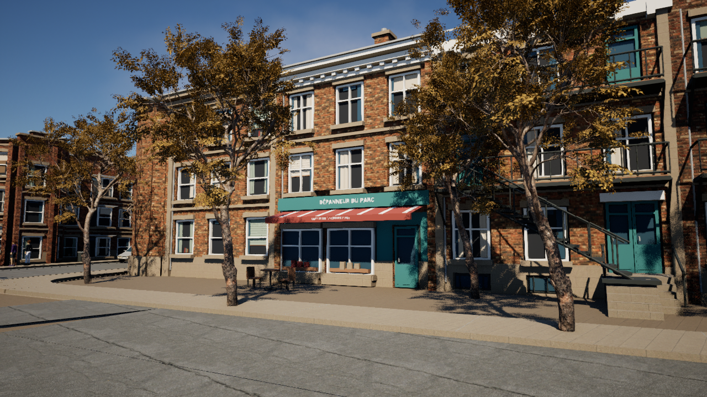

# NORD — Parc La Fontaine, Montréal

A playable Unreal Engine 5.8.3 neighborhood centered on Parc La Fontaine and **1334 Rue Sherbrooke Est**. Walk and drive with friends through a native two-mission opening of the park-saving campaign.

The latest [compact HUD](Verification/CompactHUD.md) adds outlined text, a player-centered road radar, timed briefings, contextual actions and clearer mission/car feedback. Its rebuilt local/browser package matches across 48 non-save files and passes native peer/render checks. All six current-package Epic reference scenes pass the frame-time budget; see [package checks](Verification/CompactHUDPackage.json), [performance](Verification/CompactHUDPerformance.json) and [save/settings preservation](Verification/CompactHUDPreservation.json). The [current mobile fullscreen delivery](Verification/MobileFillDelivery.json) passes seven live two-player checks and six touch-emulated checks on both preview and production, including clear fullscreen HUD regions at 800×360 and 667×375. The earlier [compact-HUD delivery](Verification/CompactHUDDelivery.json) retains its original package and contained-video layout scope.

The story campaign, [NORD: One More Tomorrow](Design/SaveThePark.md), follows the crew saving the park from a Boogeyman who traps perfect days inside comic-book panels. The native implementation contains the chalet worklight/plunger rescue and ordered street race; the remaining six missions, midpoint reversal and finale are design work. On the **integrated Plateau map**, 118 native story/save checks, a continuous seven-gate race, 13 population checks and 13 car-collision checks pass. Both supported-size native story render suites and 13 environment views pass bounded inspection. The matching Linux package passes cooked-content, crew-cycle, seven-view and separate-process join checks; six native static-view profiles and bounded live browser checks also pass. See [unified-map verification](Verification/UnifiedPlateau.md).

The base OpenStreetMap snapshot records: 1,663 building footprints, two ponds, 157 road ways, 1,209 pedestrian/cycle path ways, and 4,571 mapped trees across approximately 1.1 km². Spawn is on the pedestrian path nearest the address, with the car on Rue Sherbrooke Est. The minimap, objectives, and recovery points use the same coordinates.

The active `/Game/Maps/LaFontaine` uses the baked Plateau environment from the separate GTA-NORD project, restored with Warden's 14 authored resident routes and eight driveable parked cars. The saved map has **2,701 actors** and 4,571 mapped tree meshes. Its illustrated Plateau layers include 721 foreground detail batches, 742 surrounding-context batches, 418 local background batches and 284 park batches. The imported map adds mapped ponds, benches, crossings, alley details, landmarks and 12 Plateau pedestrians; Warden still supplies its runtime traffic, parked cars, residents, campaign, eight crew and native road graph. The former 1,161 municipal LOD2 building/4,586 comic-tree scene is retained only as historical source and recovery material, not the active environment. See [Plateau inputs and limitations](Data/Plateau/README.md) and [current unified-map checks](Verification/UnifiedPlateau.md).

The user-supplied cottage crew references are included as **eight playable characters and animated, talkable residents**, alongside three original bagel/raccoon/poutine designs (14 authored residents plus 96 runtime people: 72 walkers, 16 joggers and eight stationary social residents). The eight designs use regenerated Meshy bodies from relaxed references, with their own idle/walk/run clips and locally authored jump/landing. All eight current resting faces pass native review, including a corrected second style 8. The integrated package passes startup, rendered views, crew cycling and separate-process joining with a fresh campaign on both peers. Full story progression/save-reload is checked in native PIE; packaged campaign progression is unverified. Original plumbing props follow their right wrists. Expressions are static, with no facial rig/blinking/lip sync. Names are temporary descriptive labels. The existing fleet uses original 1970s-inspired coupes, sedans and wagons with shaped wheel arches, chrome impact bumpers, four round headlamps, detailed trim and steel wheels in four enamel colours. The collision and driving controls are retained; [nineteen rendered views, native checks and pre-merge browser delivery](Verification/SeventiesCars.md) record the earlier car-art pass.

Lumen lighting/reflections, virtual shadow maps, moving water and a restrained comic ink/halftone filter render the scene. A Vulkan SM6 GPU is required. Ground remains flat and street widths are simplified; buildings have no interiors. No GTA source or Google imagery is included. Ponds are visual surfaces; swimming is not implemented. See [geographic limitations](Data/LaFontaine/README.md).

## Play

[Open the Montréal title page and new 38-second trailer](https://arcade.uptick.systems/gta/), also available from the GTA collection and machine in [Cottage Arcade](https://arcade.uptick.systems/). The reviewed trailer was captured from this integrated game after its automated release checks passed. Public cabinet navigation, actual poster/video decoding, byte-range delivery and responsive layouts passed; see [delivery evidence](Verification/UnifiedDelivery.json).

[Open the temporary browser player](https://nord-montreal.vercel.app/) on desktop or phone. The current compact-HUD package and player pass [public two-player media/input/reconnect and touch-layout checks](Verification/MobileFillDelivery.json): seven live checks and six emulated-touch checks after publication. Choose Player 1 (`NordHost`) or Player 2 (`NordFriend1`), then **Play with sound**; each slot accepts one browser and controls a separate Unreal instance in the same native session. Desktop: click the video to capture input; **Esc** releases it. Phone: use the move/look pads and action buttons; landscape is recommended. Fullscreen landscape fills all four screen edges with the complete game frame and floating controls clear of the HUD. Wider displays stretch the image; the 800×360 layout is 25% wider than uniform 16:9 scaling. See [fullscreen layout checks](Verification/MobileFill.md). Availability depends on this host PC and GPU staying online; occupied/offline slots are reported. Physical phones, off-LAN reachability, sustained remote responsiveness, audible sound, handling enjoyment and full naturally driven browser story acceptance remain open. See [player setup](Browser/README.md) and [temporary hosting](Browser/HOSTING.md).

For the **current integrated Linux package**, run from this project directory:

```bash
cd /home/von/Work/rouge-warden-codex-nord-unreal/games/nord-unreal
./Scripts/launch.sh play
```

The launcher also supports:

```bash
./Scripts/launch.sh editor
./Scripts/launch.sh host
./Scripts/launch.sh join 127.0.0.1:7777
```

The local and browser Linux builds are in `Builds/Linux/` and `Builds/Browser/Linux/` (excluded from Git). The current HUD packages match across [48 non-save files](Verification/CompactHUDPackageIdentity.json), with existing save directories excluded from updates. `Scripts/launch.sh play` prefers the local package whenever `Builds/Linux/Quebec.sh` exists. The [current package check](Verification/CompactHUDPackage.json) passes fresh-campaign startup, seven renders, eight crew cycles and separate-process joining. The preceding integrated browser package reloaded an existing Mission 1 boundary across a full restart; full naturally driven packaged Mission 1–2 progression remains unverified. The [current HUD package profiles](Verification/CompactHUDPerformance.json) pass six warmed Epic static views on the measured RTX 4090. See [Verification](Verification/README.md) and [story-slice status](Verification/StorySlice.md). Share the whole matching packaged directory with friends using Linux. Editor mode starts this project's MCP service on port 8001.

| Control | Action |
| --- | --- |
| WASD | Walk; drive and steer while in a car |
| Mouse | Look around; aim the worklight after E acquires it |
| Left Shift | Sprint on foot |
| Space | Jump on foot; hold handbrake while driving |
| E | Enter/exit a nearby car; acquire/release the worklight or pull a reachable clamp when prompted; talk to a nearby resident |
| S in car | Brake/reverse |
| C | Cycle through the eight supplied characters, on foot or while driving |
| F2 | Switch the comic-book look on or off (for you only) |
| R | Recover the active encounter checkpoint; completed in-session steps stay banked |
| T | After both scenes finish, replay the street race without erasing completed story progress |

Follow the on-screen objective to the chalet worklight. Hold its beam on the gold seam, sprint/jump the striped cable, pull on the green release beat, then park a car facing the table in the lime bay and finish on foot. E prioritizes car entry/exit, so the table clamp is placed beyond the car-entry range. R then takes you to the street race start area. Cross blue gates in order, avoid the purple ink trap and use R to recover the last banked gate. The race has a 180-second limit.

The host owns shared progression and saves completed mission boundaries to `Saved/SaveGames/NordCampaign_v1.sav`. Retrying keeps the current encounter’s completed steps for that session. Reloading an unfinished mission starts that mission again: unfinished rescue returns to its worklight; unfinished race returns to its start after the rescued terrace. Finishing both scenes survives reload. T replays only the race while preserving both completed scenes. Character choices reset on a new connection. The QA suite uses a separate slot; `-NordNoCampaignSave` deliberately disables persistence.

The current driving implementation adds progressive acceleration, service braking, speed-sensitive steering and controllable lateral slip under the handbrake; physical handling enjoyment is still pending playtest. The camera follows turns after two seconds without mouse input and widens slightly with speed. Wheels steer and spin; bumpers, mirrors, and rims add detail to the car. The compact HUD keeps a nearby road radar, parked-car markers, one contextual interaction prompt, mission/status text, speed/handbrake feedback and shared completion. Private dialogue pauses the briefing's reading budget, and R Recover remains discoverable during active missions.

## Comic-book look

The game renders in an animated comic-book style by default, inspired by the look of *Spider-Man: Into the Spider-Verse*. No characters, suits, logos or sound words from the film are used. The post-process material `/Game/Art/Comic/M_ComicInk` adds:
- ink outlines from depth and normal edges
- flat light bands with stronger colour and violet shadows
- Ben-Day halftone dots in shade and in the sky
- hatching in the deepest shadow
- red and blue print plates that drift apart with distance, in place of depth of field

The walking character animates on twos (12 poses a second) while it moves smoothly. The HUD uses comic caption boxes, and sound-word bursts appear for jumps (HOP!), hard acceleration (VROOM!) and the handbrake (SKRRT!).

The look is per player: F2 switches it for your view only. Regenerate the material with this project's editor closed:

```bash
"$ue_root/Engine/Binaries/Linux/UnrealEditor-Cmd" "$(pwd)/Quebec.uproject" -ExecutePythonScript="$(pwd)/Scripts/apply_comic_style.py" -unattended -nop4 -NullRHI
```

To take reference screenshots, run the game with `-NordCapture`: comic and standard-lighting views from spawn, a jump and the car. The run quits on its own, and the shots land in `Saved/Screenshots/`.

```bash
"$ue_root/Engine/Binaries/Linux/UnrealEditor" "$(pwd)/Quebec.uproject" /Game/Maps/LaFontaine -game -windowed -ResX=1600 -ResY=900 -NordCapture
```


## Friends joining

The host runs `./Scripts/launch.sh host`. Friends run the same build with `./Scripts/launch.sh join HOST:7777`, replacing `HOST` with the host's reachable IPv4 address or hostname. Use a LAN address for local play or a reachable public address for internet play. The host must accept incoming UDP traffic on port 7777; router/NAT and firewall configuration may be required. The launcher does not change network settings.

The native launcher uses direct-IP listen-server support. The separate [browser demo](Browser/README.md) provides a public player page and two temporary streaming slots; it keeps the native multiplayer connection on the host PC. Neither path supplies matchmaking, accounts, reservations or persistent servers. The temporary demo has a co-located TURN relay described in [hosting notes](Browser/HOSTING.md), but off-LAN media playback remains unverified. A local test does not verify internet connectivity. The session ends when the host exits.

## Build and regenerate the map

The engine is installed at `/home/von/.local/share/Epic/UE_5.8.3`. Build the editor module before launching:

```bash
ue_root=/home/von/.local/share/Epic/UE_5.8.3
"$ue_root/Engine/Build/BatchFiles/Linux/Build.sh" QuebecEditor Linux Development "$(pwd)/Quebec.uproject" -WaitMutex -NoUBA -NoHotReloadFromIDE
```

The active map is `/Game/Maps/LaFontaine`; the original blockout remains at `/Game/Maps/Quebec`. The integration started with a recovery backup under `Saved/Recovery/unified-plateau-20261011T030430Z/`, copied the baked Plateau map and attributed inputs from GTA-NORD commit `eddc54c`, then used `Scripts/merge_plateau.py` to restore Warden's resident-route and parked-car actors. `Data/Plateau/BaseGeometry/` preserves the incoming road/marking/path OBJ inputs while Warden's `Data/LaFontaine/layout.json`, generated `LaFontaineMap.h` and traffic graph remain the gameplay source. See [Plateau regeneration guidance](Data/Plateau/README.md). The older `prepare_lafontaine.py` → `create_lafontaine.py` → municipal/park-comic workflow rebuilds the **previous** map, not this integrated scene. Preserve the current map before any regeneration; close the project's editor and serialize GPU work. Package the integrated project only after its rendered checks pass, then distribute the whole matching Linux build to friends. The source project alone is not a standalone download.

## Visual fidelity and personalization

The Google pin was used to identify the address. Roads and park geography come from the checked-in OpenStreetMap snapshot; surrounding surveyed buildings come from Montréal’s 2016 municipal survey. No Google Earth assets were extracted. Geographic source and derived map data are provided under ODbL 1.0, with attribution visible below the in-game minimap. [OpenStreetMap copyright](https://www.openstreetmap.org/copyright).

Google photorealistic streaming through [Cesium for Unreal](https://cesium.com/learn/unreal/unreal-photorealistic-3d-tiles/) remains an optional future visual layer requiring an account connection. It is not installed or active. Ground-level fidelity and interiors require further reference data. The story uses fictional festival events and temporary clothing-based crew names; no personal aspirations or histories were inferred. The former three public park exploration prompts remain available in legacy `-NordNoCampaign` mode.

## Testing

The preceding neighbourhood/crew editor and Linux Development package build successfully. Its legacy two-player suite (`-NordNoCampaign`) covers sprint/jump, private F2 rendering, car entry/exit, steering and driving, camera follow/FOV, handbrake hold/release, ordered shared missions, fall recovery and resident animation/dialogue. It also rejects through-wall and occupied-car entry, retains a safely hidden driver when all exits are blocked, displays a private blocked-door caption, and verifies departure/reconnection cleanup. See the [requirement audit](Verification/QualityAudit.md) for the evidence and remaining scope.

Run the same suite with `-NordLag` for 100 ms outgoing packet lag and 2% loss on both peers, `-NordDropout` for a complete client packet interruption, or `-NordPackagedPeer` for a separate Linux package joining the ongoing PIE session. These modes write separate reports in `Saved/Tests/`. Run PIE tests serially; they share port 17777. `-NordRenderChecks -NordCaptureWidth=1280` (or `1920`) additionally captures the HUD states and car/objective priority overlap. Earlier baseline reports are retained in `Verification/`. The integrated-map [story-slice suite](Verification/UnifiedStorySlice.json) passes 118 native checks, including light/plunger/driven gates, retry, late join and isolated save/reload. Its [720p](Verification/UnifiedStorySliceRender1280.json) and [1080p](Verification/UnifiedStorySliceRender1920.json) render suites each pass 118 checks and 18 complete images. The [current package](Verification/UnifiedPackage.json) passes startup/render/join, and [six current-map Epic/100% static views](Verification/UnifiedPerformance.json) pass the 16.67 ms p95 target. Physical solo/co-op review and final art acceptance remain open.
All 13 vehicle collision checks pass: the car crosses an existing street marking, a colliding 2 cm strip, and an 18 cm curb forward and in reverse, while a tall wall still blocks it. Results are saved to `Saved/Tests/CarCollision.json`. Fresh legacy smoke passes 66 two-player checks in 38.44 seconds with `-NordNoCampaign`; ten native unit tests pass with zero warnings/errors. These checks preserve exploration behavior and do not accept story presentation or physical handling. Decorative meshes use explicit collision profiles so loading the map preserves their settings. The arcade car can step onto low surfaces with a 30 cm trial lift.

Run the gameplay smoke test with this project's editor closed:

```bash
"$ue_root/Engine/Binaries/Linux/UnrealEditor-Cmd" "$(pwd)/Quebec.uproject" /Game/Maps/LaFontaine -NullRHI -RenderOffscreen -unattended -NordNoCampaign -ExecutePythonScript="$(pwd)/Scripts/smoke_test.py" -nosound
"$ue_root/Engine/Binaries/Linux/UnrealEditor-Cmd" "$(pwd)/Quebec.uproject" /Game/Maps/LaFontaine -NullRHI -RenderOffscreen -unattended -NordNoCampaign -ExecutePythonScript="$(pwd)/Scripts/car_collision_test.py" -nosound
python3 Scripts/test_launcher.py
```

Native story QA verifies local late join, active-tool departure/recovery, disk checkpoints and simulated lag/loss; current package startup verifies separate-process loopback. The earlier legacy packaged lifecycle run covers abrupt client loss, timeout, rejoin and exit. [Pre-merge isolated browser QA](Verification/BrowserGpuRecovery.md) completed Mission 1 through real browser controls. The [integrated browser report](Verification/UnifiedBrowser.json) instead verifies loading that existing Mission 1 boundary on both peers across a full restart, four bounded live public desktop regressions and emulated touch; full packaged campaign progression remains unverified. Off-LAN internet media reachability remains unverified. Only Linux is packaged. The arcade car uses server movement without client prediction, so driving may feel delayed over a high-latency connection. If remote drive updates stop for half a second, the server clears stale controls and the car coasts to a stop. The upgraded renderer requires Vulkan SM6; performance on other computers has not been verified. Scripts/verify_lafontaine.py validates map orientation, scale, and actual collision at the spawn, car, and address building; its report is Saved/Tests/LaFontaine.json.

Additional package checks use native Unreal Development-build console handlers, not new game test commands:

```bash
python3 Scripts/verify_package.py
python3 Scripts/verify_packaged_gameplay.py --soak-seconds 1800
python3 Scripts/profile_package.py
```

The first checks cooked models, clips and separate-process connection with seven rendered views; its [integrated-map result](Verification/UnifiedPackage.json) passes. The second exercises native controls, late join, abrupt process loss, released-car reuse and repeated joins; that longer package lifecycle has not been repeated for the integrated map. The third profiles uncapped Epic-quality Vulkan rendering at 720p and 1080p, verifying actual viewport sizes. Its [integrated-map result](Verification/UnifiedPerformance.json), also saved as `Verification/Performance.json`, passes all six p95 budgets, with a 13.93 ms maximum p95 and 87.7–112.4 average FPS across static views on the measured RTX 4090. These shared-desktop static views do not establish browser streaming FPS, worst-case driving/co-op performance or physical handling enjoyment; overall quality acceptance remains open. Close other game/editor rendering sessions before profiling; profiling is a hardware-specific measurement, not a minimum-spec guarantee.

The earlier municipal neighbourhood refresh added illustrated entrances, balconies, stairs and furniture to the previous map. Its 21-view render matrices and [visual review](Verification/NeighbourhoodVisualReview.md) are historical after the Plateau merge. The current environment's 13 captured views and limits are recorded in [unified verification](Verification/UnifiedPlateau.md). Flat terrain, stylized foliage and approximate architecture remain.

The earlier municipal upgrade's triangulation, placement and roof checks remain in `Verification/CityBuildings.json`. The integrated map now uses Plateau building and tree assets, checked separately in [unified verification](Verification/UnifiedPlateau.md).




### Detailed cottage characters

The eight cottage crew residents now use relaxed-reference Meshy replacements with their own idle/walk/run clips and locally authored jump/landing. Existing production paths and style numbers remain; original source files and backed-up packages are retained. Import, saved verification and normal player capture default to `Data/CharactersNeutral`; download/jump/source helpers require explicit `--source-root Data/CharactersNeutral`. See [current character sources and rebuild commands](Data/CharactersNeutral/README.md), [face and revision review](Verification/NaturalFaces.md) and [current verification](Verification/README.md). Normal native capture passes eight bodies × seven states, **56 views at each of 1280×720 and 1920×1080**. All eight resting faces pass review; fresh legacy smoke passes 66 native checks, and current package startup/rendering/join verifies the retained eight bodies and 32 clips. The separate story suites and bounded visual review are recorded above; physical solo/co-op and final art acceptance remain open. The immutable `Data/CharactersMeshy` README describes the preceding pipeline.

Press **C** to cycle through all eight supplied characters. You start as the revised skull-shirt character; the HUD names your current choice. Each player chooses independently, the choice replicates to peers, and switching preserves position, objectives and car occupancy. Choices reset on a new connection. The three park mascots remain NPCs. Original plumbing props follow the right wrists. Character stencil masking preserves facial texture detail while keeping silhouettes inked; relaxed facial expressions remain static.

The district adds **32 parked cars, 16 road-following traffic cars and 96 ambient people (72 walkers, 16 joggers and eight stationary social residents)** at runtime. Cars yield to obstacles and can be claimed at low speed; the original starter car can hold a queue until moved. Existing fleet vehicles are placed into clear parking spaces on sufficiently wide mapped asphalt. See [city quality evidence](Verification/CityQuality.md) and [environment sources and estimates](Data/EnvironmentRefresh/README.md).
