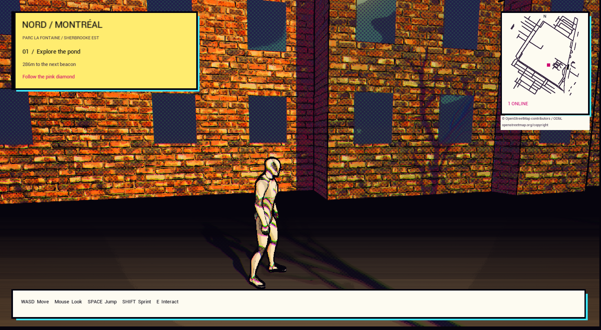
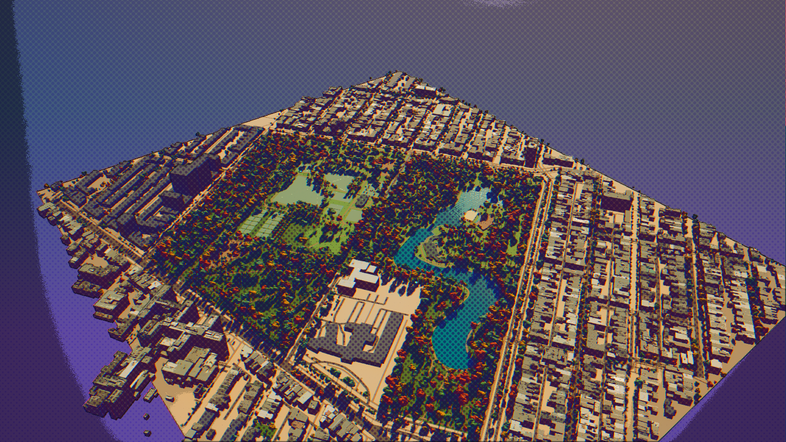
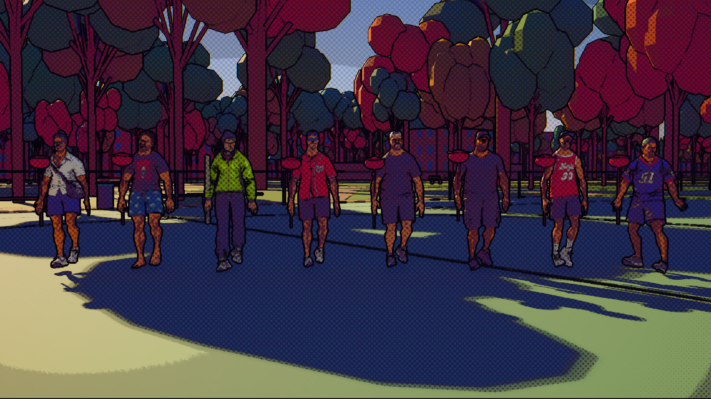

# NORD — Parc La Fontaine, Montréal

A playable Unreal Engine 5.8.3 neighborhood centered on Parc La Fontaine and **1334 Rue Sherbrooke Est**. Walk, drive, and complete three shared park exploration objectives with friends.

The base OpenStreetMap snapshot records: 1,663 building footprints, two ponds, 157 road ways, 1,209 pedestrian/cycle path ways, and 4,571 mapped trees across approximately 1.1 km². Spawn is on the pedestrian path nearest the address, with the car on Rue Sherbrooke Est. The minimap, objectives, and recovery points use the same coordinates.

The district now uses **1,161 municipal LOD2 building models**, replacing 1,299 overlapping generic footprints across the playable area. Surveyed roof shapes, setbacks and available roof photo textures are retained. Façades use estimated comic masonry, trim and window spacing. The park adds **4,586 municipal inventory trees** (2,409 in Parc La Fontaine), **566 mapped furniture points**, **21 sports pitches**, pond coping, theatre seating and three illustrated landmark buildings. Tree heights/crowns and landmark elevations are estimates. See [building provenance](Data/CityBuildings/README.md) and [park sources, art and regeneration](Data/ParkComic/README.md).

The user-supplied cottage crew references are included as **eight playable characters and animated, talkable residents**, alongside three original bagel/raccoon/poutine designs (14 authored residents plus 96 runtime walkers). The eight designs use regenerated Meshy bodies from relaxed references, with their own idle/walk/run clips and locally authored jump/landing. All eight current resting faces pass native review, including a corrected second style 8; package play passes; all eleven final packaged gameplay checks pass in 89.1 seconds. Original plumbing props follow their right wrists. Expressions are static, with no facial rig/blinking/lip sync. Names are temporary descriptive labels. Cars have shaped hatchback bodies, wheel arches, sloped windows, round lights and a fleet of four colours, while retaining the tested driving collision and controls.

Lumen lighting/reflections, virtual shadow maps, moving water and a restrained comic ink/halftone filter render the scene. A Vulkan SM6 GPU is required. Ground remains flat and street widths are simplified; buildings have no interiors. No GTA source or Google imagery is included. Ponds are visual surfaces; swimming is not implemented. See [geographic limitations](Data/LaFontaine/README.md).

## Play

Run from the project directory:

```bash
./Scripts/launch.sh play
./Scripts/launch.sh editor
./Scripts/launch.sh host
./Scripts/launch.sh join 127.0.0.1:7777
```

The local Linux build is in `Builds/Linux/` (excluded from Git). The current crew passes package startup/rendering, separate-process joining and all eleven packaged gameplay checks; see [Verification](Verification/README.md). Share that entire directory with friends using Linux. The launcher uses `Builds/Linux/Quebec.sh` when a Linux package exists, otherwise the installed Unreal Editor in game mode. Editor mode starts this project's MCP service on port 8001.

| Control | Action |
| --- | --- |
| WASD | Walk; drive and steer while in a car |
| Mouse | Look around |
| Left Shift | Sprint on foot |
| Space | Jump on foot; hold handbrake while driving |
| E | Enter/exit a nearby car; interact with a mission marker within 5 m; talk to a nearby resident |
| S in car | Brake/reverse |
| C | Cycle through the eight supplied characters, on foot or while driving |
| F2 | Switch the comic-book look on or off (for you only) |

Follow the on-screen mission objective. Progress is shared for the current server session and resets when the host restarts the map.

The driving camera follows turns after two seconds without mouse input and widens slightly with speed. Wheels steer and spin; bumpers, mirrors, and rims add detail to the car. The HUD includes a road map, parked-car markers, a nearby-car prompt, handbrake status, and a shared mission-completion notification.

## Comic-book look

The game renders in an animated comic-book style by default, inspired by the look of *Spider-Man: Into the Spider-Verse*. No characters, suits, logos or sound words from the film are used. The post-process material `/Game/Art/Comic/M_ComicInk` adds:
- ink outlines from depth and normal edges
- flat light bands with stronger colour and violet shadows
- Ben-Day halftone dots in shade and in the sky
- hatching in the deepest shadow
- red and blue print plates that drift apart with distance, in place of depth of field

The walking character animates on twos (12 poses a second) while it moves smoothly. The HUD uses comic caption boxes, and sound-word bursts appear for jumps (HOP!), hard acceleration (VROOM!) and the handbrake (SKRRT!).

The look is per player: F2 switches it for your view only. Regenerate the material with this project's editor closed:

```bash
"$ue_root/Engine/Binaries/Linux/UnrealEditor-Cmd" "$(pwd)/Quebec.uproject" -ExecutePythonScript="$(pwd)/Scripts/apply_comic_style.py" -unattended -nop4 -NullRHI
```

To take reference screenshots, run the game with `-NordCapture`: comic and standard-lighting views from spawn, a jump and the car. The run quits on its own, and the shots land in `Saved/Screenshots/`.

```bash
"$ue_root/Engine/Binaries/Linux/UnrealEditor" "$(pwd)/Quebec.uproject" /Game/Maps/LaFontaine -game -windowed -ResX=1600 -ResY=900 -NordCapture
```



## Friends joining

The host runs `./Scripts/launch.sh host`. Friends run the same build with `./Scripts/launch.sh join HOST:7777`, replacing `HOST` with the host's reachable IPv4 address or hostname. Use a LAN address for local play or a reachable public address for internet play. The host must accept incoming UDP traffic on port 7777; router/NAT and firewall configuration may be required. The launcher does not change network settings.

This is direct-IP listen-server support. Matchmaking, accounts, invite links, relay/NAT traversal, persistent servers, and public deployment are not implemented. A local test does not verify internet connectivity. The session ends when the host exits.

## Build and regenerate the map

The engine is installed at `/home/von/.local/share/Epic/UE_5.8.3`. Build the editor module before launching:

```bash
ue_root=/home/von/.local/share/Epic/UE_5.8.3
"$ue_root/Engine/Build/BatchFiles/Linux/Build.sh" QuebecEditor Linux Development "$(pwd)/Quebec.uproject" -WaitMutex -NoUBA -NoHotReloadFromIDE
```

The active map is `/Game/Maps/LaFontaine`; the original blockout remains at `/Game/Maps/Quebec`. Source/config recovery copies are in `Saved/Recovery/pre-lafontaine`. To regenerate the geographic map, first preserve the current LaFontaine map and close this project's editor. Run `python3 Scripts/prepare_lafontaine.py`, rebuild the editor module (the generated header contains gameplay coordinates), then run:

```bash
"$ue_root/Engine/Binaries/Linux/UnrealEditor-Cmd" "$(pwd)/Quebec.uproject" -ExecutePythonScript="$(pwd)/Scripts/create_lafontaine.py" -unattended -nop4 -NullRHI
```

When municipal inputs are present, `prepare_lafontaine.py` also needs Shapely and removes overlapping generic footprints. After the base map and graphics pass, run `Scripts/import_city_buildings.py` to restore surveyed buildings, then `Scripts/build_park_comic.py` to restore the park and cottage crew. See the park README for preparation and checks.

Next run `Scripts/upgrade_lafontaine_graphics.py` with `/Game/Maps/LaFontaine` loaded to apply textures, detailed foreground trees, and furniture. Sources are documented in [Data/Art/README.md](Data/Art/README.md).

The generator refuses to overwrite an existing map. The original generator `Scripts/create_world.py` is retained only for prototype recovery. Duplicate or move the existing map before rebuilding. To distribute a build, package the project for your friends' operating systems through Unreal's Platforms menu. Each friend needs the matching packaged build; the source project alone is not a standalone download.

## Visual fidelity and personalization

The Google pin was used to identify the address. Roads and park geography come from the checked-in OpenStreetMap snapshot; surrounding surveyed buildings come from Montréal’s 2016 municipal survey. No Google Earth assets were extracted. Geographic source and derived map data are provided under ODbL 1.0, with attribution visible below the in-game minimap. [OpenStreetMap copyright](https://www.openstreetmap.org/copyright).

Google photorealistic streaming through [Cesium for Unreal](https://cesium.com/learn/unreal/unreal-photorealistic-3d-tiles/) remains an optional future visual layer requiring an account connection. It is not installed or active. Ground-level fidelity and interiors require further reference data. The three objectives are public park exploration prompts; no personal aspirations were invented.

## Testing

The editor module and Linux Development package build successfully. The current two-player suite covers sprint/jump, private F2 rendering, car entry/exit, steering and driving, camera follow/FOV, handbrake hold/release, ordered shared missions, fall recovery and resident animation/dialogue. It also rejects through-wall and occupied-car entry, retains a safely hidden driver when all exits are blocked, displays a private blocked-door caption, and verifies departure/reconnection cleanup. See the [requirement audit](Verification/QualityAudit.md) for the evidence and remaining scope.

Run the same suite with `-NordLag` for 100 ms outgoing packet lag and 2% loss on both peers, `-NordDropout` for a complete client packet interruption, or `-NordPackagedPeer` for a separate Linux package joining the ongoing PIE session. These modes write separate reports in `Saved/Tests/`. Run PIE tests serially; they share port 17777. `-NordRenderChecks -NordCaptureWidth=1280` (or `1920`) additionally captures the HUD states and car/objective priority overlap. Current reports are retained in `Verification/`.
All 13 vehicle collision checks pass: the car crosses an existing street marking, a colliding 2 cm strip, and an 18 cm curb forward and in reverse, while a tall wall still blocks it. Results are saved to `Saved/Tests/CarCollision.json`. Decorative meshes use explicit collision profiles so loading the map preserves their settings. The arcade car can step onto low surfaces with a 30 cm trial lift.

Run the gameplay smoke test with this project's editor closed:

```bash
"$ue_root/Engine/Binaries/Linux/UnrealEditor-Cmd" "$(pwd)/Quebec.uproject" /Game/Maps/LaFontaine -NullRHI -RenderOffscreen -unattended -ExecutePythonScript="$(pwd)/Scripts/smoke_test.py" -nosound
"$ue_root/Engine/Binaries/Linux/UnrealEditor-Cmd" "$(pwd)/Quebec.uproject" /Game/Maps/LaFontaine -NullRHI -RenderOffscreen -unattended -ExecutePythonScript="$(pwd)/Scripts/car_collision_test.py" -nosound
python3 Scripts/test_launcher.py
```

Local loopback, late join, disconnect/reconnect, abrupt client crashes and the configured simulated lag/loss have been verified. External internet connectivity remains unverified. Only Linux is packaged. The arcade car uses server movement without client prediction, so driving may feel delayed over a high-latency connection. If remote drive updates stop for half a second, the server clears stale controls and the car coasts to a stop. The upgraded renderer requires Vulkan SM6; performance on other computers has not been verified. Scripts/verify_lafontaine.py validates map orientation, scale, and actual collision at the spawn, car, and address building; its report is Saved/Tests/LaFontaine.json.

Additional package checks use native Unreal Development-build console handlers, not new game test commands:

```bash
python3 Scripts/verify_package.py
python3 Scripts/verify_packaged_gameplay.py --soak-seconds 1800
python3 Scripts/profile_package.py
```

The first checks cooked models, clips and separate-process connection with seven rendered views. The second exercises native controls, late join, abrupt process loss, released-car reuse and repeated joins. The third profiles uncapped Epic-quality Vulkan rendering at 720p and 1080p, verifying the actual viewport dimensions. Results are in `Verification/Package.json`, `PackagedGameplay.json` and `Performance.json`. The profiler enforces a 16.67 ms 95th-percentile reference-scene frame budget. Close other game/editor rendering sessions before profiling; profiling is a hardware-specific measurement, not a minimum-spec guarantee.

The municipal upgrade was checked with source triangulation tests (courtyard holes and vertical faces), surveyed mesh placement/height checks, roof collision traces, and rendered comic/realistic reference views. Detailed tree materials now persist their Nanite usage flags for game mode. See `Verification/CityBuildings.json` for this pass’s checks.





### Detailed cottage characters

The eight cottage crew residents now use relaxed-reference Meshy replacements with their own idle/walk/run clips and locally authored jump/landing. Existing production paths and style numbers remain; original source files and backed-up packages are retained. Import, saved verification and normal player capture default to `Data/CharactersNeutral`; download/jump/source helpers require explicit `--source-root Data/CharactersNeutral`. See [current character sources and rebuild commands](Data/CharactersNeutral/README.md), [face and revision review](Verification/NaturalFaces.md) and [current verification](Verification/README.md). Normal native capture passes eight bodies × seven states, **56 views at each of 1280×720 and 1920×1080**. All eight resting faces and 66 native smoke checks pass; package play passes; all eleven final packaged gameplay checks pass in 89.1 seconds. The immutable `Data/CharactersMeshy` README describes the preceding pipeline.

Press **C** to cycle through all eight supplied characters. You start as the revised skull-shirt character; the HUD names your current choice. Each player chooses independently, the choice replicates to peers, and switching preserves position, objectives and car occupancy. Choices reset on a new connection. The three park mascots remain NPCs. Original plumbing props follow the right wrists. Character stencil masking preserves facial texture detail while keeping silhouettes inked; relaxed facial expressions remain static.

The district adds **32 parked cars, 16 road-following traffic cars and 96 walkers** at runtime. Cars yield to obstacles and can be claimed at low speed; the original starter car can hold a queue until moved. Existing fleet vehicles are placed into clear parking spaces on sufficiently wide mapped asphalt. See [city quality evidence](Verification/CityQuality.md) and [environment sources and estimates](Data/EnvironmentRefresh/README.md).
