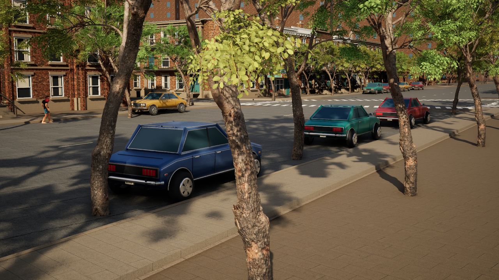
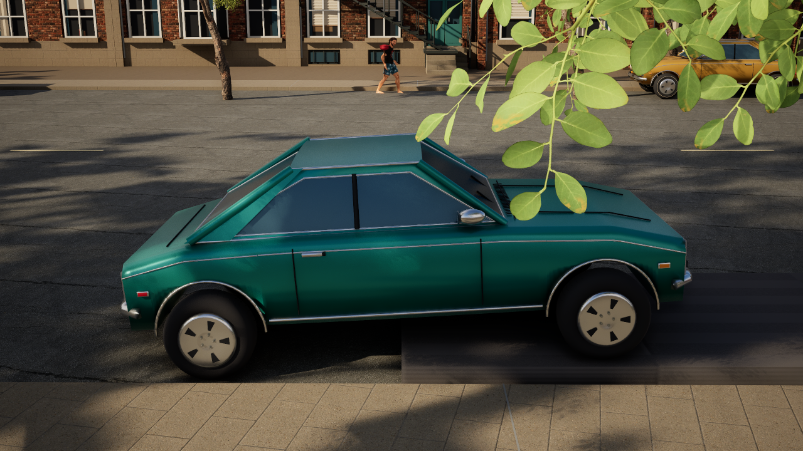

# Montréal curb parking and fitted vehicle contact — 2026-10-13

The live browser package now finds raised concrete curbs rather than using a fixed road-centre offset. Three samples across each car fit the curb angle and keep the body about 10–60 cm from its edge. Parking is checked against actual asphalt, mapped side restrictions and cycle lanes, nearby cars, and conservative intersection buffers. The starter stays on its original block; eight original parked actors relocate at runtime. The 32 added-car target is a maximum: current fresh runs find 19–20 qualified spaces. Unsupported spaces stay empty. Sixteen traffic cars, 96 pedestrians, original static decorative cars and all original map/art assets are retained.

Each seventies body profile has a hidden simple-convex collider (4/4/8 hulls). Original visual meshes, wheel centres and materials are unchanged. Four wheel-height samples support ordinary 18 cm curbs and tilt the chassis while the rear wheels remain on the road; 30 cm steps and tall walls stop the vehicle. Glancing contact retains tangential travel. The old saved-map box remains disabled for compatibility. Checkpoint/loan-car recovery uses the same fitted clearance test and preserves its ignored actors.

Traffic corridors now account for idle campaign cars, and cleared junction reservations cannot starve cars that tick before their former holder. The full two-player city run shows all sixteen cars advancing 18.3–52.2 m in the eight seconds after a temporary obstruction clears, plus native remote entry/exit, yielding and replicated profiles. No route coordinates were regenerated.

Merged [PR #345](https://github.com/vdimarco/rouge-warden/pull/345). All twelve public frontend file hashes match the pre-merge player; installed native source hashes still match after merging.

## Acceptance

| Check | Result | Evidence |
| --- | --- | --- |
| Native automation | 21 passed, exit 0 | `Saved/CurbParking-20261013/native-acceptance.log` |
| Real possessed collision PIE | 13 passed, exit 0 | `collision-final.log`; forward/reverse 18 cm curb, thin strip, marking, tall wall |
| Two-player city | 14 passed, exit 0 | `city-final.log`; `Saved_CurbCityFinal/Tests/PopulationCurbParking.json` |
| Browser unit/page | 24 unit checks and page suite passed | `browser-unit.log`, `browser-page.log` |
| Public phone layout | 16 passed, real possession/controls/video | `Browser/.qa/mobile-2026-10-14T00-51-39-627Z` |
| Public desktop peers/reconnect | 7 passed; short observed decode samples 27.3–30 FPS | `Browser/.qa/live-2026-10-14T00-52-49-377Z` |
| Lit render/curb articulation | Completed, exit 0, inspected | `render-final.log`, `ArtRender.json`, images below |
| Cook/package | Success, exit 0; all three proxies in IoStore inventory | `cook-verified.log`, `iostore.csv` |
| Preservation | 6,727 original Content files unchanged; only three proxy assets added | `content-preservation.json` |
| Runtime data | Five Saved directories copied exactly at install; campaign save still identical after browser checks | `package.json`, `post-browser-saves.json` |

Paths without a directory in the evidence column are under `Saved/CurbParking-20261013`. The curated source/package identities are in [CurbParking.json](CurbParking.json).

Installed package: `Builds/Browser/Linux`. Rollback: `Builds/BrowserPrevious-curb-parking-20261013`. Public player: https://nord-montreal.vercel.app/ . Host: `Saved/BrowserStreaming/host-20261014-005051-1631030.log`; startup confirms 15:00 frozen clock, retained changing weather, 20 qualified added parked cars, 16 traffic and 96 pedestrians. Production UI, stream settings, quality defaults, public tunnels and relay are unchanged. Only the mobile QA approach window grows to reach the curb-parked starter.

The supplied Google Street View photo and a public Rachel/De Lanaudière view informed placement; Google imagery was not used as game art or committed. The rejected width-relative captures and unsuccessful diagnostic attempts remain in the ignored run directory. A fresh pre-change ed452c1a replay established five chalet residents, eight pond residents and seven nearby street residents; the older crowd fixture expected eight chalet residents. The updated fixture preserves current park hubs and its original minimum for safe nearby street routes. Final rendering covers the unchanged artwork/wheel physics before the subsequent traffic-only and checkpoint-clearance fixes; those final logic changes passed native/city/package/browser checks.

Physical-phone/carrier performance, subjective feel/audio and a complete campaign/race replay were not checked. These remain arcade wheel supports and swept convex contacts, rather than a Chaos Vehicles suspension/tire-force simulation. OpenSpec CLI is unavailable; requirement/scenario structure was checked manually.

Subsequent verification: [Driving and sustained streaming follow-up](DrivingStreamFollowup.md) passes the complete native-input Mission 2 race circuit and a separate 60-second public-player camera sweep. Its explicit PIE/device/network limits still apply.
