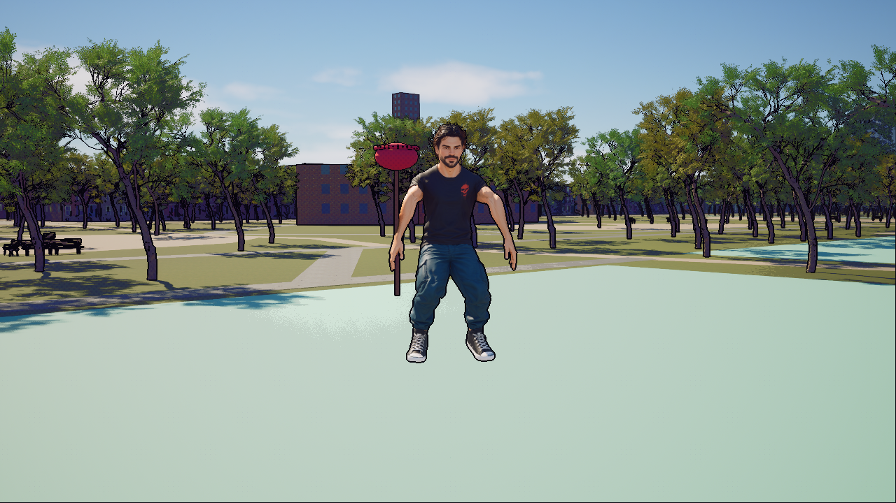

# Private higher-detail jump arm diagnostic

The reduced-arm jump trial improves the front-view shoulder silhouette, but selected side-view motion brings the plunger across the face. **Reject adoption and retain the original private clip.** Sleeve pinching, collar defects and the underlying model limits remain. This is a measured diagnostic result, not finished character art or motion acceptance.

The trial lowers only two central upper-arm angle keys in the private higher-detail jump: −95°/−110° to −60°/−70°. The [original proposal](PROPOSAL.md) remains preparation history. The separately verified Visitation detail layer already merged in [PR379](https://github.com/vdimarco/rouge-warden/pull/379) as `fa2dc6e9773fc37dde860c77aa9c2c6221e51ea6`.

| Retained Comic 720p Airborne | Reduced-arm trial |
| --- | --- |
|  |  |

The [CPU receipt](CPUAuthoring-20261017T142247Z/results.json) records three serialized four-thread Blender jobs: control export, trial export and retained/control/trial reimport comparison. Retained/control semantics match exactly. All 24 deformation bones × 37 samples cover 1.2 s at 30 fps; only the two upper-arm rotations materially change, about 40°, with small other FBX residuals inside the predeclared tolerances. All 23 retained raw source files remain unchanged.

[Native authoring](Native/Author-20261017T145315Z.json) and [separate fresh verification](Native/Verify-20261017T145331Z.json) pass in fresh NullRHI Entry processes. The [scope receipt](Native/Scope.json) confirms exactly one changed package among 6,850 Content files: private `Resident9/A_Jump`. Native 37-sample × 25-bone RAW-local comparison includes 24 deformation bones and the static `Armature` import root. Translation/scale deltas are zero; maximum forbidden rotation is 8.83×10⁻⁷ rad. Each upper arm changes about 39.997°. Own skeleton, reference transforms, length, sample rate, neutral endpoints and six root/playback flags remain intact. The native clip correctly records the trial FBX as its source; it is not asserted equal to the retained raw jump.

The [rejected native preflight](Rejected/NativeTrackInventory/Failure.json) caught an exact-inventory assumption before backup or mutation. Read-only inspection established case-insensitive Unreal FName identities and exactly one static `Armature` root. The corrected guard requires the exact observed 25-name inventory, rejects collisions/missing/extra names and checks that root against its own reference transform at every sample. Tolerances did not change. Historical helper/test bytes and negative tests are retained.

Matched native captures pass: Standard/Comic at 1280×720 and 1920×1080, seven still states each (28 baseline and 28 trial images), plus two actual 1080p 1× motion recordings per variant. Root and [independent review](Trial/Review.json) inspect the eight critical Airborne/Landing pairs; [52 selected temporal frames](Trial/Temporal/Review.md) expose the side-view prop/face occlusion tradeoff. These samples do not establish full continuous fluidity, 3D intersection or a native FPS target. The baseline combines two individually passed Standard jobs from a later-failed window with four passed jobs from the separately restored window; the rejected whole window remains failed. All eleven quality groups stay Epic 3 and ScreenPercentage 100. Earlier immersive startup attempts failed with Vulkan memory exhaustion, restored safely and remain retained. The final fixture adopts its single owned standalone startup world, avoiding a redundant overlapping PIE restart; saved body flags are truthfully reused from an earlier fresh readback of byte-identical body/module/source. No lower-quality pass is substituted.

[Original-clip restoration](Native/Restoration.json) passes at 15:00:13 UTC Oct 17: SHA `1e62a9debd7aec41beac0466ac6a5114741ce79de6bce102f6cdbe5d3cd52f26`, with every one of the 6,850 Content files byte-exact. [Window preservation](Native/WindowRestoration.json) confirms the restored demo, settings, saves and protected tunnel/TURN identities; both installed 48-file packages still match the accepted 13:35 archive. Root explicitly released runtime ownership at 15:00:15 UTC. No character derivative is adopted or included as a changed production asset. Scripts are frozen historical evidence with absolute local paths, hashes and time guards, not a general importer. Private full Content/INI/environment/save/service baselines remain under ignored Saved directories.

No additional generation spend: US$25 authorized, US$4 reserved for two completed jobs (US$3.04 estimated), US$21 uncommitted; settled balance remains unknown. No production/default/cast promotion, topology/weight repair, facial/finger articulation, package release, physical-device/off-LAN or sustained-performance acceptance is included.

The focused [CPU/native receipt audit](Checks/Results.json) passes. [OpenSpec validation](Checks/OpenSpecStructure.json) uses a manual structure/scenario review because its CLI is unavailable; the overall city-quality change remains active. No cook or frontend deployment is needed for this evidence-only checkpoint. The next bounded character pass should consider pose, prop clearance and sleeve anatomy together.
