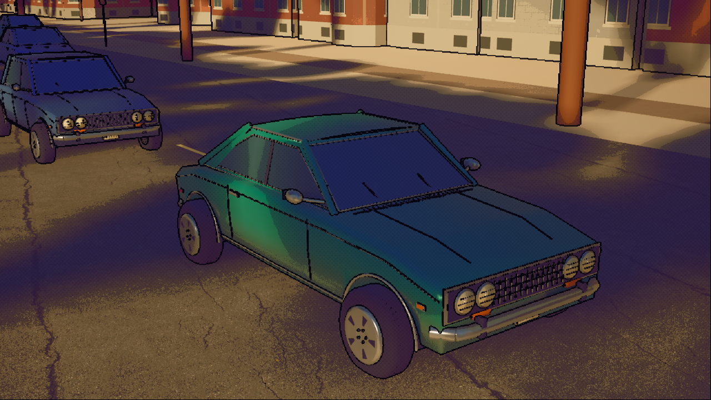
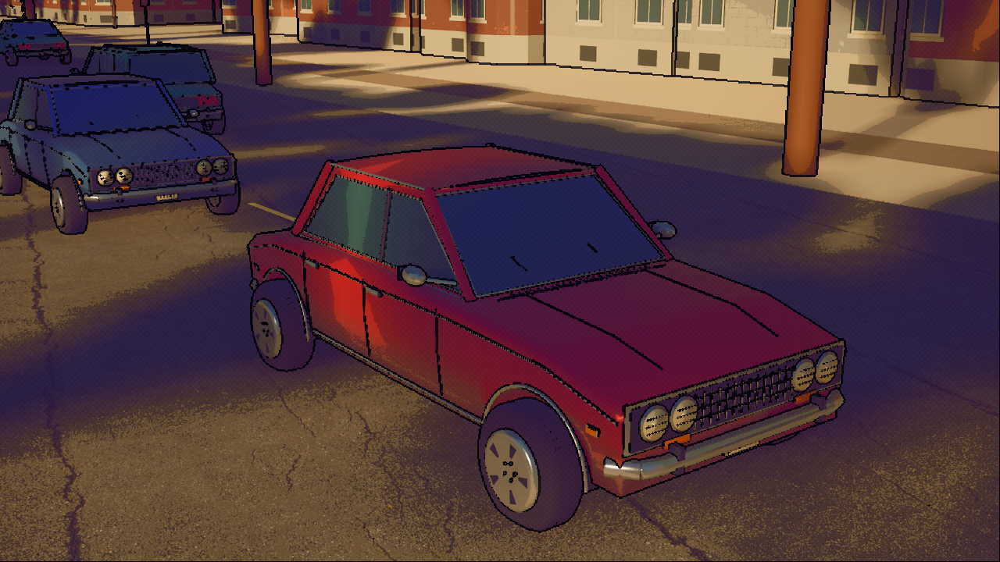
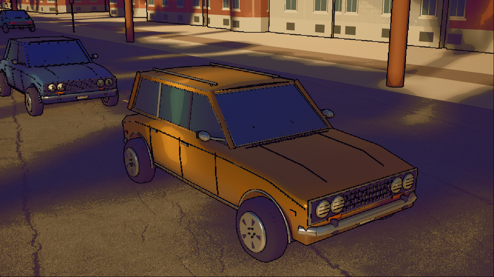

# 1970s fleet art — 2026-10-10

The city fleet now uses original fastback coupe, notchback sedan and long-roof wagon exteriors. Shaped shoulders/sills and open wheel arches, painted pillars, crowned roofs, chrome impact bumpers, four round headlamps, recessed grilles, door seams/handles, markers, rear lamps, whitewalls and steel wheels replace the primitive assembly. Four enamel colours retain the comic finish. These are period-inspired originals with shared fascia styling, opaque glazing and no detailed interiors.

## Implementation and preservation

The existing `AQuebecCar::ApplyPaint` path selects eleven new meshes and their material slots for all three replicated profiles. It reaches starter, parked, circulating, mission and possessed cars without changing fleet counts, routes, driving constants, campaign code or replication fields. The root box remains `(220,108,100)` cm; tire centres remain X ±155/Y ±95/Z −64 cm, with radius 36 cm and the existing spin/steering axis. Hubcaps move inward to meet the new tires. All visual components remain `NoCollision`. Imported parts replace the old primitive trim; the old body path remains a fallback when the new body asset is absent.

The source comprises **11 OBJ meshes / 30,432 triangles**, plus the manifest, original procedural generator and focused validator. Asset-only import produced **26 new assets** under `/Game/ParkComic`, without loading/saving a level or changing actors. The importer reported zero errors and eleven OBJ translator warnings for the smoothing directive; authored normals were retained. `/Game/ParkComic` was already always cooked. Project rendering defaults, the existing browser preset and the **12,000 MiB** launch guard are unchanged.

Both map SHA-256 hashes and the complete save-file sets recursively scanned under project `Saved*`, browser-package `Saved*` and native-package `Saved*` match the baseline. The JSON records the scan roots, recursive glob and exact expected/discovered save dictionaries. The existing isolated Mission 1 save remains `cec872fd0b2c1b7ea7f18814c787448e00117c6acd8ac46a71f674a26470e88e`; absent production saves remain absent. The separate Plateau project was not edited. The [machine-readable record](SeventiesCars.json) includes exact hashes and raw report locations.

## Checks and delivery

| Check | Result and practical scope |
| --- | --- |
| Source geometry | Pass: finite indexed triangles/normals/UVs, material slots, physical finish values, profile bounds, three distinct silhouettes, wheel axis/radius and mesh budget. |
| Native import | Pass: eleven saved meshes, ordered material slots/bounds, four paint variants, no level/actor edits. |
| Rendered native matrix | Pass: front/rear/side for each profile at 1280×720 and 1920×1080, plus one possessed 720p view; **19 captures** separately inspected. All **59 cars** use the intended meshes (25 coupe, 19 sedan, 15 wagon), including **16 traffic cars**. |
| Actual component check | Assertions pass: eleven visible Car70 parts, correct body/cabin/roof names, preserved root extent and non-colliding visuals. Per-part meshes/materials, unit scales and wheel transforms were recorded and inspected against the existing source. |
| Entry/exit | Pass: temporary PIE fixture places the character beside an available car, then ordinary native `ServerInteract` enters/exits and restores the pawn. The chase/HUD shot is stationary at 000 km/h and partly dialogue-obscured; it does not prove sustained driving or dynamic wheel motion. |
| Existing driving automation | **3/3 pass**, zero errors/warnings: frame-rate consistency, steering/handbrake recovery and throttle/brake validation. These were repeated on the final compiled car-art module; driving code did not change. No fresh full collision/occupancy/campaign suite is claimed. |
| Editor and package | Editor build passes. Linux browser build/cook/stage/pak/archive passes in **45.21 s**, AutomationTool exit 0. The native launcher's package is updated by copying that build while excluding all `Saved*` directories, without deletion. |
| Public browser regression | **7/7 pass** at 00:11:58–00:12:19 UTC on October 11 (October 10 local): two independent 1280×720 VP8 streams, advancing audio/video counters, trusted input/Escape, occupied-slot refusal, freed-slot recovery and host reconnect. Brief samples measured **21.3–24.0 decoded FPS**. Reviewed captures show distinct peers, two-player HUD, changed character/input view and street traffic. |
| GPU calibration | Normal lifecycle guard passed; **13,944 MiB free** was observed before startup. Six readings over 30 seconds during/after browser checks retained all three children and at least **2,719 MiB free**. Native logs contain no Vulkan OOM/fatal/missing car-asset failure. This is bounded evidence, not a memory reservation or sustained performance guarantee. |

The first rendered attempt exposed a case-insensitive `EndsWith("Rim")` match that also selected `GrilleTrim`; matching `WheelRim` fixes it. Visual review then found window/header gaps; painted window-frame bands close those before the accepted matrix. A later QA fixture used unsupported Rotator addition; the fixture was corrected and the full final matrix passed. Failed reports remain under ignored `Saved/Tests/SeventiesCarsRender-*.json` rather than being represented as passes.

The existing Vercel player needs no frontend redeployment for native asset changes. After the first successful regression, the two owned game processes were paused for coordinated browser/trailer GPU windows. Both tasks explicitly released their rendered jobs before restoration. At **00:32:18 UTC**, the unchanged preflight passed with **14,378 MiB free observed immediately beforehand**. The normal lifecycle restarted with ordinary arguments and the guest’s existing save isolation. A second fresh public regression at **00:32:30–00:32:52 UTC** again passed **all seven checks**; its brief decoded samples ranged **20.6–24.0 FPS**. All three children remained alive across **eight readings over 35 seconds through 00:34:21 UTC**, with at least **2,957 MiB free**. The normal demo and preserved Funnel (PID 159991) are left running; browser test contexts are closed. Both native logs remain free of OOM/fatal/missing-car-asset failures, and the final recursive map/save comparison still matches baseline. These are point-in-time observations rather than uptime guarantees.

## Remaining limits

New physical driving enjoyment, moving-wheel visual inspection, full Mission 2/save reload, off-LAN media/input, audible sound and other hardware/phones were not revalidated in this art pass. Previous campaign/collision evidence remains historical. The browser host still needs this PC and adequate GPU headroom; its preflight cannot prevent later unrelated GPU contention. OpenSpec structure/scenarios were checked manually because its CLI is unavailable.
