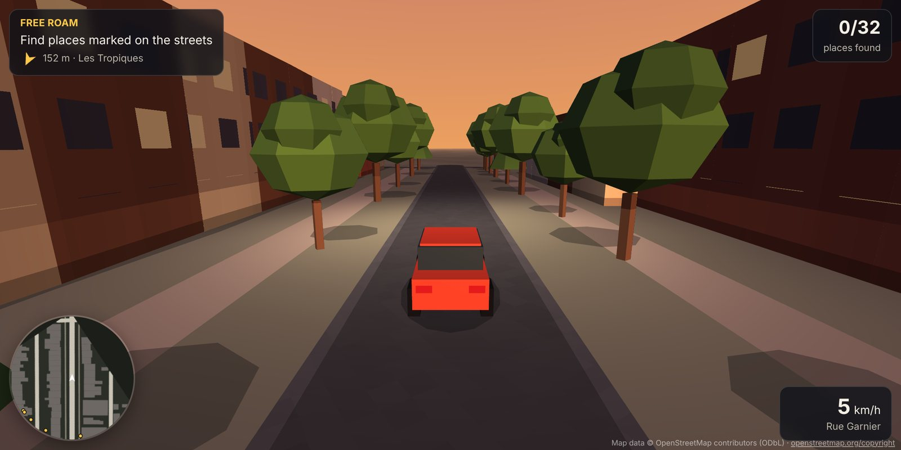
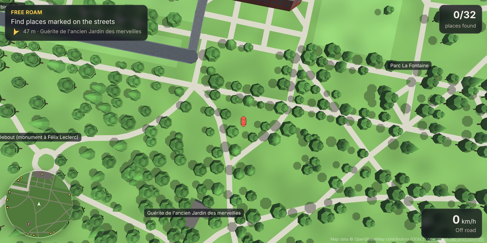
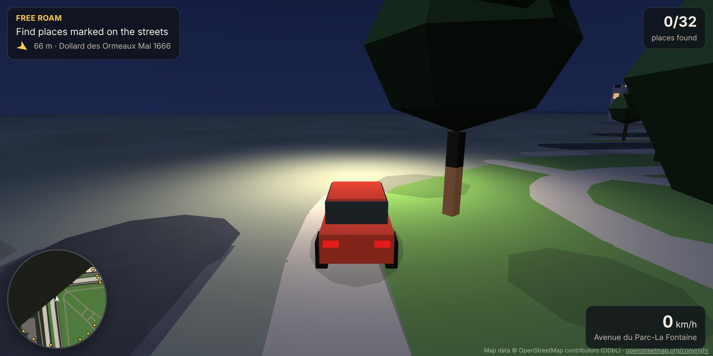
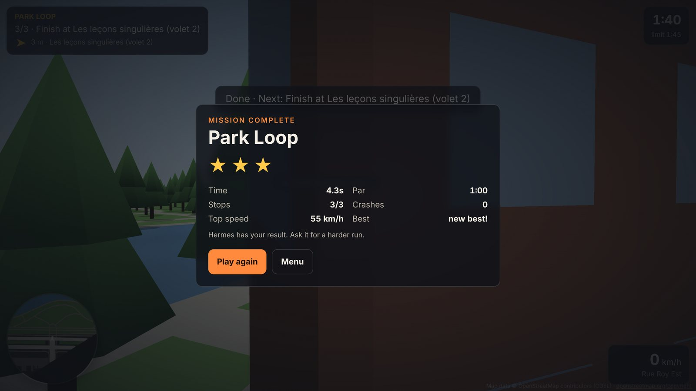

# Hometown Arcade

A Hermes Agent plugin that turns any real address into a drivable 3D browser game. Hermes builds the map from OpenStreetMap, writes missions around the real cafés, parks and landmarks nearby, and reads your race times back to make the next run harder.



> "Make my street a game. My cousin lands Saturday: a tour of the neighbourhood, ending at the bagel shop."

Hermes calls `hometown_build`, picks real places from the result, writes a mission with `hometown_mission`, and hands you a link. You drive. When you finish, the game sends your time to Hermes, and `hometown_scores` lets it praise you, coach you, or write a harder run.

## What you get

- Real buildings with mapped heights, lit windows at night and sun shadows.
- Real streets with their names on the HUD, paths, parks, ponds, rivers and trees.
- Missions with your story on every stop, a beacon, an arrow, a minimap, par times from the real route, stars and personal bests.
- Car, bike or on foot. Day, dusk or night. Free roam where you discover the places Hermes knows.
- Keyboard and touch controls. It runs in any WebGL2 browser, phones included.
- One self-contained HTML file per map, with no downloads at play time and no dependencies.

| Overhead camera | Night, headlights | Results go to Hermes |
| --- | --- | --- |
|  |  |  |

## Install

```bash
hermes plugins install vdimarco/rouge-warden/hermes-plugins/hometown-arcade   # or copy this folder to ~/.hermes/plugins/hometown-arcade
hermes plugins enable hometown-arcade
```

Then ask Hermes for a game of a place, or type `/hometown 1334 Rue Sherbrooke Est, Montréal`.

## Tools

| Tool | What it does |
| --- | --- |
| `hometown_build` | Builds a map from an address, a landmark, `lat,lon` or a local `.osm` file. Returns the URL, the main streets and the named places with ids. |
| `hometown_places` | Searches the map's places by name or type (`bakery`, `park`, `library`). |
| `hometown_mission` | Adds a mission: ordered stops, a line of story per stop, vehicle, time of day, time limit. |
| `hometown_open` | Starts the local server if needed and returns the map or mission URL. |
| `hometown_scores` | Runs, completions, best time against par, crashes and why runs failed. |
| `hometown_maps` | Lists built maps. |

The slash command `/hometown <place>` builds a map and opens it. `/hometown` alone lists your maps. The bundled skill `hometown-arcade:hometown-arcade` tells the agent how to write good missions and adapt them.

## Controls

| Key | Action |
| --- | --- |
| W A S D or arrows | Drive and steer |
| Space | Handbrake, drift |
| Shift | Boost |
| C | Chase or overhead camera |
| T | Day, dusk, night |
| R | Back to the last road |
| M | Sound on or off |
| Esc | Menu |

On a touch screen, steer, brake and gas buttons show at the bottom.

## Settings

Under `plugins.entries.hometown-arcade.settings` in `config.yaml`:

| Key | Default | Meaning |
| --- | --- | --- |
| `default_radius_m` | 350 | Half the width of a new map, 120 to 1000 m. |
| `port` | 0 | Port for the local server. 0 picks a free one. |
| `overpass_urls` | public servers | Overpass servers to try, https only. |

## What it does on your machine (disclosure)

- **Network.** A build sends the place text to Nominatim (`nominatim.openstreetmap.org`) unless you give `lat,lon`, then the map's bounding box to Overpass (`overpass-api.de`, `overpass.kumi.systems`, `maps.mail.ru`). If every Overpass server fails, a map of 600 m or less comes from the OpenStreetMap API (`api.openstreetmap.org`). Nothing else leaves your machine. There is no telemetry and no update check. Playing makes no network calls.
- **Background server.** The first build or `hometown_open` starts a small web server on `127.0.0.1` in a background thread for as long as Hermes runs. It serves the game pages and takes one kind of write: a finished run, posted by the page. It refuses other hosts, large bodies and malformed results.
- **Files.** Maps, missions and results live under `<HERMES_HOME>/plugin-data/hometown-arcade/maps/`. `osm_file` reads the file you name.
- **Browser.** With `open_browser: true` (and for `/hometown`), the plugin asks your system to open the URL.
- No credentials, no shell commands, no Python dependencies.

## Map data

Map data © [OpenStreetMap contributors](https://www.openstreetmap.org/copyright), available under the Open Database License. The game shows this credit on every map. Keep it when you share screenshots. Please be gentle with the free OSM services: one build sends one Nominatim request and one Overpass request.

## Develop

```bash
python3 -m unittest discover -s tests -v   # geometry, world build, tools, local server
node tests/smoke.e2e.mjs                    # Playwright + Chromium: desktop and phone play-through
SHOTS=/tmp/shots node tests/smoke.e2e.mjs   # also saves screenshots
```

The test fixture `tests/fixtures/la-fontaine.osm` is a small crop of OpenStreetMap data around Parc La Fontaine in Montréal (ODbL), the same place as the NORD Unreal map in this author's other project.

## License

MIT for the code. Map data stays under the ODbL.
